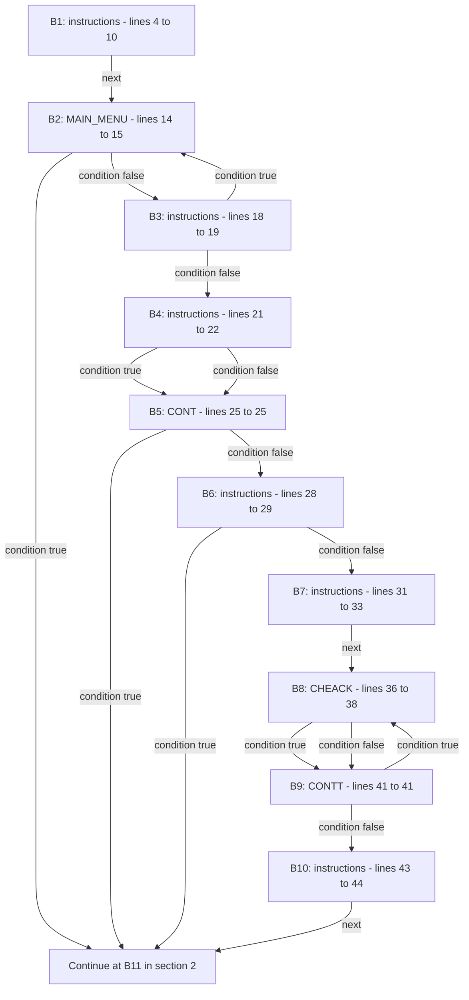
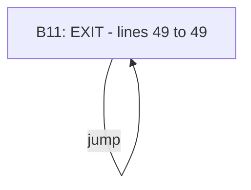

# Program Control Flow

[Back to project](README.md)

Control-flow blocks are indexed by source line. Calls resume at the instruction following the call if the subroutine returns normally.

## Entry locations

- `org 0h` begins at B1.

## Navigation

[Section 1](#section-1) · [Section 2](#section-2)

## Section 1



### B1

```asm
MOV 30H,#12H
MOV 40H,#110
MOV 50H,#12h
MOV 51H,#1
mov 52h,#0
MOV 53H,#50
```

### B2

```asm
MOV A,#1
CJNE A,#1,EXIT
```

### B3

```asm
MOV A,50H
CJNE A,30H,MAIN_MENU
```

### B4

```asm
MOV A,40H
CJNE A,#255,CONT
```

### B5

```asm
JNC EXIT
```

### B6

```asm
MOV A,51H
CJNE A,#1,EXIT
```

### B7

```asm
mov a,#255
subb a,40h
mov 52h,a
```

### B8

```asm
mov a,53h
cjne a,52h,contt
```

### B9

```asm
jnc cheack
```

### B10

```asm
add a,40h
mov 40h,a
```

## Section 2



### B11

```asm
SJMP $
```
