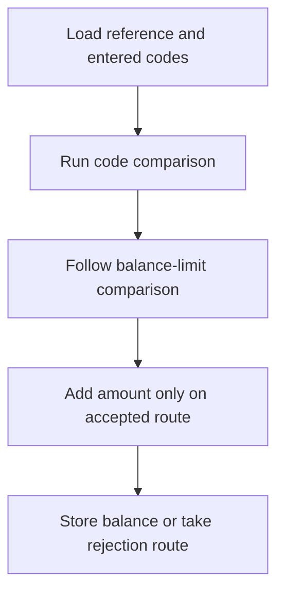
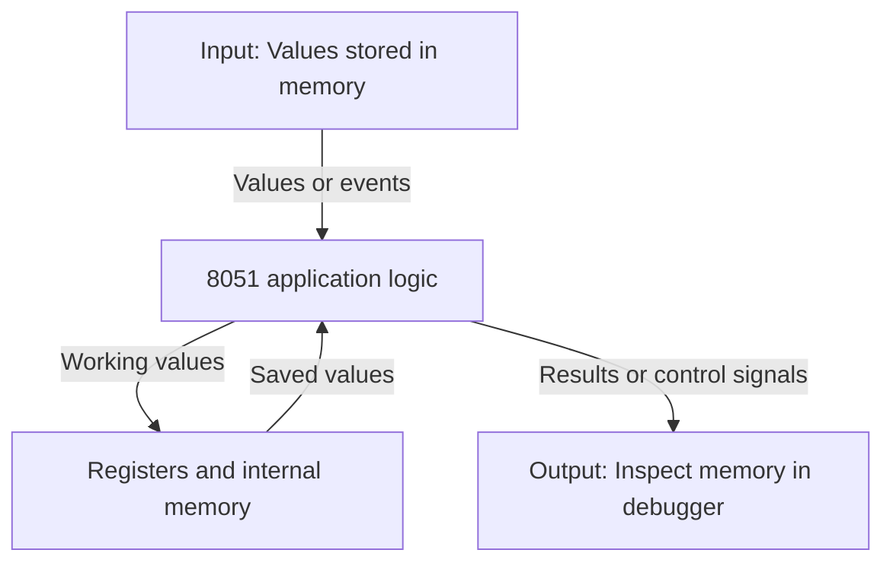

# Access Code and Balance Update

[Group overview](../../README.md) · [Compare implementations](../README.md)

Compare an entered code with a stored code and conditionally add an amount to a balance.

**Implementation:** Fixed Input Code And Amount Update

**Input:** values stored in memory.  
**Output:** inspect memory in debugger.

## Inputs and results

| Parameter | Description |
| --- | --- |
| Input | Reference and entered codes, current balance, and addition |
| Output | An updated balance or a rejected update |

## Worked example

The documented balance case starts at 110 and adds 50, giving 160.

### Calculation details

Start with the built-in values. The codes are both 12H. The code loads 100 from 53H, compares it with itself and adds the 100 in 40H. Inspect 40H at EXIT for 200 (C8H).

## Program operation

1. Load reference and entered codes.
2. Run code comparison.
3. Follow balance-limit comparison.
4. Add amount only on accepted route.
5. Store balance or take rejection route.

### Functional flowchart

[Detailed control flow](source-flow.md)

### Simplified block diagram

Results are available in memory without a display.

## Technical limitations

No additional defect was recorded in the earlier source review. This is not evidence of a successful build or hardware test.

## Build and test

1. Open the [assembly source](source.asm) in an 8051 assembler or simulator.
2. Review the technical limitations and configure the peripherals required by this implementation.
3. Check the expected result using the example inputs.
