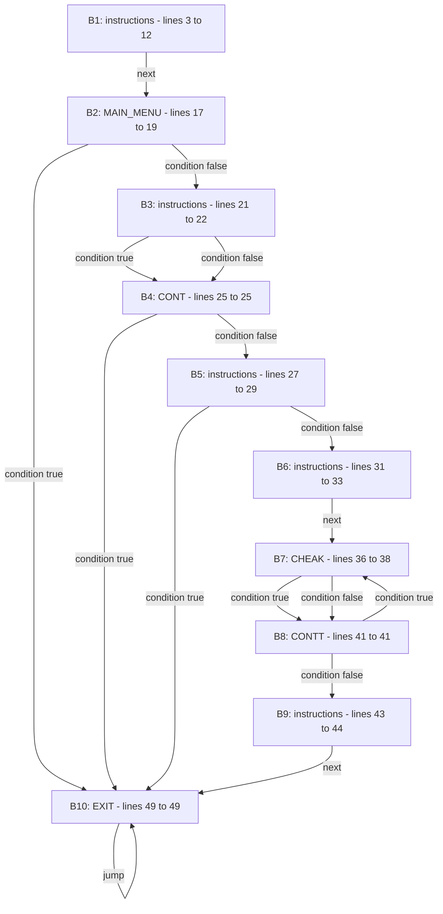

# Program Control Flow

[Back to project](README.md)

Control-flow blocks are indexed by source line. Calls resume at the instruction following the call if the subroutine returns normally.

## Entry locations

- `org 0h` begins at B1.

## Navigation

[Section 1](#section-1)

## Section 1



### B1

```asm
MOV 30H,#12H
MOV 40H,#100
MOV 50H,#0
MOV 51H,#1
mov 52h,#0
MOV 53H,#100
```

### B2

```asm
MOV 50H,#12H
MOV A,50H
CJNE A,30H,EXIT
```

### B3

```asm
MOV A,40H
CJNE A,#255,CONT
```

### B4

```asm
JNC EXIT
```

### B5

```asm
MOV 51H,#1
MOV A,51H
CJNE A,#1,EXIT
```

### B6

```asm
mov a,#255
subb a,40h
mov 52h,a
```

### B7

```asm
mov a,53h
cjne a,53h,contt
```

### B8

```asm
jc cheak
```

### B9

```asm
add a,40h
mov 40h,a
```

### B10

```asm
SJMP $
```
