# Program Control Flow

[Back to project](README.md)

Control-flow blocks are indexed by source line. Calls resume at the instruction following the call if the subroutine returns normally.

## Entry locations

- `ORG 00H` begins at B1.

## Navigation

[Section 1](#section-1) · [Section 2](#section-2) · [Section 3](#section-3) · [Section 4](#section-4) · [Section 5](#section-5) · [Section 6](#section-6) · [Section 7](#section-7) · [Section 8](#section-8) · [Section 9](#section-9) · [Section 10](#section-10) · [Section 11](#section-11) · [Section 12](#section-12) · [Section 13](#section-13) · [Section 14](#section-14) · [Section 15](#section-15) · [Section 16](#section-16) · [Section 17](#section-17) · [Section 18](#section-18) · [Section 19](#section-19) · [Section 20](#section-20) · [Section 21](#section-21) · [Section 22](#section-22) · [Section 23](#section-23) · [Section 24](#section-24) · [Section 25](#section-25) · [Section 26](#section-26) · [Section 27](#section-27) · [Section 28](#section-28) · [Section 29](#section-29) · [Section 30](#section-30) · [Section 31](#section-31) · [Section 32](#section-32) · [Section 33](#section-33) · [Section 34](#section-34) · [Section 35](#section-35) · [Section 36](#section-36)

## Section 1

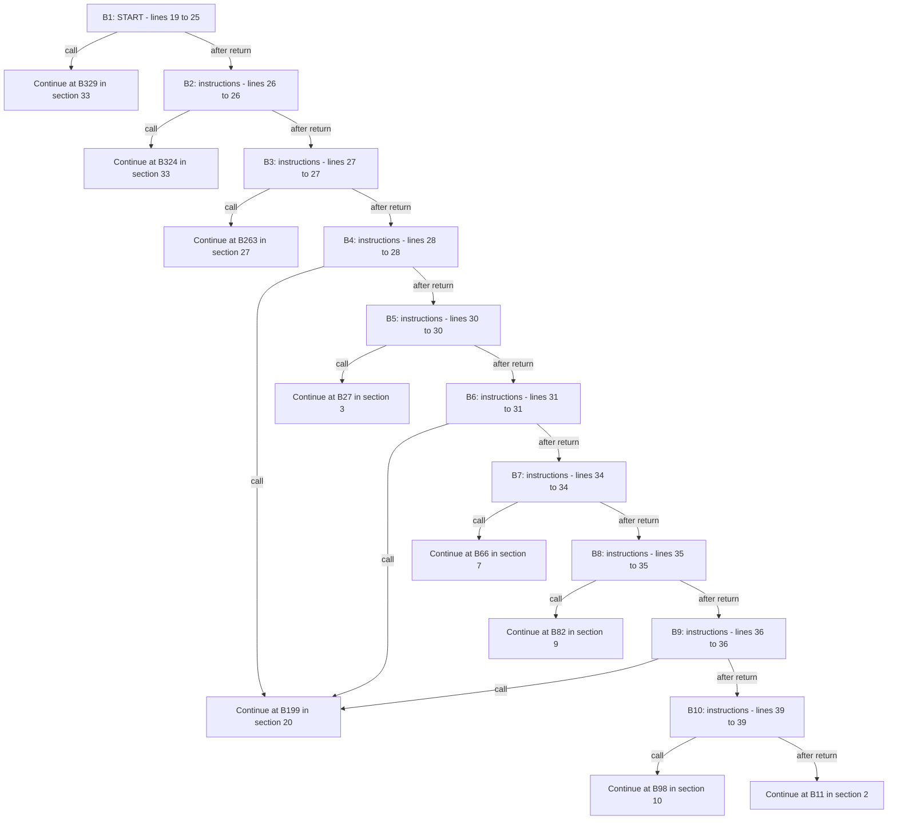

### B1

```asm
MOV 45H,#0
MOV 4AH,#0
MOV 75H,#0
MOV 77H,#2
MOV R1,#0
MOV P1,#0FFH
LCALL INLCD
```

### B2

```asm
LCALL Clear
```

### B3

```asm
LCALL MSG_WELCOME
```

### B4

```asm
ACALL LCDCONT
```

### B5

```asm
ACALL ENTER_CASH
```

### B6

```asm
ACALL LCDCONT
```

### B7

```asm
ACALL COFFEE_1
```

### B8

```asm
ACALL TYPE
```

### B9

```asm
ACALL LCDCONT
```

### B10

```asm
ACALL COFFEE_2
```

## Section 2

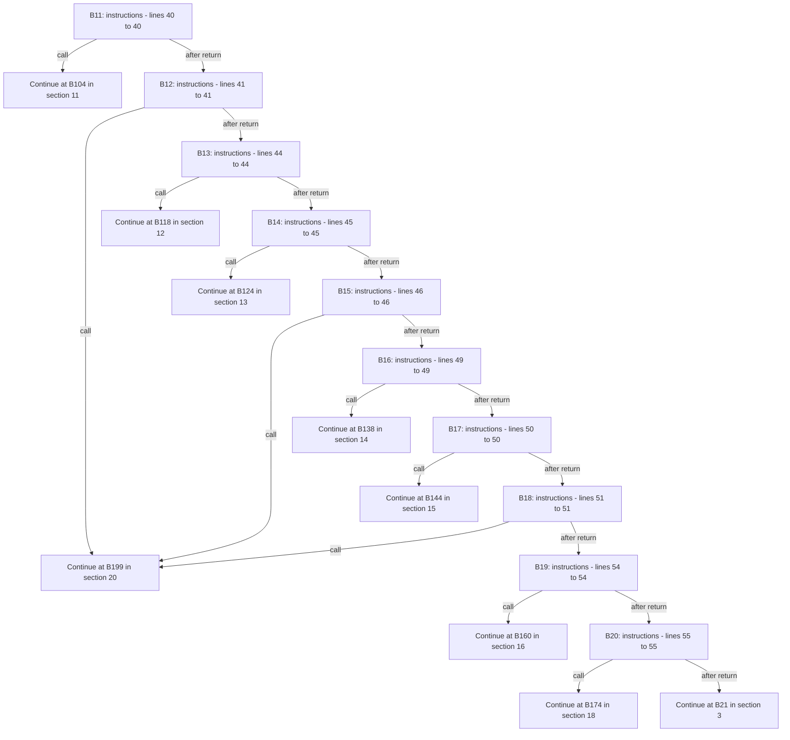

### B11

```asm
ACALL SIZE
```

### B12

```asm
ACALL LCDCONT
```

### B13

```asm
ACALL COFFEE_3
```

### B14

```asm
ACALL MILK
```

### B15

```asm
ACALL LCDCONT
```

### B16

```asm
ACALL COFFEE_4
```

### B17

```asm
ACALL SUGAR
```

### B18

```asm
ACALL LCDCONT
```

### B19

```asm
ACALL ORDER
```

### B20

```asm
ACALL COST
```

## Section 3

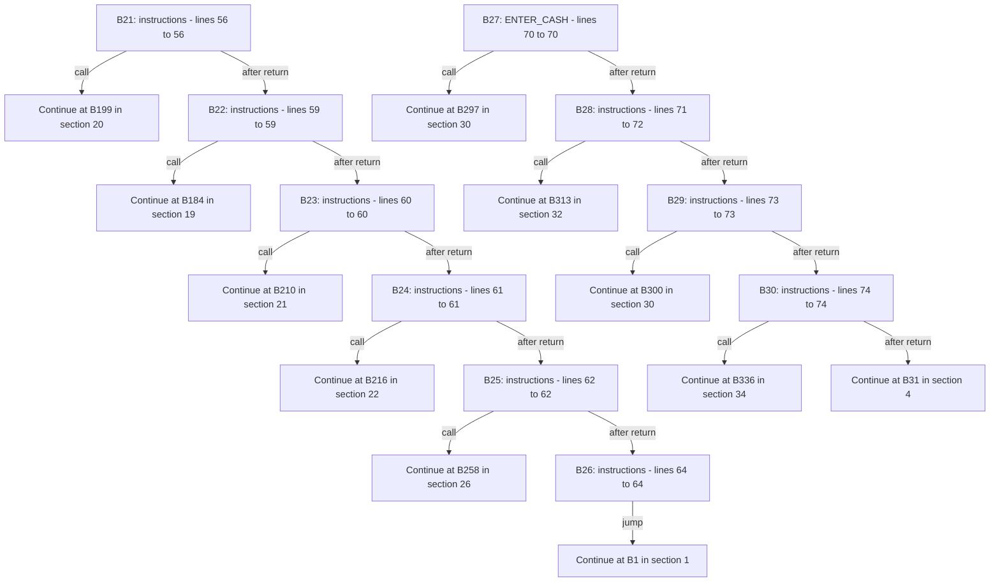

### B21

```asm
ACALL LCDCONT
```

### B22

```asm
ACALL SHOW_BILL
```

### B23

```asm
ACALL LCDCONT8
```

### B24

```asm
ACALL READY
```

### B25

```asm
LCALL FLASH
```

### B26

```asm
LJMP MAIN
```

### B27

```asm
ACALL SETUP_ROW1
```

### B28

```asm
MOV DPTR,#L2
ACALL WSTR
```

### B29

```asm
ACALL SETUP_ROW2
```

### B30

```asm
ACALL KEYPAD
```

## Section 4

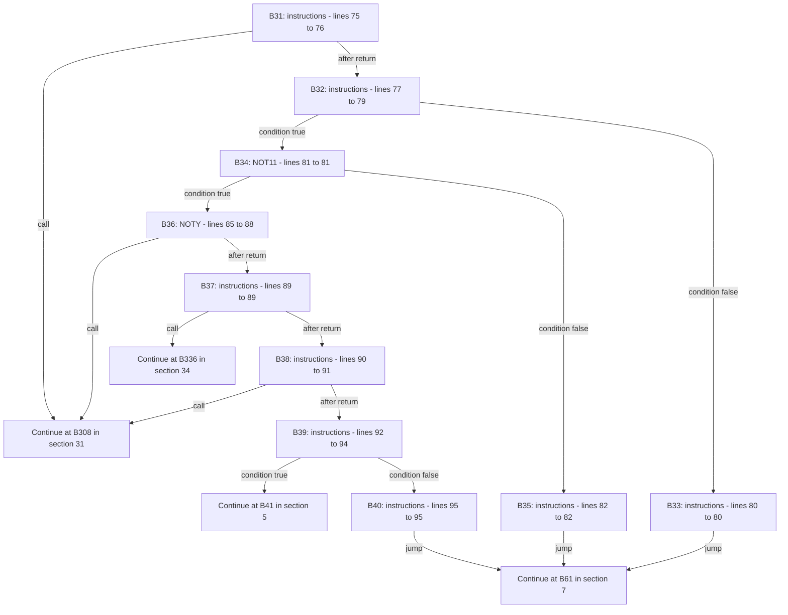

### B31

```asm
MOV 50H,A
ACALL WCHR
```

### B32

```asm
MOV A,50H
CJNE A,#'*',NOT11
```

### B33

```asm
SJMP EP
```

### B34

```asm
CJNE A,#'#',NOTY
```

### B35

```asm
SJMP EP
```

### B36

```asm
SUBB A,#30H
MOV 50H,A
MOV A,#'.'
ACALL WCHR
```

### B37

```asm
ACALL KEYPAD
```

### B38

```asm
MOV 51H,A
ACALL WCHR
```

### B39

```asm
MOV A,51H
CJNE A,#'*',NOT1O
```

### B40

```asm
SJMP EP
```

## Section 5

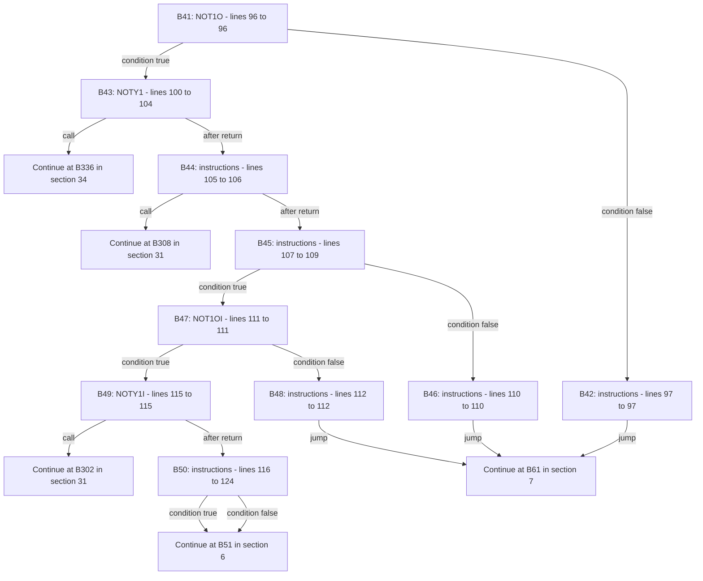

### B41

```asm
CJNE A,#'#',NOTY1
```

### B42

```asm
SJMP EP
```

### B43

```asm
SUBB A,#30H
MOV B,#10
MUL AB
MOV 51H,A
ACALL KEYPAD
```

### B44

```asm
MOV 52H,A
ACALL WCHR
```

### B45

```asm
MOV A,52H
CJNE A,#'*',NOT1OI
```

### B46

```asm
SJMP EP
```

### B47

```asm
CJNE A,#'#',NOTY1I
```

### B48

```asm
SJMP EP
```

### B49

```asm
ACALL LOOPLDELAY
```

### B50

```asm
SUBB A,#30H
MOV 52H,A
ADD A,51H
MOV 53H,A
MOV A,50H
CLR C
CJNE A,#1,JJ1
```

## Section 6

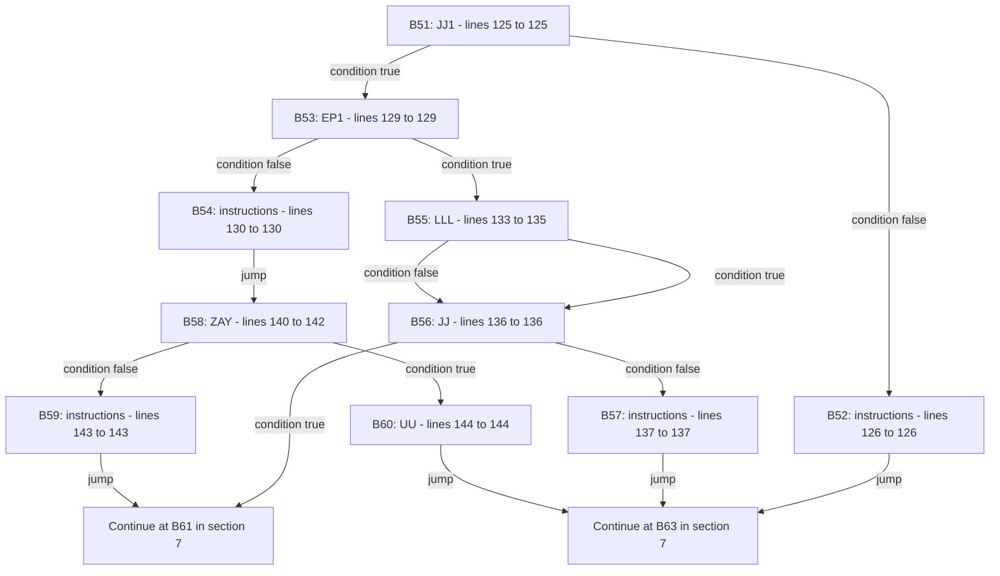

### B51

```asm
JC EP1
```

### B52

```asm
SJMP ZA
```

### B53

```asm
CJNE R1,#1,LLL
```

### B54

```asm
SJMP ZAY
```

### B55

```asm
MOV A,53H
CLR C
CJNE A,#50,JJ
```

### B56

```asm
JC EP
```

### B57

```asm
SJMP ZA
```

### B58

```asm
MOV A,53H
CLR C
CJNE A,#00,UU
```

### B59

```asm
SJMP EP
```

### B60

```asm
SJMP ZA
```

## Section 7

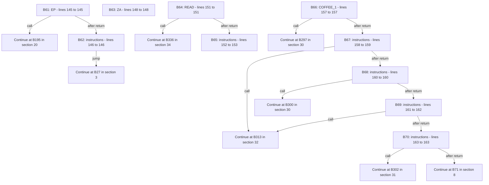

### B61

```asm
ACALL ERROR_MSG
```

### B62

```asm
LJMP MMM
```

### B63

Return to the instruction following the active call.

```asm
RET
```

### B64

```asm
ACALL KEYPAD
```

### B65

Return to the instruction following the active call.

```asm
SUBB A,#30H
RET
```

### B66

```asm
ACALL SETUP_ROW1
```

### B67

```asm
MOV DPTR,#L3
ACALL WSTR
```

### B68

```asm
ACALL SETUP_ROW2
```

### B69

```asm
MOV DPTR,#L4
ACALL WSTR
```

### B70

```asm
ACALL LOOPLDELAY
```

## Section 8

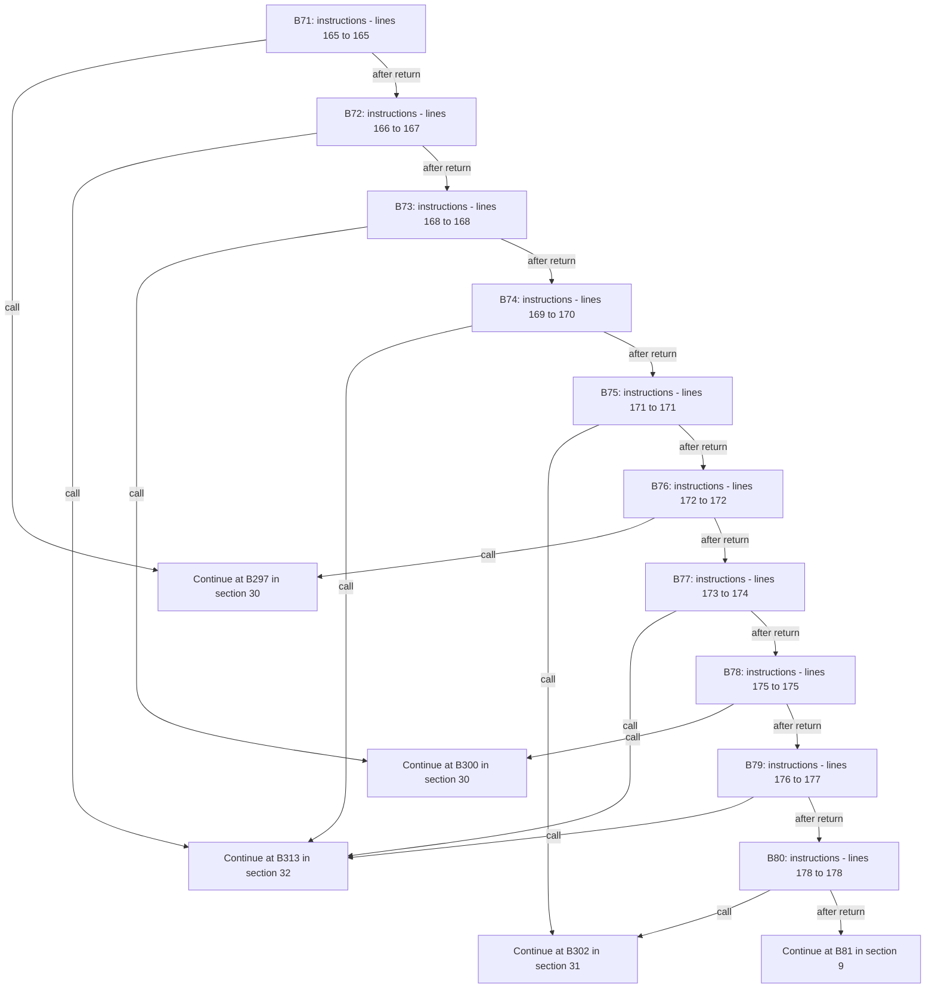

### B71

```asm
ACALL SETUP_ROW1
```

### B72

```asm
MOV DPTR,#L5
ACALL WSTR
```

### B73

```asm
ACALL SETUP_ROW2
```

### B74

```asm
MOV DPTR,#L6
ACALL WSTR
```

### B75

```asm
ACALL LOOPLDELAY
```

### B76

```asm
ACALL SETUP_ROW1
```

### B77

```asm
MOV DPTR,#L7
ACALL WSTR
```

### B78

```asm
ACALL SETUP_ROW2
```

### B79

```asm
MOV DPTR,#L8
ACALL WSTR
```

### B80

```asm
ACALL LOOPLDELAY
```

## Section 9

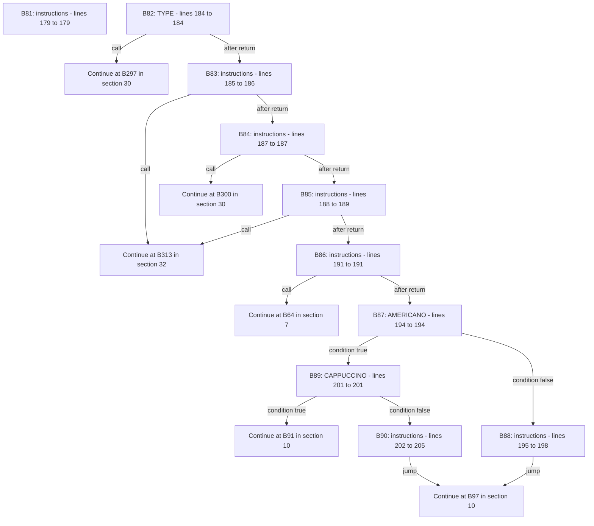

### B81

Return to the instruction following the active call.

```asm
RET
```

### B82

```asm
ACALL SETUP_ROW1
```

### B83

```asm
MOV DPTR,#TY1
ACALL WSTR
```

### B84

```asm
ACALL SETUP_ROW2
```

### B85

```asm
MOV DPTR,#TY2
ACALL WSTR
```

### B86

```asm
ACALL READ
```

### B87

```asm
CJNE A,#1,Cappuccino
```

### B88

```asm
MOV R3,#AMER
MOV R4,#0
MOV 40H,#1
SJMP BACK
```

### B89

```asm
CJNE A,#2,Lattee
```

### B90

```asm
MOV R3,#CAP
MOV R4,#0
MOV 40H,#2
SJMP BACK
```

## Section 10

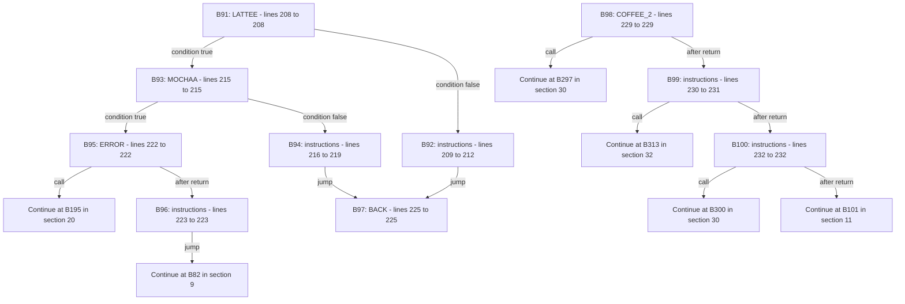

### B91

```asm
CJNE A,#3,Mochaa
```

### B92

```asm
MOV R3,#LATTE
MOV R4,#0
MOV 40H,#3
SJMP BACK
```

### B93

```asm
CJNE A,#4,ERROR
```

### B94

```asm
MOV R4,#MOCHA
MOV R3,#0
MOV 40H,#4
SJMP BACK
```

### B95

```asm
ACALL ERROR_MSG
```

### B96

```asm
LJMP ZZZ
```

### B97

Return to the instruction following the active call.

```asm
RET
```

### B98

```asm
ACALL SETUP_ROW1
```

### B99

```asm
MOV DPTR,#L3
ACALL WSTR
```

### B100

```asm
ACALL SETUP_ROW2
```

## Section 11

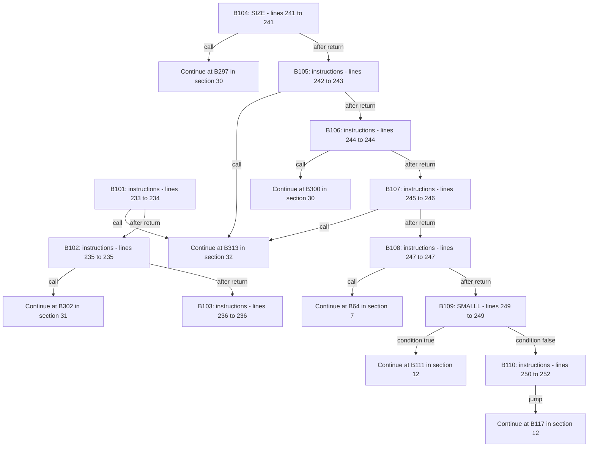

### B101

```asm
MOV DPTR,#L10
ACALL WSTR
```

### B102

```asm
ACALL LOOPLDELAY
```

### B103

Return to the instruction following the active call.

```asm
RET
```

### B104

```asm
ACALL SETUP_ROW1
```

### B105

```asm
MOV DPTR,#CY1
ACALL WSTR
```

### B106

```asm
ACALL SETUP_ROW2
```

### B107

```asm
MOV DPTR,#CY2
ACALL WSTR
```

### B108

```asm
ACALL READ
```

### B109

```asm
CJNE A,#1,Medium
```

### B110

```asm
MOV R5,#SMALL
MOV 41H,#1
SJMP BACK1
```

## Section 12


### B111

```asm
CJNE A,#2,Largee
```

### B112

```asm
MOV R5,#MED
MOV 41H,#2
SJMP BACK1
```

### B113

```asm
CJNE A,#3,ERROR1
```

### B114

```asm
MOV R5,#LARGE
MOV 41H,#3
SJMP BACK1
```

### B115

```asm
ACALL ERROR_MSG
```

### B116

```asm
LJMP XXX
```

### B117

Return to the instruction following the active call.

```asm
RET
```

### B118

```asm
ACALL SETUP_ROW1
```

### B119

```asm
MOV DPTR,#L3
ACALL WSTR
```

### B120

```asm
ACALL SETUP_ROW2
```

## Section 13


### B121

```asm
MOV DPTR,#L11
ACALL WSTR
```

### B122

```asm
ACALL LOOPLDELAY
```

### B123

Return to the instruction following the active call.

```asm
RET
```

### B124

```asm
ACALL SETUP_ROW1
```

### B125

```asm
MOV DPTR,#MY1
ACALL WSTR
```

### B126

```asm
ACALL SETUP_ROW2
```

### B127

```asm
MOV DPTR,#MY2
ACALL WSTR
```

### B128

```asm
ACALL READ
```

### B129

```asm
CJNE A,#1,Half
```

### B130

```asm
MOV 42H,#1
SJMP BACK2
```

## Section 14

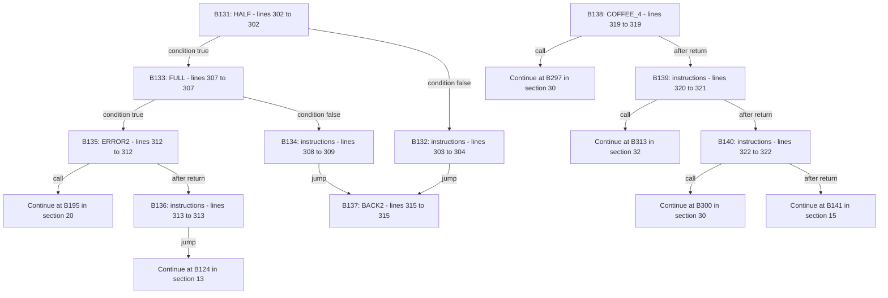

### B131

```asm
CJNE A,#2,Full
```

### B132

```asm
MOV 42H,#2
SJMP BACK2
```

### B133

```asm
CJNE A,#3,ERROR2
```

### B134

```asm
MOV 42H,#3
SJMP BACK2
```

### B135

```asm
ACALL ERROR_MSG
```

### B136

```asm
LJMP CCC
```

### B137

Return to the instruction following the active call.

```asm
RET
```

### B138

```asm
ACALL SETUP_ROW1
```

### B139

```asm
MOV DPTR,#L3
ACALL WSTR
```

### B140

```asm
ACALL SETUP_ROW2
```

## Section 15

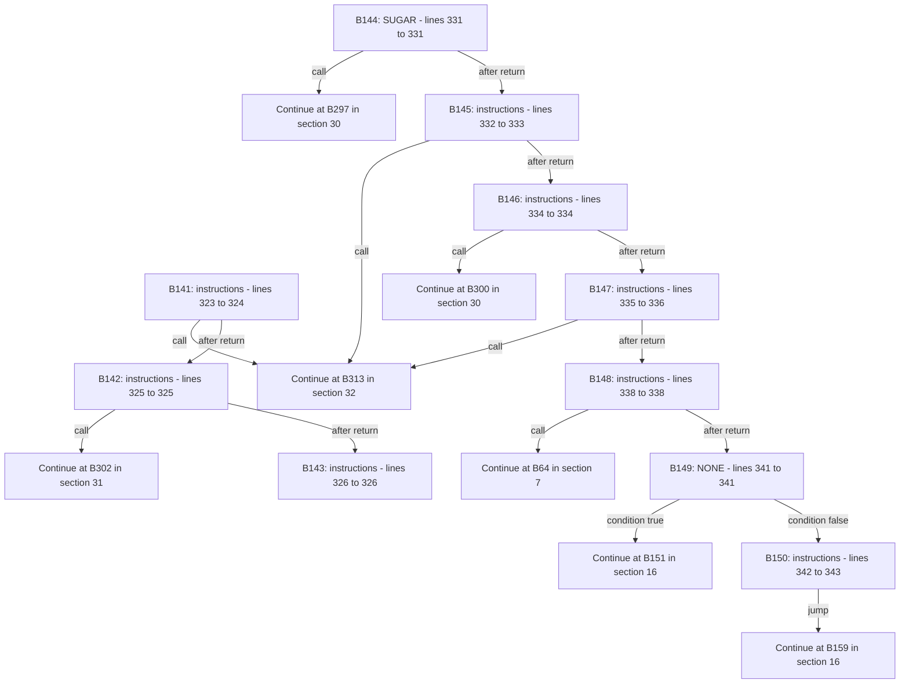

### B141

```asm
MOV DPTR,#L12
ACALL WSTR
```

### B142

```asm
ACALL LOOPLDELAY
```

### B143

Return to the instruction following the active call.

```asm
RET
```

### B144

```asm
ACALL SETUP_ROW1
```

### B145

```asm
MOV DPTR,#SY1
ACALL WSTR
```

### B146

```asm
ACALL SETUP_ROW2
```

### B147

```asm
MOV DPTR,#SY2
ACALL WSTR
```

### B148

```asm
ACALL READ
```

### B149

```asm
CJNE A,#1,Low1
```

### B150

```asm
MOV 43H,#1
SJMP BACK3
```

## Section 16

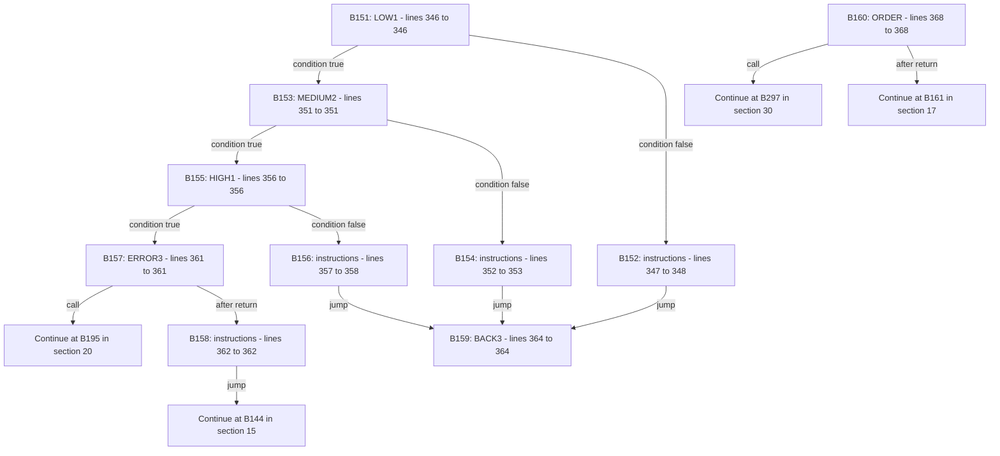

### B151

```asm
CJNE A,#2,Medium2
```

### B152

```asm
MOV 43H,#2
SJMP BACK3
```

### B153

```asm
CJNE A,#3,High1
```

### B154

```asm
MOV 43H,#3
SJMP BACK3
```

### B155

```asm
CJNE A,#4,ERROR3
```

### B156

```asm
MOV 43H,#4
SJMP BACK3
```

### B157

```asm
ACALL ERROR_MSG
```

### B158

```asm
LJMP VVV
```

### B159

Return to the instruction following the active call.

```asm
RET
```

### B160

```asm
ACALL SETUP_ROW1
```

## Section 17

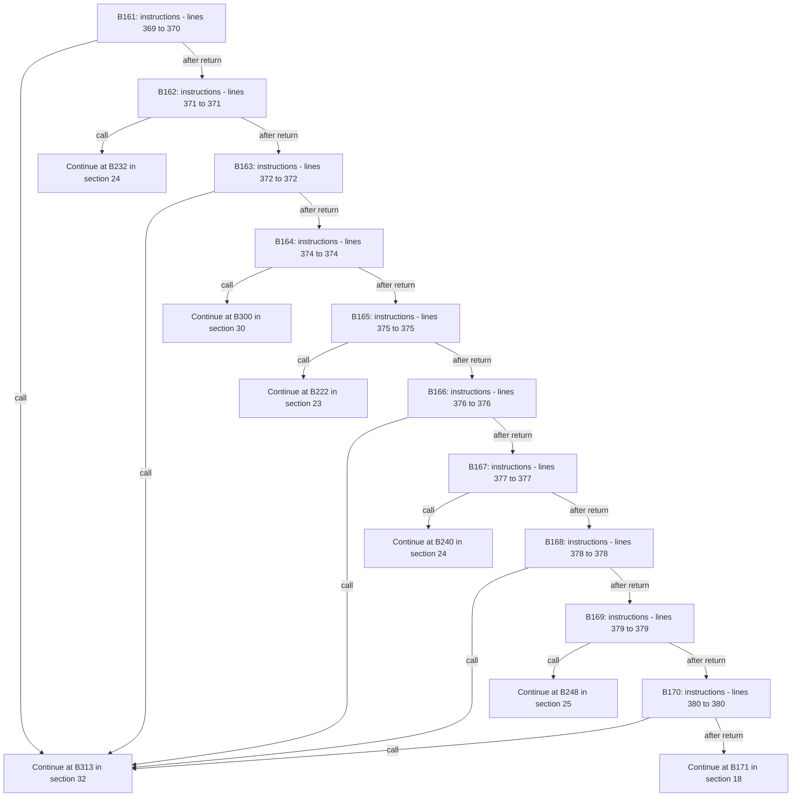

### B161

```asm
MOV DPTR,#LO
ACALL WSTR
```

### B162

```asm
ACALL SELECTION2
```

### B163

```asm
ACALL WSTR
```

### B164

```asm
ACALL SETUP_ROW2
```

### B165

```asm
ACALL SELECTION1
```

### B166

```asm
ACALL WSTR
```

### B167

```asm
ACALL SELECTION3
```

### B168

```asm
ACALL WSTR
```

### B169

```asm
ACALL SELECTION4
```

### B170

```asm
ACALL WSTR
```

## Section 18

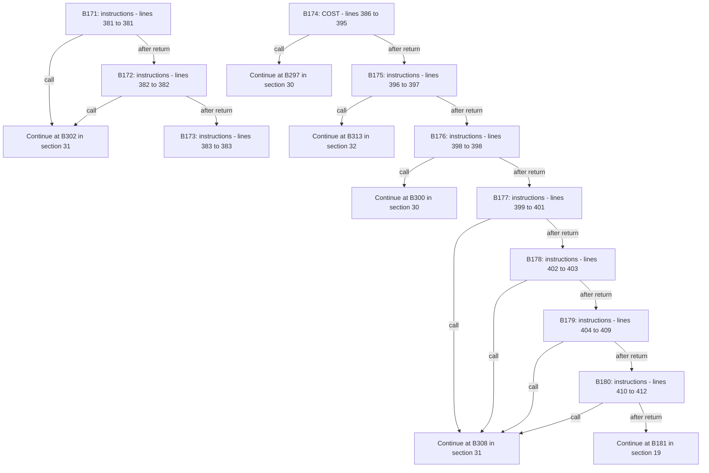

### B171

```asm
ACALL LOOPLDELAY
```

### B172

```asm
ACALL LOOPLDELAY
```

### B173

Return to the instruction following the active call.

```asm
RET
```

### B174

```asm
MOV A,R3
ADD A,R5
MOV R3,A
MOV B,#100
DIV AB
MOV R3,B
ADD A,R4
MOV R4,A
ACALL SETUP_ROW1
```

### B175

```asm
MOV DPTR,#L13
ACALL WSTR
```

### B176

```asm
ACALL SETUP_ROW2
```

### B177

```asm
MOV A,R4
ADD A,#30H
ACALL WCHR
```

### B178

```asm
MOV A,#'.'
ACALL WCHR
```

### B179

```asm
MOV A,R3
MOV B,#10
DIV AB
MOV 65H,B
ADD A,#30H
ACALL WCHR
```

### B180

```asm
MOV A,65H
ADD A,#30H
ACALL WCHR
```

## Section 19

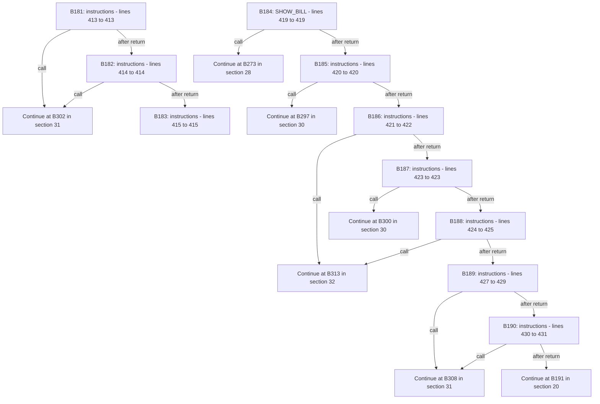

### B181

```asm
ACALL LOOPLDELAY
```

### B182

```asm
ACALL LOOPLDELAY
```

### B183

Return to the instruction following the active call.

```asm
RET
```

### B184

```asm
ACALL BALANCE
```

### B185

```asm
ACALL SETUP_ROW1
```

### B186

```asm
MOV DPTR,#L16
ACALL WSTR
```

### B187

```asm
ACALL SETUP_ROW2
```

### B188

```asm
MOV DPTR,#L17
ACALL WSTR
```

### B189

```asm
MOV A,60H
ADD A,#30H
ACALL WCHR
```

### B190

```asm
MOV A,#'.'
ACALL WCHR
```

## Section 20

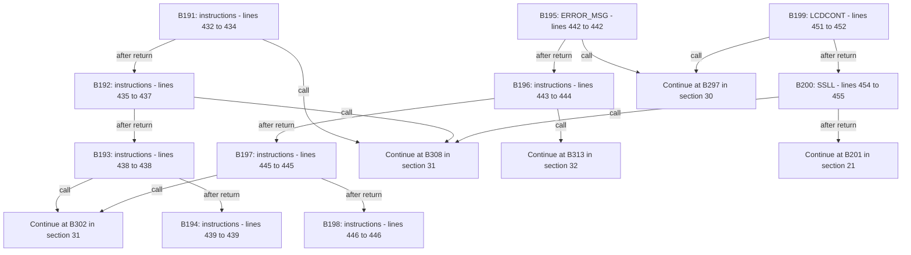

### B191

```asm
MOV A,61H
ADD A,#30H
ACALL WCHR
```

### B192

```asm
MOV A,62H
ADD A,#30H
ACALL WCHR
```

### B193

```asm
ACALL LOOPLDELAY
```

### B194

Return to the instruction following the active call.

```asm
RET
```

### B195

```asm
ACALL SETUP_ROW1
```

### B196

```asm
MOV DPTR,#L9
ACALL WSTR
```

### B197

```asm
ACALL LOOPLDELAY
```

### B198

Return to the instruction following the active call.

```asm
RET
```

### B199

```asm
MOV 75H,77H
ACALL SETUP_ROW1
```

### B200

```asm
MOV A,#'X'
ACALL WCHR
```

## Section 21

```mermaid
flowchart TD
B200["B201: instructions - lines 457 to 457"]
B201["B202: instructions - lines 458 to 461"]
B202["B203: instructions - lines 462 to 478"]
B203["B204: instructions - lines 479 to 481"]
B204["B205: instructions - lines 482 to 483"]
B205["B206: instructions - lines 484 to 486"]
B206["B207: instructions - lines 487 to 488"]
B207["B208: instructions - lines 489 to 489"]
B208["B209: instructions - lines 490 to 490"]
B209["B210: LCDCONT8 - lines 493 to 493"]
B200 -->|condition true| B199
B200 -->|condition false| B201
B201 -->|call| B299
B201 -->|after return| B202
B202 -->|call| B307
B202 -->|after return| B203
B203 -->|call| B307
B203 -->|after return| B204
B204 -->|call| B307
B204 -->|after return| B205
B205 -->|call| B307
B205 -->|after return| B206
B206 -->|call| B307
B206 -->|after return| B207
B207 -->|call| B301
B207 -->|after return| B208
B209 -->|call| B296
B209 -->|after return| B210
B199["Continue at B200 in section 20"]
B299["Continue at B300 in section 30"]
B307["Continue at B308 in section 31"]
B301["Continue at B302 in section 31"]
B296["Continue at B297 in section 30"]
B210["Continue at B211 in section 22"]
```

### B201

```asm
DJNZ 75H,SSLL
```

### B202

```asm
INC 77H
INC 77H
ACALL SETUP_ROW2
```

### B203

```asm
CLR C
MOV A,45H
ADD A,#05H
MOV B,#10
DIV AB
MOV 45H,B
ADD A,#12
ADD A,4AH
MOV 4AH,A
MOV B,#10
DIV AB
MOV 4BH,A
MOV 4CH,B
MOV A,4BH
ADD A,#30H
ACALL WCHR
```

### B204

```asm
MOV A,4CH
ADD A,#30H
ACALL WCHR
```

### B205

```asm
MOV A,#'.'
ACALL WCHR
```

### B206

```asm
MOV A,45H
ADD A,#30H
ACALL WCHR
```

### B207

```asm
MOV A,#'%'
ACALL WCHR
```

### B208

```asm
ACALL LOOPLDELAY
```

### B209

Return to the instruction following the active call.

```asm
RET
```

### B210

```asm
ACALL SETUP_ROW1
```

## Section 22

```mermaid
flowchart TD
B210["B211: instructions - lines 494 to 495"]
B211["B212: instructions - lines 496 to 496"]
B212["B213: instructions - lines 497 to 498"]
B213["B214: instructions - lines 499 to 499"]
B214["B215: instructions - lines 500 to 500"]
B215["B216: READY - lines 503 to 503"]
B216["B217: instructions - lines 504 to 505"]
B217["B218: instructions - lines 506 to 506"]
B218["B219: instructions - lines 507 to 508"]
B219["B220: instructions - lines 509 to 509"]
B210 -->|call| B312
B210 -->|after return| B211
B211 -->|call| B299
B211 -->|after return| B212
B212 -->|call| B312
B212 -->|after return| B213
B213 -->|call| B301
B213 -->|after return| B214
B215 -->|call| B296
B215 -->|after return| B216
B216 -->|call| B312
B216 -->|after return| B217
B217 -->|call| B299
B217 -->|after return| B218
B218 -->|call| B312
B218 -->|after return| B219
B219 -->|call| B301
B219 -->|after return| B220
B312["Continue at B313 in section 32"]
B299["Continue at B300 in section 30"]
B301["Continue at B302 in section 31"]
B296["Continue at B297 in section 30"]
B220["Continue at B221 in section 23"]
```

### B211

```asm
MOV DPTR,#X15
ACALL WSTR
```

### B212

```asm
ACALL SETUP_ROW2
```

### B213

```asm
MOV DPTR,#X16
ACALL WSTR
```

### B214

```asm
ACALL LOOPLDELAY
```

### B215

Return to the instruction following the active call.

```asm
RET
```

### B216

```asm
ACALL SETUP_ROW1
```

### B217

```asm
MOV DPTR,#L14
ACALL WSTR
```

### B218

```asm
ACALL SETUP_ROW2
```

### B219

```asm
MOV DPTR,#L15
ACALL WSTR
```

### B220

```asm
ACALL LOOPLDELAY
```

## Section 23

```mermaid
flowchart TD
B220["B221: instructions - lines 510 to 510"]
B221["B222: SELECTION1 - lines 513 to 513"]
B222["B223: GG1 - lines 514 to 514"]
B223["B224: instructions - lines 515 to 516"]
B224["B225: Z1 - lines 517 to 517"]
B225["B226: instructions - lines 518 to 519"]
B226["B227: Z2 - lines 520 to 520"]
B227["B228: instructions - lines 521 to 522"]
B228["B229: Z3 - lines 523 to 523"]
B229["B230: instructions - lines 524 to 524"]
B221 -->|next| B222
B222 -->|condition true| B224
B222 -->|condition false| B223
B223 -->|jump| B230
B224 -->|condition true| B226
B224 -->|condition false| B225
B225 -->|jump| B230
B226 -->|condition true| B228
B226 -->|condition false| B227
B227 -->|jump| B230
B228 -->|condition true| B222
B228 -->|condition false| B229
B229 -->|next| B230
B230["Continue at B231 in section 24"]
```

### B221

Return to the instruction following the active call.

```asm
RET
```

### B222

```asm
MOV A,40H
```

### B223

```asm
CJNE A,#1H,Z1
```

### B224

```asm
MOV DPTR ,#T1
SJMP GO1
```

### B225

```asm
CJNE A,#2H,Z2
```

### B226

```asm
MOV DPTR ,#T2
SJMP GO1
```

### B227

```asm
CJNE A,#3H,Z3
```

### B228

```asm
MOV DPTR ,#T3
SJMP GO1
```

### B229

```asm
CJNE A,#4H,GG1
```

### B230

```asm
MOV DPTR ,#T4
```

## Section 24

```mermaid
flowchart TD
B230["B231: GO1 - lines 526 to 526"]
B231["B232: SELECTION2 - lines 529 to 529"]
B232["B233: GG2 - lines 530 to 530"]
B233["B234: instructions - lines 531 to 532"]
B234["B235: A1 - lines 533 to 533"]
B235["B236: instructions - lines 534 to 535"]
B236["B237: A2 - lines 536 to 536"]
B237["B238: instructions - lines 537 to 537"]
B238["B239: GO2 - lines 539 to 539"]
B239["B240: SELECTION3 - lines 542 to 542"]
B231 -->|next| B232
B232 -->|condition true| B234
B232 -->|condition false| B233
B233 -->|jump| B238
B234 -->|condition true| B236
B234 -->|condition false| B235
B235 -->|jump| B238
B236 -->|condition true| B232
B236 -->|condition false| B237
B237 -->|next| B238
B239 -->|next| B240
B240["Continue at B241 in section 25"]
```

### B231

Return to the instruction following the active call.

```asm
RET
```

### B232

```asm
MOV A,41H
```

### B233

```asm
CJNE A,#1H,A1
```

### B234

```asm
MOV DPTR ,#C1
SJMP GO2
```

### B235

```asm
CJNE A,#2H,A2
```

### B236

```asm
MOV DPTR ,#C2
SJMP GO2
```

### B237

```asm
CJNE A,#3H,GG2
```

### B238

```asm
MOV DPTR ,#C3
```

### B239

Return to the instruction following the active call.

```asm
RET
```

### B240

```asm
MOV A,42H
```

## Section 25

```mermaid
flowchart TD
B240["B241: GG3 - lines 543 to 543"]
B241["B242: instructions - lines 544 to 545"]
B242["B243: Q1 - lines 546 to 546"]
B243["B244: instructions - lines 547 to 548"]
B244["B245: Q2 - lines 549 to 549"]
B245["B246: instructions - lines 550 to 550"]
B246["B247: GO3 - lines 552 to 552"]
B247["B248: SELECTION4 - lines 555 to 555"]
B248["B249: GG4 - lines 556 to 556"]
B249["B250: instructions - lines 557 to 558"]
B240 -->|condition true| B242
B240 -->|condition false| B241
B241 -->|jump| B246
B242 -->|condition true| B244
B242 -->|condition false| B243
B243 -->|jump| B246
B244 -->|condition true| B240
B244 -->|condition false| B245
B245 -->|next| B246
B247 -->|next| B248
B248 -->|condition true| B250
B248 -->|condition false| B249
B249 -->|jump| B256
B250["Continue at B251 in section 26"]
B256["Continue at B257 in section 26"]
```

### B241

```asm
CJNE A,#1H,Q1
```

### B242

```asm
MOV DPTR ,#M1
SJMP GO3
```

### B243

```asm
CJNE A,#2H,Q2
```

### B244

```asm
MOV DPTR ,#M2
SJMP GO3
```

### B245

```asm
CJNE A,#3H,GG3
```

### B246

```asm
MOV DPTR ,#M3
```

### B247

Return to the instruction following the active call.

```asm
RET
```

### B248

```asm
MOV A,43H
```

### B249

```asm
CJNE A,#1H,W1
```

### B250

```asm
MOV DPTR ,#S1
SJMP GO4
```

## Section 26

```mermaid
flowchart TD
B250["B251: W1 - lines 559 to 559"]
B251["B252: instructions - lines 560 to 561"]
B252["B253: W2 - lines 562 to 562"]
B253["B254: instructions - lines 563 to 564"]
B254["B255: W3 - lines 565 to 565"]
B255["B256: instructions - lines 566 to 566"]
B256["B257: GO4 - lines 568 to 568"]
B257["B258: FLASH - lines 571 to 571"]
B258["B259: RE - lines 573 to 574"]
B259["B260: instructions - lines 575 to 576"]
B250 -->|condition true| B252
B250 -->|condition false| B251
B251 -->|jump| B256
B252 -->|condition true| B254
B252 -->|condition false| B253
B253 -->|jump| B256
B254 -->|condition true| B248
B254 -->|condition false| B255
B255 -->|next| B256
B257 -->|next| B258
B258 -->|call| B267
B258 -->|after return| B259
B259 -->|call| B267
B259 -->|after return| B260
B248["Continue at B249 in section 25"]
B267["Continue at B268 in section 27"]
B260["Continue at B261 in section 27"]
```

### B251

```asm
CJNE A,#2H,W2
```

### B252

```asm
MOV DPTR ,#S2
SJMP GO4
```

### B253

```asm
CJNE A,#3H,W3
```

### B254

```asm
MOV DPTR ,#S3
SJMP GO4
```

### B255

```asm
CJNE A,#4H,GG4
```

### B256

```asm
MOV DPTR ,#S4
```

### B257

Return to the instruction following the active call.

```asm
RET
```

### B258

```asm
MOV R6,#3H
```

### B259

```asm
MOV P1,#00H
ACALL DELAY
```

### B260

```asm
MOV P1,#0FFH
ACALL DELAY
```

## Section 27

```mermaid
flowchart TD
B260["B261: instructions - lines 577 to 577"]
B261["B262: instructions - lines 578 to 578"]
B262["B263: MSG_WELCOME - lines 582 to 583"]
B263["B264: instructions - lines 584 to 585"]
B264["B265: instructions - lines 586 to 586"]
B265["B266: instructions - lines 587 to 587"]
B266["B267: instructions - lines 588 to 588"]
B267["B268: DELAY - lines 593 to 599"]
B268["B269: X1234 - lines 601 to 603"]
B269["B270: AGAIIN44 - lines 604 to 604"]
B260 -->|condition true| B258
B260 -->|condition false| B261
B262 -->|call| B317
B262 -->|after return| B263
B263 -->|call| B312
B263 -->|after return| B264
B264 -->|call| B301
B264 -->|after return| B265
B265 -->|call| B323
B265 -->|after return| B266
B267 -->|next| B268
B268 -->|next| B269
B269 -->|condition true| B269
B269 -->|condition false| B270
B258["Continue at B259 in section 26"]
B317["Continue at B318 in section 32"]
B312["Continue at B313 in section 32"]
B301["Continue at B302 in section 31"]
B323["Continue at B324 in section 33"]
B270["Continue at B271 in section 28"]
```

### B261

```asm
DJNZ R6,RE
```

### B262

Return to the instruction following the active call.

```asm
RET
```

### B263

```asm
MOV A,#85H
ACALL CMD
```

### B264

```asm
MOV DPTR,#L1
ACALL WSTR
```

### B265

```asm
ACALL LOOPLDELAY
```

### B266

```asm
ACALL CLEAR
```

### B267

Return to the instruction following the active call.

```asm
RET
```

### B268

```asm
CLR C
MOV A,#255
MOV R2,#TIME_DELAY
SUBB A,R2
ADDC A,#1
MOV 73H,2
```

### B269

```asm
MOV TMOD,#02H
MOV TH0,A
SETB TR0
```

### B270

```asm
JNB TF0,AGAIIN44
```

## Section 28

```mermaid
flowchart TD
B270["B271: instructions - lines 605 to 607"]
B271["B272: instructions - lines 609 to 609"]
B272["B273: BALANCE - lines 612 to 612"]
B273["B274: LOL - lines 614 to 617"]
B274["B275: instructions - lines 618 to 621"]
B275["B276: instructions - lines 622 to 623"]
B276["B277: NOTE - lines 626 to 629"]
B277["B278: instructions - lines 630 to 638"]
B278["B279: instructions - lines 639 to 640"]
B279["B280: NJIJ - lines 643 to 646"]
B270 -->|condition true| B268
B270 -->|condition false| B271
B272 -->|next| B273
B273 -->|condition true| B276
B273 -->|condition false| B274
B274 -->|condition true| B279
B274 -->|condition false| B275
B275 -->|jump| B294
B276 -->|condition true| B279
B276 -->|condition false| B277
B277 -->|condition true| B279
B277 -->|condition false| B278
B278 -->|jump| B294
B279 -->|condition true| B281
B279 -->|condition false| B280
B268["Continue at B269 in section 27"]
B294["Continue at B295 in section 30"]
B281["Continue at B282 in section 29"]
B280["Continue at B281 in section 29"]
```

### B271

```asm
CLR TR0
CLR TF0
DJNZ 73H,X1234
```

### B272

Return to the instruction following the active call.

```asm
RET
```

### B273

```asm
MOV R1,#1
```

### B274

```asm
CLR C
MOV A,53H
SUBB A,R3
JC NOTE
```

### B275

```asm
MOV 30H,A
MOV A,50H
SUBB A,R4
JC NJIJ
```

### B276

```asm
MOV 31H,A
LJMP HEEEH
```

### B277

```asm
CLR C
MOV A,50H
SUBB A,#1
JC NJIJ
```

### B278

```asm
MOV 55H,A
MOV A,#100
ADD A,53H
SUBB A,R3
MOV 30H,A
CLR C
MOV A,55H
SUBB A,R4
JC NJIJ
```

### B279

```asm
MOV 31H,A
LJMP HEEEH
```

### B280

```asm
CLR C
MOV A,R3
SUBB A,53H
JC KOM
```

## Section 29

```mermaid
flowchart TD
B280["B281: instructions - lines 647 to 656"]
B281["B282: KOM - lines 659 to 675"]
B282["B283: RFV - lines 678 to 678"]
B283["B284: instructions - lines 679 to 680"]
B284["B285: instructions - lines 681 to 681"]
B285["B286: instructions - lines 682 to 683"]
B286["B287: instructions - lines 684 to 686"]
B287["B288: instructions - lines 687 to 688"]
B288["B289: instructions - lines 689 to 691"]
B289["B290: instructions - lines 692 to 694"]
B280 -->|jump| B282
B281 -->|jump| B282
B282 -->|call| B296
B282 -->|after return| B283
B283 -->|call| B312
B283 -->|after return| B284
B284 -->|call| B299
B284 -->|after return| B285
B285 -->|call| B312
B285 -->|after return| B286
B286 -->|call| B307
B286 -->|after return| B287
B287 -->|call| B307
B287 -->|after return| B288
B288 -->|call| B307
B288 -->|after return| B289
B289 -->|call| B307
B289 -->|after return| B290
B296["Continue at B297 in section 30"]
B312["Continue at B313 in section 32"]
B299["Continue at B300 in section 30"]
B307["Continue at B308 in section 31"]
B290["Continue at B291 in section 30"]
```

### B281

```asm
MOV R3,A
MOV B,#10
DIV AB
MOV 61H,A
MOV 62H,B
MOV A,R4
SUBB A,50H
MOV R4,A
MOV 60H,A
SJMP RFV
```

### B282

```asm
CLR C
MOV A,R4
SUBB A,#1
MOV 56H,A
MOV A,#100
ADD A,R3
SUBB A,53H
MOV R3,A
MOV B,#10
DIV AB
MOV 61H,A
MOV 62H,B
MOV A,56H
SUBB A,50H
MOV R4,A
MOV 60H,A
SJMP RFV
```

### B283

```asm
ACALL SETUP_ROW1
```

### B284

```asm
MOV DPTR,#L18
ACALL WSTR
```

### B285

```asm
ACALL SETUP_ROW2
```

### B286

```asm
MOV DPTR,#L19
ACALL WSTR
```

### B287

```asm
MOV A,60H
ADD A,#30H
ACALL WCHR
```

### B288

```asm
MOV A,#'.'
ACALL WCHR
```

### B289

```asm
MOV A,61H
ADD A,#30H
ACALL WCHR
```

### B290

```asm
MOV A,62H
ADD A,#30H
ACALL WCHR
```

## Section 30

```mermaid
flowchart TD
B290["B291: instructions - lines 695 to 695"]
B291["B292: instructions - lines 696 to 696"]
B292["B293: instructions - lines 697 to 697"]
B293["B294: instructions - lines 699 to 699"]
B294["B295: HEEEH - lines 701 to 707"]
B295["B296: instructions - lines 708 to 708"]
B296["B297: SETUP_ROW1 - lines 713 to 713"]
B297["B298: instructions - lines 714 to 715"]
B298["B299: instructions - lines 716 to 716"]
B299["B300: SETUP_ROW2 - lines 718 to 719"]
B290 -->|call| B301
B290 -->|after return| B291
B291 -->|call| B301
B291 -->|after return| B292
B292 -->|call| B26
B292 -->|after return| B293
B293 -->|jump| B273
B294 -->|call| B267
B294 -->|after return| B295
B296 -->|call| B323
B296 -->|after return| B297
B297 -->|call| B317
B297 -->|after return| B298
B299 -->|call| B317
B299 -->|after return| B300
B301["Continue at B302 in section 31"]
B26["Continue at B27 in section 3"]
B273["Continue at B274 in section 28"]
B267["Continue at B268 in section 27"]
B323["Continue at B324 in section 33"]
B317["Continue at B318 in section 32"]
B300["Continue at B301 in section 31"]
```

### B291

```asm
ACALL LOOPLDELAY
```

### B292

```asm
ACALL LOOPLDELAY
```

### B293

```asm
ACALL ENTER_CASH
```

### B294

```asm
LJMP LOL
```

### B295

```asm
MOV 60H,31H
MOV A,30H
MOV B,#10
DIV AB
MOV 61H,A
MOV 62H,B
ACALL DELAY
```

### B296

Return to the instruction following the active call.

```asm
RET
```

### B297

```asm
ACALL CLEAR
```

### B298

```asm
MOV A,#80H
ACALL CMD
```

### B299

Return to the instruction following the active call.

```asm
RET
```

### B300

```asm
MOV A,#0C0H
ACALL CMD
```

## Section 31

```mermaid
flowchart TD
B300["B301: instructions - lines 720 to 720"]
B301["B302: LOOPLDELAY - lines 723 to 723"]
B302["B303: KL - lines 724 to 724"]
B303["B304: WAIT18 - lines 725 to 725"]
B304["B305: instructions - lines 726 to 726"]
B305["B306: instructions - lines 727 to 727"]
B306["B307: instructions - lines 728 to 728"]
B307["B308: WCHR - lines 732 to 736"]
B308["B309: instructions - lines 737 to 737"]
B309["B310: instructions - lines 738 to 740"]
B301 -->|next| B302
B302 -->|next| B303
B303 -->|call| B333
B303 -->|after return| B304
B304 -->|condition true| B303
B304 -->|condition false| B305
B305 -->|condition true| B302
B305 -->|condition false| B306
B307 -->|call| B322
B307 -->|after return| B308
B308 -->|call| B333
B308 -->|after return| B309
B309 -->|call| B322
B309 -->|after return| B310
B333["Continue at B334 in section 34"]
B322["Continue at B323 in section 33"]
B310["Continue at B311 in section 32"]
```

### B301

Return to the instruction following the active call.

```asm
RET
```

### B302

```asm
MOV 71H,#7
```

### B303

```asm
MOV 72H,#250
```

### B304

```asm
ACALL LDELAY
```

### B305

```asm
DJNZ 72H,WAIT18
```

### B306

```asm
DJNZ 71H,KL
```

### B307

Return to the instruction following the active call.

```asm
RET
```

### B308

```asm
PUSH ACC
PUSH B
SETB P1.3
MOV B,A
ACALL COMMON
```

### B309

```asm
ACALL LDELAY
```

### B310

```asm
MOV A,B
SWAP A
ACALL COMMON
```

## Section 32

```mermaid
flowchart TD
B310["B311: instructions - lines 741 to 741"]
B311["B312: instructions - lines 742 to 744"]
B312["B313: WSTR - lines 747 to 747"]
B313["B314: CONT1 - lines 749 to 751"]
B314["B315: PRINT - lines 753 to 753"]
B315["B316: instructions - lines 754 to 755"]
B316["B317: EXIT1 - lines 756 to 757"]
B317["B318: CMD - lines 760 to 762"]
B318["B319: instructions - lines 763 to 763"]
B319["B320: instructions - lines 764 to 766"]
B310 -->|call| B333
B310 -->|after return| B311
B312 -->|next| B313
B313 -->|condition true| B316
B313 -->|condition false| B314
B314 -->|call| B307
B314 -->|after return| B315
B315 -->|jump| B313
B317 -->|call| B322
B317 -->|after return| B318
B318 -->|call| B333
B318 -->|after return| B319
B319 -->|call| B322
B319 -->|after return| B320
B333["Continue at B334 in section 34"]
B307["Continue at B308 in section 31"]
B322["Continue at B323 in section 33"]
B320["Continue at B321 in section 33"]
```

### B311

```asm
ACALL LDELAY
```

### B312

Return to the instruction following the active call.

```asm
POP B
POP ACC
RET
```

### B313

```asm
PUSH ACC
```

### B314

```asm
CLR A
MOVC A,@A+DPTR
JZ Exit1
```

### B315

```asm
ACALL WCHR
```

### B316

```asm
INC DPTR
AJMP CONT1
```

### B317

Return to the instruction following the active call.

```asm
POP ACC
RET
```

### B318

```asm
CLR P1.3
MOV B,A
ACALL COMMON
```

### B319

```asm
ACALL LDELAY
```

### B320

```asm
MOV A,B
SWAP A
ACALL COMMON
```

## Section 33

```mermaid
flowchart TD
B320["B321: instructions - lines 767 to 767"]
B321["B322: instructions - lines 768 to 768"]
B322["B323: COMMON - lines 771 to 776"]
B323["B324: CLEAR - lines 779 to 780"]
B324["B325: instructions - lines 781 to 781"]
B325["B326: WAIT11 - lines 782 to 782"]
B326["B327: instructions - lines 783 to 783"]
B327["B328: instructions - lines 784 to 784"]
B328["B329: INLCD - lines 787 to 794"]
B329["B330: instructions - lines 795 to 803"]
B320 -->|call| B333
B320 -->|after return| B321
B323 -->|call| B317
B323 -->|after return| B324
B324 -->|next| B325
B325 -->|call| B333
B325 -->|after return| B326
B326 -->|condition true| B325
B326 -->|condition false| B327
B328 -->|call| B333
B328 -->|after return| B329
B329 -->|call| B333
B329 -->|after return| B330
B333["Continue at B334 in section 34"]
B317["Continue at B318 in section 32"]
B330["Continue at B331 in section 34"]
```

### B321

```asm
ACALL LDELAY
```

### B322

Return to the instruction following the active call.

```asm
RET
```

### B323

Return to the instruction following the active call.

```asm
ANL a,#11110000B
ANL P1, #00001111B
ORL P1,A
SETB P1.2
CLR P1.2
RET
```

### B324

```asm
MOV A,#01H
ACALL CMD
```

### B325

```asm
MOV R7,#14
```

### B326

```asm
ACALL LDELAY
```

### B327

```asm
DJNZ R7,WAIT11
```

### B328

Return to the instruction following the active call.

```asm
ret
```

### B329

```asm
CLR P1.3
CLR P1.7
CLR P1.6
SETB P1.5
CLR P1.4
SETB P1.2
CLR P1.2
ACALL LDELAY
```

### B330

```asm
SETB P1.2
CLR P1.2
SETB P1.7
CLR P1.6
CLR P1.5
CLR P1.4
SETB P1.2
CLR P1.2
ACALL LDELAY
```

## Section 34

```mermaid
flowchart TD
B330["B331: instructions - lines 804 to 816"]
B331["B332: instructions - lines 817 to 827"]
B332["B333: instructions - lines 828 to 828"]
B333["B334: LDELAY - lines 831 to 832"]
B334["B335: instructions - lines 833 to 833"]
B335["B336: KEYPAD - lines 838 to 838"]
B336["B337: K1 - lines 841 to 844"]
B337["B338: K2 - lines 846 to 848"]
B338["B339: instructions - lines 849 to 849"]
B339["B340: OVER1 - lines 852 to 855"]
B330 -->|call| B333
B330 -->|after return| B331
B331 -->|call| B333
B331 -->|after return| B332
B333 -->|condition true| B333
B333 -->|condition false| B334
B335 -->|next| B336
B336 -->|condition true| B336
B336 -->|condition false| B337
B337 -->|condition true| B339
B337 -->|condition false| B338
B338 -->|jump| B337
B339 -->|condition true| B344
B339 -->|condition false| B340
B344["Continue at B345 in section 35"]
B340["Continue at B341 in section 35"]
```

### B331

```asm
CLR P1.7
CLR P1.6
CLR P1.5
CLR P1.4
SETB P1.2
CLR P1.2
SETB P1.7
SETB P1.6
SETB P1.5
SETB P1.4
SETB P1.2
CLR P1.2
ACALL LDELAY
```

### B332

```asm
CLR P1.7
CLR P1.6
CLR P1.5
CLR P1.4
SETB P1.2
CLR P1.2
SETB P1.6
SETB P1.5
SETB P1.2
CLR P1.2
ACALL LDELAY
```

### B333

Return to the instruction following the active call.

```asm
RET
```

### B334

```asm
MOV R0, #50
DJNZ R0, $
```

### B335

Return to the instruction following the active call.

```asm
RET
```

### B336

```asm
MOV P0,#01110000B
```

### B337

```asm
MOV P0,#01110000B
MOV A,P0
ANL A,#01110000B
CJNE A,#01110000B,K1
```

### B338

```asm
MOV A,P0
ANL A,#01110000B
CJNE A,#01110000B,OVER1
```

### B339

```asm
SJMP K2
```

### B340

```asm
MOV P0,#01111110B
MOV A,P0
ANL A,#01110000B
CJNE A,#01110000B,ROW_0
```

## Section 35

```mermaid
flowchart TD
B340["B341: instructions - lines 856 to 859"]
B341["B342: instructions - lines 860 to 863"]
B342["B343: instructions - lines 864 to 867"]
B343["B344: instructions - lines 869 to 869"]
B344["B345: ROW_0 - lines 872 to 873"]
B345["B346: ROW_1 - lines 876 to 877"]
B346["B347: ROW_2 - lines 879 to 880"]
B347["B348: ROW_3 - lines 882 to 882"]
B348["B349: FIND - lines 886 to 886"]
B349["B350: FIND1 - lines 888 to 889"]
B340 -->|condition true| B345
B340 -->|condition false| B341
B341 -->|condition true| B346
B341 -->|condition false| B342
B342 -->|condition true| B347
B342 -->|condition false| B343
B343 -->|jump| B337
B344 -->|jump| B348
B345 -->|jump| B348
B346 -->|jump| B348
B347 -->|next| B348
B348 -->|next| B349
B349 -->|condition true| B351
B349 -->|condition false| B350
B337["Continue at B338 in section 34"]
B351["Continue at B352 in section 36"]
B350["Continue at B351 in section 36"]
```

### B341

```asm
MOV P0,#01111101B
MOV A,P0
ANL A,#01110000B
CJNE A,#01110000B,ROW_1
```

### B342

```asm
MOV P0,#01111011B
MOV A,P0
ANL A,#01110000B
CJNE A,#01110000B,ROW_2
```

### B343

```asm
MOV P0,#01110111B
MOV A,P0
ANL A,#01110000B
CJNE A,#01110000B,ROW_3
```

### B344

```asm
LJMP K2
```

### B345

```asm
MOV DPTR,#KCODE0
SJMP FIND
```

### B346

```asm
MOV DPTR,#KCODE1
SJMP FIND
```

### B347

```asm
MOV DPTR,#KCODE2
SJMP FIND
```

### B348

```asm
MOV DPTR,#KCODE3
```

### B349

```asm
RLC A
```

### B350

```asm
RLC A
JNC MATCH
```

## Section 36

```mermaid
flowchart TD
B350["B351: instructions - lines 890 to 891"]
B351["B352: MATCH - lines 893 to 895"]
B352["B353: STOP - lines 1012 to 1012"]
B350 -->|jump| B349
B352 -->|jump| B352
B349["Continue at B350 in section 35"]
```

### B351

```asm
INC DPTR
SJMP FIND1
```

### B352

Return to the instruction following the active call.

```asm
CLR A
MOVC A,@A+DPTR
RET
```

### B353

```asm
SJMP STOP
```
