# Program Control Flow

[Back to project](README.md)

Control-flow blocks are indexed by source line. Calls resume at the instruction following the call if the subroutine returns normally.

## Entry locations

- `ORG 00H` begins at B1.

## Navigation

[Section 1](#section-1) · [Section 2](#section-2) · [Section 3](#section-3) · [Section 4](#section-4) · [Section 5](#section-5) · [Section 6](#section-6) · [Section 7](#section-7) · [Section 8](#section-8) · [Section 9](#section-9) · [Section 10](#section-10) · [Section 11](#section-11) · [Section 12](#section-12) · [Section 13](#section-13) · [Section 14](#section-14) · [Section 15](#section-15) · [Section 16](#section-16) · [Section 17](#section-17) · [Section 18](#section-18) · [Section 19](#section-19) · [Section 20](#section-20) · [Section 21](#section-21) · [Section 22](#section-22) · [Section 23](#section-23) · [Section 24](#section-24) · [Section 25](#section-25) · [Section 26](#section-26) · [Section 27](#section-27) · [Section 28](#section-28) · [Section 29](#section-29) · [Section 30](#section-30) · [Section 31](#section-31) · [Section 32](#section-32) · [Section 33](#section-33) · [Section 34](#section-34) · [Section 35](#section-35) · [Section 36](#section-36)

## Section 1

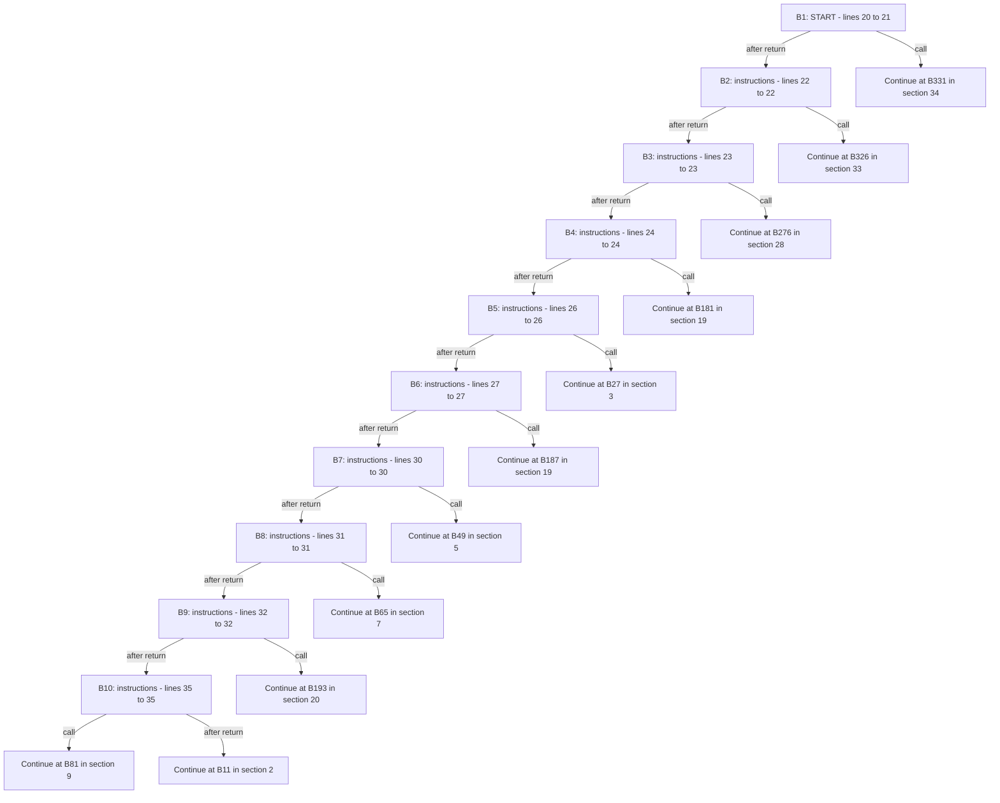

### B1

```asm
MOV P1,#0FFH
LCALL INLCD
```

### B2

```asm
LCALL Clear
```

### B3

```asm
LCALL MSG_WELCOME
```

### B4

```asm
ACALL LCDCONT1
```

### B5

```asm
ACALL ENTER_CASH
```

### B6

```asm
ACALL LCDCONT2
```

### B7

```asm
ACALL COFFEE_1
```

### B8

```asm
ACALL TYPE
```

### B9

```asm
ACALL LCDCONT3
```

### B10

```asm
ACALL COFFEE_2
```

## Section 2

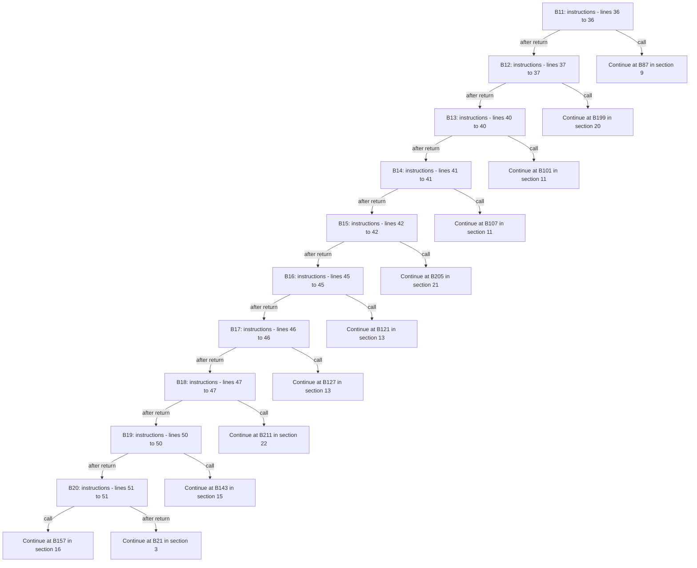

### B11

```asm
ACALL SIZE
```

### B12

```asm
ACALL LCDCONT4
```

### B13

```asm
ACALL COFFEE_3
```

### B14

```asm
ACALL MILK
```

### B15

```asm
ACALL LCDCONT5
```

### B16

```asm
ACALL COFFEE_4
```

### B17

```asm
ACALL SUGAR
```

### B18

```asm
ACALL LCDCONT6
```

### B19

```asm
ACALL ORDER
```

### B20

```asm
ACALL COST
```

## Section 3

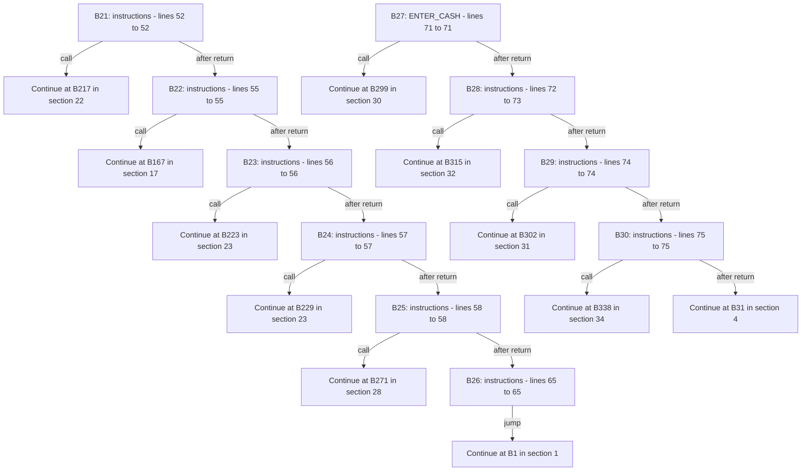

### B21

```asm
ACALL LCDCONT7
```

### B22

```asm
ACALL SHOW_BILL
```

### B23

```asm
ACALL LCDCONT8
```

### B24

```asm
ACALL READY
```

### B25

```asm
LCALL FLASH
```

### B26

```asm
LJMP MAIN
```

### B27

```asm
ACALL SETUP_ROW1
```

### B28

```asm
MOV DPTR,#L2
ACALL WSTR
```

### B29

```asm
ACALL SETUP_ROW2
```

### B30

```asm
ACALL KEYPAD
```

## Section 4

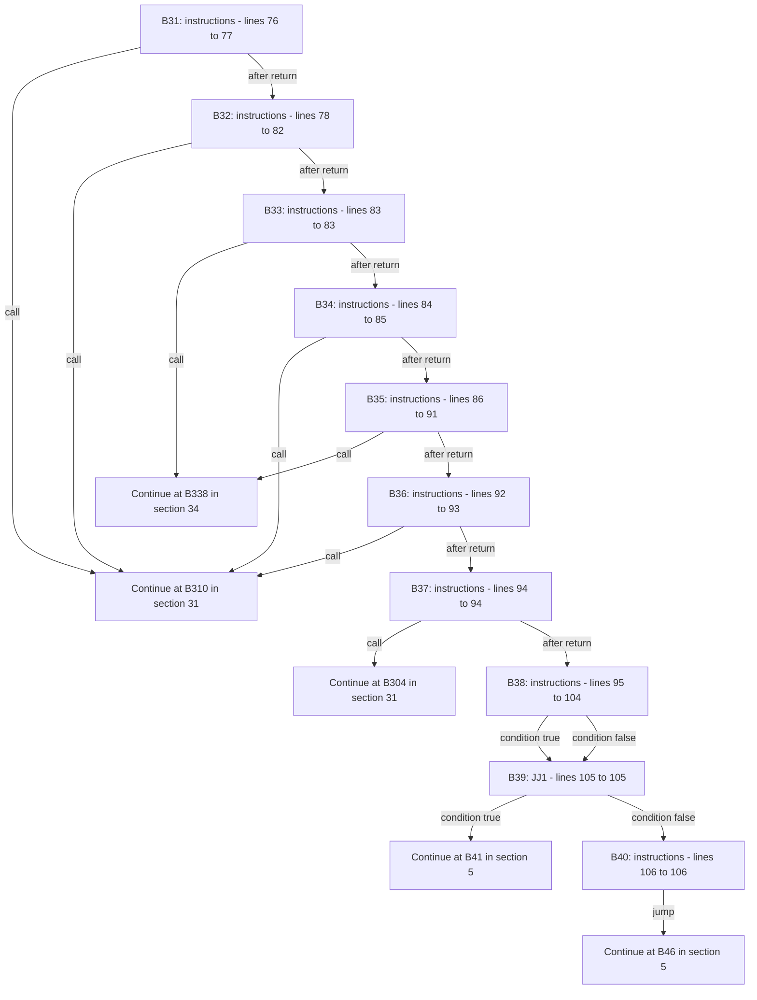

### B31

```asm
MOV 50H,A
ACALL WCHR
```

### B32

```asm
MOV A,50H
SUBB A,#30H
MOV 50H,A
MOV A,#'.'
ACALL WCHR
```

### B33

```asm
ACALL KEYPAD
```

### B34

```asm
MOV 51H,A
ACALL WCHR
```

### B35

```asm
MOV A,51H
SUBB A,#30H
MOV B,#10
MUL AB
MOV 51H,A
ACALL KEYPAD
```

### B36

```asm
MOV 52H,A
ACALL WCHR
```

### B37

```asm
ACALL LOOPLDELAY
```

### B38

```asm
MOV A,52H
SUBB A,#30H
MOV 52H,A
ADD A,51H
MOV 53H,A
MOV A,50H
CLR C
CJNE A,#1,JJ1
```

### B39

```asm
JC EP1
```

### B40

```asm
SJMP ZA
```

## Section 5

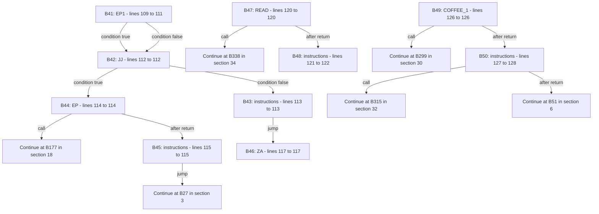

### B41

```asm
MOV A,53H
CLR C
CJNE A,#50,JJ
```

### B42

```asm
JC EP
```

### B43

```asm
SJMP ZA
```

### B44

```asm
ACALL ERROR_MSG
```

### B45

```asm
LJMP MMM
```

### B46

Return to the instruction following the active call.

```asm
RET
```

### B47

```asm
ACALL KEYPAD
```

### B48

Return to the instruction following the active call.

```asm
SUBB A,#30H
RET
```

### B49

```asm
ACALL SETUP_ROW1
```

### B50

```asm
MOV DPTR,#L3
ACALL WSTR
```

## Section 6

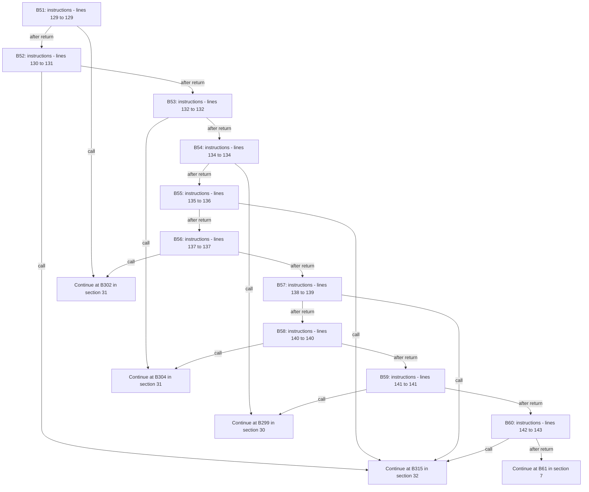

### B51

```asm
ACALL SETUP_ROW2
```

### B52

```asm
MOV DPTR,#L4
ACALL WSTR
```

### B53

```asm
ACALL LOOPLDELAY
```

### B54

```asm
ACALL SETUP_ROW1
```

### B55

```asm
MOV DPTR,#L5
ACALL WSTR
```

### B56

```asm
ACALL SETUP_ROW2
```

### B57

```asm
MOV DPTR,#L6
ACALL WSTR
```

### B58

```asm
ACALL LOOPLDELAY
```

### B59

```asm
ACALL SETUP_ROW1
```

### B60

```asm
MOV DPTR,#L7
ACALL WSTR
```

## Section 7

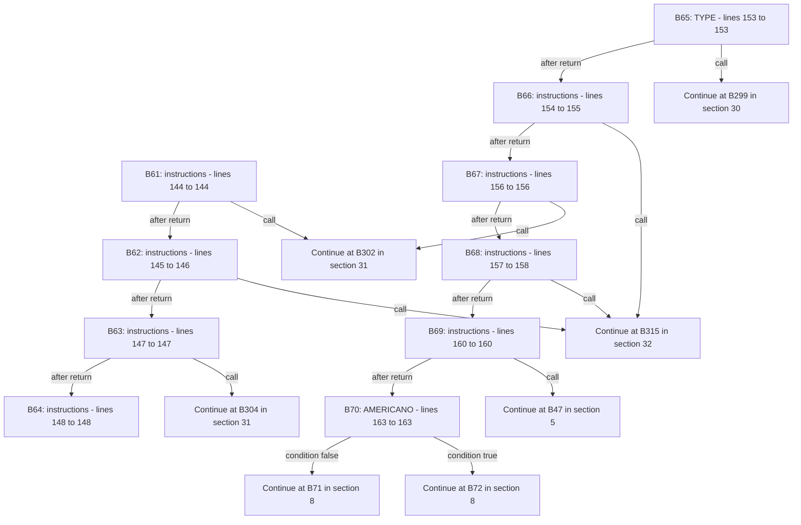

### B61

```asm
ACALL SETUP_ROW2
```

### B62

```asm
MOV DPTR,#L8
ACALL WSTR
```

### B63

```asm
ACALL LOOPLDELAY
```

### B64

Return to the instruction following the active call.

```asm
RET
```

### B65

```asm
ACALL SETUP_ROW1
```

### B66

```asm
MOV DPTR,#TY1
ACALL WSTR
```

### B67

```asm
ACALL SETUP_ROW2
```

### B68

```asm
MOV DPTR,#TY2
ACALL WSTR
```

### B69

```asm
ACALL READ
```

### B70

```asm
CJNE A,#1,Cappuccino
```

## Section 8

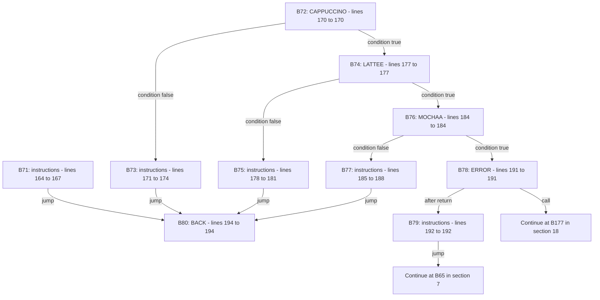

### B71

```asm
MOV R3,#AMER
MOV R4,#0
MOV 40H,#1
SJMP BACK
```

### B72

```asm
CJNE A,#2,Lattee
```

### B73

```asm
MOV R3,#CAP
MOV R4,#0
MOV 40H,#2
SJMP BACK
```

### B74

```asm
CJNE A,#3,Mochaa
```

### B75

```asm
MOV R3,#LATTE
MOV R4,#0
MOV 40H,#3
SJMP BACK
```

### B76

```asm
CJNE A,#4,ERROR
```

### B77

```asm
MOV R4,#MOCHA
MOV R3,#0
MOV 40H,#4
SJMP BACK
```

### B78

```asm
ACALL ERROR_MSG
```

### B79

```asm
LJMP ZZZ
```

### B80

Return to the instruction following the active call.

```asm
RET
```

## Section 9


### B81

```asm
ACALL SETUP_ROW1
```

### B82

```asm
MOV DPTR,#L3
ACALL WSTR
```

### B83

```asm
ACALL SETUP_ROW2
```

### B84

```asm
MOV DPTR,#L10
ACALL WSTR
```

### B85

```asm
ACALL LOOPLDELAY
```

### B86

Return to the instruction following the active call.

```asm
RET
```

### B87

```asm
ACALL SETUP_ROW1
```

### B88

```asm
MOV DPTR,#CY1
ACALL WSTR
```

### B89

```asm
ACALL SETUP_ROW2
```

### B90

```asm
MOV DPTR,#CY2
ACALL WSTR
```

## Section 10

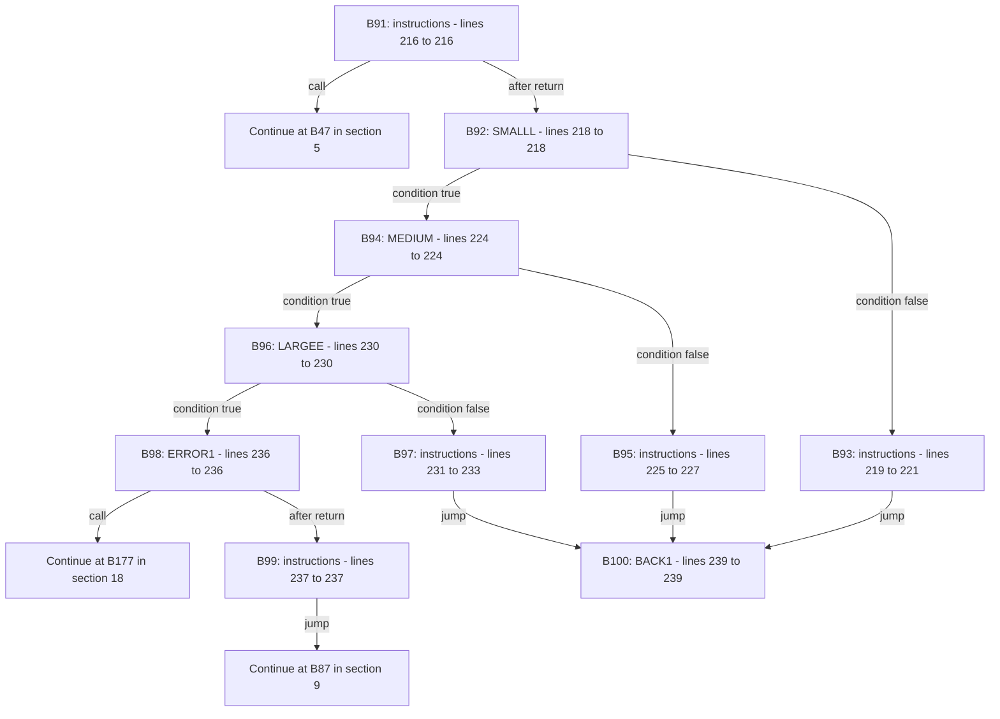

### B91

```asm
ACALL READ
```

### B92

```asm
CJNE A,#1,Medium
```

### B93

```asm
MOV R5,#SMALL
MOV 41H,#1
SJMP BACK1
```

### B94

```asm
CJNE A,#2,Largee
```

### B95

```asm
MOV R5,#MED
MOV 41H,#2
SJMP BACK1
```

### B96

```asm
CJNE A,#3,ERROR1
```

### B97

```asm
MOV R5,#LARGE
MOV 41H,#3
SJMP BACK1
```

### B98

```asm
ACALL ERROR_MSG
```

### B99

```asm
LJMP XXX
```

### B100

Return to the instruction following the active call.

```asm
RET
```

## Section 11


### B101

```asm
ACALL SETUP_ROW1
```

### B102

```asm
MOV DPTR,#L3
ACALL WSTR
```

### B103

```asm
ACALL SETUP_ROW2
```

### B104

```asm
MOV DPTR,#L11
ACALL WSTR
```

### B105

```asm
ACALL LOOPLDELAY
```

### B106

Return to the instruction following the active call.

```asm
RET
```

### B107

```asm
ACALL SETUP_ROW1
```

### B108

```asm
MOV DPTR,#MY1
ACALL WSTR
```

### B109

```asm
ACALL SETUP_ROW2
```

### B110

```asm
MOV DPTR,#MY2
ACALL WSTR
```

## Section 12


### B111

```asm
ACALL READ
```

### B112

```asm
CJNE A,#1,Half
```

### B113

```asm
MOV 42H,#1
SJMP BACK2
```

### B114

```asm
CJNE A,#2,Full
```

### B115

```asm
MOV 42H,#2
SJMP BACK2
```

### B116

```asm
CJNE A,#3,ERROR2
```

### B117

```asm
MOV 42H,#3
SJMP BACK2
```

### B118

```asm
ACALL ERROR_MSG
```

### B119

```asm
LJMP CCC
```

### B120

Return to the instruction following the active call.

```asm
RET
```

## Section 13


### B121

```asm
ACALL SETUP_ROW1
```

### B122

```asm
MOV DPTR,#L3
ACALL WSTR
```

### B123

```asm
ACALL SETUP_ROW2
```

### B124

```asm
MOV DPTR,#L12
ACALL WSTR
```

### B125

```asm
ACALL LOOPLDELAY
```

### B126

Return to the instruction following the active call.

```asm
RET
```

### B127

```asm
ACALL SETUP_ROW1
```

### B128

```asm
MOV DPTR,#SY1
ACALL WSTR
```

### B129

```asm
ACALL SETUP_ROW2
```

### B130

```asm
MOV DPTR,#SY2
ACALL WSTR
```

## Section 14

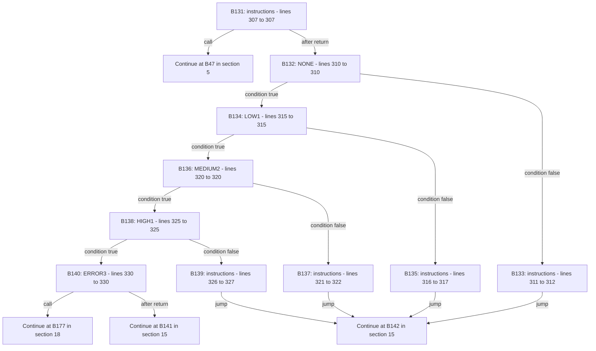

### B131

```asm
ACALL READ
```

### B132

```asm
CJNE A,#1,Low1
```

### B133

```asm
MOV 43H,#1
SJMP BACK3
```

### B134

```asm
CJNE A,#2,Medium2
```

### B135

```asm
MOV 43H,#2
SJMP BACK3
```

### B136

```asm
CJNE A,#3,High1
```

### B137

```asm
MOV 43H,#3
SJMP BACK3
```

### B138

```asm
CJNE A,#4,ERROR3
```

### B139

```asm
MOV 43H,#4
SJMP BACK3
```

### B140

```asm
ACALL ERROR_MSG
```

## Section 15

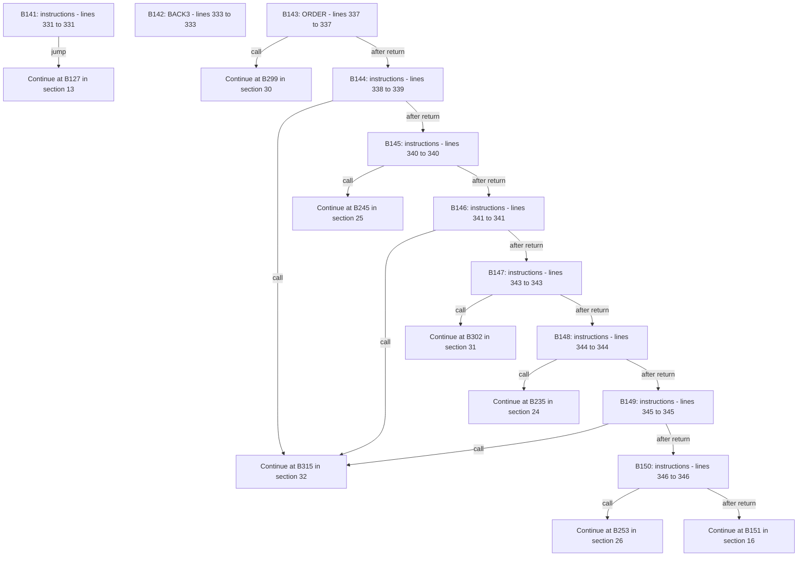

### B141

```asm
LJMP VVV
```

### B142

Return to the instruction following the active call.

```asm
RET
```

### B143

```asm
ACALL SETUP_ROW1
```

### B144

```asm
MOV DPTR,#LO
ACALL WSTR
```

### B145

```asm
ACALL SELECTION2
```

### B146

```asm
ACALL WSTR
```

### B147

```asm
ACALL SETUP_ROW2
```

### B148

```asm
ACALL SELECTION1
```

### B149

```asm
ACALL WSTR
```

### B150

```asm
ACALL SELECTION3
```

## Section 16

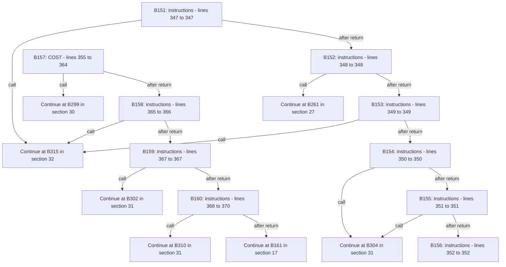

### B151

```asm
ACALL WSTR
```

### B152

```asm
ACALL SELECTION4
```

### B153

```asm
ACALL WSTR
```

### B154

```asm
ACALL LOOPLDELAY
```

### B155

```asm
ACALL LOOPLDELAY
```

### B156

Return to the instruction following the active call.

```asm
RET
```

### B157

```asm
MOV A,R3
ADD A,R5
MOV R3,A
MOV B,#100
DIV AB
MOV R3,B
ADD A,R4
MOV R4,A
ACALL SETUP_ROW1
```

### B158

```asm
MOV DPTR,#L13
ACALL WSTR
```

### B159

```asm
ACALL SETUP_ROW2
```

### B160

```asm
MOV A,R4
ADD A,#30H
ACALL WCHR
```

## Section 17

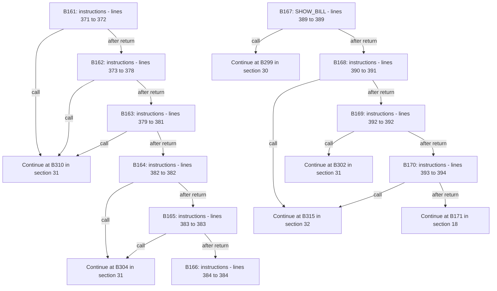

### B161

```asm
MOV A,#'.'
ACALL WCHR
```

### B162

```asm
MOV A,R3
MOV B,#10
DIV AB
MOV 65H,B
ADD A,#30H
ACALL WCHR
```

### B163

```asm
MOV A,65H
ADD A,#30H
ACALL WCHR
```

### B164

```asm
ACALL LOOPLDELAY
```

### B165

```asm
ACALL LOOPLDELAY
```

### B166

Return to the instruction following the active call.

```asm
RET
```

### B167

```asm
ACALL SETUP_ROW1
```

### B168

```asm
MOV DPTR,#L16
ACALL WSTR
```

### B169

```asm
ACALL SETUP_ROW2
```

### B170

```asm
MOV DPTR,#L17
ACALL WSTR
```

## Section 18

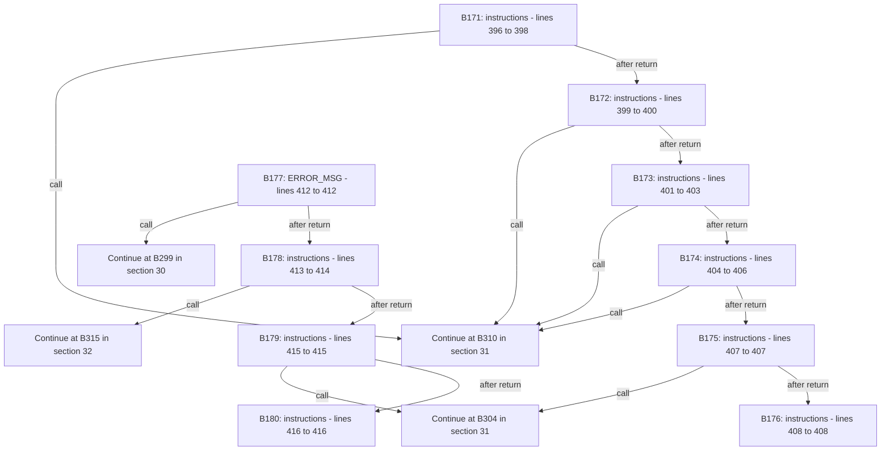

### B171

```asm
MOV A,60H
ADD A,#30H
ACALL WCHR
```

### B172

```asm
MOV A,#'.'
ACALL WCHR
```

### B173

```asm
MOV A,61H
ADD A,#30H
ACALL WCHR
```

### B174

```asm
MOV A,62H
ADD A,#30H
ACALL WCHR
```

### B175

```asm
ACALL LOOPLDELAY
```

### B176

Return to the instruction following the active call.

```asm
RET
```

### B177

```asm
ACALL SETUP_ROW1
```

### B178

```asm
MOV DPTR,#L9
ACALL WSTR
```

### B179

```asm
ACALL LOOPLDELAY
```

### B180

Return to the instruction following the active call.

```asm
RET
```

## Section 19

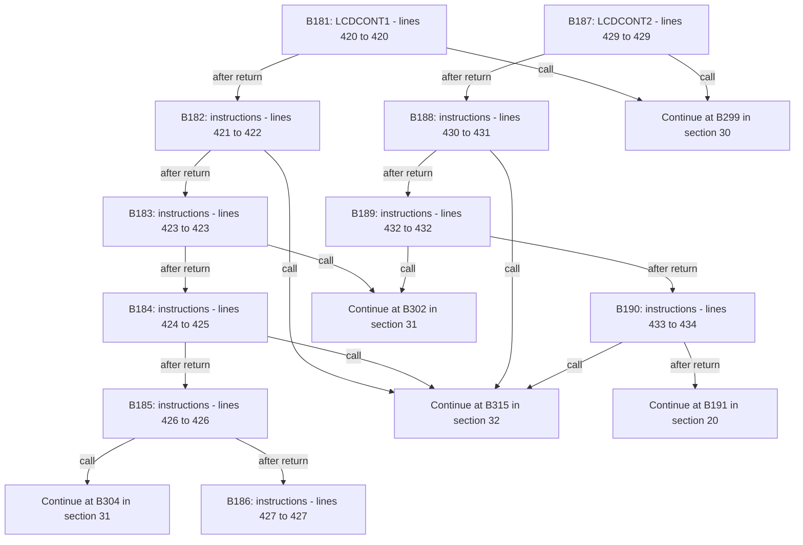

### B181

```asm
ACALL SETUP_ROW1
```

### B182

```asm
MOV DPTR,#X1
ACALL WSTR
```

### B183

```asm
ACALL SETUP_ROW2
```

### B184

```asm
MOV DPTR,#X2
ACALL WSTR
```

### B185

```asm
ACALL LOOPLDELAY
```

### B186

Return to the instruction following the active call.

```asm
RET
```

### B187

```asm
ACALL SETUP_ROW1
```

### B188

```asm
MOV DPTR,#X3
ACALL WSTR
```

### B189

```asm
ACALL SETUP_ROW2
```

### B190

```asm
MOV DPTR,#X4
ACALL WSTR
```

## Section 20

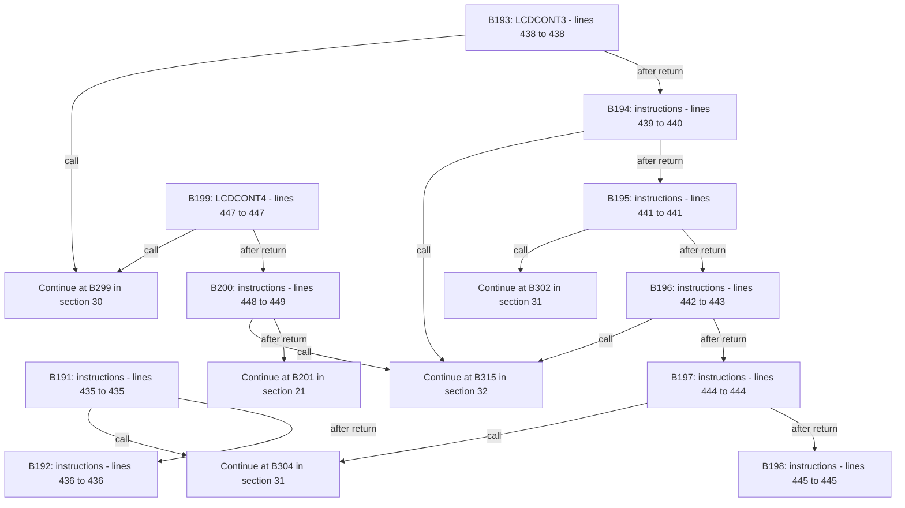

### B191

```asm
ACALL LOOPLDELAY
```

### B192

Return to the instruction following the active call.

```asm
RET
```

### B193

```asm
ACALL SETUP_ROW1
```

### B194

```asm
MOV DPTR,#X5
ACALL WSTR
```

### B195

```asm
ACALL SETUP_ROW2
```

### B196

```asm
MOV DPTR,#X6
ACALL WSTR
```

### B197

```asm
ACALL LOOPLDELAY
```

### B198

Return to the instruction following the active call.

```asm
RET
```

### B199

```asm
ACALL SETUP_ROW1
```

### B200

```asm
MOV DPTR,#X7
ACALL WSTR
```

## Section 21

```mermaid
flowchart TD
B200["B201: instructions - lines 450 to 450"]
B201["B202: instructions - lines 451 to 452"]
B202["B203: instructions - lines 453 to 453"]
B203["B204: instructions - lines 454 to 454"]
B204["B205: LCDCONT5 - lines 456 to 456"]
B205["B206: instructions - lines 457 to 458"]
B206["B207: instructions - lines 459 to 459"]
B207["B208: instructions - lines 460 to 461"]
B208["B209: instructions - lines 462 to 462"]
B209["B210: instructions - lines 463 to 463"]
B200 -->|call| B301
B200 -->|after return| B201
B201 -->|call| B314
B201 -->|after return| B202
B202 -->|call| B303
B202 -->|after return| B203
B204 -->|call| B298
B204 -->|after return| B205
B205 -->|call| B314
B205 -->|after return| B206
B206 -->|call| B301
B206 -->|after return| B207
B207 -->|call| B314
B207 -->|after return| B208
B208 -->|call| B303
B208 -->|after return| B209
B301["Continue at B302 in section 31"]
B314["Continue at B315 in section 32"]
B303["Continue at B304 in section 31"]
B298["Continue at B299 in section 30"]
```

### B201

```asm
ACALL SETUP_ROW2
```

### B202

```asm
MOV DPTR,#X8
ACALL WSTR
```

### B203

```asm
ACALL LOOPLDELAY
```

### B204

Return to the instruction following the active call.

```asm
RET
```

### B205

```asm
ACALL SETUP_ROW1
```

### B206

```asm
MOV DPTR,#X9
ACALL WSTR
```

### B207

```asm
ACALL SETUP_ROW2
```

### B208

```asm
MOV DPTR,#X10
ACALL WSTR
```

### B209

```asm
ACALL LOOPLDELAY
```

### B210

Return to the instruction following the active call.

```asm
RET
```

## Section 22

```mermaid
flowchart TD
B210["B211: LCDCONT6 - lines 465 to 465"]
B211["B212: instructions - lines 466 to 467"]
B212["B213: instructions - lines 468 to 468"]
B213["B214: instructions - lines 469 to 470"]
B214["B215: instructions - lines 471 to 471"]
B215["B216: instructions - lines 472 to 472"]
B216["B217: LCDCONT7 - lines 474 to 474"]
B217["B218: instructions - lines 475 to 476"]
B218["B219: instructions - lines 477 to 477"]
B219["B220: instructions - lines 478 to 479"]
B210 -->|call| B298
B210 -->|after return| B211
B211 -->|call| B314
B211 -->|after return| B212
B212 -->|call| B301
B212 -->|after return| B213
B213 -->|call| B314
B213 -->|after return| B214
B214 -->|call| B303
B214 -->|after return| B215
B216 -->|call| B298
B216 -->|after return| B217
B217 -->|call| B314
B217 -->|after return| B218
B218 -->|call| B301
B218 -->|after return| B219
B219 -->|call| B314
B219 -->|after return| B220
B298["Continue at B299 in section 30"]
B314["Continue at B315 in section 32"]
B301["Continue at B302 in section 31"]
B303["Continue at B304 in section 31"]
B220["Continue at B221 in section 23"]
```

### B211

```asm
ACALL SETUP_ROW1
```

### B212

```asm
MOV DPTR,#X11
ACALL WSTR
```

### B213

```asm
ACALL SETUP_ROW2
```

### B214

```asm
MOV DPTR,#X12
ACALL WSTR
```

### B215

```asm
ACALL LOOPLDELAY
```

### B216

Return to the instruction following the active call.

```asm
RET
```

### B217

```asm
ACALL SETUP_ROW1
```

### B218

```asm
MOV DPTR,#X13
ACALL WSTR
```

### B219

```asm
ACALL SETUP_ROW2
```

### B220

```asm
MOV DPTR,#X14
ACALL WSTR
```

## Section 23

```mermaid
flowchart TD
B220["B221: instructions - lines 480 to 480"]
B221["B222: instructions - lines 481 to 481"]
B222["B223: LCDCONT8 - lines 483 to 483"]
B223["B224: instructions - lines 484 to 485"]
B224["B225: instructions - lines 486 to 486"]
B225["B226: instructions - lines 487 to 488"]
B226["B227: instructions - lines 489 to 489"]
B227["B228: instructions - lines 490 to 490"]
B228["B229: READY - lines 493 to 493"]
B229["B230: instructions - lines 494 to 495"]
B220 -->|call| B303
B220 -->|after return| B221
B222 -->|call| B298
B222 -->|after return| B223
B223 -->|call| B314
B223 -->|after return| B224
B224 -->|call| B301
B224 -->|after return| B225
B225 -->|call| B314
B225 -->|after return| B226
B226 -->|call| B303
B226 -->|after return| B227
B228 -->|call| B298
B228 -->|after return| B229
B229 -->|call| B314
B229 -->|after return| B230
B303["Continue at B304 in section 31"]
B298["Continue at B299 in section 30"]
B314["Continue at B315 in section 32"]
B301["Continue at B302 in section 31"]
B230["Continue at B231 in section 24"]
```

### B221

```asm
ACALL LOOPLDELAY
```

### B222

Return to the instruction following the active call.

```asm
RET
```

### B223

```asm
ACALL SETUP_ROW1
```

### B224

```asm
MOV DPTR,#X15
ACALL WSTR
```

### B225

```asm
ACALL SETUP_ROW2
```

### B226

```asm
MOV DPTR,#X16
ACALL WSTR
```

### B227

```asm
ACALL LOOPLDELAY
```

### B228

Return to the instruction following the active call.

```asm
RET
```

### B229

```asm
ACALL SETUP_ROW1
```

### B230

```asm
MOV DPTR,#L14
ACALL WSTR
```

## Section 24

```mermaid
flowchart TD
B230["B231: instructions - lines 496 to 496"]
B231["B232: instructions - lines 497 to 498"]
B232["B233: instructions - lines 499 to 499"]
B233["B234: instructions - lines 500 to 500"]
B234["B235: SELECTION1 - lines 503 to 503"]
B235["B236: GG1 - lines 504 to 504"]
B236["B237: instructions - lines 505 to 506"]
B237["B238: Z1 - lines 507 to 507"]
B238["B239: instructions - lines 508 to 509"]
B239["B240: Z2 - lines 510 to 510"]
B230 -->|call| B301
B230 -->|after return| B231
B231 -->|call| B314
B231 -->|after return| B232
B232 -->|call| B303
B232 -->|after return| B233
B234 -->|next| B235
B235 -->|condition true| B237
B235 -->|condition false| B236
B236 -->|jump| B243
B237 -->|condition true| B239
B237 -->|condition false| B238
B238 -->|jump| B243
B239 -->|condition true| B241
B239 -->|condition false| B240
B301["Continue at B302 in section 31"]
B314["Continue at B315 in section 32"]
B303["Continue at B304 in section 31"]
B243["Continue at B244 in section 25"]
B241["Continue at B242 in section 25"]
B240["Continue at B241 in section 25"]
```

### B231

```asm
ACALL SETUP_ROW2
```

### B232

```asm
MOV DPTR,#L15
ACALL WSTR
```

### B233

```asm
ACALL LOOPLDELAY
```

### B234

Return to the instruction following the active call.

```asm
RET
```

### B235

```asm
MOV A,40H
```

### B236

```asm
CJNE A,#1H,Z1
```

### B237

```asm
MOV DPTR ,#T1
SJMP GO1
```

### B238

```asm
CJNE A,#2H,Z2
```

### B239

```asm
MOV DPTR ,#T2
SJMP GO1
```

### B240

```asm
CJNE A,#3H,Z3
```

## Section 25

```mermaid
flowchart TD
B240["B241: instructions - lines 511 to 512"]
B241["B242: Z3 - lines 513 to 513"]
B242["B243: instructions - lines 514 to 514"]
B243["B244: GO1 - lines 516 to 516"]
B244["B245: SELECTION2 - lines 519 to 519"]
B245["B246: GG2 - lines 520 to 520"]
B246["B247: instructions - lines 521 to 522"]
B247["B248: A1 - lines 523 to 523"]
B248["B249: instructions - lines 524 to 525"]
B249["B250: A2 - lines 526 to 526"]
B240 -->|jump| B243
B241 -->|condition true| B235
B241 -->|condition false| B242
B242 -->|next| B243
B244 -->|next| B245
B245 -->|condition true| B247
B245 -->|condition false| B246
B246 -->|jump| B251
B247 -->|condition true| B249
B247 -->|condition false| B248
B248 -->|jump| B251
B249 -->|condition true| B245
B249 -->|condition false| B250
B235["Continue at B236 in section 24"]
B251["Continue at B252 in section 26"]
B250["Continue at B251 in section 26"]
```

### B241

```asm
MOV DPTR ,#T3
SJMP GO1
```

### B242

```asm
CJNE A,#4H,GG1
```

### B243

```asm
MOV DPTR ,#T4
```

### B244

Return to the instruction following the active call.

```asm
RET
```

### B245

```asm
MOV A,41H
```

### B246

```asm
CJNE A,#1H,A1
```

### B247

```asm
MOV DPTR ,#C1
SJMP GO2
```

### B248

```asm
CJNE A,#2H,A2
```

### B249

```asm
MOV DPTR ,#C2
SJMP GO2
```

### B250

```asm
CJNE A,#3H,GG2
```

## Section 26

```mermaid
flowchart TD
B250["B251: instructions - lines 527 to 527"]
B251["B252: GO2 - lines 529 to 529"]
B252["B253: SELECTION3 - lines 532 to 532"]
B253["B254: GG3 - lines 533 to 533"]
B254["B255: instructions - lines 534 to 535"]
B255["B256: Q1 - lines 536 to 536"]
B256["B257: instructions - lines 537 to 538"]
B257["B258: Q2 - lines 539 to 539"]
B258["B259: instructions - lines 540 to 540"]
B259["B260: GO3 - lines 542 to 542"]
B250 -->|next| B251
B252 -->|next| B253
B253 -->|condition true| B255
B253 -->|condition false| B254
B254 -->|jump| B259
B255 -->|condition true| B257
B255 -->|condition false| B256
B256 -->|jump| B259
B257 -->|condition true| B253
B257 -->|condition false| B258
B258 -->|next| B259
```

### B251

```asm
MOV DPTR ,#C3
```

### B252

Return to the instruction following the active call.

```asm
RET
```

### B253

```asm
MOV A,42H
```

### B254

```asm
CJNE A,#1H,Q1
```

### B255

```asm
MOV DPTR ,#M1
SJMP GO3
```

### B256

```asm
CJNE A,#2H,Q2
```

### B257

```asm
MOV DPTR ,#M2
SJMP GO3
```

### B258

```asm
CJNE A,#3H,GG3
```

### B259

```asm
MOV DPTR ,#M3
```

### B260

Return to the instruction following the active call.

```asm
RET
```

## Section 27

```mermaid
flowchart TD
B260["B261: SELECTION4 - lines 545 to 545"]
B261["B262: GG4 - lines 546 to 546"]
B262["B263: instructions - lines 547 to 548"]
B263["B264: W1 - lines 549 to 549"]
B264["B265: instructions - lines 550 to 551"]
B265["B266: W2 - lines 552 to 552"]
B266["B267: instructions - lines 553 to 554"]
B267["B268: W3 - lines 555 to 555"]
B268["B269: instructions - lines 556 to 556"]
B269["B270: GO4 - lines 558 to 558"]
B260 -->|next| B261
B261 -->|condition true| B263
B261 -->|condition false| B262
B262 -->|jump| B269
B263 -->|condition true| B265
B263 -->|condition false| B264
B264 -->|jump| B269
B265 -->|condition true| B267
B265 -->|condition false| B266
B266 -->|jump| B269
B267 -->|condition true| B261
B267 -->|condition false| B268
B268 -->|next| B269
```

### B261

```asm
MOV A,43H
```

### B262

```asm
CJNE A,#1H,W1
```

### B263

```asm
MOV DPTR ,#S1
SJMP GO4
```

### B264

```asm
CJNE A,#2H,W2
```

### B265

```asm
MOV DPTR ,#S2
SJMP GO4
```

### B266

```asm
CJNE A,#3H,W3
```

### B267

```asm
MOV DPTR ,#S3
SJMP GO4
```

### B268

```asm
CJNE A,#4H,GG4
```

### B269

```asm
MOV DPTR ,#S4
```

### B270

Return to the instruction following the active call.

```asm
RET
```

## Section 28

```mermaid
flowchart TD
B270["B271: FLASH - lines 562 to 562"]
B271["B272: RE - lines 564 to 565"]
B272["B273: instructions - lines 566 to 567"]
B273["B274: instructions - lines 568 to 568"]
B274["B275: instructions - lines 569 to 569"]
B275["B276: MSG_WELCOME - lines 573 to 574"]
B276["B277: instructions - lines 575 to 576"]
B277["B278: instructions - lines 577 to 577"]
B278["B279: instructions - lines 578 to 578"]
B279["B280: instructions - lines 579 to 579"]
B270 -->|next| B271
B271 -->|call| B280
B271 -->|after return| B272
B272 -->|call| B280
B272 -->|after return| B273
B273 -->|condition true| B271
B273 -->|condition false| B274
B275 -->|call| B319
B275 -->|after return| B276
B276 -->|call| B314
B276 -->|after return| B277
B277 -->|call| B303
B277 -->|after return| B278
B278 -->|call| B325
B278 -->|after return| B279
B280["Continue at B281 in section 29"]
B319["Continue at B320 in section 32"]
B314["Continue at B315 in section 32"]
B303["Continue at B304 in section 31"]
B325["Continue at B326 in section 33"]
```

### B271

```asm
MOV R6,#3H
```

### B272

```asm
MOV P1,#00H
ACALL DELAY
```

### B273

```asm
MOV P1,#0FFH
ACALL DELAY
```

### B274

```asm
DJNZ R6,RE
```

### B275

Return to the instruction following the active call.

```asm
RET
```

### B276

```asm
MOV A,#85H
ACALL CMD
```

### B277

```asm
MOV DPTR ,#L1
ACALL WSTR
```

### B278

```asm
ACALL LOOPLDELAY
```

### B279

```asm
ACALL CLEAR
```

### B280

Return to the instruction following the active call.

```asm
RET
```

## Section 29

```mermaid
flowchart TD
B280["B281: DELAY - lines 584 to 588"]
B281["B282: Y1254 - lines 591 to 591"]
B282["B283: X1234 - lines 594 to 596"]
B283["B284: AGAIIN44 - lines 597 to 597"]
B284["B285: instructions - lines 598 to 601"]
B285["B286: instructions - lines 603 to 603"]
B286["B287: BALANCE - lines 609 to 609"]
B287["B288: RFV - lines 611 to 611"]
B288["B289: instructions - lines 612 to 613"]
B289["B290: instructions - lines 614 to 614"]
B280 -->|next| B281
B281 -->|next| B282
B282 -->|next| B283
B283 -->|condition true| B283
B283 -->|condition false| B284
B284 -->|condition true| B282
B284 -->|condition false| B285
B286 -->|jump| B297
B287 -->|call| B298
B287 -->|after return| B288
B288 -->|call| B314
B288 -->|after return| B289
B289 -->|call| B301
B289 -->|after return| B290
B297["Continue at B298 in section 30"]
B298["Continue at B299 in section 30"]
B314["Continue at B315 in section 32"]
B301["Continue at B302 in section 31"]
B290["Continue at B291 in section 30"]
```

### B281

```asm
CLR C
MOV A,#255
MOV R2,#TIME_DELAY
SUBB A,R2
ADDC A,#1
```

### B282

```asm
MOV 73H,2
```

### B283

```asm
MOV TMOD,#02H
MOV TH0,A
SETB TR0
```

### B284

```asm
JNB TF0,AGAIIN44
```

### B285

```asm
CLR TR0
CLR TF0
DJNZ 73H,X1234
```

### B286

Return to the instruction following the active call.

```asm
RET
```

### B287

```asm
SJMP XSW
```

### B288

```asm
ACALL SETUP_ROW1
```

### B289

```asm
MOV DPTR,#L18
ACALL WSTR
```

### B290

```asm
ACALL SETUP_ROW2
```

## Section 30

```mermaid
flowchart TD
B290["B291: instructions - lines 615 to 616"]
B291["B292: instructions - lines 617 to 617"]
B292["B293: instructions - lines 618 to 620"]
B293["B294: instructions - lines 621 to 622"]
B294["B295: instructions - lines 623 to 625"]
B295["B296: instructions - lines 626 to 628"]
B296["B297: instructions - lines 629 to 629"]
B297["B298: XSW - lines 631 to 631"]
B298["B299: SETUP_ROW1 - lines 635 to 635"]
B299["B300: instructions - lines 636 to 637"]
B290 -->|call| B314
B290 -->|after return| B291
B291 -->|call| B303
B291 -->|after return| B292
B292 -->|call| B309
B292 -->|after return| B293
B293 -->|call| B309
B293 -->|after return| B294
B294 -->|call| B309
B294 -->|after return| B295
B295 -->|call| B309
B295 -->|after return| B296
B296 -->|call| B26
B296 -->|after return| B297
B298 -->|call| B325
B298 -->|after return| B299
B299 -->|call| B319
B299 -->|after return| B300
B314["Continue at B315 in section 32"]
B303["Continue at B304 in section 31"]
B309["Continue at B310 in section 31"]
B26["Continue at B27 in section 3"]
B325["Continue at B326 in section 33"]
B319["Continue at B320 in section 32"]
B300["Continue at B301 in section 31"]
```

### B291

```asm
MOV DPTR,#L19
ACALL WSTR
```

### B292

```asm
ACALL LOOPLDELAY
```

### B293

```asm
MOV A,60H
ADD A,#30H
ACALL WCHR
```

### B294

```asm
MOV A,#'.'
ACALL WCHR
```

### B295

```asm
MOV A,61H
ADD A,#30H
ACALL WCHR
```

### B296

```asm
MOV A,62H
ADD A,#30H
ACALL WCHR
```

### B297

```asm
ACALL ENTER_CASH
```

### B298

Return to the instruction following the active call.

```asm
RET
```

### B299

```asm
ACALL CLEAR
```

### B300

```asm
MOV A,#80H
ACALL CMD
```

## Section 31

```mermaid
flowchart TD
B300["B301: instructions - lines 638 to 638"]
B301["B302: SETUP_ROW2 - lines 640 to 641"]
B302["B303: instructions - lines 642 to 642"]
B303["B304: LOOPLDELAY - lines 645 to 645"]
B304["B305: KL - lines 646 to 646"]
B305["B306: WAIT18 - lines 647 to 647"]
B306["B307: instructions - lines 648 to 648"]
B307["B308: instructions - lines 649 to 649"]
B308["B309: instructions - lines 650 to 650"]
B309["B310: WCHR - lines 654 to 658"]
B301 -->|call| B319
B301 -->|after return| B302
B303 -->|next| B304
B304 -->|next| B305
B305 -->|call| B335
B305 -->|after return| B306
B306 -->|condition true| B305
B306 -->|condition false| B307
B307 -->|condition true| B304
B307 -->|condition false| B308
B309 -->|call| B324
B309 -->|after return| B310
B319["Continue at B320 in section 32"]
B335["Continue at B336 in section 34"]
B324["Continue at B325 in section 33"]
B310["Continue at B311 in section 32"]
```

### B301

Return to the instruction following the active call.

```asm
RET
```

### B302

```asm
MOV A,#0C0H
ACALL CMD
```

### B303

Return to the instruction following the active call.

```asm
RET
```

### B304

```asm
MOV 71H,#7
```

### B305

```asm
MOV 72H,#250
```

### B306

```asm
ACALL LDELAY
```

### B307

```asm
DJNZ 72H,WAIT18
```

### B308

```asm
DJNZ 71H,KL
```

### B309

Return to the instruction following the active call.

```asm
RET
```

### B310

```asm
PUSH ACC
PUSH B
SETB P1.3
MOV B,A
ACALL COMMON
```

## Section 32

```mermaid
flowchart TD
B310["B311: instructions - lines 659 to 659"]
B311["B312: instructions - lines 660 to 662"]
B312["B313: instructions - lines 663 to 663"]
B313["B314: instructions - lines 664 to 666"]
B314["B315: WSTR - lines 669 to 669"]
B315["B316: CONT1 - lines 671 to 673"]
B316["B317: PRINT - lines 675 to 675"]
B317["B318: instructions - lines 676 to 677"]
B318["B319: EXIT1 - lines 678 to 679"]
B319["B320: CMD - lines 682 to 684"]
B310 -->|call| B335
B310 -->|after return| B311
B311 -->|call| B324
B311 -->|after return| B312
B312 -->|call| B335
B312 -->|after return| B313
B314 -->|next| B315
B315 -->|condition true| B318
B315 -->|condition false| B316
B316 -->|call| B309
B316 -->|after return| B317
B317 -->|jump| B315
B319 -->|call| B324
B319 -->|after return| B320
B335["Continue at B336 in section 34"]
B324["Continue at B325 in section 33"]
B309["Continue at B310 in section 31"]
B320["Continue at B321 in section 33"]
```

### B311

```asm
ACALL LDELAY
```

### B312

```asm
MOV A,B
SWAP A
ACALL COMMON
```

### B313

```asm
ACALL LDELAY
```

### B314

Return to the instruction following the active call.

```asm
POP B
POP ACC
RET
```

### B315

```asm
PUSH ACC
```

### B316

```asm
CLR A
MOVC A,@A+DPTR
JZ Exit1
```

### B317

```asm
ACALL WCHR
```

### B318

```asm
INC DPTR
AJMP CONT1
```

### B319

Return to the instruction following the active call.

```asm
POP ACC
RET
```

### B320

```asm
CLR P1.3
MOV B,A
ACALL COMMON
```

## Section 33

```mermaid
flowchart TD
B320["B321: instructions - lines 685 to 685"]
B321["B322: instructions - lines 686 to 688"]
B322["B323: instructions - lines 689 to 689"]
B323["B324: instructions - lines 690 to 690"]
B324["B325: COMMON - lines 693 to 698"]
B325["B326: CLEAR - lines 701 to 702"]
B326["B327: instructions - lines 703 to 703"]
B327["B328: WAIT11 - lines 704 to 704"]
B328["B329: instructions - lines 705 to 705"]
B329["B330: instructions - lines 706 to 706"]
B320 -->|call| B335
B320 -->|after return| B321
B321 -->|call| B324
B321 -->|after return| B322
B322 -->|call| B335
B322 -->|after return| B323
B325 -->|call| B319
B325 -->|after return| B326
B326 -->|next| B327
B327 -->|call| B335
B327 -->|after return| B328
B328 -->|condition true| B327
B328 -->|condition false| B329
B335["Continue at B336 in section 34"]
B319["Continue at B320 in section 32"]
```

### B321

```asm
ACALL LDELAY
```

### B322

```asm
MOV A,B
SWAP A
ACALL COMMON
```

### B323

```asm
ACALL LDELAY
```

### B324

Return to the instruction following the active call.

```asm
RET
```

### B325

Return to the instruction following the active call.

```asm
ANL a,#11110000B
ANL P1, #00001111B
ORL P1,A
SETB P1.2
CLR P1.2
RET
```

### B326

```asm
MOV A,#01H
ACALL CMD
```

### B327

```asm
MOV R7,#14
```

### B328

```asm
ACALL LDELAY
```

### B329

```asm
DJNZ R7,WAIT11
```

### B330

Return to the instruction following the active call.

```asm
ret
```

## Section 34

```mermaid
flowchart TD
B330["B331: INLCD - lines 709 to 716"]
B331["B332: instructions - lines 717 to 725"]
B332["B333: instructions - lines 726 to 738"]
B333["B334: instructions - lines 739 to 749"]
B334["B335: instructions - lines 750 to 750"]
B335["B336: LDELAY - lines 753 to 754"]
B336["B337: instructions - lines 755 to 755"]
B337["B338: KEYPAD - lines 760 to 760"]
B338["B339: K1 - lines 763 to 766"]
B339["B340: K2 - lines 768 to 770"]
B330 -->|call| B335
B330 -->|after return| B331
B331 -->|call| B335
B331 -->|after return| B332
B332 -->|call| B335
B332 -->|after return| B333
B333 -->|call| B335
B333 -->|after return| B334
B335 -->|condition true| B335
B335 -->|condition false| B336
B337 -->|next| B338
B338 -->|condition true| B338
B338 -->|condition false| B339
B339 -->|condition true| B341
B339 -->|condition false| B340
B341["Continue at B342 in section 35"]
B340["Continue at B341 in section 35"]
```

### B331

```asm
CLR P1.3
CLR P1.7
CLR P1.6
SETB P1.5
CLR P1.4
SETB P1.2
CLR P1.2
ACALL LDELAY
```

### B332

```asm
SETB P1.2
CLR P1.2
SETB P1.7
CLR P1.6
CLR P1.5
CLR P1.4
SETB P1.2
CLR P1.2
ACALL LDELAY
```

### B333

```asm
CLR P1.7
CLR P1.6
CLR P1.5
CLR P1.4
SETB P1.2
CLR P1.2
SETB P1.7
SETB P1.6
SETB P1.5
SETB P1.4
SETB P1.2
CLR P1.2
ACALL LDELAY
```

### B334

```asm
CLR P1.7
CLR P1.6
CLR P1.5
CLR P1.4
SETB P1.2
CLR P1.2
SETB P1.6
SETB P1.5
SETB P1.2
CLR P1.2
ACALL LDELAY
```

### B335

Return to the instruction following the active call.

```asm
RET
```

### B336

```asm
MOV R0, #50
DJNZ R0, $
```

### B337

Return to the instruction following the active call.

```asm
RET
```

### B338

```asm
MOV P0,#01110000B
```

### B339

```asm
MOV P0,#01110000B
MOV A,P0
ANL A,#01110000B
CJNE A,#01110000B,K1
```

### B340

```asm
MOV A,P0
ANL A,#01110000B
CJNE A,#01110000B,OVER1
```

## Section 35

```mermaid
flowchart TD
B340["B341: instructions - lines 771 to 771"]
B341["B342: OVER1 - lines 774 to 777"]
B342["B343: instructions - lines 778 to 781"]
B343["B344: instructions - lines 782 to 785"]
B344["B345: instructions - lines 786 to 789"]
B345["B346: instructions - lines 791 to 791"]
B346["B347: ROW_0 - lines 794 to 795"]
B347["B348: ROW_1 - lines 798 to 799"]
B348["B349: ROW_2 - lines 801 to 802"]
B349["B350: ROW_3 - lines 804 to 804"]
B340 -->|jump| B339
B341 -->|condition true| B346
B341 -->|condition false| B342
B342 -->|condition true| B347
B342 -->|condition false| B343
B343 -->|condition true| B348
B343 -->|condition false| B344
B344 -->|condition true| B349
B344 -->|condition false| B345
B345 -->|jump| B339
B346 -->|jump| B350
B347 -->|jump| B350
B348 -->|jump| B350
B349 -->|next| B350
B339["Continue at B340 in section 34"]
B350["Continue at B351 in section 36"]
```

### B341

```asm
SJMP K2
```

### B342

```asm
MOV P0,#01111110B
MOV A,P0
ANL A,#01110000B
CJNE A,#01110000B,ROW_0
```

### B343

```asm
MOV P0,#01111101B
MOV A,P0
ANL A,#01110000B
CJNE A,#01110000B,ROW_1
```

### B344

```asm
MOV P0,#01111011B
MOV A,P0
ANL A,#01110000B
CJNE A,#01110000B,ROW_2
```

### B345

```asm
MOV P0,#01110111B
MOV A,P0
ANL A,#01110000B
CJNE A,#01110000B,ROW_3
```

### B346

```asm
LJMP K2
```

### B347

```asm
MOV DPTR,#KCODE0
SJMP FIND
```

### B348

```asm
MOV DPTR,#KCODE1
SJMP FIND
```

### B349

```asm
MOV DPTR,#KCODE2
SJMP FIND
```

### B350

```asm
MOV DPTR,#KCODE3
```

## Section 36

```mermaid
flowchart TD
B350["B351: FIND - lines 808 to 808"]
B351["B352: FIND1 - lines 810 to 811"]
B352["B353: instructions - lines 812 to 813"]
B353["B354: MATCH - lines 815 to 817"]
B354["B355: STOP - lines 979 to 979"]
B350 -->|next| B351
B351 -->|condition true| B353
B351 -->|condition false| B352
B352 -->|jump| B351
B354 -->|jump| B354
```

### B351

```asm
RLC A
```

### B352

```asm
RLC A
JNC MATCH
```

### B353

```asm
INC DPTR
SJMP FIND1
```

### B354

Return to the instruction following the active call.

```asm
CLR A
MOVC A,@A+DPTR
RET
```

### B355

```asm
SJMP STOP
```
