# Program Control Flow

[Back to project](README.md)

Control-flow blocks are indexed by source line. Calls resume at the instruction following the call if the subroutine returns normally.

## Entry locations

- `ORG	0` begins at B1.

## Navigation

[Section 1](#section-1) · [Section 2](#section-2) · [Section 3](#section-3) · [Section 4](#section-4) · [Section 5](#section-5) · [Section 6](#section-6) · [Section 7](#section-7) · [Section 8](#section-8) · [Section 9](#section-9) · [Section 10](#section-10) · [Section 11](#section-11) · [Section 12](#section-12) · [Section 13](#section-13) · [Section 14](#section-14) · [Section 15](#section-15) · [Section 16](#section-16) · [Section 17](#section-17) · [Section 18](#section-18) · [Section 19](#section-19) · [Section 20](#section-20) · [Section 21](#section-21) · [Section 22](#section-22) · [Section 23](#section-23) · [Section 24](#section-24) · [Section 25](#section-25)

## Section 1

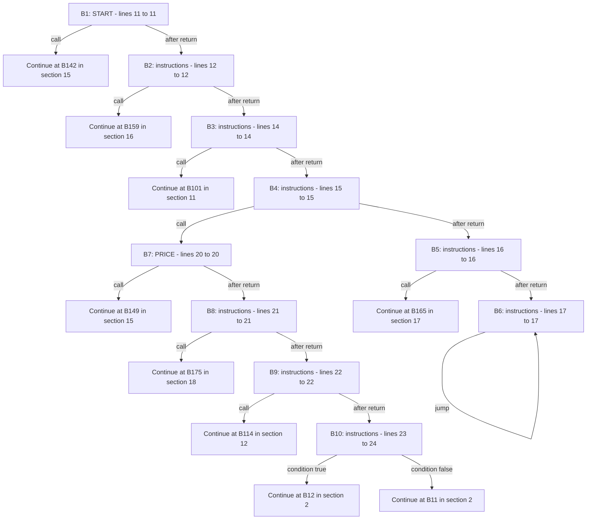

### B1

```asm
ACALL INLCD
```

### B2

```asm
ACALL WELCOME
```

### B3

```asm
ACALL CASH
```

### B4

```asm
ACALL PRICE
```

### B5

```asm
ACALL COMPLETE
```

### B6

```asm
SJMP $
```

### B7

```asm
ACALL CLEAR
```

### B8

```asm
ACALL ENTERTYPE
```

### B9

```asm
ACALL KEYPAD
```

### B10

```asm
SUBB A,#30H
CJNE A,#1H,LC2
```

## Section 2

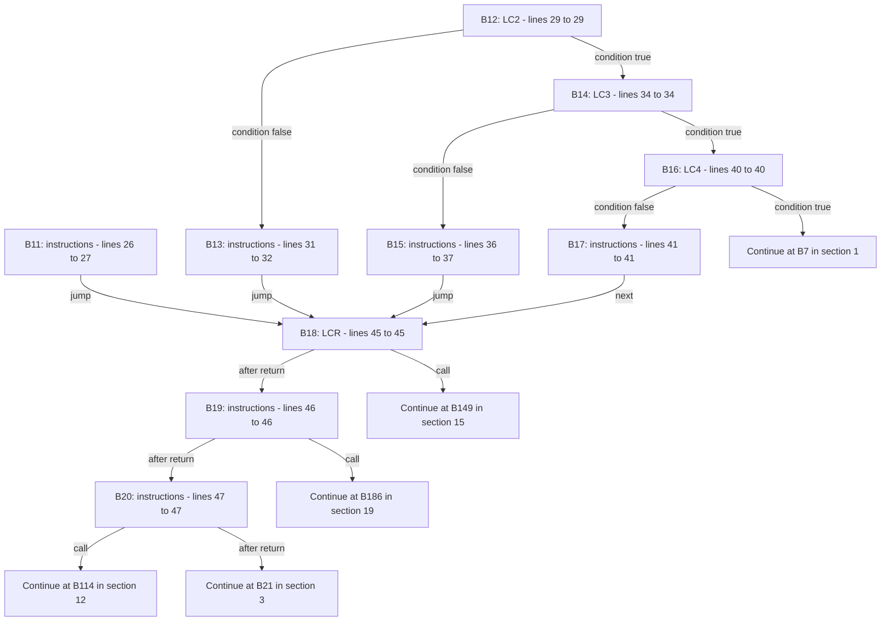

### B11

```asm
MOV	33H,#2
SJMP LCR
```

### B12

```asm
CJNE A,#2H,LC3
```

### B13

```asm
MOV	33H,#3
SJMP LCR
```

### B14

```asm
CJNE A,#3H,LC4
```

### B15

```asm
MOV	33H,#3
SJMP LCR
```

### B16

```asm
CJNE A,#4H,PRICE
```

### B17

```asm
MOV	33H,#4
```

### B18

```asm
ACALL CLEAR
```

### B19

```asm
ACALL CUPSIZE
```

### B20

```asm
ACALL KEYPAD
```

## Section 3

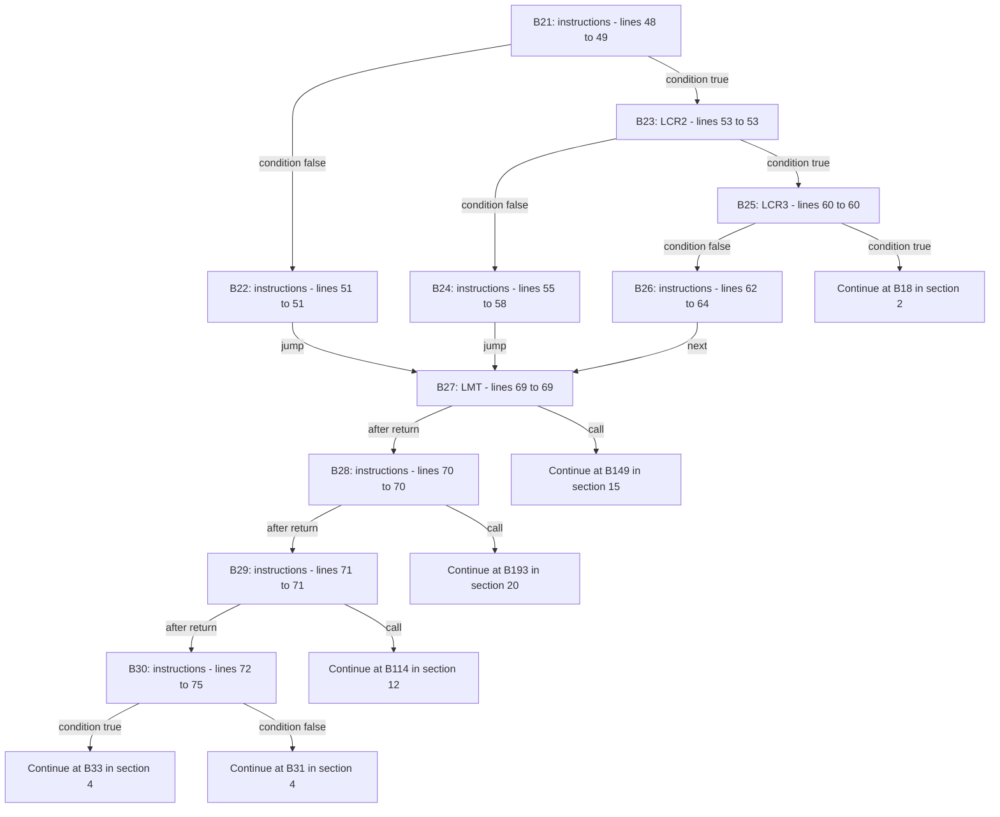

### B21

```asm
SUBB A,#30H
CJNE A,#1,LCR2
```

### B22

```asm
SJMP LMT
```

### B23

```asm
CJNE A,#2,LCR3
```

### B24

```asm
MOV	A,33H
ADD	A,#1
MOV	33H,A
SJMP LMT
```

### B25

```asm
CJNE A,#3,LCR
```

### B26

```asm
MOV	A,33H
ADD	A,#2
MOV	33H,A
```

### B27

```asm
ACALL CLEAR
```

### B28

```asm
ACALL MILKTYPE
```

### B29

```asm
ACALL KEYPAD
```

### B30

```asm
SUBB A,#30H
MOV 70H,A
CJNE A,#1H,LMT2
```

## Section 4

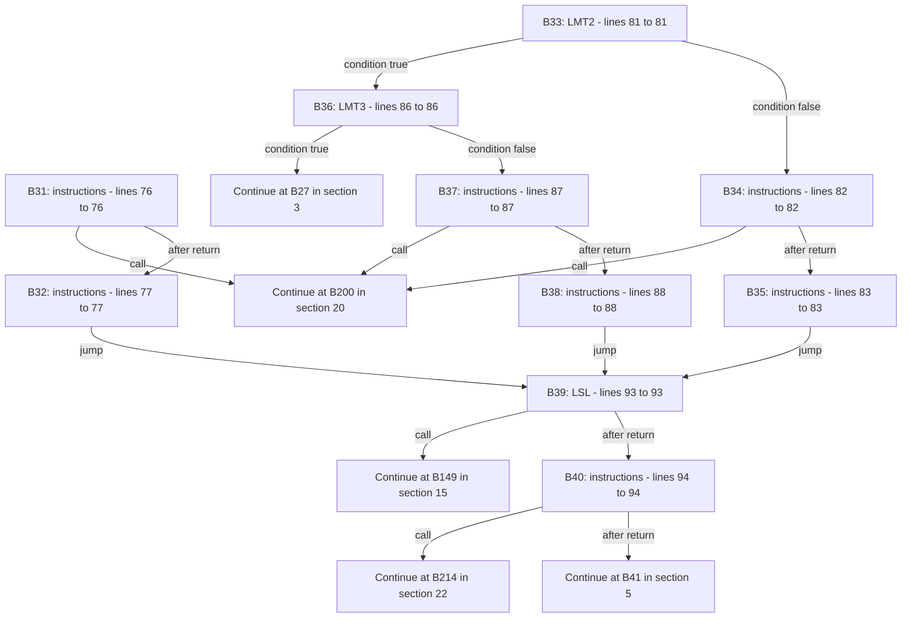

### B31

```asm
ACALL MILKTYPE2
```

### B32

```asm
Sjmp LSL
```

### B33

```asm
CJNE A,#2,LMT3
```

### B34

```asm
ACALL MILKTYPE2
```

### B35

```asm
Sjmp LSL
```

### B36

```asm
CJNE A,#3,LMT
```

### B37

```asm
ACALL MILKTYPE2
```

### B38

```asm
Sjmp LSL
```

### B39

```asm
ACALL CLEAR
```

### B40

```asm
ACALL SUGARLEVEL
```

## Section 5

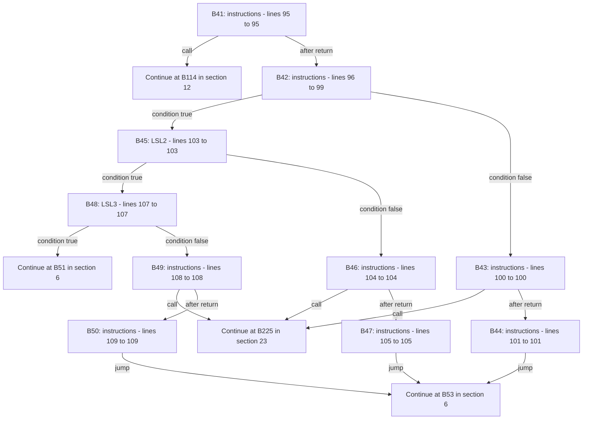

### B41

```asm
ACALL KEYPAD
```

### B42

```asm
SUBB A,#30H
MOV 71H,A
CJNE A,#1,LSL2
```

### B43

```asm
ACALL SUGARLEVEL2
```

### B44

```asm
SJMP PRE
```

### B45

```asm
CJNE A,#2,LSL3
```

### B46

```asm
ACALL SUGARLEVEL2
```

### B47

```asm
SJMP PRE
```

### B48

```asm
CJNE A,#3,LSL4
```

### B49

```asm
ACALL SUGARLEVEL2
```

### B50

```asm
SJMP PRE
```

## Section 6

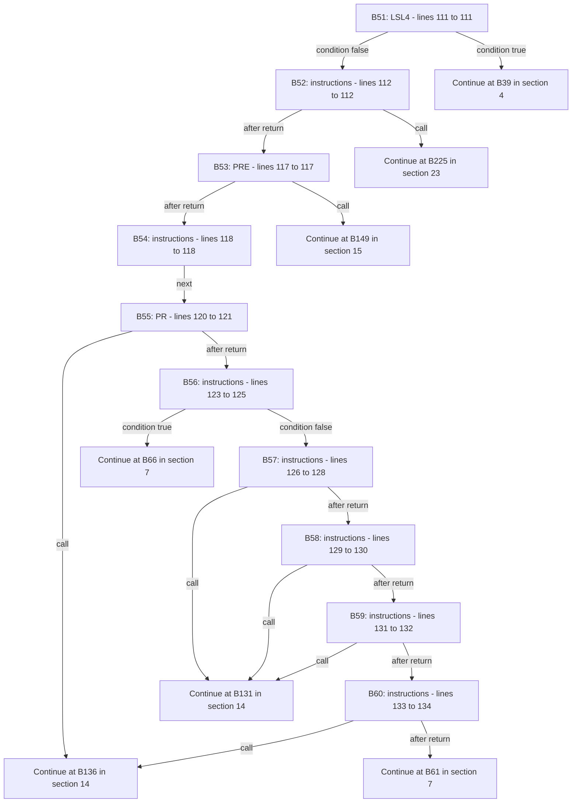

### B51

```asm
CJNE A,#4,LSL
```

### B52

```asm
ACALL SUGARLEVEL2
```

### B53

```asm
ACALL CLEAR
```

### B54

```asm
MOV R6,#10
```

### B55

```asm
MOV A,#80H
ACALL CMD
```

### B56

```asm
MOV A,#10
SUBB A,R6
JZ HERE
```

### B57

```asm
MOV R5,A
ADD A,#30H
ACALL WCHR
```

### B58

```asm
MOV A,#'0'
ACALL WCHR
```

### B59

```asm
MOV A,#'%'
ACALL WCHR
```

### B60

```asm
MOV A,#0C0H
ACALL CMD
```

## Section 7

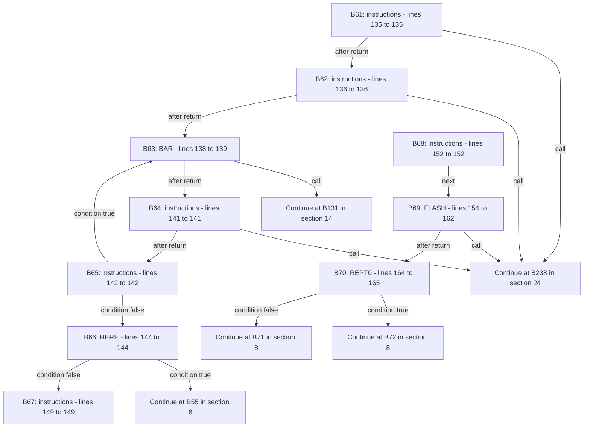

### B61

```asm
ACALL DELAY
```

### B62

```asm
ACALL DELAY
```

### B63

```asm
MOV A,#'.'
ACALL WCHR
```

### B64

```asm
ACALL DELAY
```

### B65

```asm
DJNZ R5,BAR
```

### B66

```asm
DJNZ R6,PR
```

### B67

Return to the instruction following the active call.

```asm
RET
```

### B68

```asm
mov p2,#0FFH
```

### B69

```asm
CLR P2.0
SETB P2.1
SETB P2.2
SETB P2.3
SETB P2.4
SETB P2.5
SETB P2.6
SETB P2.7
Acall DELAY
```

### B70

```asm
MOV A,P2
CJNE A,#00000001B,BACK0
```

## Section 8

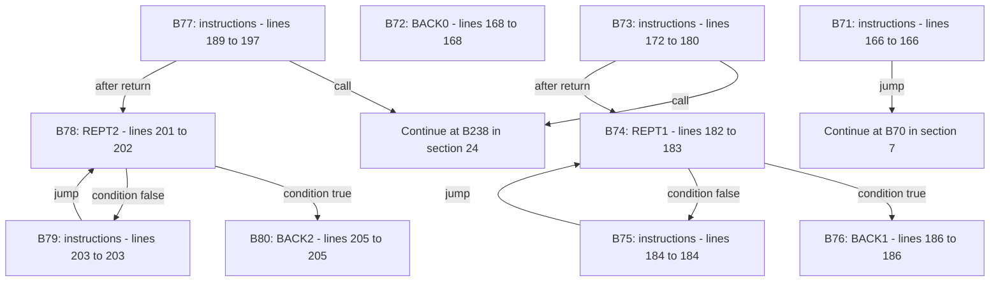

### B71

```asm
SJMP REPT0
```

### B72

Return to the instruction following the active call.

```asm
RET
```

### B73

```asm
clR p2.0
CLR P2.1
SETB P2.2
SETB P2.3
SETB P2.4
SETB P2.5
SETB P2.6
SETB P2.7
Acall DELAY
```

### B74

```asm
MOV A,P2
CJNE A,#00000011B,BACK1
```

### B75

```asm
SJMP REPT1
```

### B76

Return to the instruction following the active call.

```asm
RET
```

### B77

```asm
CLR P2.0
clr p2.1
clr p2.2
SETB P2.3
SETB P2.4
SETB P2.5
SETB P2.6
SETB P2.7
Acall DELAY
```

### B78

```asm
MOV A,P2
CJNE A,#00000111B,BACK2
```

### B79

```asm
SJMP REPT2
```

### B80

Return to the instruction following the active call.

```asm
RET
```

## Section 9

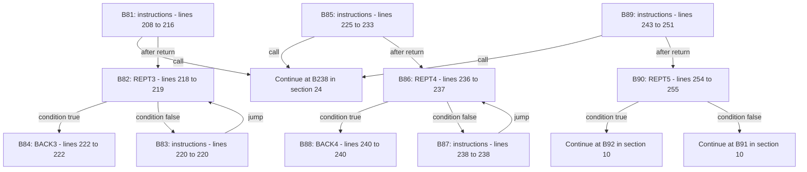

### B81

```asm
CLR P2.0
clr p2.1
clr p2.2
clr p2.3
SETB P2.4
SETB P2.5
SETB P2.6
SETB P2.7
Acall DELAY
```

### B82

```asm
MOV A,P2
CJNE A,#00001111B,BACK3
```

### B83

```asm
SJMP REPT3
```

### B84

Return to the instruction following the active call.

```asm
RET
```

### B85

```asm
CLR P2.0
clr p2.1
clr p2.2
clr p2.3
clr p2.4
SETB P2.5
SETB P2.6
SETB P2.7
Acall DELAY
```

### B86

```asm
MOV A,P2
CJNE A,#00011111B,BACK4
```

### B87

```asm
SJMP REPT4
```

### B88

Return to the instruction following the active call.

```asm
RET
```

### B89

```asm
CLR P2.0
clr p2.1
clr p2.2
clr p2.3
clr p2.4
clr p2.5
SETB P2.6
SETB P2.7
Acall DELAY
```

### B90

```asm
MOV A,P2
CJNE A,#00111111B,BACK5
```

## Section 10

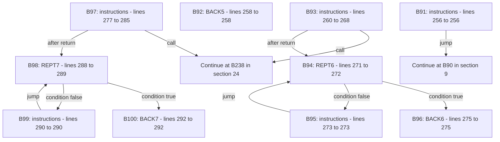

### B91

```asm
SJMP REPT5
```

### B92

Return to the instruction following the active call.

```asm
RET
```

### B93

```asm
CLR P2.0
clr p2.1
clr p2.2
clr p2.3
clr p2.4
clr p2.5
clr p2.6
SETB P2.7
Acall DELAY
```

### B94

```asm
MOV A,P2
CJNE A,#01111111B,BACK6
```

### B95

```asm
SJMP REPT6
```

### B96

Return to the instruction following the active call.

```asm
RET
```

### B97

```asm
CLR P2.0
clr p2.1
clr p2.2
clr p2.3
clr p2.4
clr p2.5
clr p2.6
clr p2.7
Acall DELAY
```

### B98

```asm
MOV A,P2
CJNE A,#11111111B,BACK7
```

### B99

```asm
SJMP REPT7
```

### B100

Return to the instruction following the active call.

```asm
RET
```

## Section 11

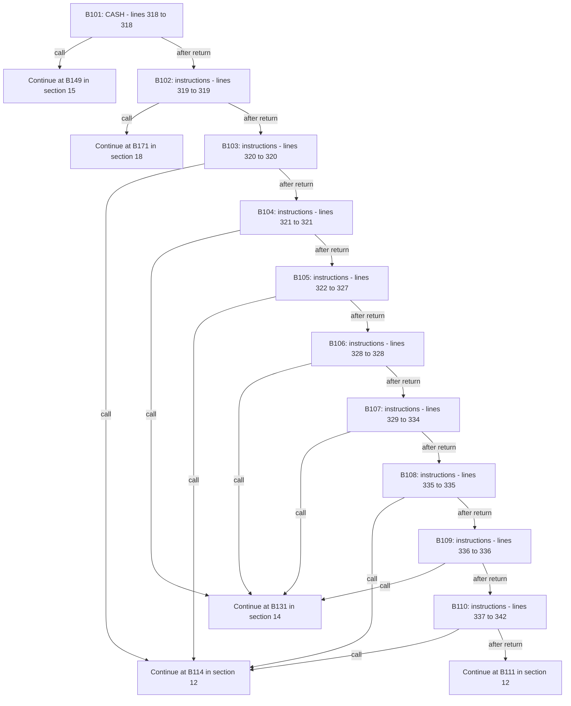

### B101

```asm
ACALL CLEAR
```

### B102

```asm
ACALL ENTERCASH
```

### B103

```asm
ACALL KEYPAD
```

### B104

```asm
ACALL  WCHR
```

### B105

```asm
SUBB A,#30H
MOV B,#10
MUL AB
MOV 60H,A
ACALL KEYPAD
```

### B106

```asm
ACALL WCHR
```

### B107

```asm
SUBB A,#30H
ADD A,60H
MOV 60H,A
MOV A,#'.'
ACALL WCHR
```

### B108

```asm
ACALL KEYPAD
```

### B109

```asm
ACALL  WCHR
```

### B110

```asm
SUBB A,#30H
MOV B,#10
MUL AB
MOV 61H,A
ACALL KEYPAD
```

## Section 12

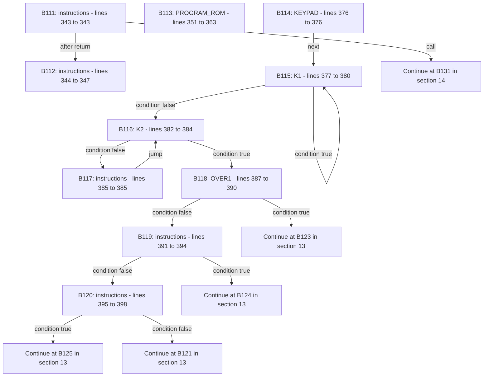

### B111

```asm
ACALL  WCHR
```

### B112

Return to the instruction following the active call.

```asm
SUBB A,#30H
ADD A,61H
MOV 61H,A
RET
```

### B113

Return to the instruction following the active call.

```asm
MOV	DPTR,#INX
CLR	A
MOVC A,@A+DPTR
MOV	30H,A
MOV	DPTR,#INY
CLR	A
MOVC A,@A+DPTR
MOV	31H,A
MOV	DPTR,#TIME_DELAY
CLR	A
MOVC A,@A+DPTR
MOV	32H,A
RET
```

### B114

```asm
MOV P0,#01110000B
```

### B115

```asm
MOV P0,#01110000B
MOV A,P0
ANL A,#01110000B
CJNE A,#01110000B,K1
```

### B116

```asm
MOV A,P0
ANL A,#01110000B
CJNE A,#01110000B,OVER1
```

### B117

```asm
SJMP K2
```

### B118

```asm
MOV P0,#01111110B
MOV A,P0
ANL A,#01110000B
CJNE A,#01110000B,ROW_0
```

### B119

```asm
MOV P0,#01111101B
MOV A,P0
ANL A,#01110000B
CJNE A,#01110000B,ROW_1
```

### B120

```asm
MOV P0,#01111011B
MOV A,P0
ANL A,#01110000B
CJNE A,#01110000B,ROW_2
```

## Section 13

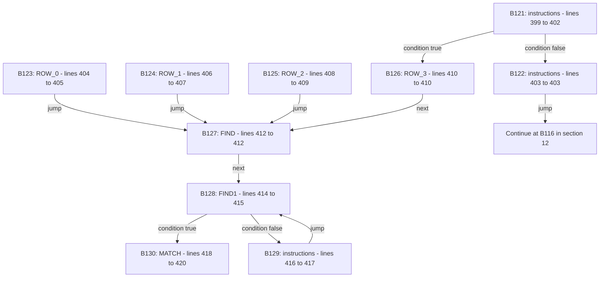

### B121

```asm
MOV P0,#01110111B
MOV A,P0
ANL A,#01110000B
CJNE A,#01110000B,ROW_3
```

### B122

```asm
LJMP K2
```

### B123

```asm
MOV DPTR,#KCODE0
SJMP FIND
```

### B124

```asm
MOV DPTR,#KCODE1
SJMP FIND
```

### B125

```asm
MOV DPTR,#KCODE2
SJMP FIND
```

### B126

```asm
MOV DPTR,#KCODE3
```

### B127

```asm
RLC A
```

### B128

```asm
RLC A
JNC MATCH
```

### B129

```asm
INC DPTR
SJMP FIND1
```

### B130

Return to the instruction following the active call.

```asm
CLR A
MOVC A,@A+DPTR
RET
```

## Section 14

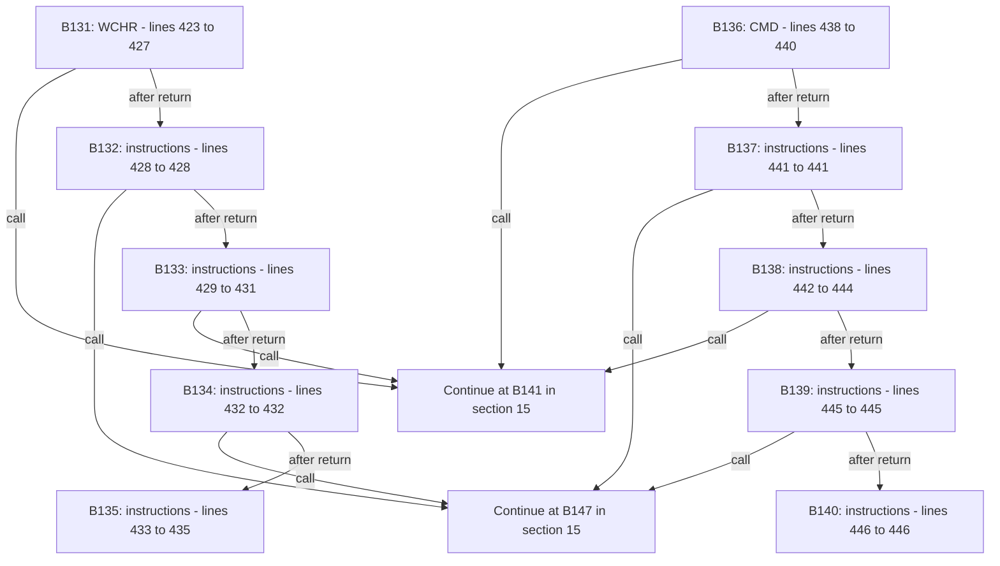

### B131

```asm
PUSH ACC
PUSH B
SETB P1.3
MOV B,A
ACALL COMMON
```

### B132

```asm
ACALL LDELAY
```

### B133

```asm
MOV A,B
SWAP A
ACALL COMMON
```

### B134

```asm
ACALL LDELAY
```

### B135

Return to the instruction following the active call.

```asm
POP B
POP ACC
RET
```

### B136

```asm
CLR P1.3
MOV B,A
ACALL COMMON
```

### B137

```asm
ACALL LDELAY
```

### B138

```asm
MOV A,B
SWAP A
ACALL COMMON
```

### B139

```asm
ACALL LDELAY
```

### B140

Return to the instruction following the active call.

```asm
RET
```

## Section 15

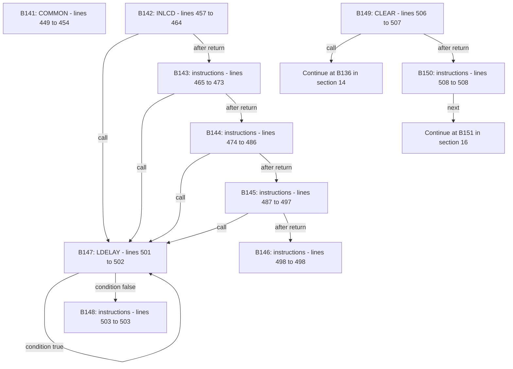

### B141

Return to the instruction following the active call.

```asm
ANL a,#11110000B
ANL P1, #00001111B
ORL P1,A
SETB P1.2
CLR P1.2
RET
```

### B142

```asm
CLR P1.3
CLR P1.7
CLR P1.6
SETB P1.5
CLR P1.4
SETB P1.2
CLR P1.2
ACALL LDELAY
```

### B143

```asm
SETB P1.2
CLR P1.2
SETB P1.7
CLR P1.6
CLR P1.5
CLR P1.4
SETB P1.2
CLR P1.2
ACALL LDELAY
```

### B144

```asm
CLR P1.7
CLR P1.6
CLR P1.5
CLR P1.4
SETB P1.2
CLR P1.2
SETB P1.7
SETB P1.6
SETB P1.5
SETB P1.4
SETB P1.2
CLR P1.2
ACALL LDELAY
```

### B145

```asm
CLR P1.7
CLR P1.6
CLR P1.5
CLR P1.4
SETB P1.2
CLR P1.2
SETB P1.6
SETB P1.5
SETB P1.2
CLR P1.2
ACALL LDELAY
```

### B146

Return to the instruction following the active call.

```asm
RET
```

### B147

```asm
MOV R0, #50
DJNZ R0, $
```

### B148

Return to the instruction following the active call.

```asm
RET
```

### B149

```asm
MOV A,#01H
ACALL CMD
```

### B150

```asm
MOV R7,#14
```

## Section 16

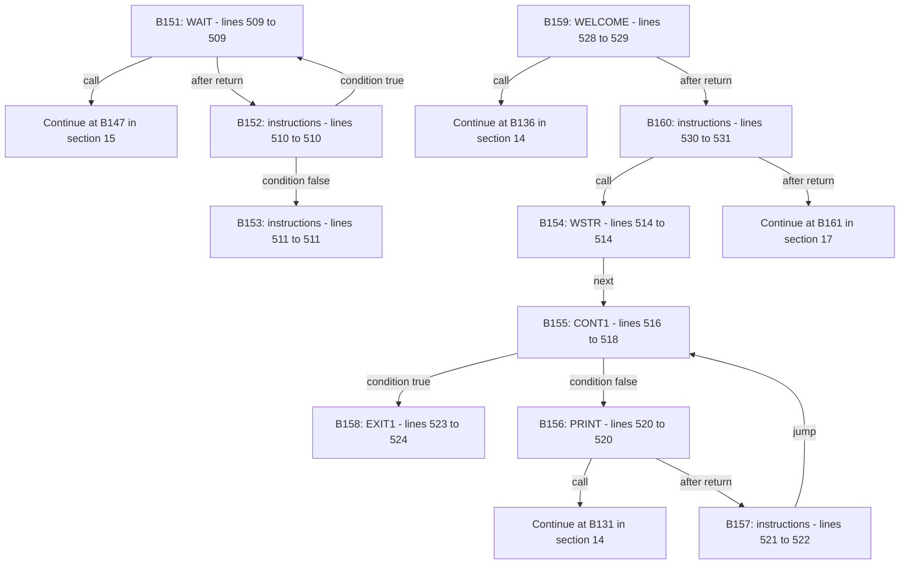

### B151

```asm
ACALL LDELAY
```

### B152

```asm
DJNZ R7,WAIT
```

### B153

Return to the instruction following the active call.

```asm
ret
```

### B154

```asm
PUSH    ACC
```

### B155

```asm
CLR     A
MOVC    A,@A+DPTR
JZ Exit1
```

### B156

```asm
ACALL    WCHR
```

### B157

```asm
INC DPTR
AJMP    CONT1
```

### B158

Return to the instruction following the active call.

```asm
POP     ACC
RET
```

### B159

```asm
mov a, #80H
acall cmd
```

### B160

```asm
mov dptr, #WEL1
acall wstr
```

## Section 17

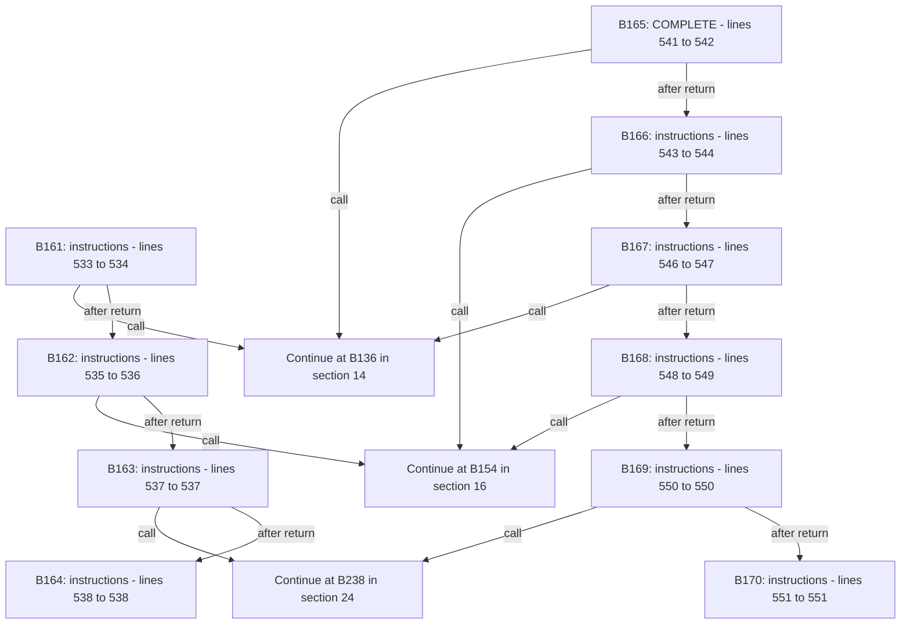

### B161

```asm
mov a,#0c0h
acall cmd
```

### B162

```asm
mov dptr, #WEL2
acall wstr
```

### B163

```asm
acall delay
```

### B164

Return to the instruction following the active call.

```asm
ret
```

### B165

```asm
mov a, #80H
acall cmd
```

### B166

```asm
mov dptr, #comp1
acall wstr
```

### B167

```asm
mov a,#0c0h
acall cmd
```

### B168

```asm
mov dptr, #comp2
acall wstr
```

### B169

```asm
acall delay
```

### B170

Return to the instruction following the active call.

```asm
ret
```

## Section 18

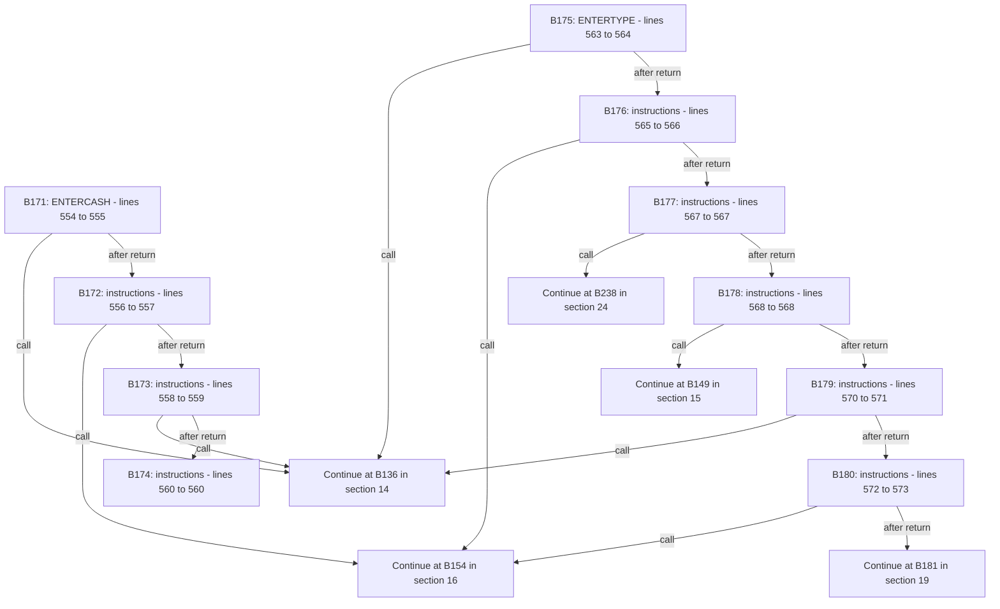

### B171

```asm
mov a, #80H
acall cmd
```

### B172

```asm
mov dptr, #ENT1
acall wstr
```

### B173

```asm
mov a,#0c0h
acall cmd
```

### B174

Return to the instruction following the active call.

```asm
ret
```

### B175

```asm
mov a, #80H
acall cmd
```

### B176

```asm
mov dptr, #T1
acall wstr
```

### B177

```asm
ACALL DELAY
```

### B178

```asm
ACALL CLEAR
```

### B179

```asm
mov a,#80h
acall cmd
```

### B180

```asm
mov dptr, #T2
acall wstr
```

## Section 19

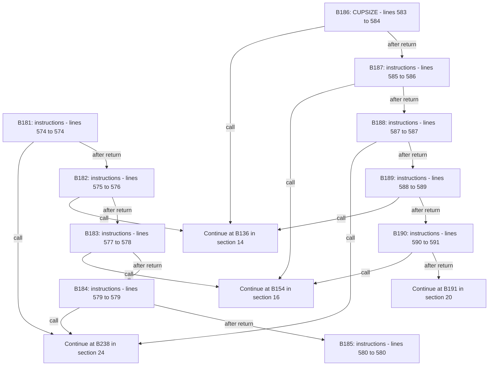

### B181

```asm
acall delay
```

### B182

```asm
mov a,#0C0h
acall cmd
```

### B183

```asm
mov dptr, #T3
acall wstr
```

### B184

```asm
acall delay
```

### B185

Return to the instruction following the active call.

```asm
ret
```

### B186

```asm
mov a,#80h
acall cmd
```

### B187

```asm
mov dptr, #C1
acall wstr
```

### B188

```asm
acall delay
```

### B189

```asm
mov a,#0C0h
acall cmd
```

### B190

```asm
mov dptr, #C2
acall wstr
```

## Section 20

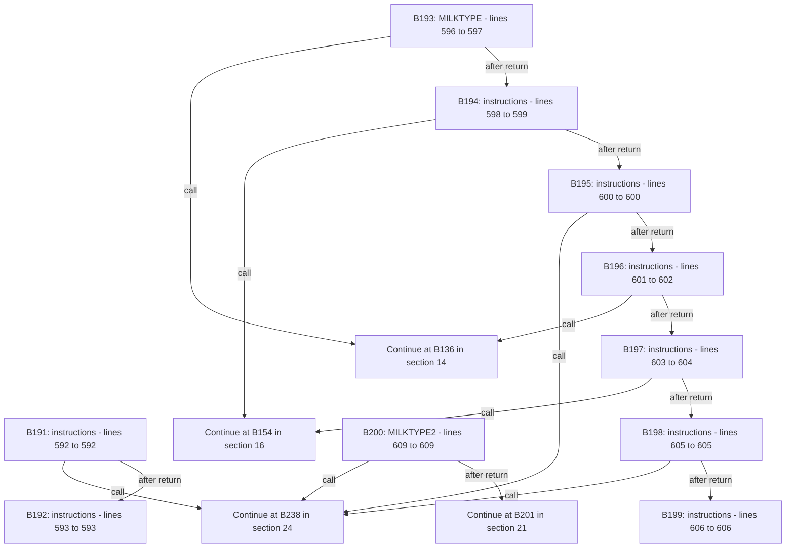

### B191

```asm
acall delay
```

### B192

Return to the instruction following the active call.

```asm
ret
```

### B193

```asm
mov a,#80h
acall cmd
```

### B194

```asm
mov dptr, #M1
acall wstr
```

### B195

```asm
acall delay
```

### B196

```asm
mov a,#0C0h
acall cmd
```

### B197

```asm
mov dptr, #M2
acall wstr
```

### B198

```asm
acall delay
```

### B199

Return to the instruction following the active call.

```asm
ret
```

### B200

```asm
ACALL DELAY
```

## Section 21

```mermaid
flowchart TD
B200["B201: instructions - lines 610 to 610"]
B201["B202: instructions - lines 611 to 612"]
B202["B203: instructions - lines 613 to 614"]
B203["B204: instructions - lines 615 to 615"]
B204["B205: instructions - lines 616 to 617"]
B205["B206: instructions - lines 618 to 619"]
B206["B207: instructions - lines 620 to 621"]
B207["B208: N1 - lines 622 to 622"]
B208["B209: instructions - lines 623 to 624"]
B209["B210: N2 - lines 626 to 626"]
B200 -->|call| B148
B200 -->|after return| B201
B201 -->|call| B135
B201 -->|after return| B202
B202 -->|call| B153
B202 -->|after return| B203
B203 -->|call| B237
B203 -->|after return| B204
B204 -->|call| B135
B204 -->|after return| B205
B205 -->|condition true| B207
B205 -->|condition false| B206
B206 -->|jump| B210
B207 -->|condition true| B209
B207 -->|condition false| B208
B208 -->|jump| B210
B209 -->|next| B210
B148["Continue at B149 in section 15"]
B135["Continue at B136 in section 14"]
B153["Continue at B154 in section 16"]
B237["Continue at B238 in section 24"]
B210["Continue at B211 in section 22"]
```

### B201

```asm
ACALL CLEAR
```

### B202

```asm
mov a,#80h
acall cmd
```

### B203

```asm
mov dptr, #M3
acall wstr
```

### B204

```asm
acall delay
```

### B205

```asm
mov a,#0C0h
acall cmd
```

### B206

```asm
MOV A,70H
CJNE A,#1,N1
```

### B207

```asm
mov dptr, #M4
SJMP N3
```

### B208

```asm
CJNE A,#2,N2
```

### B209

```asm
mov dptr, #M5
SJMP N3
```

### B210

```asm
mov dptr, #M6
```

## Section 22

```mermaid
flowchart TD
B210["B211: N3 - lines 628 to 628"]
B211["B212: instructions - lines 629 to 629"]
B212["B213: instructions - lines 630 to 630"]
B213["B214: SUGARLEVEL - lines 633 to 634"]
B214["B215: instructions - lines 635 to 636"]
B215["B216: instructions - lines 637 to 637"]
B216["B217: instructions - lines 638 to 638"]
B217["B218: instructions - lines 640 to 641"]
B218["B219: instructions - lines 642 to 643"]
B219["B220: instructions - lines 644 to 644"]
B210 -->|call| B153
B210 -->|after return| B211
B211 -->|call| B237
B211 -->|after return| B212
B213 -->|call| B135
B213 -->|after return| B214
B214 -->|call| B153
B214 -->|after return| B215
B215 -->|call| B237
B215 -->|after return| B216
B216 -->|call| B148
B216 -->|after return| B217
B217 -->|call| B135
B217 -->|after return| B218
B218 -->|call| B153
B218 -->|after return| B219
B219 -->|call| B237
B219 -->|after return| B220
B153["Continue at B154 in section 16"]
B237["Continue at B238 in section 24"]
B135["Continue at B136 in section 14"]
B148["Continue at B149 in section 15"]
B220["Continue at B221 in section 23"]
```

### B211

```asm
acall wstr
```

### B212

```asm
acall delay
```

### B213

Return to the instruction following the active call.

```asm
ret
```

### B214

```asm
mov a, #80H
acall cmd
```

### B215

```asm
mov dptr, #S1
acall wstr
```

### B216

```asm
ACALL DELAY
```

### B217

```asm
ACALL CLEAR
```

### B218

```asm
mov a,#80h
acall cmd
```

### B219

```asm
mov dptr, #S2
acall wstr
```

### B220

```asm
acall delay
```

## Section 23

```mermaid
flowchart TD
B220["B221: instructions - lines 645 to 646"]
B221["B222: instructions - lines 647 to 648"]
B222["B223: instructions - lines 649 to 649"]
B223["B224: instructions - lines 650 to 650"]
B224["B225: SUGARLEVEL2 - lines 653 to 653"]
B225["B226: instructions - lines 654 to 654"]
B226["B227: instructions - lines 655 to 656"]
B227["B228: instructions - lines 658 to 659"]
B228["B229: instructions - lines 660 to 661"]
B229["B230: NN1 - lines 662 to 662"]
B220 -->|call| B135
B220 -->|after return| B221
B221 -->|call| B153
B221 -->|after return| B222
B222 -->|call| B237
B222 -->|after return| B223
B224 -->|call| B237
B224 -->|after return| B225
B225 -->|call| B148
B225 -->|after return| B226
B226 -->|call| B135
B226 -->|after return| B227
B227 -->|condition true| B229
B227 -->|condition false| B228
B228 -->|jump| B234
B229 -->|condition true| B231
B229 -->|condition false| B230
B135["Continue at B136 in section 14"]
B153["Continue at B154 in section 16"]
B237["Continue at B238 in section 24"]
B148["Continue at B149 in section 15"]
B234["Continue at B235 in section 24"]
B231["Continue at B232 in section 24"]
B230["Continue at B231 in section 24"]
```

### B221

```asm
mov a,#0C0h
acall cmd
```

### B222

```asm
mov dptr, #S3
acall wstr
```

### B223

```asm
acall delay
```

### B224

Return to the instruction following the active call.

```asm
ret
```

### B225

```asm
ACALL DELAY
```

### B226

```asm
ACALL CLEAR
```

### B227

```asm
mov a,#80h
acall cmd
```

### B228

```asm
MOV A,71H
CJNE A,#1,NN1
```

### B229

```asm
mov dptr, #S4
SJMP NN4
```

### B230

```asm
CJNE A,#2,NN2
```

## Section 24

```mermaid
flowchart TD
B230["B231: instructions - lines 663 to 664"]
B231["B232: NN2 - lines 665 to 665"]
B232["B233: instructions - lines 666 to 666"]
B233["B234: NN3 - lines 667 to 667"]
B234["B235: NN4 - lines 669 to 669"]
B235["B236: instructions - lines 670 to 670"]
B236["B237: instructions - lines 671 to 671"]
B237["B238: DELAY - lines 675 to 678"]
B238["B239: L1 - lines 679 to 679"]
B239["B240: L3 - lines 680 to 680"]
B230 -->|jump| B234
B231 -->|condition true| B233
B231 -->|condition false| B232
B232 -->|next| B233
B233 -->|next| B234
B234 -->|call| B153
B234 -->|after return| B235
B235 -->|call| B237
B235 -->|after return| B236
B237 -->|next| B238
B238 -->|next| B239
B239 -->|condition true| B239
B239 -->|condition false| B240
B153["Continue at B154 in section 16"]
B240["Continue at B241 in section 25"]
```

### B231

```asm
mov dptr, #S5
SJMP NN4
```

### B232

```asm
CJNE A,#3,NN3
```

### B233

```asm
mov dptr, #S6
```

### B234

```asm
mov dptr, #S7
```

### B235

```asm
acall wstr
```

### B236

```asm
acall delay
```

### B237

Return to the instruction following the active call.

```asm
ret
```

### B238

```asm
PUSH 0
PUSH 1
PUSH 2
MOV	R0,#4
```

### B239

```asm
MOV	R1,#0
```

### B240

```asm
DJNZ R2,L3
```

## Section 25

```mermaid
flowchart TD
B240["B241: instructions - lines 681 to 681"]
B241["B242: instructions - lines 682 to 685"]
B240 -->|condition true| B238
B240 -->|condition false| B241
B238["Continue at B239 in section 24"]
```

### B241

```asm
DJNZ R0,L1
```

### B242

Return to the instruction following the active call.

```asm
POP 2
POP 1
POP 0
RET
```
