# Program Control Flow

[Back to project](README.md)

Control-flow blocks are indexed by source line. Calls resume at the instruction following the call if the subroutine returns normally.

## Entry locations

- `ORG	0` begins at B1.

## Navigation

[Section 1](#section-1) · [Section 2](#section-2) · [Section 3](#section-3) · [Section 4](#section-4) · [Section 5](#section-5) · [Section 6](#section-6) · [Section 7](#section-7) · [Section 8](#section-8) · [Section 9](#section-9) · [Section 10](#section-10) · [Section 11](#section-11) · [Section 12](#section-12) · [Section 13](#section-13) · [Section 14](#section-14) · [Section 15](#section-15) · [Section 16](#section-16) · [Section 17](#section-17) · [Section 18](#section-18) · [Section 19](#section-19) · [Section 20](#section-20) · [Section 21](#section-21) · [Section 22](#section-22) · [Section 23](#section-23) · [Section 24](#section-24) · [Section 25](#section-25) · [Section 26](#section-26) · [Section 27](#section-27) · [Section 28](#section-28) · [Section 29](#section-29)

## Section 1

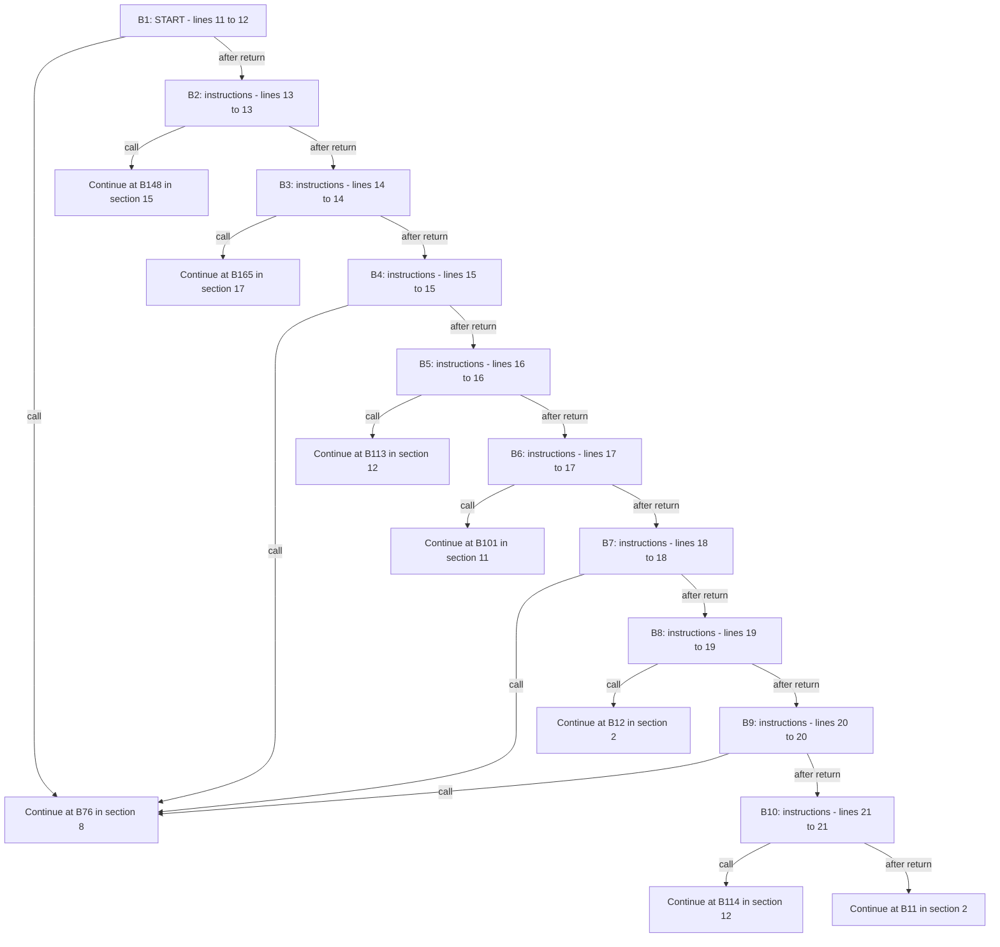

### B1

```asm
MOV R3,#-1
acall flash
```

### B2

```asm
ACALL INLCD
```

### B3

```asm
ACALL WELCOME
```

### B4

```asm
acall flash
```

### B5

```asm
ACALL PROGRAM_ROM
```

### B6

```asm
ACALL CASH
```

### B7

```asm
acall flash
```

### B8

```asm
ACALL PRICE
```

### B9

```asm
acall flash
```

### B10

```asm
ACALL DISPLAY
```

## Section 2

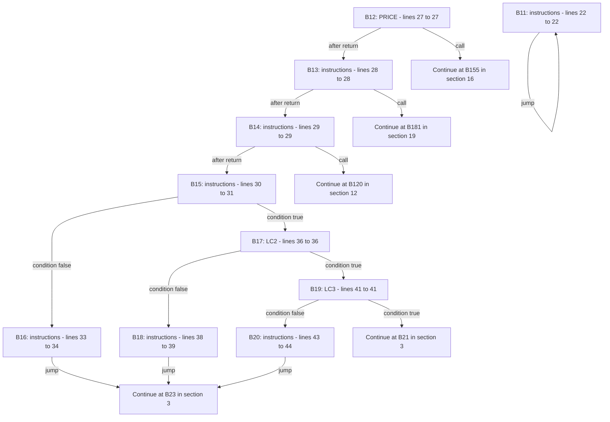

### B11

```asm
SJMP $
```

### B12

```asm
ACALL CLEAR
```

### B13

```asm
ACALL ENTERTYPE
```

### B14

```asm
ACALL KEYPAD
```

### B15

```asm
SUBB A,#30H
CJNE A,#1H,LC2
```

### B16

```asm
MOV	33H,#2
SJMP LCR
```

### B17

```asm
CJNE A,#2H,LC3
```

### B18

```asm
MOV	33H,#3
SJMP LCR
```

### B19

```asm
CJNE A,#3H,LC4
```

### B20

```asm
MOV	33H,#3
SJMP LCR
```

## Section 3

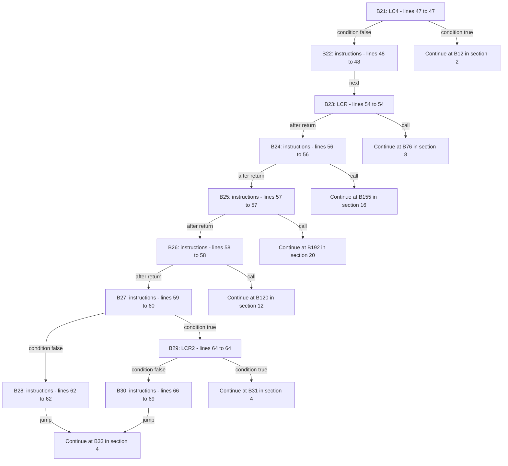

### B21

```asm
CJNE A,#4H,PRICE
```

### B22

```asm
MOV	33H,#4
```

### B23

```asm
acall flash
```

### B24

```asm
ACALL CLEAR
```

### B25

```asm
ACALL CUPSIZE
```

### B26

```asm
ACALL KEYPAD
```

### B27

```asm
SUBB A,#30H
CJNE A,#1,LCR2
```

### B28

```asm
SJMP LMT
```

### B29

```asm
CJNE A,#2,LCR3
```

### B30

```asm
MOV	A,33H
ADD	A,#1
MOV	33H,A
SJMP LMT
```

## Section 4

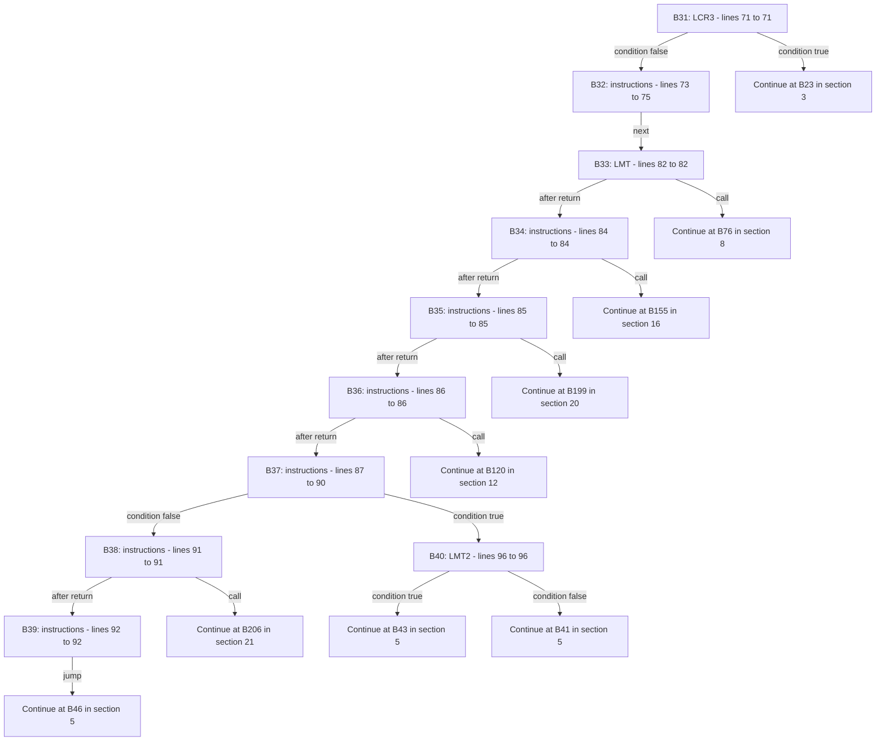

### B31

```asm
CJNE A,#3,LCR
```

### B32

```asm
MOV	A,33H
ADD	A,#2
MOV	33H,A
```

### B33

```asm
acall flash
```

### B34

```asm
ACALL CLEAR
```

### B35

```asm
ACALL MILKTYPE
```

### B36

```asm
ACALL KEYPAD
```

### B37

```asm
SUBB A,#30H
MOV 70H,A
CJNE A,#1H,LMT2
```

### B38

```asm
ACALL MILKTYPE2
```

### B39

```asm
Sjmp LSL
```

### B40

```asm
CJNE A,#2,LMT3
```

## Section 5

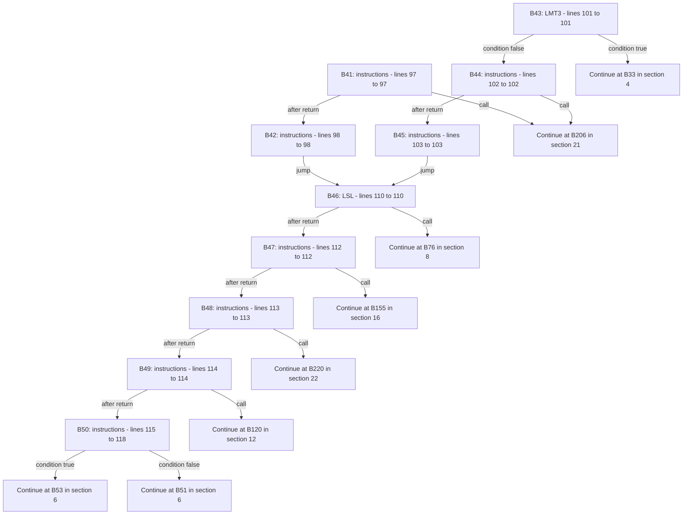

### B41

```asm
ACALL MILKTYPE2
```

### B42

```asm
Sjmp LSL
```

### B43

```asm
CJNE A,#3,LMT
```

### B44

```asm
ACALL MILKTYPE2
```

### B45

```asm
Sjmp LSL
```

### B46

```asm
acall flash
```

### B47

```asm
ACALL CLEAR
```

### B48

```asm
ACALL SUGARLEVEL
```

### B49

```asm
ACALL KEYPAD
```

### B50

```asm
SUBB A,#30H
MOV 71H,A
CJNE A,#1,LSL2
```

## Section 6

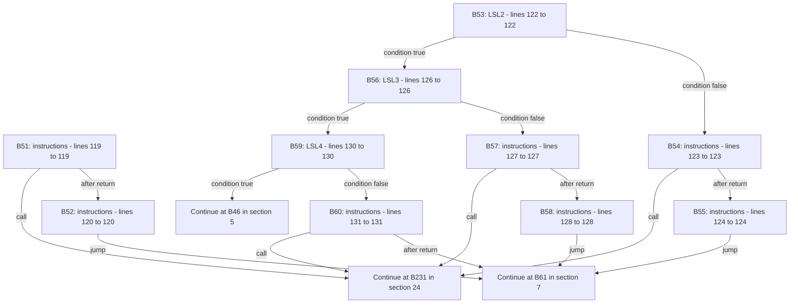

### B51

```asm
ACALL SUGARLEVEL2
```

### B52

```asm
SJMP PRE
```

### B53

```asm
CJNE A,#2,LSL3
```

### B54

```asm
ACALL SUGARLEVEL2
```

### B55

```asm
SJMP PRE
```

### B56

```asm
CJNE A,#3,LSL4
```

### B57

```asm
ACALL SUGARLEVEL2
```

### B58

```asm
SJMP PRE
```

### B59

```asm
CJNE A,#4,LSL
```

### B60

```asm
ACALL SUGARLEVEL2
```

## Section 7

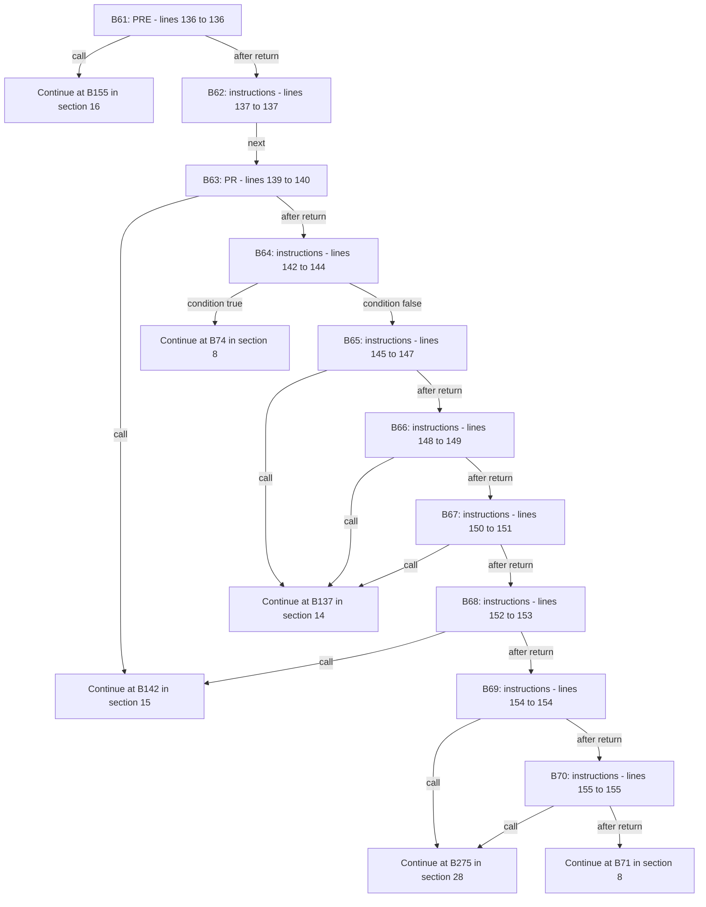

### B61

```asm
ACALL CLEAR
```

### B62

```asm
MOV R6,#10
```

### B63

```asm
MOV A,#80H
ACALL CMD
```

### B64

```asm
MOV A,#10
SUBB A,R6
JZ HERE
```

### B65

```asm
MOV R5,A
ADD A,#30H
ACALL WCHR
```

### B66

```asm
MOV A,#'0'
ACALL WCHR
```

### B67

```asm
MOV A,#'%'
ACALL WCHR
```

### B68

```asm
MOV A,#0C0H
ACALL CMD
```

### B69

```asm
ACALL DELAY
```

### B70

```asm
ACALL DELAY
```

## Section 8

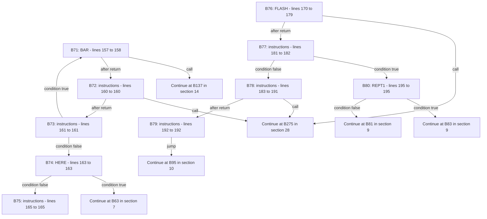

### B71

```asm
MOV A,#'.'
ACALL WCHR
```

### B72

```asm
ACALL DELAY
```

### B73

```asm
DJNZ R5,BAR
```

### B74

```asm
DJNZ R6,PR
```

### B75

Return to the instruction following the active call.

```asm
RET
```

### B76

```asm
INC R3
CLR P2.0
SETB P2.1
SETB P2.2
SETB P2.3
SETB P2.4
SETB P2.5
SETB P2.6
SETB P2.7
Acall DELAY
```

### B77

```asm
MOV A,R3
CJNE A,#1,REPT1
```

### B78

```asm
clR p2.0
CLR P2.1
SETB P2.2
SETB P2.3
SETB P2.4
SETB P2.5
SETB P2.6
SETB P2.7
Acall DELAY
```

### B79

```asm
LJMP BACK7
```

### B80

```asm
CJNE A,#2,REPT2
```

## Section 9

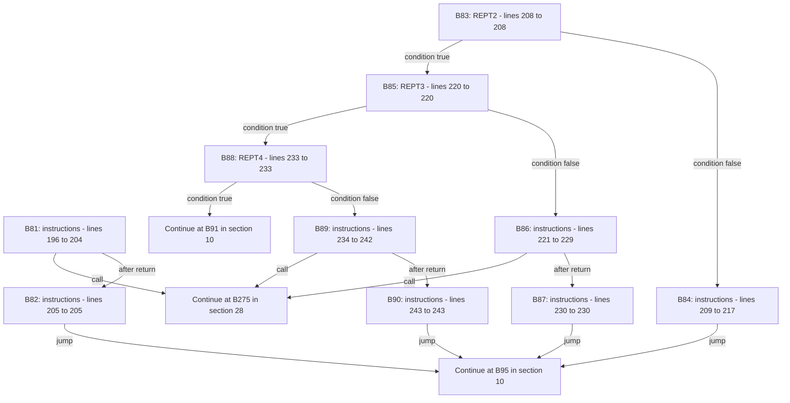

### B81

```asm
CLR P2.0
clr p2.1
clr p2.2
SETB P2.3
SETB P2.4
SETB P2.5
SETB P2.6
SETB P2.7
Acall DELAY
```

### B82

```asm
LJMP BACK7
```

### B83

```asm
CJNE A,#3,REPT3
```

### B84

```asm
CLR P2.0
clr p2.1
clr p2.2
clr p2.3
SETB P2.4
SETB P2.5
SETB P2.6
SETB P2.7
SJMP BACK7
```

### B85

```asm
CJNE A,#4,REPT4
```

### B86

```asm
CLR P2.0
clr p2.1
clr p2.2
clr p2.3
clr p2.4
SETB P2.5
SETB P2.6
SETB P2.7
Acall DELAY
```

### B87

```asm
LJMP BACK7
```

### B88

```asm
CJNE A,#5,REPT5
```

### B89

```asm
CLR P2.0
clr p2.1
clr p2.2
clr p2.3
clr p2.4
clr p2.5
SETB P2.6
SETB P2.7
Acall DELAY
```

### B90

```asm
LJMP BACK7
```

## Section 10

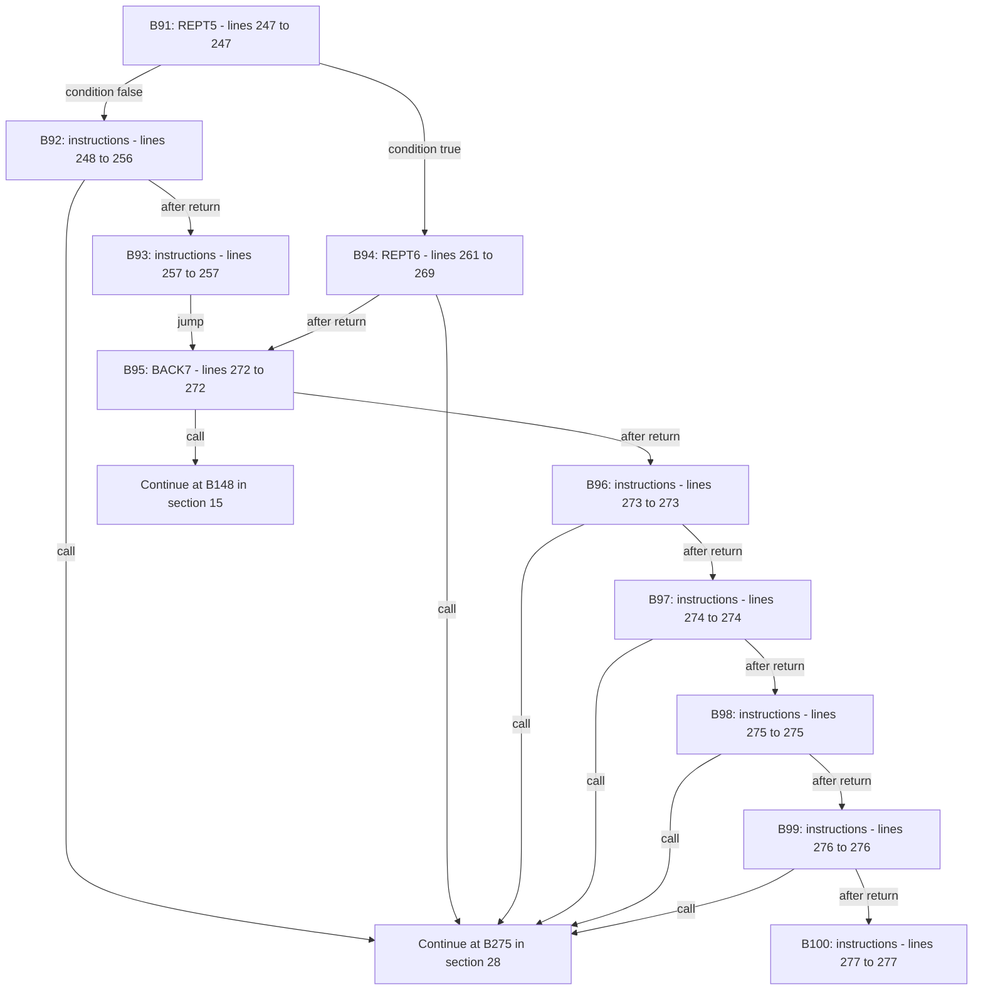

### B91

```asm
CJNE A,#6,REPT6
```

### B92

```asm
CLR P2.0
clr p2.1
clr p2.2
clr p2.3
clr p2.4
clr p2.5
CLR P2.6
SETB P2.7
Acall DELAY
```

### B93

```asm
LJMP BACK7
```

### B94

```asm
CLR P2.0
clr p2.1
clr p2.2
clr p2.3
clr p2.4
clr p2.5
clr p2.6
clr p2.7
Acall DELAY
```

### B95

```asm
ACALL INLCD
```

### B96

```asm
ACALL DELAY
```

### B97

```asm
ACALL DELAY
```

### B98

```asm
ACALL DELAY
```

### B99

```asm
ACALL DELAY
```

### B100

Return to the instruction following the active call.

```asm
RET
```

## Section 11

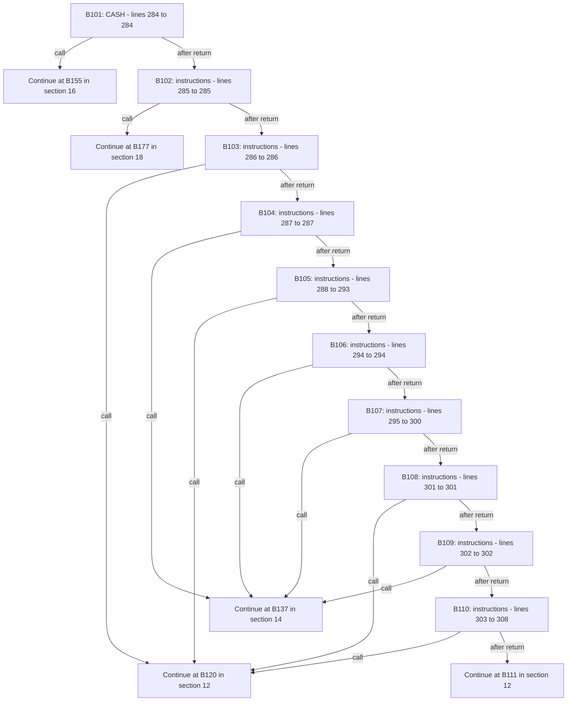

### B101

```asm
ACALL CLEAR
```

### B102

```asm
ACALL ENTERCASH
```

### B103

```asm
ACALL KEYPAD
```

### B104

```asm
ACALL  WCHR
```

### B105

```asm
SUBB A,#30H
MOV B,#10
MUL AB
MOV 60H,A
ACALL KEYPAD
```

### B106

```asm
ACALL WCHR
```

### B107

```asm
SUBB A,#30H
ADD A,60H
MOV 60H,A
MOV A,#'.'
ACALL WCHR
```

### B108

```asm
ACALL KEYPAD
```

### B109

```asm
ACALL  WCHR
```

### B110

```asm
SUBB A,#30H
MOV B,#10
MUL AB
MOV 61H,A
ACALL KEYPAD
```

## Section 12

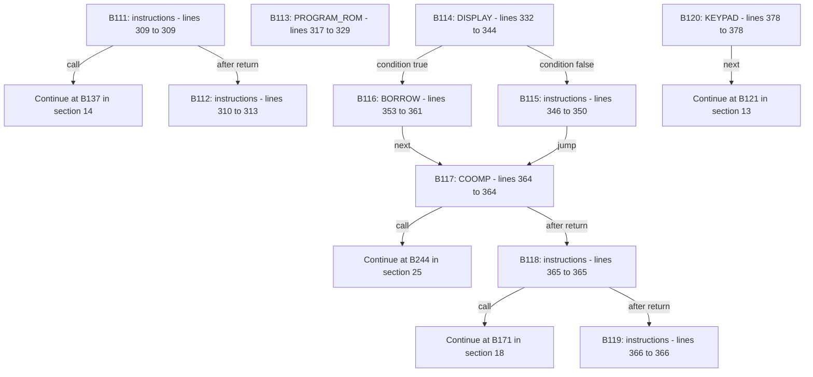

### B111

```asm
ACALL  WCHR
```

### B112

Return to the instruction following the active call.

```asm
SUBB A,#30H
ADD A,61H
MOV 61H,A
RET
```

### B113

Return to the instruction following the active call.

```asm
MOV	DPTR,#INX
CLR	A
MOVC A,@A+DPTR
MOV	30H,A
MOV	DPTR,#INY
CLR	A
MOVC A,@A+DPTR
MOV	31H,A
MOV	DPTR,#TIME_DELAY
CLR	A
MOVC A,@A+DPTR
MOV	32H,A
RET
```

### B114

```asm
MOV A,33H
MOV B,#25
MUL AB
MOV 55H,A
MOV B,#100
DIV AB
MOV 50H,A
MOV 51H,B
MOV A,61H
MOV B,51H
DIV AB
JZ BORROW
```

### B115

```asm
MOV A,61H
SUBB A,51H
MOV  66H,A
MOV 65H,60H
SJMP COOMP
```

### B116

```asm
MOV A,60H
SUBB A,#1
SUBB A,50h
MOV 65H,A
MOV A,61H
ADD A,#100
SUBB A,51H
MOV  66H,A
```

### B117

```asm
ACALL SHOWPRICE
```

### B118

```asm
ACALL COMPLETE
```

### B119

Return to the instruction following the active call.

```asm
RET
```

### B120

```asm
MOV P0,#01110000B
```

## Section 13

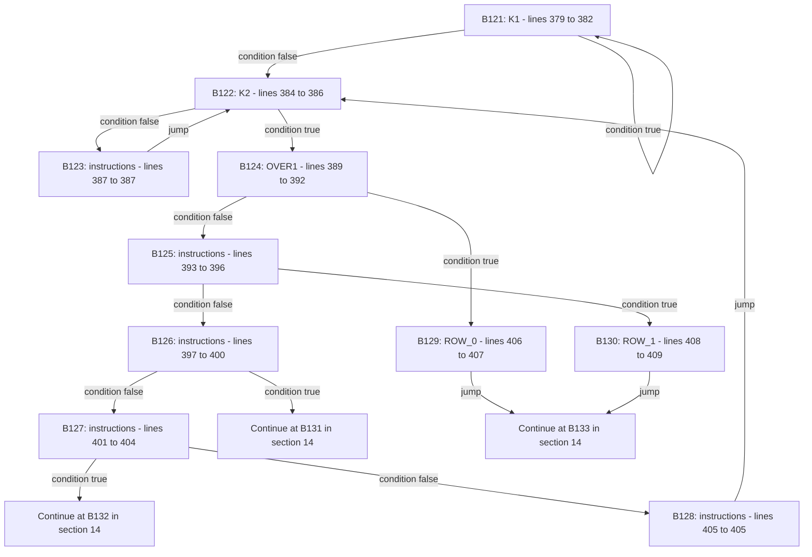

### B121

```asm
MOV P0,#01110000B
MOV A,P0
ANL A,#01110000B
CJNE A,#01110000B,K1
```

### B122

```asm
MOV A,P0
ANL A,#01110000B
CJNE A,#01110000B,OVER1
```

### B123

```asm
SJMP K2
```

### B124

```asm
MOV P0,#01111110B
MOV A,P0
ANL A,#01110000B
CJNE A,#01110000B,ROW_0
```

### B125

```asm
MOV P0,#01111101B
MOV A,P0
ANL A,#01110000B
CJNE A,#01110000B,ROW_1
```

### B126

```asm
MOV P0,#01111011B
MOV A,P0
ANL A,#01110000B
CJNE A,#01110000B,ROW_2
```

### B127

```asm
MOV P0,#01110111B
MOV A,P0
ANL A,#01110000B
CJNE A,#01110000B,ROW_3
```

### B128

```asm
LJMP K2
```

### B129

```asm
MOV DPTR,#KCODE0
SJMP FIND
```

### B130

```asm
MOV DPTR,#KCODE1
SJMP FIND
```

## Section 14

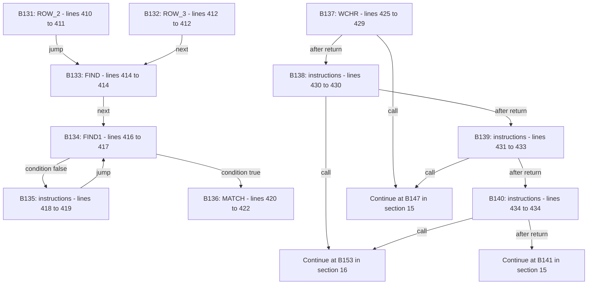

### B131

```asm
MOV DPTR,#KCODE2
SJMP FIND
```

### B132

```asm
MOV DPTR,#KCODE3
```

### B133

```asm
RLC A
```

### B134

```asm
RLC A
JNC MATCH
```

### B135

```asm
INC DPTR
SJMP FIND1
```

### B136

Return to the instruction following the active call.

```asm
CLR A
MOVC A,@A+DPTR
RET
```

### B137

```asm
PUSH ACC
PUSH B
SETB P1.3
MOV B,A
ACALL COMMON
```

### B138

```asm
ACALL LDELAY
```

### B139

```asm
MOV A,B
SWAP A
ACALL COMMON
```

### B140

```asm
ACALL LDELAY
```

## Section 15

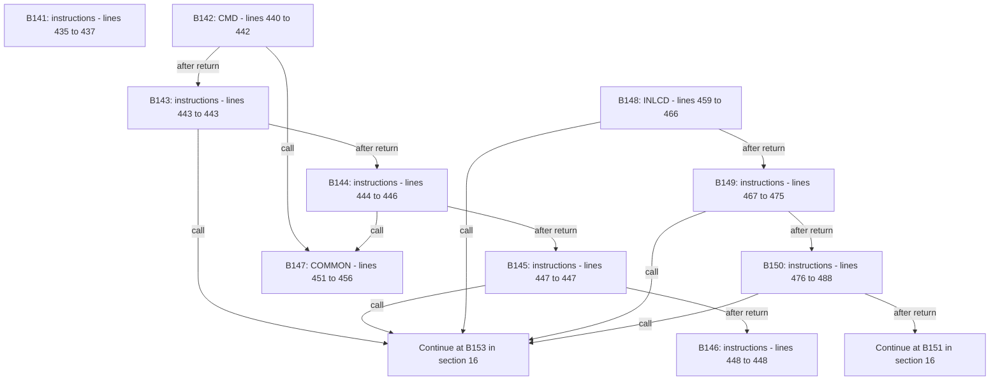

### B141

Return to the instruction following the active call.

```asm
POP B
POP ACC
RET
```

### B142

```asm
CLR P1.3
MOV B,A
ACALL COMMON
```

### B143

```asm
ACALL LDELAY
```

### B144

```asm
MOV A,B
SWAP A
ACALL COMMON
```

### B145

```asm
ACALL LDELAY
```

### B146

Return to the instruction following the active call.

```asm
RET
```

### B147

Return to the instruction following the active call.

```asm
ANL a,#11110000B
ANL P1, #00001111B
ORL P1,A
SETB P1.2
CLR P1.2
RET
```

### B148

```asm
CLR P1.3
CLR P1.7
CLR P1.6
SETB P1.5
CLR P1.4
SETB P1.2
CLR P1.2
ACALL LDELAY
```

### B149

```asm
SETB P1.2
CLR P1.2
SETB P1.7
CLR P1.6
CLR P1.5
CLR P1.4
SETB P1.2
CLR P1.2
ACALL LDELAY
```

### B150

```asm
CLR P1.7
CLR P1.6
CLR P1.5
CLR P1.4
SETB P1.2
CLR P1.2
SETB P1.7
SETB P1.6
SETB P1.5
SETB P1.4
SETB P1.2
CLR P1.2
ACALL LDELAY
```

## Section 16

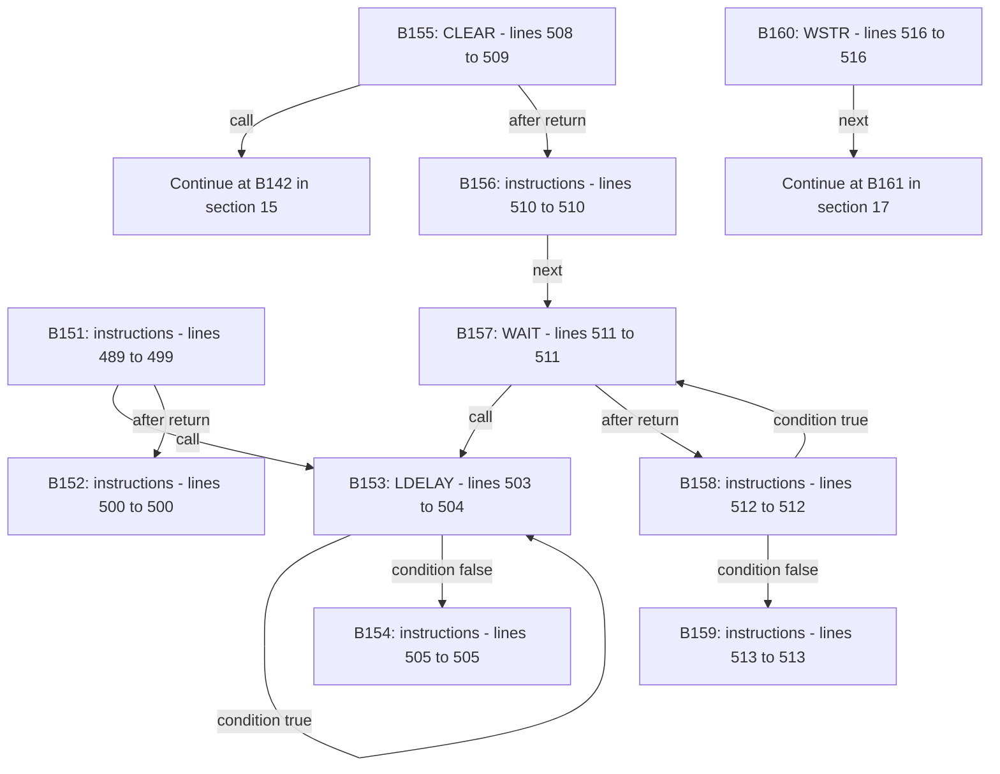

### B151

```asm
CLR P1.7
CLR P1.6
CLR P1.5
CLR P1.4
SETB P1.2
CLR P1.2
SETB P1.6
SETB P1.5
SETB P1.2
CLR P1.2
ACALL LDELAY
```

### B152

Return to the instruction following the active call.

```asm
RET
```

### B153

```asm
MOV R0, #50
DJNZ R0, $
```

### B154

Return to the instruction following the active call.

```asm
RET
```

### B155

```asm
MOV A,#01H
ACALL CMD
```

### B156

```asm
MOV R7,#14
```

### B157

```asm
ACALL LDELAY
```

### B158

```asm
DJNZ R7,WAIT
```

### B159

Return to the instruction following the active call.

```asm
ret
```

### B160

```asm
PUSH    ACC
```

## Section 17

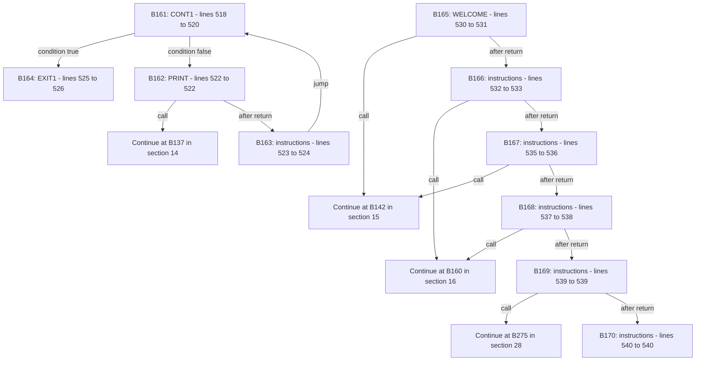

### B161

```asm
CLR     A
MOVC    A,@A+DPTR
JZ Exit1
```

### B162

```asm
ACALL    WCHR
```

### B163

```asm
INC DPTR
AJMP    CONT1
```

### B164

Return to the instruction following the active call.

```asm
POP     ACC
RET
```

### B165

```asm
mov a, #80H
acall cmd
```

### B166

```asm
mov dptr, #WEL1
acall wstr
```

### B167

```asm
mov a,#0c0h
acall cmd
```

### B168

```asm
mov dptr, #WEL2
acall wstr
```

### B169

```asm
acall delay
```

### B170

Return to the instruction following the active call.

```asm
ret
```

## Section 18

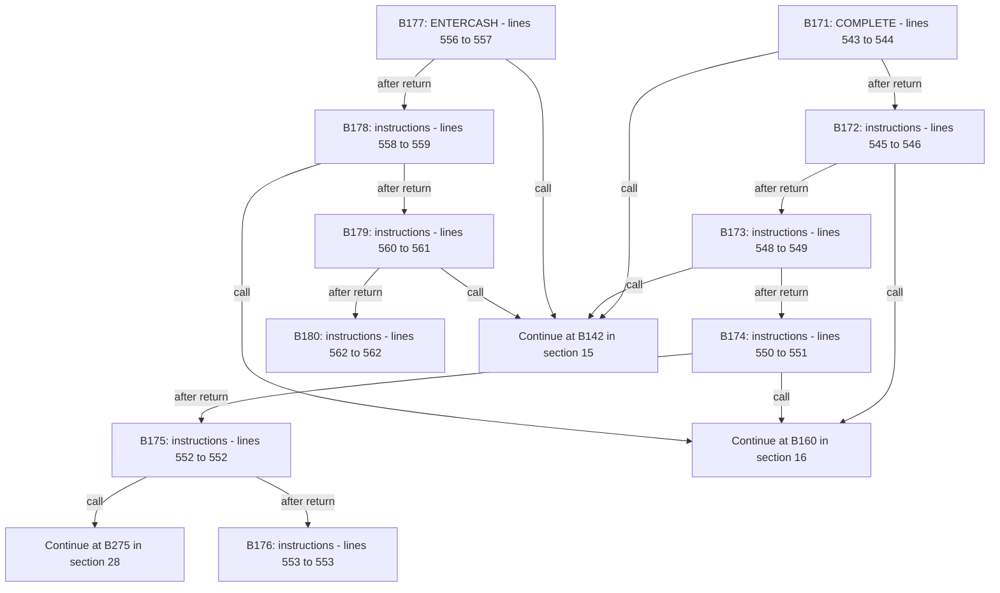

### B171

```asm
mov a, #80H
acall cmd
```

### B172

```asm
mov dptr, #comp1
acall wstr
```

### B173

```asm
mov a,#0c0h
acall cmd
```

### B174

```asm
mov dptr, #comp2
acall wstr
```

### B175

```asm
acall delay
```

### B176

Return to the instruction following the active call.

```asm
ret
```

### B177

```asm
mov a, #80H
acall cmd
```

### B178

```asm
mov dptr, #ENT1
acall wstr
```

### B179

```asm
mov a,#0c0h
acall cmd
```

### B180

Return to the instruction following the active call.

```asm
ret
```

## Section 19

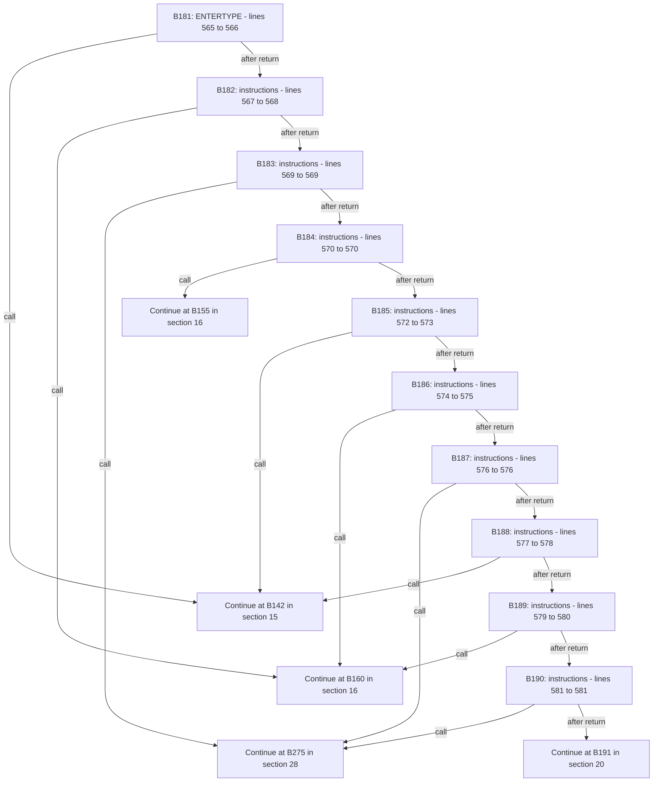

### B181

```asm
mov a, #80H
acall cmd
```

### B182

```asm
mov dptr, #Type1
acall wstr
```

### B183

```asm
ACALL DELAY
```

### B184

```asm
ACALL CLEAR
```

### B185

```asm
mov a,#80h
acall cmd
```

### B186

```asm
mov dptr, #Type2
acall wstr
```

### B187

```asm
acall delay
```

### B188

```asm
mov a,#0C0h
acall cmd
```

### B189

```asm
mov dptr, #Type3
acall wstr
```

### B190

```asm
acall delay
```

## Section 20

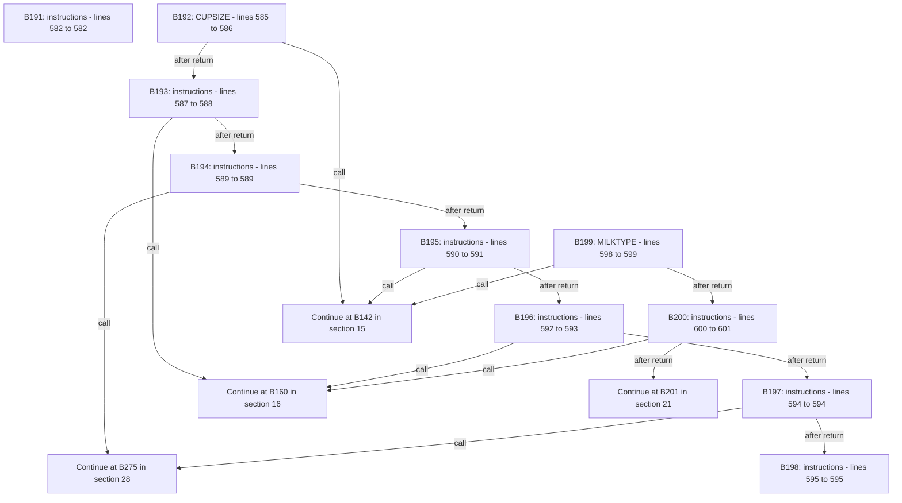

### B191

Return to the instruction following the active call.

```asm
ret
```

### B192

```asm
mov a,#80h
acall cmd
```

### B193

```asm
mov dptr, #Cup1
acall wstr
```

### B194

```asm
acall delay
```

### B195

```asm
mov a,#0C0h
acall cmd
```

### B196

```asm
mov dptr, #Cup2
acall wstr
```

### B197

```asm
acall delay
```

### B198

Return to the instruction following the active call.

```asm
ret
```

### B199

```asm
mov a,#80h
acall cmd
```

### B200

```asm
mov dptr, #Milk1
acall wstr
```

## Section 21

```mermaid
flowchart TD
B200["B201: instructions - lines 602 to 602"]
B201["B202: instructions - lines 603 to 604"]
B202["B203: instructions - lines 605 to 606"]
B203["B204: instructions - lines 607 to 607"]
B204["B205: instructions - lines 608 to 608"]
B205["B206: MILKTYPE2 - lines 611 to 611"]
B206["B207: instructions - lines 612 to 612"]
B207["B208: instructions - lines 613 to 614"]
B208["B209: instructions - lines 615 to 616"]
B209["B210: instructions - lines 617 to 617"]
B200 -->|call| B274
B200 -->|after return| B201
B201 -->|call| B141
B201 -->|after return| B202
B202 -->|call| B159
B202 -->|after return| B203
B203 -->|call| B274
B203 -->|after return| B204
B205 -->|call| B274
B205 -->|after return| B206
B206 -->|call| B154
B206 -->|after return| B207
B207 -->|call| B141
B207 -->|after return| B208
B208 -->|call| B159
B208 -->|after return| B209
B209 -->|call| B274
B209 -->|after return| B210
B274["Continue at B275 in section 28"]
B141["Continue at B142 in section 15"]
B159["Continue at B160 in section 16"]
B154["Continue at B155 in section 16"]
B210["Continue at B211 in section 22"]
```

### B201

```asm
acall delay
```

### B202

```asm
mov a,#0C0h
acall cmd
```

### B203

```asm
mov dptr, #Milk2
acall wstr
```

### B204

```asm
acall delay
```

### B205

Return to the instruction following the active call.

```asm
ret
```

### B206

```asm
ACALL DELAY
```

### B207

```asm
ACALL CLEAR
```

### B208

```asm
mov a,#80h
acall cmd
```

### B209

```asm
mov dptr, #Milk3
acall wstr
```

### B210

```asm
acall delay
```

## Section 22

```mermaid
flowchart TD
B210["B211: instructions - lines 618 to 619"]
B211["B212: instructions - lines 620 to 621"]
B212["B213: instructions - lines 622 to 623"]
B213["B214: N1 - lines 624 to 624"]
B214["B215: instructions - lines 625 to 626"]
B215["B216: N2 - lines 628 to 628"]
B216["B217: N3 - lines 630 to 630"]
B217["B218: instructions - lines 631 to 631"]
B218["B219: instructions - lines 632 to 632"]
B219["B220: SUGARLEVEL - lines 635 to 636"]
B210 -->|call| B141
B210 -->|after return| B211
B211 -->|condition true| B213
B211 -->|condition false| B212
B212 -->|jump| B216
B213 -->|condition true| B215
B213 -->|condition false| B214
B214 -->|jump| B216
B215 -->|next| B216
B216 -->|call| B159
B216 -->|after return| B217
B217 -->|call| B274
B217 -->|after return| B218
B219 -->|call| B141
B219 -->|after return| B220
B141["Continue at B142 in section 15"]
B159["Continue at B160 in section 16"]
B274["Continue at B275 in section 28"]
B220["Continue at B221 in section 23"]
```

### B211

```asm
mov a,#0C0h
acall cmd
```

### B212

```asm
MOV A,70H
CJNE A,#1,N1
```

### B213

```asm
mov dptr, #Milk4
SJMP N3
```

### B214

```asm
CJNE A,#2,N2
```

### B215

```asm
mov dptr, #Milk5
SJMP N3
```

### B216

```asm
mov dptr, #Milk6
```

### B217

```asm
acall wstr
```

### B218

```asm
acall delay
```

### B219

Return to the instruction following the active call.

```asm
ret
```

### B220

```asm
mov a, #80H
acall cmd
```

## Section 23

```mermaid
flowchart TD
B220["B221: instructions - lines 637 to 638"]
B221["B222: instructions - lines 639 to 639"]
B222["B223: instructions - lines 640 to 640"]
B223["B224: instructions - lines 642 to 643"]
B224["B225: instructions - lines 644 to 645"]
B225["B226: instructions - lines 646 to 646"]
B226["B227: instructions - lines 647 to 648"]
B227["B228: instructions - lines 649 to 650"]
B228["B229: instructions - lines 651 to 651"]
B229["B230: instructions - lines 652 to 652"]
B220 -->|call| B159
B220 -->|after return| B221
B221 -->|call| B274
B221 -->|after return| B222
B222 -->|call| B154
B222 -->|after return| B223
B223 -->|call| B141
B223 -->|after return| B224
B224 -->|call| B159
B224 -->|after return| B225
B225 -->|call| B274
B225 -->|after return| B226
B226 -->|call| B141
B226 -->|after return| B227
B227 -->|call| B159
B227 -->|after return| B228
B228 -->|call| B274
B228 -->|after return| B229
B159["Continue at B160 in section 16"]
B274["Continue at B275 in section 28"]
B154["Continue at B155 in section 16"]
B141["Continue at B142 in section 15"]
```

### B221

```asm
mov dptr, #Sugar1
acall wstr
```

### B222

```asm
ACALL DELAY
```

### B223

```asm
ACALL CLEAR
```

### B224

```asm
mov a,#80h
acall cmd
```

### B225

```asm
mov dptr, #Sugar2
acall wstr
```

### B226

```asm
acall delay
```

### B227

```asm
mov a,#0C0h
acall cmd
```

### B228

```asm
mov dptr, #Sugar3
acall wstr
```

### B229

```asm
acall delay
```

### B230

Return to the instruction following the active call.

```asm
ret
```

## Section 24

```mermaid
flowchart TD
B230["B231: SUGARLEVEL2 - lines 655 to 655"]
B231["B232: instructions - lines 656 to 656"]
B232["B233: instructions - lines 657 to 658"]
B233["B234: instructions - lines 660 to 661"]
B234["B235: instructions - lines 662 to 663"]
B235["B236: NN1 - lines 664 to 664"]
B236["B237: instructions - lines 665 to 666"]
B237["B238: NN2 - lines 667 to 667"]
B238["B239: instructions - lines 668 to 668"]
B239["B240: NN3 - lines 669 to 669"]
B230 -->|call| B274
B230 -->|after return| B231
B231 -->|call| B154
B231 -->|after return| B232
B232 -->|call| B141
B232 -->|after return| B233
B233 -->|condition true| B235
B233 -->|condition false| B234
B234 -->|jump| B240
B235 -->|condition true| B237
B235 -->|condition false| B236
B236 -->|jump| B240
B237 -->|condition true| B239
B237 -->|condition false| B238
B238 -->|next| B239
B239 -->|next| B240
B274["Continue at B275 in section 28"]
B154["Continue at B155 in section 16"]
B141["Continue at B142 in section 15"]
B240["Continue at B241 in section 25"]
```

### B231

```asm
ACALL DELAY
```

### B232

```asm
ACALL CLEAR
```

### B233

```asm
mov a,#80h
acall cmd
```

### B234

```asm
MOV A,71H
CJNE A,#1,NN1
```

### B235

```asm
mov dptr, #Sugar4
SJMP NN4
```

### B236

```asm
CJNE A,#2,NN2
```

### B237

```asm
mov dptr, #Sugar5
SJMP NN4
```

### B238

```asm
CJNE A,#3,NN3
```

### B239

```asm
mov dptr, #Sugar6
```

### B240

```asm
mov dptr, #Sugar7
```

## Section 25

```mermaid
flowchart TD
B240["B241: NN4 - lines 671 to 671"]
B241["B242: instructions - lines 672 to 672"]
B242["B243: instructions - lines 673 to 673"]
B243["B244: SHOWPRICE - lines 676 to 676"]
B244["B245: instructions - lines 677 to 677"]
B245["B246: instructions - lines 678 to 679"]
B246["B247: instructions - lines 680 to 681"]
B247["B248: instructions - lines 682 to 686"]
B248["B249: instructions - lines 687 to 689"]
B249["B250: instructions - lines 690 to 691"]
B240 -->|call| B159
B240 -->|after return| B241
B241 -->|call| B274
B241 -->|after return| B242
B243 -->|call| B274
B243 -->|after return| B244
B244 -->|call| B154
B244 -->|after return| B245
B245 -->|call| B141
B245 -->|after return| B246
B246 -->|call| B159
B246 -->|after return| B247
B247 -->|call| B136
B247 -->|after return| B248
B248 -->|call| B136
B248 -->|after return| B249
B249 -->|call| B136
B249 -->|after return| B250
B159["Continue at B160 in section 16"]
B274["Continue at B275 in section 28"]
B154["Continue at B155 in section 16"]
B141["Continue at B142 in section 15"]
B136["Continue at B137 in section 14"]
B250["Continue at B251 in section 26"]
```

### B241

```asm
acall wstr
```

### B242

```asm
acall delay
```

### B243

Return to the instruction following the active call.

```asm
ret
```

### B244

```asm
ACALL DELAY
```

### B245

```asm
ACALL CLEAR
```

### B246

```asm
mov a,#80h
acall cmd
```

### B247

```asm
mov dptr, #CASH1
acall wstr
```

### B248

```asm
mov a,60h
mov b,#10
div ab
add a,#30h
acall wchr
```

### B249

```asm
mov a,b
add a,#30h
acall wchr
```

### B250

```asm
mov a,#'.'
acall wchr
```

## Section 26

```mermaid
flowchart TD
B250["B251: instructions - lines 692 to 696"]
B251["B252: instructions - lines 697 to 699"]
B252["B253: instructions - lines 700 to 700"]
B253["B254: instructions - lines 701 to 701"]
B254["B255: instructions - lines 703 to 704"]
B255["B256: instructions - lines 705 to 706"]
B256["B257: instructions - lines 707 to 711"]
B257["B258: instructions - lines 712 to 714"]
B258["B259: instructions - lines 715 to 716"]
B259["B260: instructions - lines 717 to 721"]
B250 -->|call| B136
B250 -->|after return| B251
B251 -->|call| B136
B251 -->|after return| B252
B252 -->|call| B274
B252 -->|after return| B253
B253 -->|call| B274
B253 -->|after return| B254
B254 -->|call| B141
B254 -->|after return| B255
B255 -->|call| B159
B255 -->|after return| B256
B256 -->|call| B136
B256 -->|after return| B257
B257 -->|call| B136
B257 -->|after return| B258
B258 -->|call| B136
B258 -->|after return| B259
B259 -->|call| B136
B259 -->|after return| B260
B136["Continue at B137 in section 14"]
B274["Continue at B275 in section 28"]
B141["Continue at B142 in section 15"]
B159["Continue at B160 in section 16"]
B260["Continue at B261 in section 27"]
```

### B251

```asm
mov a,61h
mov b,#10
div ab
add a,#30h
acall wchr
```

### B252

```asm
mov a,b
add a,#30h
acall wchr
```

### B253

```asm
acall delay
```

### B254

```asm
acall delay
```

### B255

```asm
mov a,#0c0h
acall cmd
```

### B256

```asm
mov dptr, #CASH2
acall wstr
```

### B257

```asm
mov a,50h
mov b,#10
div ab
add a,#30h
acall wchr
```

### B258

```asm
mov a,b
add a,#30h
acall wchr
```

### B259

```asm
mov a,#'.'
acall wchr
```

### B260

```asm
mov a,51h
mov b,#10
div ab
add a,#30h
acall wchr
```

## Section 27

```mermaid
flowchart TD
B260["B261: instructions - lines 722 to 724"]
B261["B262: instructions - lines 726 to 726"]
B262["B263: instructions - lines 727 to 727"]
B263["B264: instructions - lines 729 to 729"]
B264["B265: instructions - lines 730 to 731"]
B265["B266: instructions - lines 732 to 733"]
B266["B267: instructions - lines 734 to 738"]
B267["B268: instructions - lines 739 to 741"]
B268["B269: instructions - lines 742 to 743"]
B269["B270: instructions - lines 744 to 748"]
B260 -->|call| B136
B260 -->|after return| B261
B261 -->|call| B274
B261 -->|after return| B262
B262 -->|call| B274
B262 -->|after return| B263
B263 -->|call| B154
B263 -->|after return| B264
B264 -->|call| B141
B264 -->|after return| B265
B265 -->|call| B159
B265 -->|after return| B266
B266 -->|call| B136
B266 -->|after return| B267
B267 -->|call| B136
B267 -->|after return| B268
B268 -->|call| B136
B268 -->|after return| B269
B269 -->|call| B136
B269 -->|after return| B270
B136["Continue at B137 in section 14"]
B274["Continue at B275 in section 28"]
B154["Continue at B155 in section 16"]
B141["Continue at B142 in section 15"]
B159["Continue at B160 in section 16"]
B270["Continue at B271 in section 28"]
```

### B261

```asm
mov a,b
add a,#30h
acall wchr
```

### B262

```asm
acall delay
```

### B263

```asm
acall delay
```

### B264

```asm
acall clear
```

### B265

```asm
mov a,#80h
acall cmd
```

### B266

```asm
mov dptr, #CASH3
acall wstr
```

### B267

```asm
mov a,65h
mov b,#10
div ab
add a,#30h
acall wchr
```

### B268

```asm
mov a,b
add a,#30h
acall wchr
```

### B269

```asm
mov a,#'.'
acall wchr
```

### B270

```asm
mov a,66h
mov b,#10
div ab
add a,#30h
acall wchr
```

## Section 28

```mermaid
flowchart TD
B270["B271: instructions - lines 749 to 751"]
B271["B272: instructions - lines 753 to 753"]
B272["B273: instructions - lines 754 to 754"]
B273["B274: instructions - lines 756 to 756"]
B274["B275: DELAY - lines 760 to 763"]
B275["B276: L1 - lines 764 to 764"]
B276["B277: L2 - lines 765 to 765"]
B277["B278: L3 - lines 766 to 766"]
B278["B279: instructions - lines 767 to 767"]
B279["B280: instructions - lines 768 to 768"]
B270 -->|call| B136
B270 -->|after return| B271
B271 -->|call| B274
B271 -->|after return| B272
B272 -->|call| B274
B272 -->|after return| B273
B274 -->|next| B275
B275 -->|next| B276
B276 -->|next| B277
B277 -->|condition true| B277
B277 -->|condition false| B278
B278 -->|condition true| B276
B278 -->|condition false| B279
B279 -->|condition true| B275
B279 -->|condition false| B280
B136["Continue at B137 in section 14"]
B280["Continue at B281 in section 29"]
```

### B271

```asm
mov a,b
add a,#30h
acall wchr
```

### B272

```asm
acall delay
```

### B273

```asm
acall delay
```

### B274

Return to the instruction following the active call.

```asm
RET
```

### B275

```asm
PUSH 0
PUSH 1
PUSH 2
MOV	R0,#4
```

### B276

```asm
MOV	R1,#2
```

### B277

```asm
MOV R2,32H
```

### B278

```asm
DJNZ R2,L3
```

### B279

```asm
DJNZ R1,L2
```

### B280

```asm
DJNZ R0,L1
```

## Section 29

```mermaid
flowchart TD
B280["B281: instructions - lines 769 to 772"]
```

### B281

Return to the instruction following the active call.

```asm
POP 2
POP 1
POP 0
RET
```
