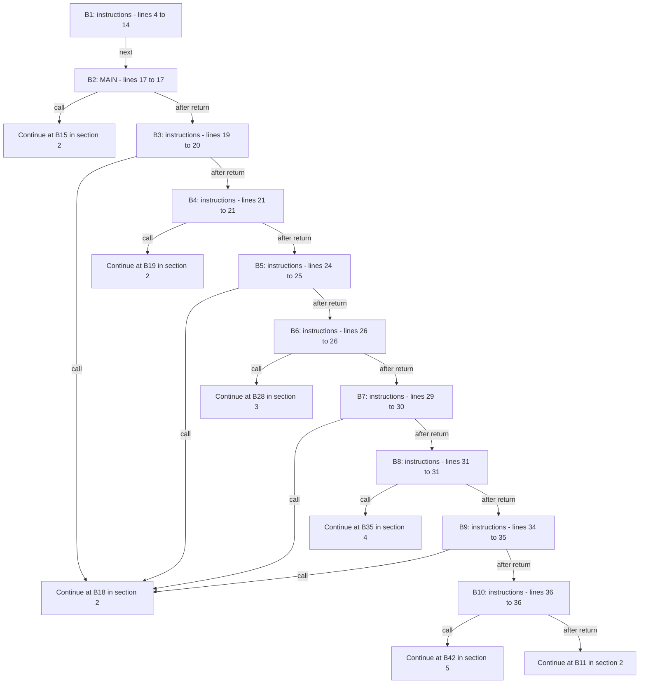
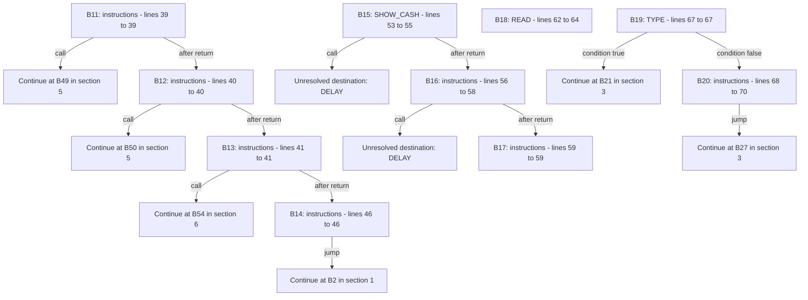
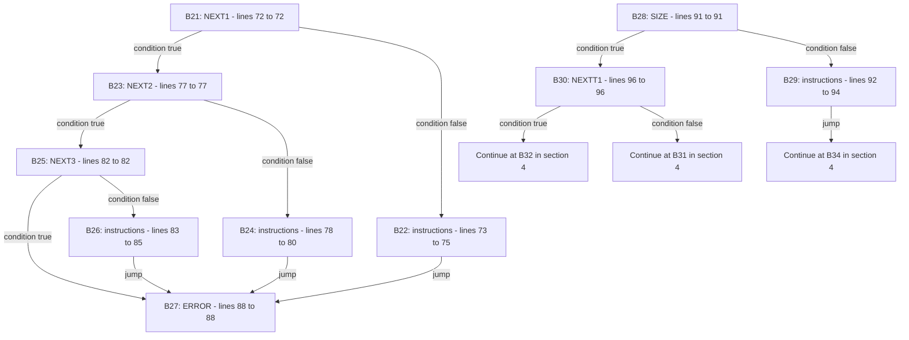
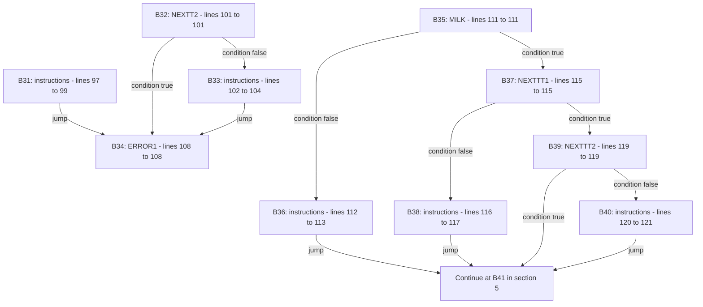
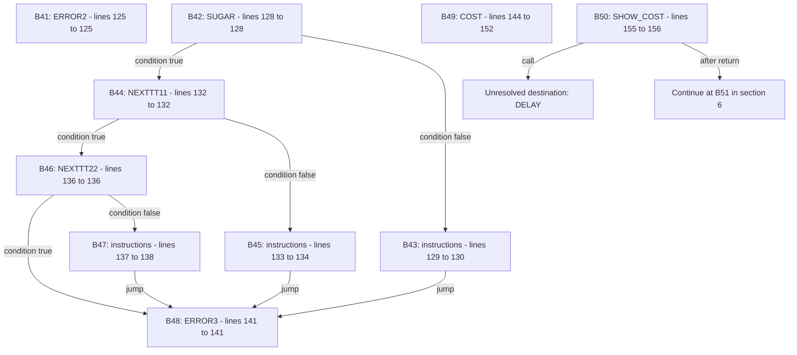
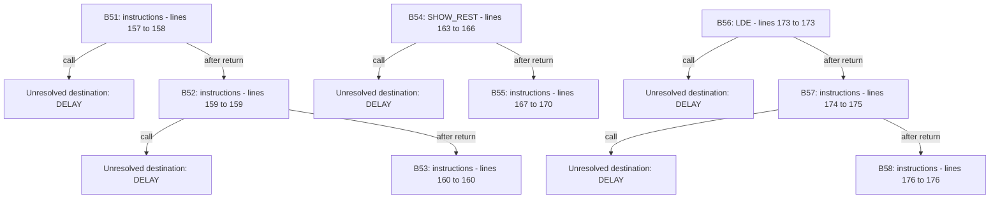

# Program Control Flow

[Back to project](README.md)

Control-flow blocks are indexed by source line. Calls resume at the instruction following the call if the subroutine returns normally.

## Entry locations

- `ORG 000H` begins at B1.

## Navigation

[Section 1](#section-1) · [Section 2](#section-2) · [Section 3](#section-3) · [Section 4](#section-4) · [Section 5](#section-5) · [Section 6](#section-6)

## Destinations requiring review

`DELAY`. A repeated label is also unresolved because it has more than one candidate target.

## Section 1



### B1

```asm
MOV P2,#0FFH
MOV P1,#00H
MOV R7,#0H
MOV R5,#0
MOV R4,#0
MOV R3,#0
MOV 40H,#0
MOV 41H,#0
MOV 42H,#0
MOV 43H,#0
MOV 45H,#0
```

### B2

```asm
ACALL SHOW_CASH
```

### B3

```asm
MOV R6,#00000011B
ACALL READ
```

### B4

```asm
ACALL TYPE
```

### B5

```asm
MOV R6,#00001100B
ACALL READ
```

### B6

```asm
ACALL SIZE
```

### B7

```asm
MOV R6,#00110000B
ACALL READ
```

### B8

```asm
ACALL MILK
```

### B9

```asm
MOV R6,#11000000B
ACALL READ
```

### B10

```asm
ACALL SUGAR
```

## Section 2



### B11

```asm
ACALL COST
```

### B12

```asm
ACALL SHOW_COST
```

### B13

```asm
ACALL SHOW_REST
```

### B14

```asm
SJMP MAIN
```

### B15

```asm
MOV A,#CASHX
MOV P1,A
ACALL DELAY
```

### B16

```asm
MOV A,#CASHY
MOV P1,A
ACALL DELAY
```

### B17

Return to the instruction following the active call.

```asm
RET
```

### B18

Return to the instruction following the active call.

```asm
MOV A,P2
ANL A,R6
RET
```

### B19

```asm
CJNE A,#00H, NEXT1
```

### B20

```asm
MOV R3,#AMER
MOV 40H,#1
SJMP BACK
```

## Section 3



### B21

```asm
CJNE A,#01H,NEXT2
```

### B22

```asm
MOV R3,#CAP
MOV 40H,#2
SJMP BACK
```

### B23

```asm
CJNE A,#02H,NEXT3
```

### B24

```asm
MOV R3,#LATTE
MOV 40H,#3
SJMP BACK
```

### B25

```asm
CJNE A,#03H,ERROR
```

### B26

```asm
MOV R4,#MOCHA
MOV 40H,#4
SJMP BACK
```

### B27

Return to the instruction following the active call.

```asm
RET
```

### B28

```asm
CJNE A,#00B, NEXTT1
```

### B29

```asm
MOV R5,#SMALL
MOV 41H,#1
SJMP BACK1
```

### B30

```asm
CJNE A,#0100B,NEXTT2
```

## Section 4



### B31

```asm
MOV R5,#MED
MOV 41H,#2
SJMP BACK1
```

### B32

```asm
CJNE A,#1000B,ERROR1
```

### B33

```asm
MOV R5,#LARGE
MOV 41H,#3
SJMP BACK1
```

### B34

Return to the instruction following the active call.

```asm
RET
```

### B35

```asm
CJNE A,#000000B, NEXTTT1
```

### B36

```asm
MOV 42H,#1
SJMP BACK2
```

### B37

```asm
CJNE A,#010000B,NEXTTT2
```

### B38

```asm
MOV 42H,#2
SJMP BACK2
```

### B39

```asm
CJNE A,#100000B,ERROR2
```

### B40

```asm
MOV 42H,#3
SJMP BACK2
```

## Section 5



### B41

Return to the instruction following the active call.

```asm
RET
```

### B42

```asm
CJNE A,#00000000B, NEXTTT11
```

### B43

```asm
MOV 43H,#1
SJMP BACK3
```

### B44

```asm
CJNE A,#01000000B,NEXTTT22
```

### B45

```asm
MOV 43H,#2
SJMP BACK3
```

### B46

```asm
CJNE A,#10000000B,ERROR3
```

### B47

```asm
MOV 43H,#3
SJMP BACK3
```

### B48

Return to the instruction following the active call.

```asm
RET
```

### B49

Return to the instruction following the active call.

```asm
MOV A,R3
ADD A,R5
MOV R3,A
MOV B,#100
DIV AB
MOV R3,B
ADD A,R4
MOV R4,A
RET
```

### B50

```asm
MOV P1,R4
ACALL DELAY
```

## Section 6



### B51

```asm
MOV P1,R3
ACALL DELAY
```

### B52

```asm
ACALL DELAY
```

### B53

Return to the instruction following the active call.

```asm
RET
```

### B54

```asm
MOV A,#CASHX
SUBB A,R4
MOV P1,A
ACALL DELAY
```

### B55

Return to the instruction following the active call.

```asm
MOV A,#CASHY
SUBB A,R3
MOV P1,A
RET
```

### B56

```asm
ACALL DELAY
```

### B57

```asm
MOV P1,R7
ACALL DELAY
```

### B58

Return to the instruction following the active call.

```asm
RET
```
