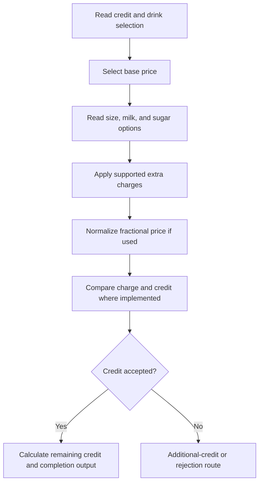
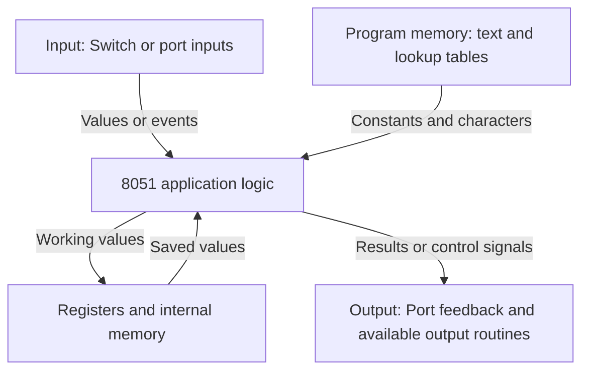

# Coffee Machine

[Group overview](../../README.md) · [Compare implementations](../README.md)

Choose a drink and options, calculate its price, and process the credit available for the purchase.

**Implementation:** Switch Selected Drink Options

**Input:** switch or port inputs.  
**Output:** port feedback and available output routines.

## Inputs and results

| Parameter | Description |
| --- | --- |
| Input | Credit, drink type, cup size, and supported milk or sugar choices |
| Output | Selected drink price and, where implemented, balance or insufficient-credit feedback |

## Worked example

A fractional-price calculation of 2.75 plus 0.50 gives 3.25: 125 hundredths become one whole unit and 25 hundredths.

### Calculation details

Hold P2 inputs at zero while PRICE samples the option fields. Bits 1:0 select the first drink, setting 33H to 2. Bits 3:2 are zero, so the cup size adds nothing. The zero milk and sugar options lead to FLASH. At that point the selected price at 33H is 02H. The subsequent pin-polling behaviour depends on external wiring.

## Program operation

### Functional flowchart

[Detailed control flow](source-flow.md)

### Simplified block diagram

**Port registers:** `P1`, `P2`, `P2.0`, `P2.1`, `P2.2`, `P2.3`, `P2.4`, `P2.5`, `P2.6`, `P2.7`, `p2`, `p2.0`, `p2.1`, `p2.2`, `p2.3`, `p2.4`, `p2.5`, `p2.6`, `p2.7`.

## Technical limitations

No additional defect was recorded in the earlier source review. This is not evidence of a successful build or hardware test.

## Build and test

1. Open the [assembly source](source.asm) in an 8051 assembler or simulator.
2. Review the technical limitations and configure the peripherals required by this implementation.
3. Check the expected result using the example inputs.
