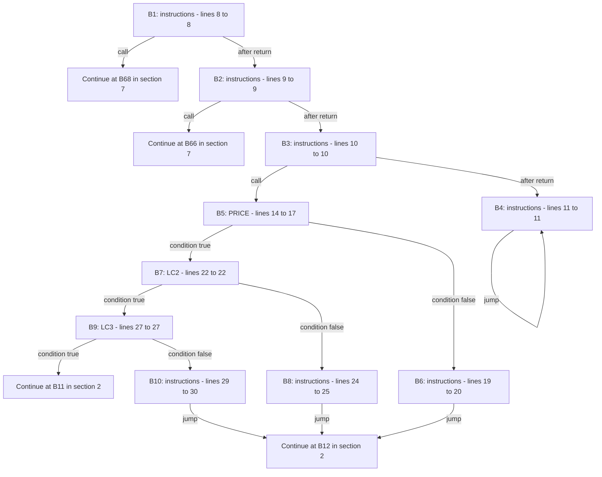
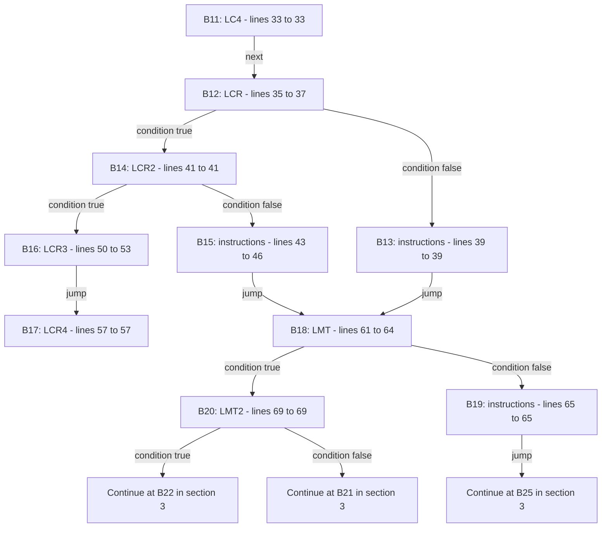
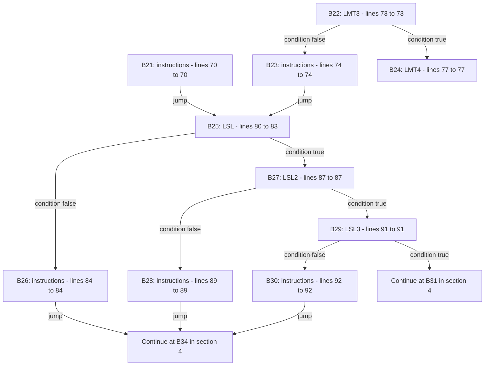
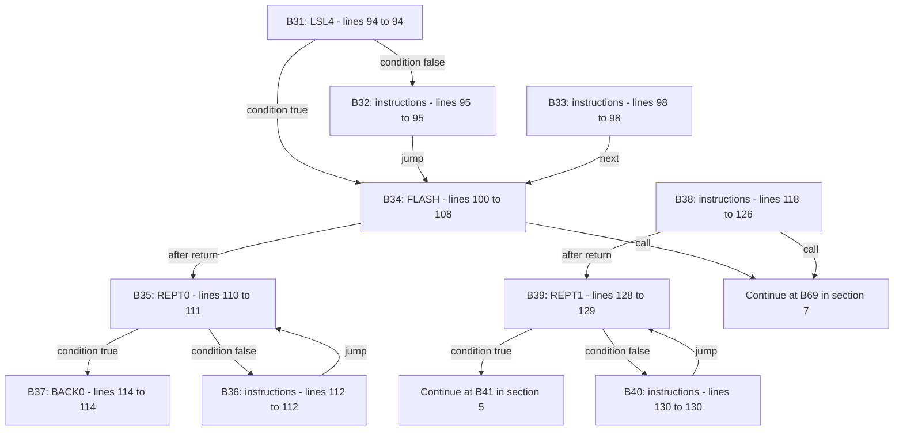
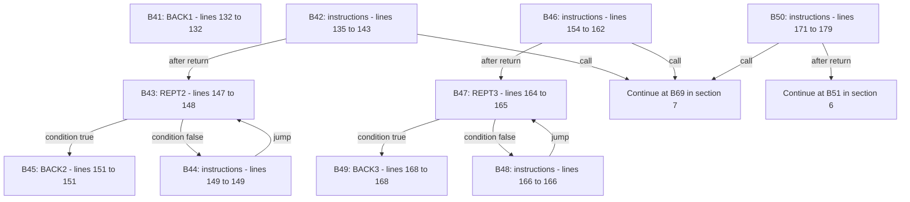
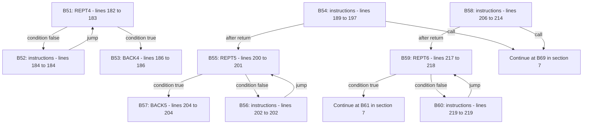
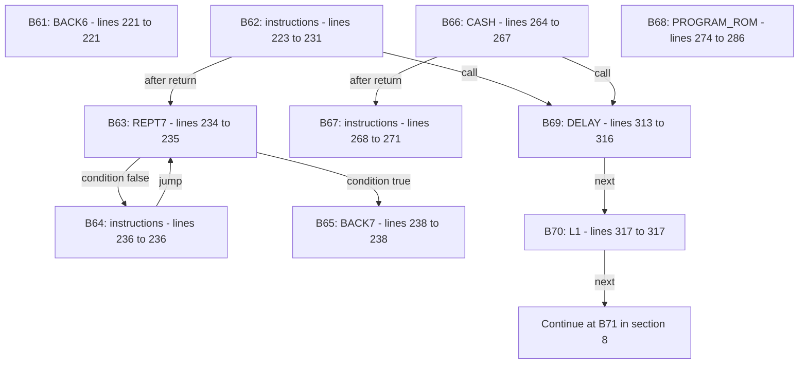
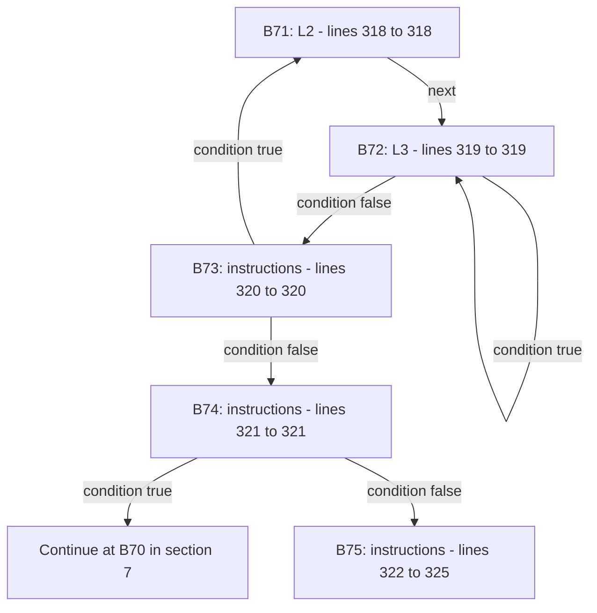

# Program Control Flow

[Back to project](README.md)

Control-flow blocks are indexed by source line. Calls resume at the instruction following the call if the subroutine returns normally.

## Entry locations

- `ORG	0` begins at B1.

## Navigation

[Section 1](#section-1) · [Section 2](#section-2) · [Section 3](#section-3) · [Section 4](#section-4) · [Section 5](#section-5) · [Section 6](#section-6) · [Section 7](#section-7) · [Section 8](#section-8)

## Section 1



### B1

```asm
ACALL PROGRAM_ROM
```

### B2

```asm
ACALL CASH
```

### B3

```asm
ACALL PRICE
```

### B4

```asm
SJMP $
```

### B5

```asm
MOV	P2,#0FFH
MOV A,P2
ANL	A,#00000011B
CJNE A,#00000000B,LC2
```

### B6

```asm
MOV	33H,#2
SJMP LCR
```

### B7

```asm
CJNE A,#00000001B,LC3
```

### B8

```asm
MOV	33H,#3
SJMP LCR
```

### B9

```asm
CJNE A,#00000010B,LC4
```

### B10

```asm
MOV	33H,#3
SJMP LCR
```

## Section 2



### B11

```asm
MOV	33H,#4
```

### B12

```asm
MOV A,P2
ANL	A,#00001100B
CJNE A,#00000000B,LCR2
```

### B13

```asm
SJMP LMT
```

### B14

```asm
CJNE A,#00000100B,LCR3
```

### B15

```asm
MOV	A,33H
ADD	A,#1
MOV	33H,A
SJMP LMT
```

### B16

```asm
MOV	A,33H
ADD	A,#2
MOV	33H,A
SJMP LCR4
```

### B17

Return to the instruction following the active call.

```asm
RET
```

### B18

```asm
MOV	P2,#0FFH
MOV A,P2
ANL	A,#00110000B
CJNE A,#00000000B,LMT2
```

### B19

```asm
Sjmp LSL
```

### B20

```asm
CJNE A,#00010000B,LMT3
```

## Section 3



### B21

```asm
Sjmp LSL
```

### B22

```asm
CJNE A,#00100000B,LMT4
```

### B23

```asm
Sjmp LSL
```

### B24

Return to the instruction following the active call.

```asm
RET
```

### B25

```asm
MOV	P2,#0FFH
MOV A,P2
ANL	A,#11000000B
CJNE A,#00000000B,LSL2
```

### B26

```asm
sjmp FLASH
```

### B27

```asm
CJNE A,#01000000B,LSL3
```

### B28

```asm
SJMP FLASH
```

### B29

```asm
CJNE A,#10000000B,LSL4
```

### B30

```asm
SJMP FLASH
```

## Section 4



### B31

```asm
CJNE A,#11000000B,FLASH
```

### B32

```asm
SJMP FLASH
```

### B33

```asm
mov p2,#0FFH
```

### B34

```asm
CLR P2.0
SETB P2.1
SETB P2.2
SETB P2.3
SETB P2.4
SETB P2.5
SETB P2.6
SETB P2.7
Acall DELAY
```

### B35

```asm
MOV A,P2
CJNE A,#00000001B,BACK0
```

### B36

```asm
SJMP REPT0
```

### B37

Return to the instruction following the active call.

```asm
RET
```

### B38

```asm
clR p2.0
CLR P2.1
SETB P2.2
SETB P2.3
SETB P2.4
SETB P2.5
SETB P2.6
SETB P2.7
Acall DELAY
```

### B39

```asm
MOV A,P2
CJNE A,#00000011B,BACK1
```

### B40

```asm
SJMP REPT1
```

## Section 5



### B41

Return to the instruction following the active call.

```asm
RET
```

### B42

```asm
CLR P2.0
clr p2.1
clr p2.2
SETB P2.3
SETB P2.4
SETB P2.5
SETB P2.6
SETB P2.7
Acall DELAY
```

### B43

```asm
MOV A,P2
CJNE A,#00000111B,BACK2
```

### B44

```asm
SJMP REPT2
```

### B45

Return to the instruction following the active call.

```asm
RET
```

### B46

```asm
CLR P2.0
clr p2.1
clr p2.2
clr p2.3
SETB P2.4
SETB P2.5
SETB P2.6
SETB P2.7
Acall DELAY
```

### B47

```asm
MOV A,P2
CJNE A,#00001111B,BACK3
```

### B48

```asm
SJMP REPT3
```

### B49

Return to the instruction following the active call.

```asm
RET
```

### B50

```asm
CLR P2.0
clr p2.1
clr p2.2
clr p2.3
clr p2.4
SETB P2.5
SETB P2.6
SETB P2.7
Acall DELAY
```

## Section 6



### B51

```asm
MOV A,P2
CJNE A,#00011111B,BACK4
```

### B52

```asm
SJMP REPT4
```

### B53

Return to the instruction following the active call.

```asm
RET
```

### B54

```asm
CLR P2.0
clr p2.1
clr p2.2
clr p2.3
clr p2.4
clr p2.5
SETB P2.6
SETB P2.7
Acall DELAY
```

### B55

```asm
MOV A,P2
CJNE A,#00111111B,BACK5
```

### B56

```asm
SJMP REPT5
```

### B57

Return to the instruction following the active call.

```asm
RET
```

### B58

```asm
CLR P2.0
clr p2.1
clr p2.2
clr p2.3
clr p2.4
clr p2.5
clr p2.6
SETB P2.7
Acall DELAY
```

### B59

```asm
MOV A,P2
CJNE A,#01111111B,BACK6
```

### B60

```asm
SJMP REPT6
```

## Section 7



### B61

Return to the instruction following the active call.

```asm
RET
```

### B62

```asm
CLR P2.0
clr p2.1
clr p2.2
clr p2.3
clr p2.4
clr p2.5
clr p2.6
clr p2.7
Acall DELAY
```

### B63

```asm
MOV A,P2
CJNE A,#11111111B,BACK7
```

### B64

```asm
SJMP REPT7
```

### B65

Return to the instruction following the active call.

```asm
RET
```

### B66

```asm
MOV	A,30H
CPL	A
MOV	P1,A
ACALL DELAY
```

### B67

Return to the instruction following the active call.

```asm
MOV	A,31H
CPL	A
MOV	P1,A
RET
```

### B68

Return to the instruction following the active call.

```asm
MOV	DPTR,#INX
CLR	A
MOVC A,@A+DPTR
MOV	30H,A
MOV	DPTR,#INY
CLR	A
MOVC A,@A+DPTR
MOV	31H,A
MOV	DPTR,#TIME_DELAY
CLR	A
MOVC A,@A+DPTR
MOV	32H,A
RET
```

### B69

```asm
PUSH 0
PUSH 1
PUSH 2
MOV	R0,#4
```

### B70

```asm
MOV	R1,#250
```

## Section 8



### B71

```asm
MOV R2,32H
```

### B72

```asm
DJNZ R2,L3
```

### B73

```asm
DJNZ R1,L2
```

### B74

```asm
DJNZ R0,L1
```

### B75

Return to the instruction following the active call.

```asm
POP 2
POP 1
POP 0
RET
```
