# Program Control Flow

[Back to project](README.md)

Control-flow blocks are indexed by source line. Calls resume at the instruction following the call if the subroutine returns normally.

## Entry locations

- `ORG 000H` begins at B1.
- `ORG 0003H` begins at B2.
- `ORG 030H` begins at B5.

## Navigation

[Section 1](#section-1) · [Section 2](#section-2) · [Section 3](#section-3) · [Section 4](#section-4) · [Section 5](#section-5) · [Section 6](#section-6) · [Section 7](#section-7) · [Section 8](#section-8) · [Section 9](#section-9) · [Section 10](#section-10) · [Section 11](#section-11) · [Section 12](#section-12) · [Section 13](#section-13) · [Section 14](#section-14) · [Section 15](#section-15) · [Section 16](#section-16) · [Section 17](#section-17) · [Section 18](#section-18) · [Section 19](#section-19) · [Section 20](#section-20) · [Section 21](#section-21) · [Section 22](#section-22) · [Section 23](#section-23)

## Section 1

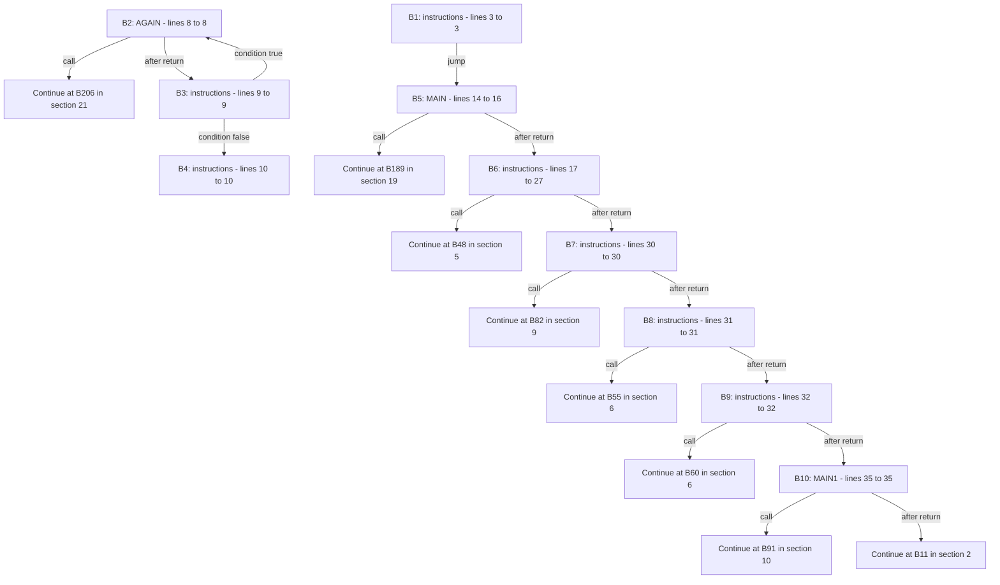

### B1

```asm
SJMP MAIN
```

### B2

```asm
ACALL KEYPAD
```

### B3

```asm
CJNE A,#'#',AGAIN
```

### B4

Resume the interrupted program.

```asm
RETI
```

### B5

```asm
MOV IE,#81H
SETB IT0
ACALL INLCD
```

### B6

```asm
MOV P1,#00
MOV R3,#21
MOV R4,#19
MOV R5,#0
MOV R0,#0
MOV R1,#0
MOV R2,#0
MOV R7,#0
MOV 20H,#0FBH
LCALL FLASH
```

### B7

```asm
acall display0
```

### B8

```asm
acall delay
```

### B9

```asm
ACALL RUN_INT
```

### B10

```asm
ACALL displayy
```

## Section 2

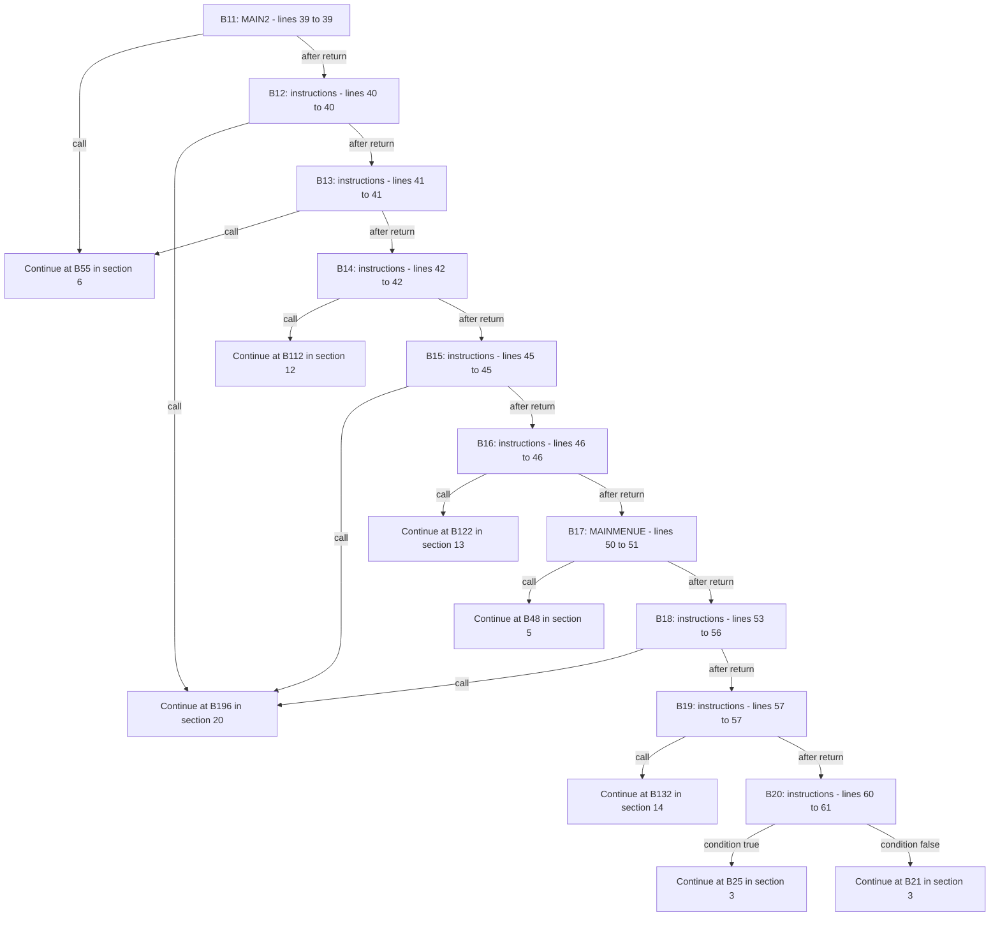

### B11

```asm
acall delay
```

### B12

```asm
acall clear
```

### B13

```asm
acall delay
```

### B14

```asm
acall display1
```

### B15

```asm
acall clear
```

### B16

```asm
acall display2
```

### B17

```asm
MOV 20H,#07FH
LCALL FLASH
```

### B18

```asm
MOV A,R4
SUBB A,#1
mov R4,A
acall clear
```

### B19

```asm
acall display3
```

### B20

```asm
MOV A,R4
CJNE A,#0H,CASE2
```

## Section 3

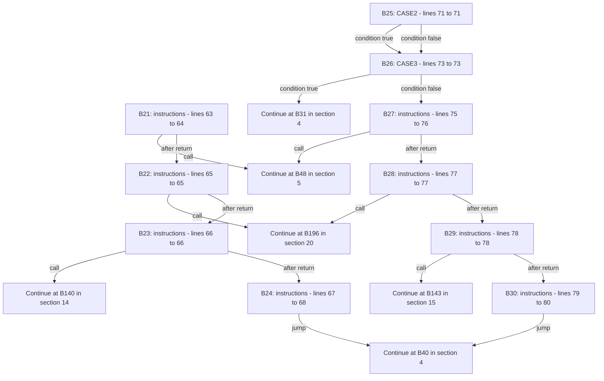

### B21

```asm
MOV 20H,#0BFH
LCALL FLASH
```

### B22

```asm
acall clear
```

### B23

```asm
acall display4
```

### B24

```asm
MOV R5,#0H
AJMP CALC
```

### B25

```asm
CJNE A,#10, CASE3
```

### B26

```asm
JNC CASE4
```

### B27

```asm
MOV 20H,#0eFH
LCALL FLASH
```

### B28

```asm
acall clear
```

### B29

```asm
acall display5
```

### B30

```asm
MOV R5,#1
AJMP CALC
```

## Section 4

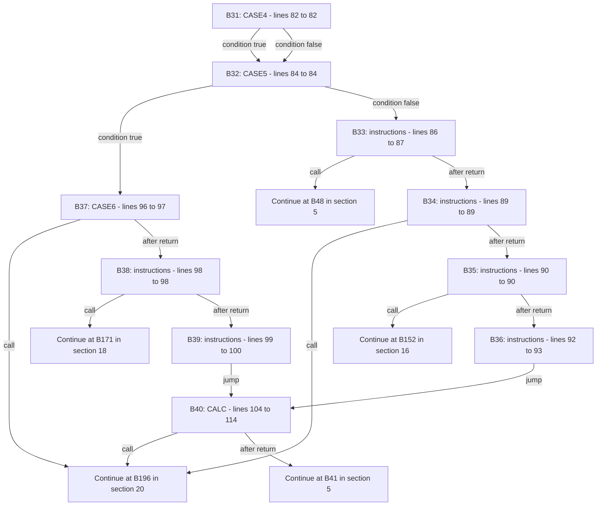

### B31

```asm
CJNE A,#20, CASE5
```

### B32

```asm
JNC CASE6
```

### B33

```asm
MOV 20H,#0f7H
LCALL FLASH
```

### B34

```asm
acall clear
```

### B35

```asm
acall display6
```

### B36

```asm
MOV R5,#2
AJMP CALC
```

### B37

```asm
MOV 20H,#00FH
acall clear
```

### B38

```asm
acall display8
```

### B39

```asm
MOV R5,#10
AJMP CALC
```

### B40

```asm
MOV B,R5
MOV A,R3
MUL AB
mov 50h,a
MOV B,#10
DIV AB
MOV R5,A
MOV A,R3
SUBB A,R5
MOV R6,A
acall clear
```

## Section 5

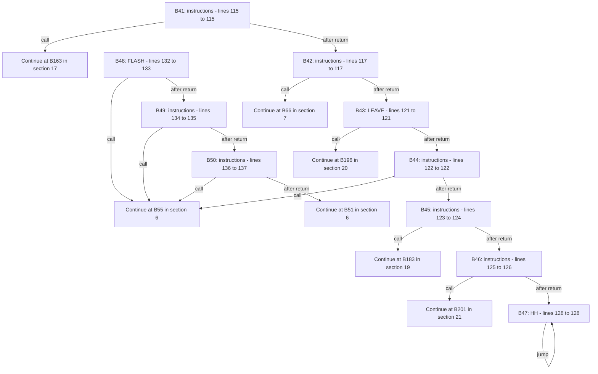

### B41

```asm
acall display7
```

### B42

```asm
ACALL CHECK
```

### B43

```asm
ACALL CLEAR
```

### B44

```asm
ACALL DELAY
```

### B45

```asm
mov a, #80H
acall cmd
```

### B46

```asm
mov dptr, #BYE
acall wstr
```

### B47

```asm
SJMP hh
```

### B48

```asm
MOV P1,20H
ACALL DELAY
```

### B49

```asm
MOV P1,#0FFH
ACALL DELAY
```

### B50

```asm
MOV P1,20H
ACALL DELAY
```

## Section 6

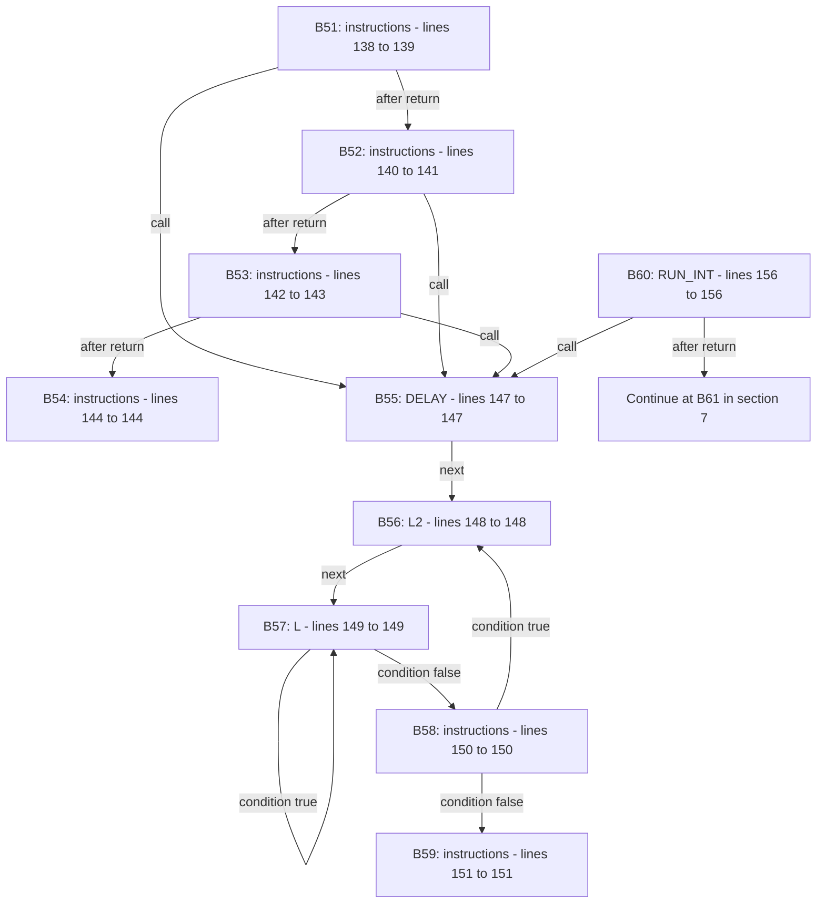

### B51

```asm
MOV P1,#0FFH
ACALL DELAY
```

### B52

```asm
MOV P1,20H
ACALL DELAY
```

### B53

```asm
MOV P1,#0FFH
ACALL DELAY
```

### B54

Return to the instruction following the active call.

```asm
RET
```

### B55

```asm
MOV R0,#250
```

### B56

```asm
MOV R1,#10
```

### B57

```asm
DJNZ R1,L
```

### B58

```asm
DJNZ R0,L2
```

### B59

Return to the instruction following the active call.

```asm
RET
```

### B60

```asm
ACALL DELAY
```

## Section 7

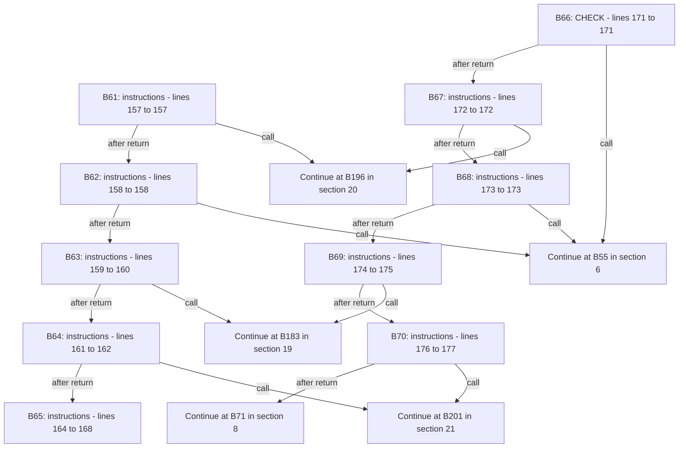

### B61

```asm
ACALL CLEAR
```

### B62

```asm
ACALL DELAY
```

### B63

```asm
mov a, #80H
acall cmd
```

### B64

```asm
mov dptr, #PRESS
acall wstr
```

### B65

Return to the instruction following the active call.

```asm
CLR P3.6
SETB P3.6
RET
```

### B66

```asm
ACALL DELAY
```

### B67

```asm
ACALL CLEAR
```

### B68

```asm
ACALL DELAY
```

### B69

```asm
mov a, #80H
acall cmd
```

### B70

```asm
mov dptr, #OP3
acall wstr
```

## Section 8

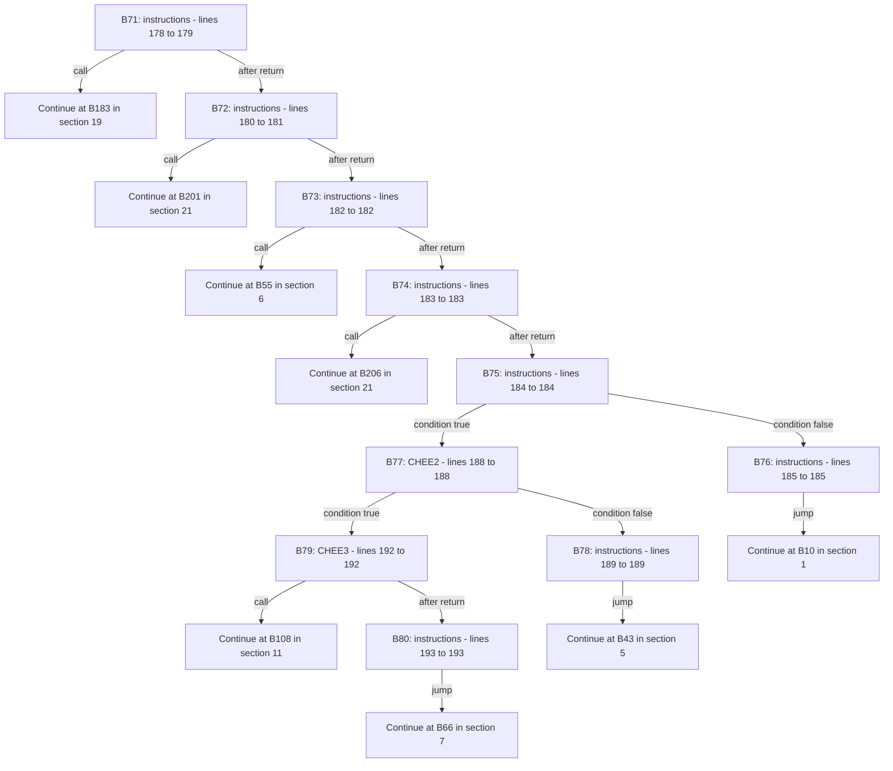

### B71

```asm
mov a,#0c0h
acall cmd
```

### B72

```asm
mov dptr, #OP4
acall wstr
```

### B73

```asm
ACALL DELAY
```

### B74

```asm
ACALL KEYPAD
```

### B75

```asm
CJNE A,#'1',CHEE2
```

### B76

```asm
LJMP main1
```

### B77

```asm
CJNE A,#'2',CHEE3
```

### B78

```asm
LJMP leave
```

### B79

```asm
ACALL WRONG
```

### B80

```asm
SJMP CHECK
```

## Section 9

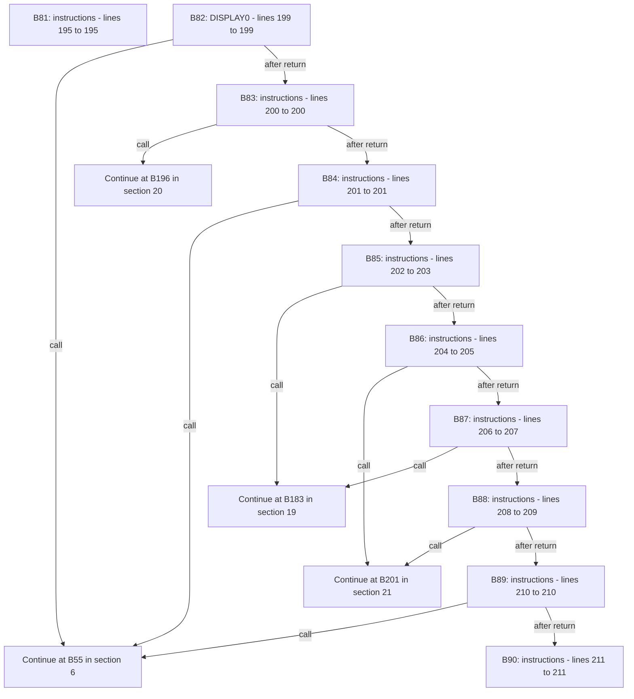

### B81

Return to the instruction following the active call.

```asm
ret
```

### B82

```asm
ACALL DELAY
```

### B83

```asm
ACALL CLEAR
```

### B84

```asm
ACALL DELAY
```

### B85

```asm
mov a, #80H
acall cmd
```

### B86

```asm
mov dptr, #WELCOME1
acall wstr
```

### B87

```asm
mov a,#0c0h
acall cmd
```

### B88

```asm
mov dptr, #WELCOME2
acall wstr
```

### B89

```asm
ACALL DELAY
```

### B90

Return to the instruction following the active call.

```asm
ret
```

## Section 10

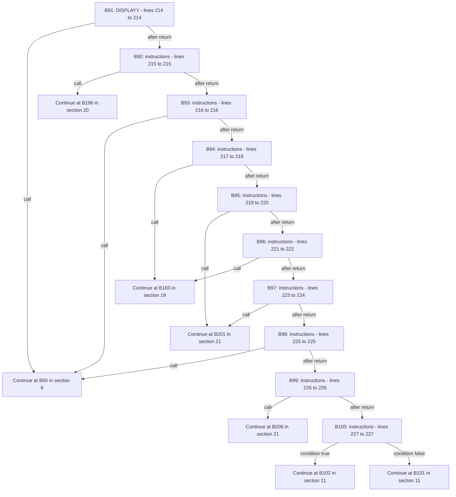

### B91

```asm
ACALL DELAY
```

### B92

```asm
ACALL CLEAR
```

### B93

```asm
ACALL DELAY
```

### B94

```asm
mov a, #80H
acall cmd
```

### B95

```asm
mov dptr, #op1
acall wstr
```

### B96

```asm
mov a,#0c0h
acall cmd
```

### B97

```asm
mov dptr, #op2
acall wstr
```

### B98

```asm
ACALL DELAY
```

### B99

```asm
ACALL KEYPAD
```

### B100

```asm
CJNE A,#'1',CHE2
```

## Section 11

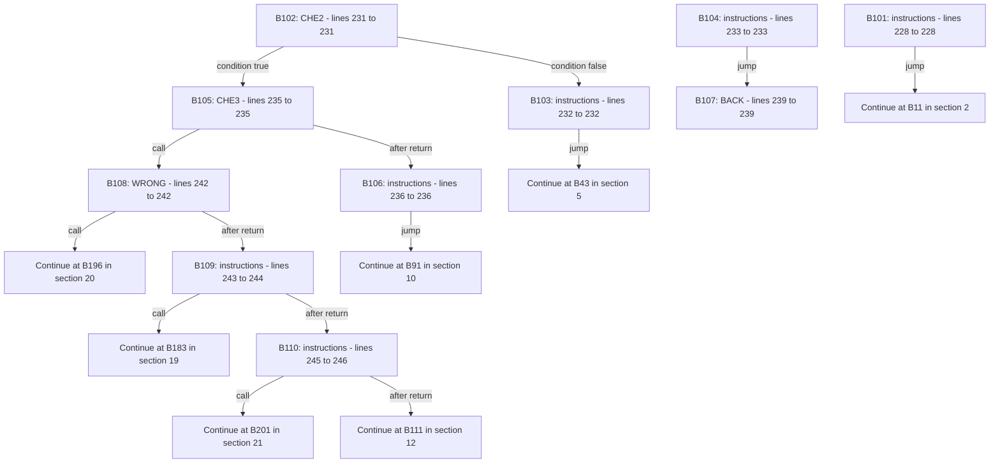

### B101

```asm
LJMP MAIN2
```

### B102

```asm
CJNE A,#'2',CHE3
```

### B103

```asm
LJMP leave
```

### B104

```asm
SJMP BACK
```

### B105

```asm
ACALL WRONG
```

### B106

```asm
SJMP displayy
```

### B107

Return to the instruction following the active call.

```asm
ret
```

### B108

```asm
ACALL CLEAR
```

### B109

```asm
mov a, #80H
acall cmd
```

### B110

```asm
mov dptr, #WRONGG
acall wstr
```

## Section 12


### B111

Return to the instruction following the active call.

```asm
RET
```

### B112

```asm
mov a, #80H
acall cmd
```

### B113

```asm
mov dptr, #amount
acall wstr
```

### B114

```asm
mov a,#0c0h
acall cmd
```

### B115

```asm
ACALL KEYPAD
```

### B116

```asm
MOV R2,A
acall wchr
```

### B117

```asm
MOV B,#10
MOV A,R2
SUBB A,#30H
MUL AB
MOV R2,A
ACALL DELAY
```

### B118

```asm
ACALL KEYPAD
```

### B119

```asm
MOV R1,A
acall wchr
```

### B120

```asm
MOV A,R1
SUBB A,#30H
MOV R1,A
MOV A,R2
ADD A,R1
MOV R3,A
ACALL DELAY
```

## Section 13

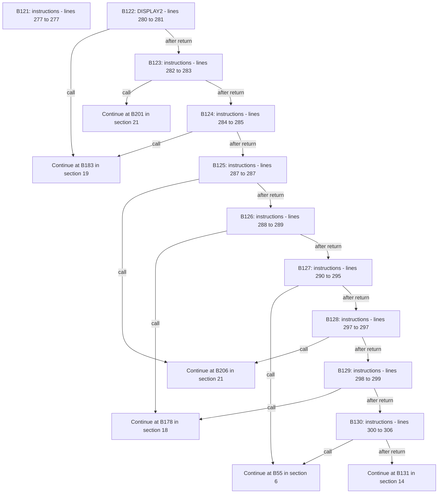

### B121

Return to the instruction following the active call.

```asm
ret
```

### B122

```asm
mov a, #80H
acall cmd
```

### B123

```asm
mov dptr, #data
acall wstr
```

### B124

```asm
mov a,#0c0h
acall cmd
```

### B125

```asm
ACALL KEYPAD
```

### B126

```asm
MOV R2,A
acall wchr
```

### B127

```asm
MOV B,#10
MOV A,R2
SUBB A,#30H
MUL AB
MOV R2,A
ACALL DELAY
```

### B128

```asm
ACALL KEYPAD
```

### B129

```asm
MOV R1,A
acall wchr
```

### B130

```asm
MOV A,R1
SUBB A,#30H
MOV R1,A
MOV A,R2
ADD A,R1
MOV R4,A
ACALL DELAY
```

## Section 14

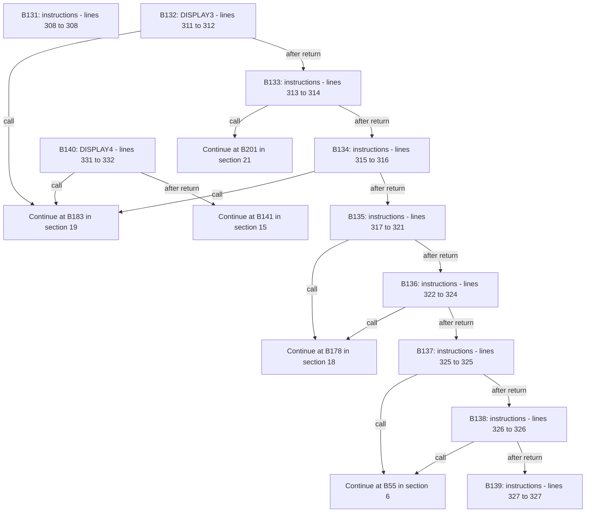

### B131

Return to the instruction following the active call.

```asm
ret
```

### B132

```asm
mov a, #80H
acall cmd
```

### B133

```asm
mov dptr, #days
acall wstr
```

### B134

```asm
mov a,#0c0h
acall cmd
```

### B135

```asm
mov a,R4
mov b,#10
div ab
add a,#30h
acall wchr
```

### B136

```asm
mov a,b
add a,#30h
acall wchr
```

### B137

```asm
ACALL DELAY
```

### B138

```asm
ACALL DELAY
```

### B139

Return to the instruction following the active call.

```asm
ret
```

### B140

```asm
mov a, #80H
acall cmd
```

## Section 15

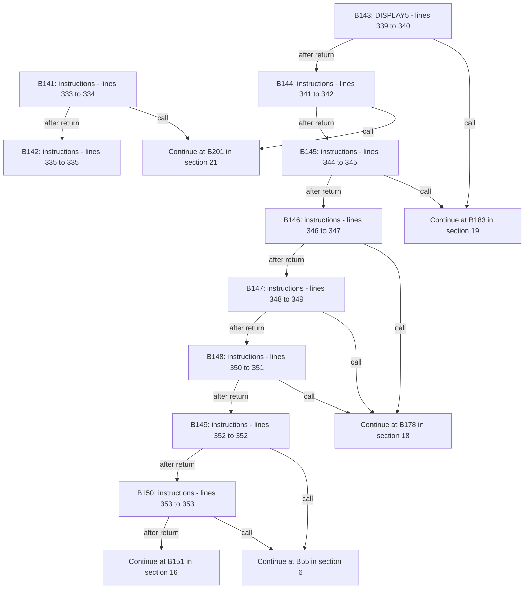

### B141

```asm
mov dptr,#nolate
acall wstr
```

### B142

Return to the instruction following the active call.

```asm
ret
```

### B143

```asm
mov a, #80H
acall cmd
```

### B144

```asm
mov dptr, #dis
acall wstr
```

### B145

```asm
mov a,#0c0h
acall cmd
```

### B146

```asm
mov a,#'1'
acall wchr
```

### B147

```asm
mov a,#'0'
acall wchr
```

### B148

```asm
mov a,#'%'
acall wchr
```

### B149

```asm
ACALL DELAY
```

### B150

```asm
ACALL DELAY
```

## Section 16

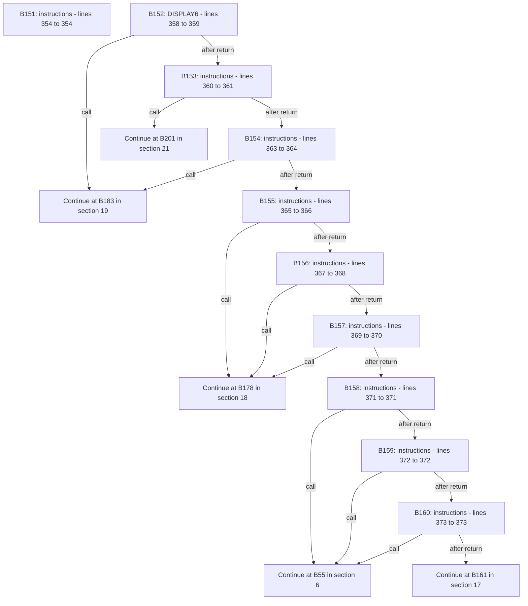

### B151

Return to the instruction following the active call.

```asm
ret
```

### B152

```asm
mov a, #80H
acall cmd
```

### B153

```asm
mov dptr, #dis
acall wstr
```

### B154

```asm
mov a,#0c0h
acall cmd
```

### B155

```asm
mov a,#'2'
acall wchr
```

### B156

```asm
mov a,#'0'
acall wchr
```

### B157

```asm
mov a,#'%'
acall wchr
```

### B158

```asm
ACALL DELAY
```

### B159

```asm
ACALL DELAY
```

### B160

```asm
ACALL DELAY
```

## Section 17

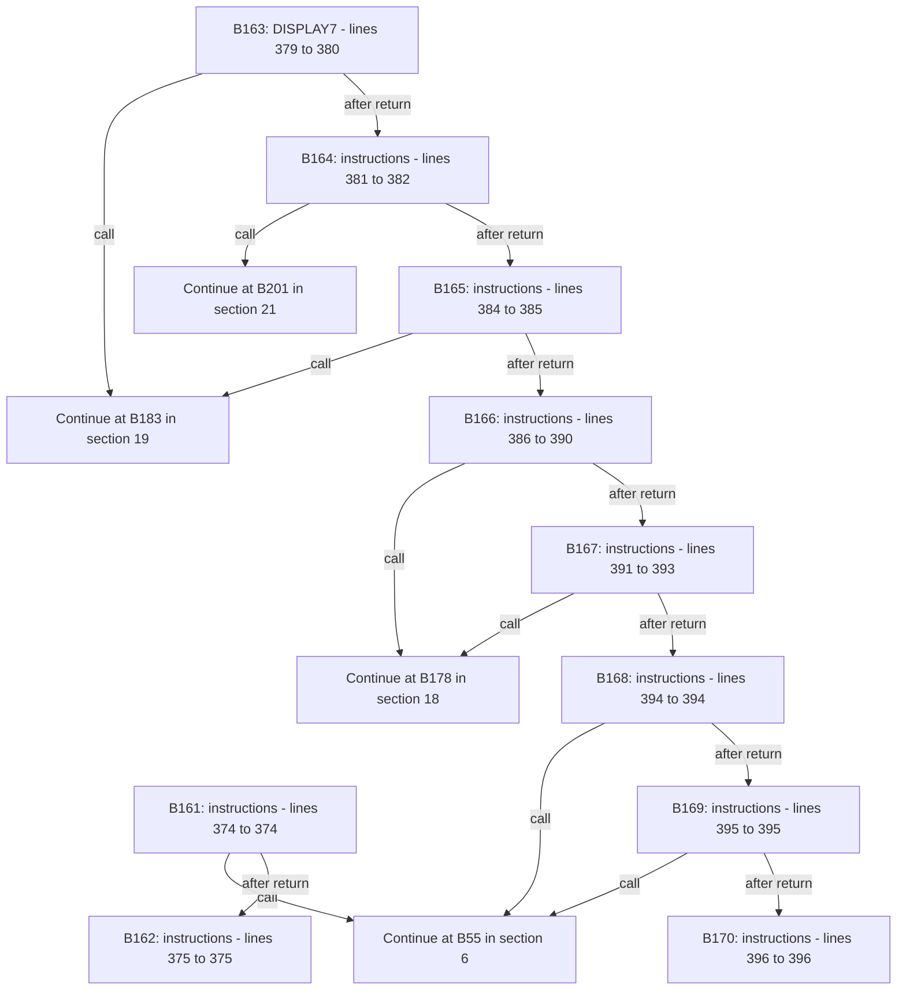

### B161

```asm
ACALL DELAY
```

### B162

Return to the instruction following the active call.

```asm
ret
```

### B163

```asm
mov a, #80H
acall cmd
```

### B164

```asm
mov dptr, #pay
acall wstr
```

### B165

```asm
mov a,#0c0h
acall cmd
```

### B166

```asm
mov a,R6
mov b,#10
div ab
add a,#30h
acall wchr
```

### B167

```asm
mov a,b
add a,#30h
acall wchr
```

### B168

```asm
ACALL DELAY
```

### B169

```asm
ACALL DELAY
```

### B170

Return to the instruction following the active call.

```asm
ret
```

## Section 18

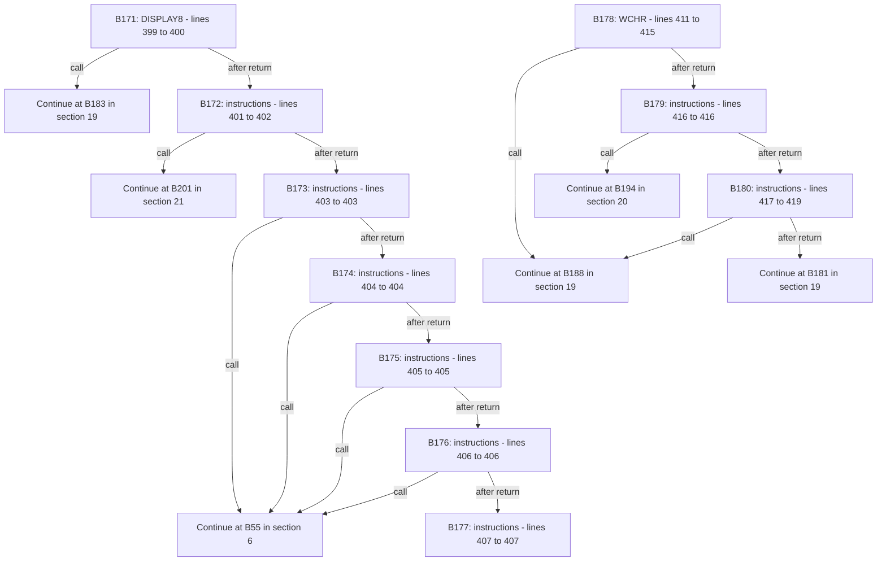

### B171

```asm
mov a, #80H
acall cmd
```

### B172

```asm
mov dptr,#free
acall wstr
```

### B173

```asm
ACALL DELAY
```

### B174

```asm
ACALL DELAY
```

### B175

```asm
ACALL DELAY
```

### B176

```asm
ACALL DELAY
```

### B177

Return to the instruction following the active call.

```asm
ret
```

### B178

```asm
PUSH ACC
PUSH B
SETB P1.3
MOV B,A
ACALL COMMON
```

### B179

```asm
ACALL LDELAY
```

### B180

```asm
MOV A,B
SWAP A
ACALL COMMON
```

## Section 19

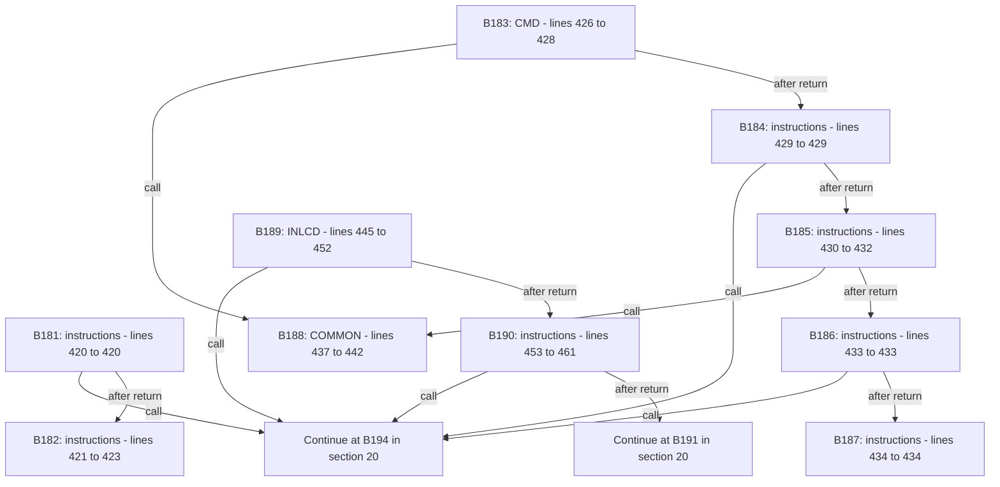

### B181

```asm
ACALL LDELAY
```

### B182

Return to the instruction following the active call.

```asm
POP B
POP ACC
RET
```

### B183

```asm
CLR P1.3
MOV B,A
ACALL COMMON
```

### B184

```asm
ACALL LDELAY
```

### B185

```asm
MOV A,B
SWAP A
ACALL COMMON
```

### B186

```asm
ACALL LDELAY
```

### B187

Return to the instruction following the active call.

```asm
RET
```

### B188

Return to the instruction following the active call.

```asm
ANL a,#11110000B
ANL P1, #00001111B
ORL P1,A
SETB P1.2
CLR P1.2
RET
```

### B189

```asm
CLR P1.3
CLR P1.7
CLR P1.6
SETB P1.5
CLR P1.4
SETB P1.2
CLR P1.2
ACALL LDELAY
```

### B190

```asm
SETB P1.2
CLR P1.2
SETB P1.7
CLR P1.6
CLR P1.5
CLR P1.4
SETB P1.2
CLR P1.2
ACALL LDELAY
```

## Section 20

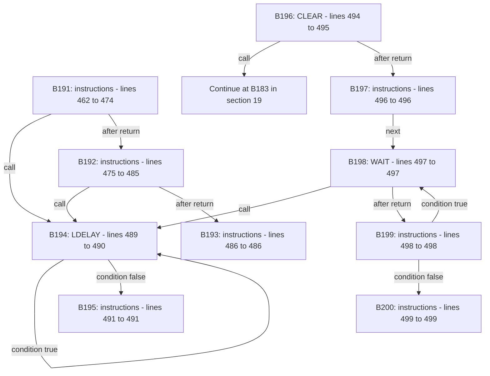

### B191

```asm
CLR P1.7
CLR P1.6
CLR P1.5
CLR P1.4
SETB P1.2
CLR P1.2
SETB P1.7
SETB P1.6
SETB P1.5
SETB P1.4
SETB P1.2
CLR P1.2
ACALL LDELAY
```

### B192

```asm
CLR P1.7
CLR P1.6
CLR P1.5
CLR P1.4
SETB P1.2
CLR P1.2
SETB P1.6
SETB P1.5
SETB P1.2
CLR P1.2
ACALL LDELAY
```

### B193

Return to the instruction following the active call.

```asm
RET
```

### B194

```asm
MOV R0, #50
DJNZ R0, $
```

### B195

Return to the instruction following the active call.

```asm
RET
```

### B196

```asm
MOV A,#01H
ACALL CMD
```

### B197

```asm
MOV R7,#14
```

### B198

```asm
ACALL LDELAY
```

### B199

```asm
DJNZ R7,WAIT
```

### B200

Return to the instruction following the active call.

```asm
ret
```

## Section 21

```mermaid
flowchart TD
B200["B201: WSTR - lines 502 to 502"]
B201["B202: CONT1 - lines 504 to 506"]
B202["B203: PRINT - lines 508 to 508"]
B203["B204: instructions - lines 509 to 510"]
B204["B205: EXIT1 - lines 511 to 512"]
B205["B206: KEYPAD - lines 517 to 517"]
B206["B207: K1 - lines 518 to 521"]
B207["B208: K2 - lines 523 to 525"]
B208["B209: instructions - lines 526 to 526"]
B209["B210: OVER1 - lines 528 to 531"]
B200 -->|next| B201
B201 -->|condition true| B204
B201 -->|condition false| B202
B202 -->|call| B177
B202 -->|after return| B203
B203 -->|jump| B201
B205 -->|next| B206
B206 -->|condition true| B206
B206 -->|condition false| B207
B207 -->|condition true| B209
B207 -->|condition false| B208
B208 -->|jump| B207
B209 -->|condition true| B214
B209 -->|condition false| B210
B177["Continue at B178 in section 18"]
B214["Continue at B215 in section 22"]
B210["Continue at B211 in section 22"]
```

### B201

```asm
PUSH    ACC
```

### B202

```asm
CLR     A
MOVC    A,@A+DPTR
JZ Exit1
```

### B203

```asm
ACALL    WCHR
```

### B204

```asm
INC DPTR
AJMP    CONT1
```

### B205

Return to the instruction following the active call.

```asm
POP     ACC
RET
```

### B206

```asm
MOV P0,#01110000B
```

### B207

```asm
MOV P0,#01110000B
MOV A,P0
ANL A,#01110000B
CJNE A,#01110000B,K1
```

### B208

```asm
MOV A,P0
ANL A,#01110000B
CJNE A,#01110000B,OVER1
```

### B209

```asm
SJMP K2
```

### B210

```asm
MOV P0,#01111110B
MOV A,P0
ANL A,#01110000B
CJNE A,#01110000B,ROW_0
```

## Section 22

```mermaid
flowchart TD
B210["B211: instructions - lines 532 to 535"]
B211["B212: instructions - lines 536 to 539"]
B212["B213: instructions - lines 540 to 543"]
B213["B214: instructions - lines 544 to 544"]
B214["B215: ROW_0 - lines 545 to 546"]
B215["B216: ROW_1 - lines 547 to 548"]
B216["B217: ROW_2 - lines 549 to 550"]
B217["B218: ROW_3 - lines 551 to 551"]
B218["B219: FIND - lines 553 to 553"]
B219["B220: FIND1 - lines 555 to 556"]
B210 -->|condition true| B215
B210 -->|condition false| B211
B211 -->|condition true| B216
B211 -->|condition false| B212
B212 -->|condition true| B217
B212 -->|condition false| B213
B213 -->|jump| B207
B214 -->|jump| B218
B215 -->|jump| B218
B216 -->|jump| B218
B217 -->|next| B218
B218 -->|next| B219
B219 -->|condition true| B221
B219 -->|condition false| B220
B207["Continue at B208 in section 21"]
B221["Continue at B222 in section 23"]
B220["Continue at B221 in section 23"]
```

### B211

```asm
MOV P0,#01111101B
MOV A,P0
ANL A,#01110000B
CJNE A,#01110000B,ROW_1
```

### B212

```asm
MOV P0,#01111011B
MOV A,P0
ANL A,#01110000B
CJNE A,#01110000B,ROW_2
```

### B213

```asm
MOV P0,#01110111B
MOV A,P0
ANL A,#01110000B
CJNE A,#01110000B,ROW_3
```

### B214

```asm
LJMP K2
```

### B215

```asm
MOV DPTR,#KCODE0
SJMP FIND
```

### B216

```asm
MOV DPTR,#KCODE1
SJMP FIND
```

### B217

```asm
MOV DPTR,#KCODE2
SJMP FIND
```

### B218

```asm
MOV DPTR,#KCODE3
```

### B219

```asm
RLC A
```

### B220

```asm
RLC A
JNC MATCH
```

## Section 23

```mermaid
flowchart TD
B220["B221: instructions - lines 557 to 558"]
B221["B222: MATCH - lines 559 to 561"]
B220 -->|jump| B219
B219["Continue at B220 in section 22"]
```

### B221

```asm
INC DPTR
SJMP FIND1
```

### B222

Return to the instruction following the active call.

```asm
CLR A
MOVC A,@A+DPTR
RET
```
