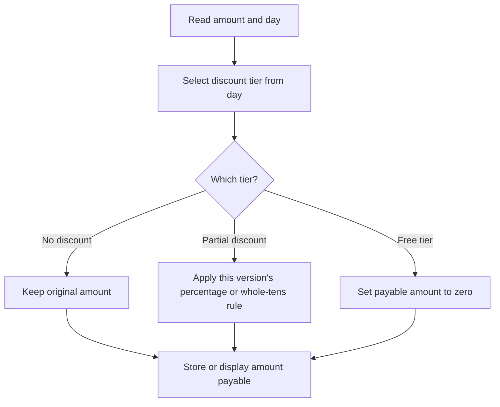
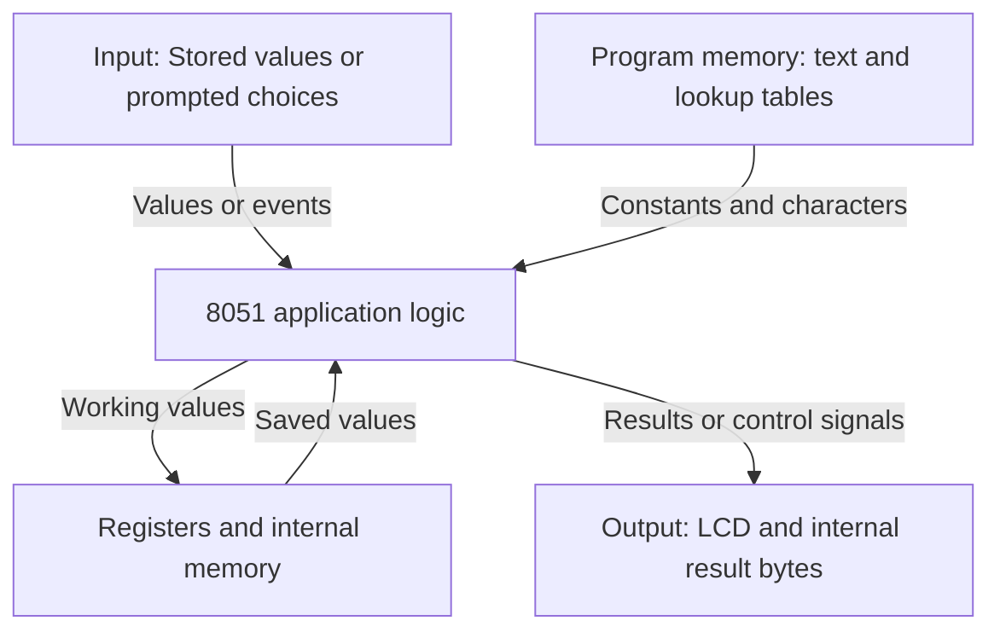

# Date Based Discount

[Group overview](../../README.md) · [Compare implementations](../README.md)

Choose a discount tier from a day value and calculate the amount payable.

**Implementation:** LCD Date Tier Payment

**Input:** stored values or prompted choices.  
**Output:** LCD and internal result bytes.

## Inputs and results

| Parameter | Description |
| --- | --- |
| Input | Original amount and day value |
| Output | Payable amount |

## Worked example

With amount 20 and tier 2 representing 20%, the discount is 4 and the payable amount is 16.

### Calculation details

Use amount 29 and set the day to 12, selecting tier 2. COST divides 29 by 10, keeping quotient 2 and remainder 9. It multiplies 2 by (10 − 2) and adds the remainder back. The payable amount is 25 (19H) at 33H. This revision discounts whole tens and preserves the units digit.

## Program operation

### Functional flowchart

[Detailed control flow](source-flow.md)

### Simplified block diagram

**Port registers:** `P1`, `P1.1`, `P1.2`, `P1.3`, `P1.4`, `P1.5`, `P1.6`, `P1.7`.

## Technical limitations

No additional defect was recorded in the earlier source review. This is not evidence of a successful build or hardware test.

## Build and test

1. Open the [assembly source](source.asm) in an 8051 assembler or simulator.
2. Review the technical limitations and configure the peripherals required by this implementation.
3. Check the expected result using the example inputs.
