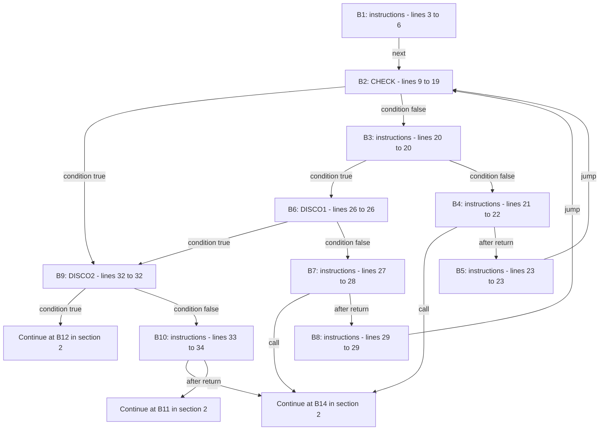
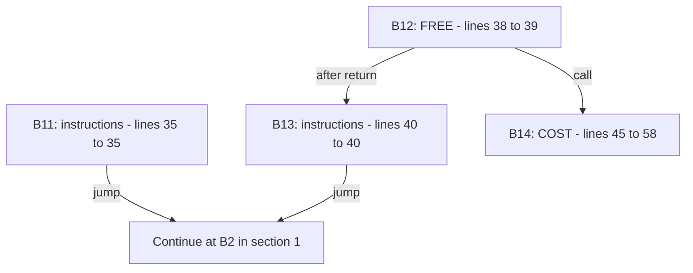

# Program Control Flow

[Back to project](README.md)

Control-flow blocks are indexed by source line. Calls resume at the instruction following the call if the subroutine returns normally.

## Entry locations

- `org 0h` begins at B1.

## Navigation

[Section 1](#section-1) · [Section 2](#section-2)

## Section 1



### B1

```asm
MOV 30H,#27H
MOV 31H,#9
MOV 32H,#0
MOV 33H,#0
```

### B2

```asm
MOV A,31H
MOV B,#1
SUBB A,B
MOV B,#10
DIV AB
MOV R1,B
CJNE A,#0H, DISCO2
```

### B3

```asm
CJNE R1,#0H, DISCO1
```

### B4

```asm
MOV 32H,#0
ACALL COST
```

### B5

```asm
AJMP CHECK
```

### B6

```asm
CJNE A,#0H, DISCO2
```

### B7

```asm
MOV 32H,#1
ACALL COST
```

### B8

```asm
AJMP CHECK
```

### B9

```asm
CJNE A,#1H, FREE
```

### B10

```asm
MOV 32H,#2
ACALL COST
```

## Section 2



### B11

```asm
AJMP CHECK
```

### B12

```asm
MOV 32H,#10
ACALL COST
```

### B13

```asm
AJMP CHECK
```

### B14

Return to the instruction following the active call.

```asm
MOV A,30H
MOV B,#10
DIV AB
MOV R3,A
MOV A,#10
SUBB A,32H
MOV B,A
MOV A,R3
MUL AB
MOV 33H,A
RET
```
