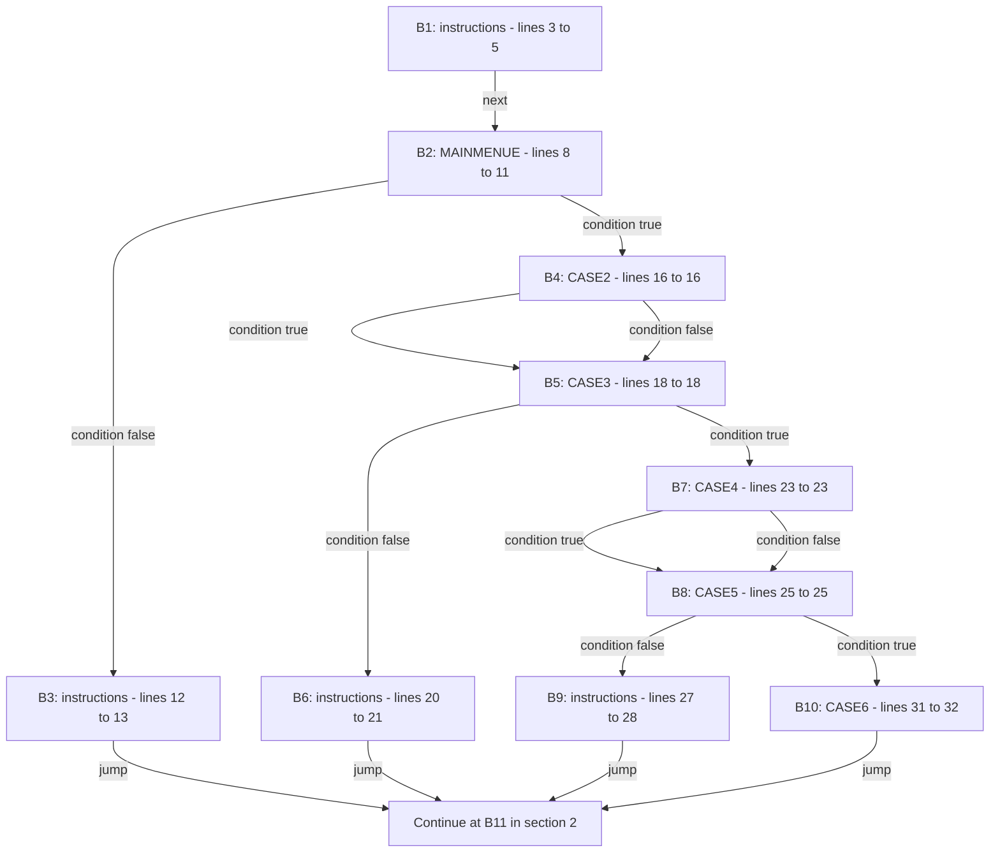
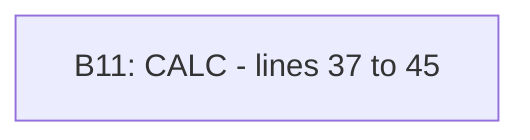

# Program Control Flow

[Back to project](README.md)

Control-flow blocks are indexed by source line. Calls resume at the instruction following the call if the subroutine returns normally.

## Entry locations

- `ORG 000H` begins at B1.

## Navigation

[Section 1](#section-1) · [Section 2](#section-2)

## Section 1



### B1

```asm
MOV R3,#20
MOV R4,#12
MOV R5,#0
```

### B2

```asm
MOV A,R4
SUBB A,#1
CJNE A,#0H,CASE2
```

### B3

```asm
MOV R5,#0H
AJMP CALC
```

### B4

```asm
CJNE A,#10, CASE3
```

### B5

```asm
JNC CASE4
```

### B6

```asm
MOV R5,#1
AJMP CALC
```

### B7

```asm
CJNE A,#20, CASE5
```

### B8

```asm
JNC CASE6
```

### B9

```asm
MOV R5,#2
AJMP CALC
```

### B10

```asm
MOV R5,#10
AJMP CALC
```

## Section 2



### B11

```asm
MOV B,R5
MOV A,R3
MUL AB
MOV B,#10
DIV AB
MOV R5,A
MOV A,R3
SUBB A,R5
MOV R6,A
```
