# Program Control Flow

[Back to project](README.md)

Control-flow blocks are indexed by source line. Calls resume at the instruction following the call if the subroutine returns normally.

## Entry locations

- `ORG 0H` begins at B1.
- `ORG 0003H` begins at B2.
- `ORG 030H` begins at B5.

## Navigation

[Section 1](#section-1) · [Section 2](#section-2) · [Section 3](#section-3) · [Section 4](#section-4) · [Section 5](#section-5) · [Section 6](#section-6) · [Section 7](#section-7) · [Section 8](#section-8) · [Section 9](#section-9) · [Section 10](#section-10) · [Section 11](#section-11) · [Section 12](#section-12) · [Section 13](#section-13) · [Section 14](#section-14) · [Section 15](#section-15) · [Section 16](#section-16) · [Section 17](#section-17) · [Section 18](#section-18) · [Section 19](#section-19) · [Section 20](#section-20) · [Section 21](#section-21) · [Section 22](#section-22) · [Section 23](#section-23)

## Destinations requiring review

`INITIATE_INT`. A repeated label is also unresolved because it has more than one candidate target.

## Lines outside the instruction parser

These may be assembler directives, macros, or malformed source; inspect them before building.

```asm
200: CALL DELAY
```

## Section 1

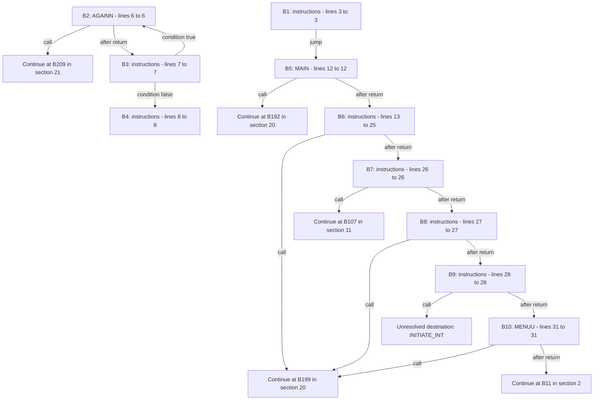

### B1

```asm
SJMP MAIN
```

### B2

```asm
ACALL KEYPAD
```

### B3

```asm
CJNE A,#'#',AGAINn
```

### B4

Resume the interrupted program.

```asm
RETI
```

### B5

```asm
ACALL INLCD
```

### B6

```asm
MOV IE,#81H
SETB IT0
MOV 30H,#2
MOV 31H,#1
MOV 32H,#0
MOV 40H,#5
MOV 41H,#5
MOV 42H,#30
MOV 43H,#30
MOV 44H,#20
MOV 45H,#20
ACALL CLEAR
```

### B7

```asm
ACALL WELCOME
```

### B8

```asm
ACALL CLEAR
```

### B9

```asm
ACALL INITIATE_INT
```

### B10

```asm
ACALL CLEAR
```

## Section 2

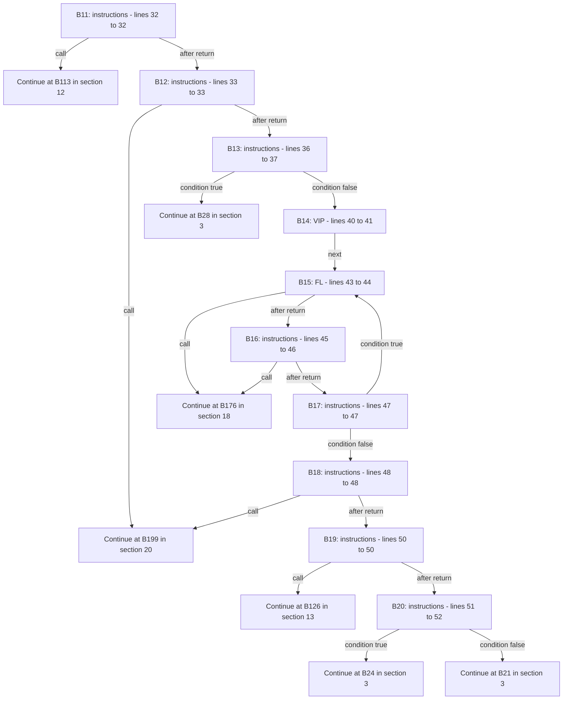

### B11

```asm
acall mmenu
```

### B12

```asm
ACALL CLEAR
```

### B13

```asm
MOV A,30H
CJNE A,#1,ONLINE
```

### B14

```asm
mov r5,#3
mov p1,#0ffh
```

### B15

```asm
setb p1.2
acall delay
```

### B16

```asm
clr p1.2
acall delay
```

### B17

```asm
djnz r5,fl
```

### B18

```asm
acall clear
```

### B19

```asm
ACALL vipmesg
```

### B20

```asm
MOV A,31H
CJNE A,#1,YEARLY
```

## Section 3

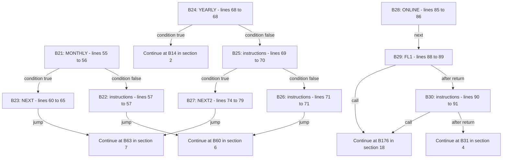

### B21

```asm
MOV R1,40H
DJNZ R1,NEXT
```

### B22

```asm
AJMP NOTAVAILABLE
```

### B23

```asm
CLR A
DEC 40H
MOV DPTR,#VIPM
MOVC A,@A+DPTR
MOV 32H,A
AJMP OUT
```

### B24

```asm
CJNE A,#2,VIP
```

### B25

```asm
MOV R2,41H
DJNZ R2,NEXT2
```

### B26

```asm
AJMP NOTAVAILABLE
```

### B27

```asm
CLR A
DEC 41H
MOV DPTR,#VIPY
MOVC A,@A+DPTR
MOV 32H,A
AJMP OUT
```

### B28

```asm
mov r5,#3
mov p1,#0ffh
```

### B29

```asm
setb p1.3
acall delay
```

### B30

```asm
clr p1.3
acall delay
```

## Section 4

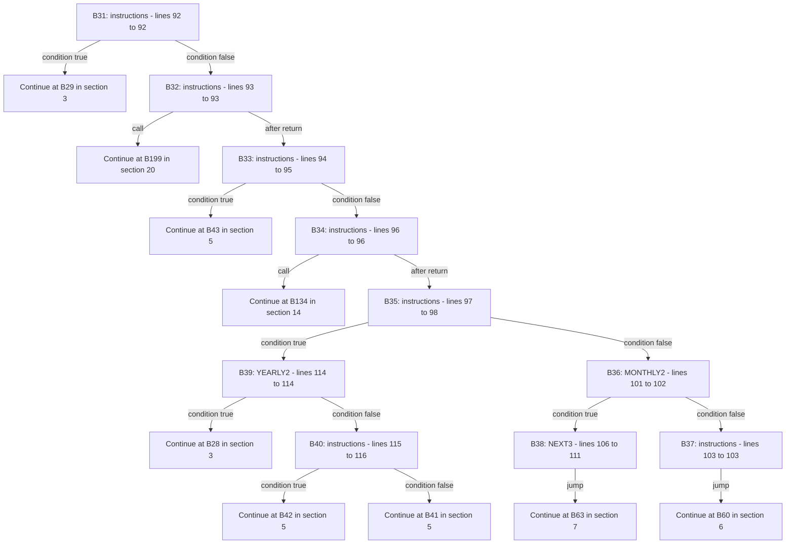

### B31

```asm
djnz r5,fl1
```

### B32

```asm
acall clear
```

### B33

```asm
MOV A,30H
CJNE A,#2,REGULAR
```

### B34

```asm
ACALL onlmesg
```

### B35

```asm
MOV A,31H
CJNE A,#1,YEARLY2
```

### B36

```asm
MOV R1,42H
DJNZ R1,NEXT3
```

### B37

```asm
AJMP NOTAVAILABLE
```

### B38

```asm
CLR A
DEC 42H
MOV DPTR,#ONM
MOVC A,@A+DPTR
MOV 32H,A
AJMP OUT
```

### B39

```asm
CJNE A,#2,ONLINE
```

### B40

```asm
MOV R2,43H
DJNZ R2,NEXT4
```

## Section 5

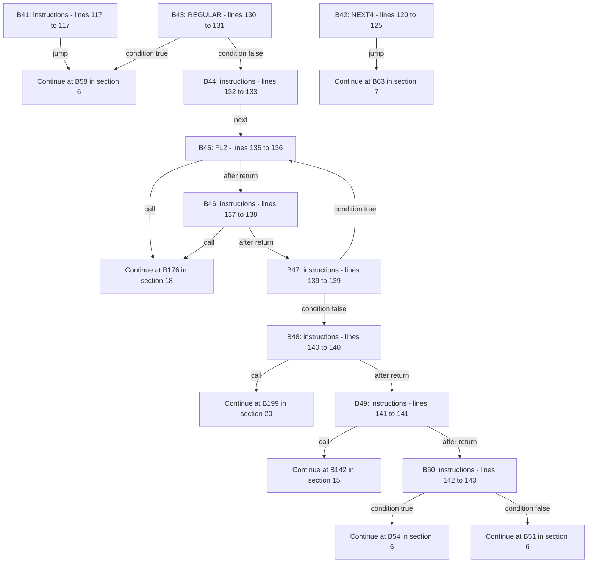

### B41

```asm
AJMP WRONG
```

### B42

```asm
CLR A
DEC 43H
MOV DPTR,#ONY
MOVC A,@A+DPTR
MOV 32H,A
AJMP OUT
```

### B43

```asm
MOV A,30H
CJNE A,#3,WRONG
```

### B44

```asm
mov r5,#3
mov p1,#0ffh
```

### B45

```asm
setb p1.4
acall delay
```

### B46

```asm
clr p1.4
acall delay
```

### B47

```asm
djnz r5,fl2
```

### B48

```asm
acall clear
```

### B49

```asm
ACALL regmesg
```

### B50

```asm
MOV A,31H
CJNE A,#1,YEARLY3
```

## Section 6

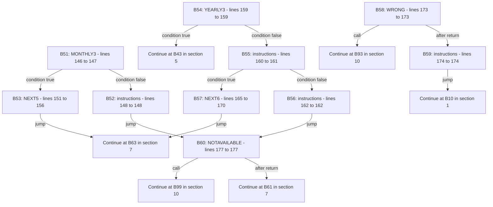

### B51

```asm
MOV R1,44H
DJNZ R1,NEXT5
```

### B52

```asm
SJMP NOTAVAILABLE
```

### B53

```asm
CLR A
DEC 44H
MOV DPTR,#REGM
MOVC A,@A+DPTR
MOV 32H,A
AJMP OUT
```

### B54

```asm
CJNE A,#2,REGULAR
```

### B55

```asm
MOV R2,45H
DJNZ R2,NEXT6
```

### B56

```asm
SJMP NOTAVAILABLE
```

### B57

```asm
CLR A
DEC 45H
MOV DPTR,#REGY
MOVC A,@A+DPTR
MOV 32H,A
AJMP OUT
```

### B58

```asm
ACALL WRRONG
```

### B59

```asm
AJMP MENUU
```

### B60

```asm
ACALL NOTAV
```

## Section 7

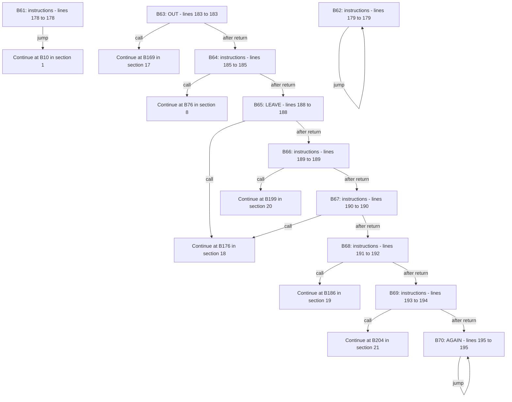

### B61

```asm
AJMP MENUU
```

### B62

```asm
SJMP $
```

### B63

```asm
acall payment
```

### B64

```asm
ACALL REPEAT
```

### B65

```asm
ACALL DELAY
```

### B66

```asm
ACALL CLEAR
```

### B67

```asm
ACALL DELAY
```

### B68

```asm
mov a, #80H
acall cmd
```

### B69

```asm
mov dptr, #BYE
acall wstr
```

### B70

```asm
sjmp again
```

## Section 8

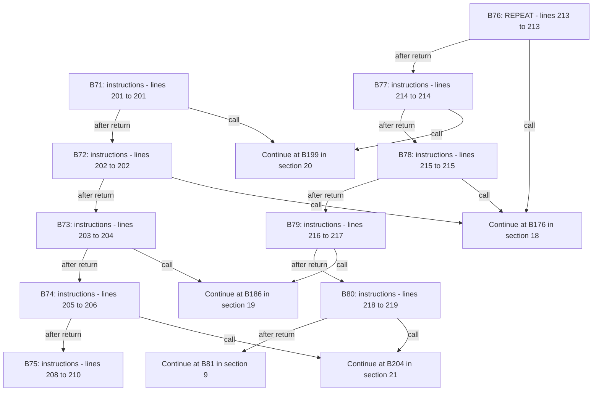

### B71

```asm
ACALL CLEAR
```

### B72

```asm
ACALL DELAY
```

### B73

```asm
mov a, #80H
acall cmd
```

### B74

```asm
mov dptr, #PRESS
acall wstr
```

### B75

Return to the instruction following the active call.

```asm
CLR P3.6
SETB P3.6
RET
```

### B76

```asm
ACALL DELAY
```

### B77

```asm
ACALL CLEAR
```

### B78

```asm
ACALL DELAY
```

### B79

```asm
mov a, #80H
acall cmd
```

### B80

```asm
mov dptr, #op3
acall wstr
```

## Section 9

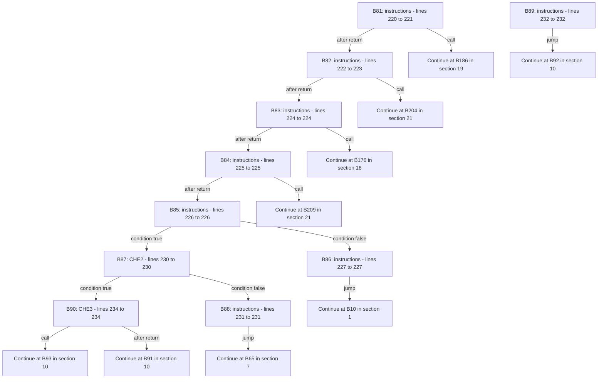

### B81

```asm
mov a,#0c0h
acall cmd
```

### B82

```asm
mov dptr, #op4
acall wstr
```

### B83

```asm
ACALL DELAY
```

### B84

```asm
ACALL KEYPAD
```

### B85

```asm
CJNE A,#'1,CHE2
```

### B86

```asm
LJMP MENUU
```

### B87

```asm
CJNE A,#'2',CHE3
```

### B88

```asm
LJMP LEAVE
```

### B89

```asm
SJMP BACK
```

### B90

```asm
ACALL WRRONG
```

## Section 10

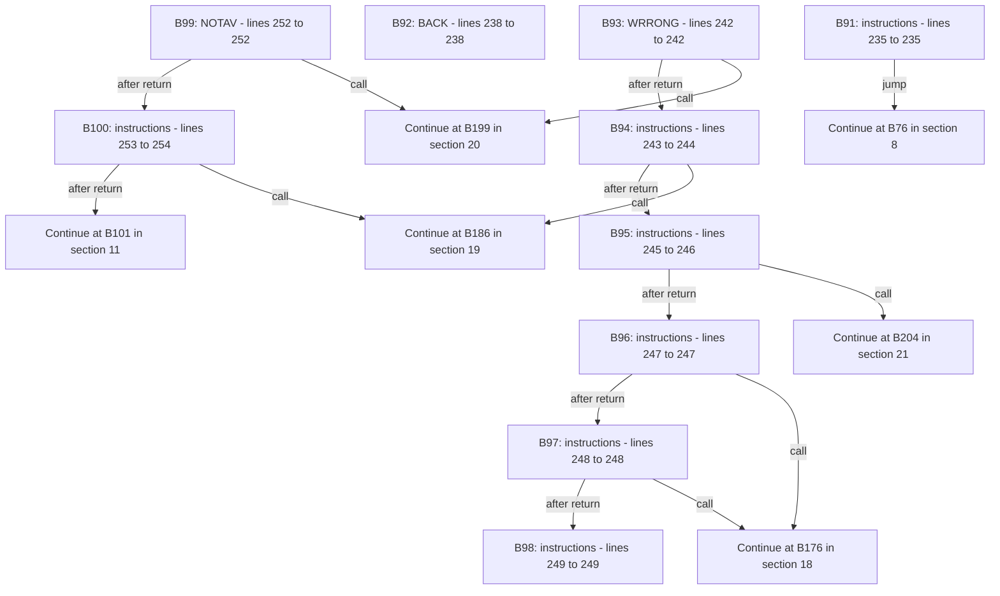

### B91

```asm
SJMP REPEAT
```

### B92

Return to the instruction following the active call.

```asm
RET
```

### B93

```asm
ACALL CLEAR
```

### B94

```asm
mov a, #80H
acall cmd
```

### B95

```asm
mov dptr, #WRONGG
acall wstr
```

### B96

```asm
ACALL DELAY
```

### B97

```asm
ACALL DELAY
```

### B98

Return to the instruction following the active call.

```asm
RET
```

### B99

```asm
ACALL CLEAR
```

### B100

```asm
mov a, #80H
acall cmd
```

## Section 11

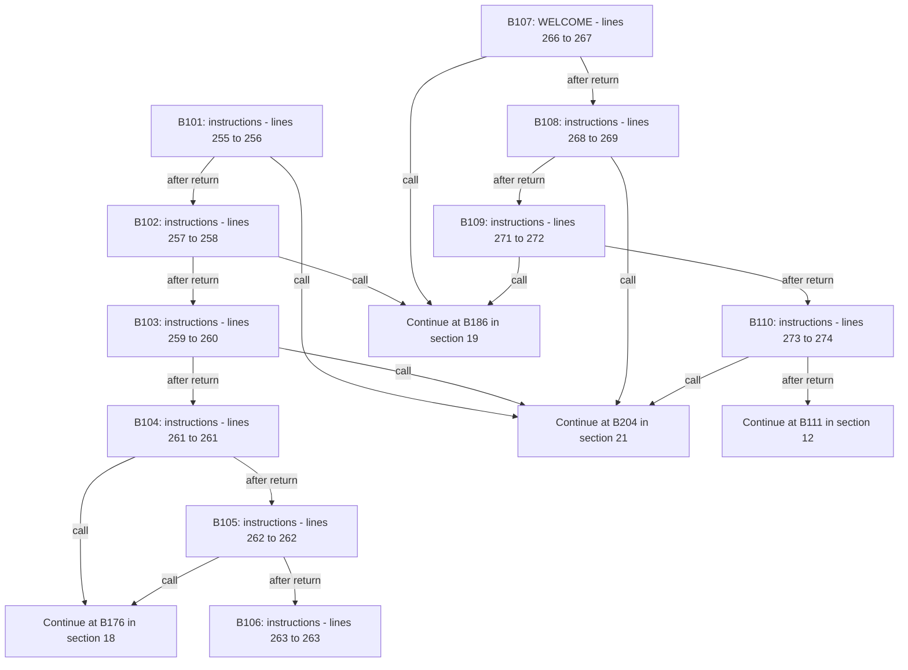

### B101

```asm
mov dptr, #NOTA
acall wstr
```

### B102

```asm
mov a, #0C0H
acall cmd
```

### B103

```asm
mov dptr, #NOTA1
acall wstr
```

### B104

```asm
ACALL DELAY
```

### B105

```asm
ACALL DELAY
```

### B106

Return to the instruction following the active call.

```asm
RET
```

### B107

```asm
mov a, #80H
acall cmd
```

### B108

```asm
mov dptr, #wel
acall wstr
```

### B109

```asm
mov a,#0c0h
acall cmd
```

### B110

```asm
mov dptr, #gym
acall wstr
```

## Section 12

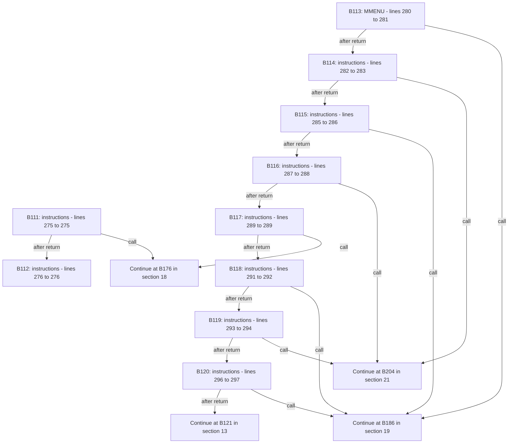

### B111

```asm
acall delay
```

### B112

Return to the instruction following the active call.

```asm
ret
```

### B113

```asm
mov a, #80H
acall cmd
```

### B114

```asm
mov dptr, #sel
acall wstr
```

### B115

```asm
mov a,#0c0h
acall cmd
```

### B116

```asm
mov dptr, #op
acall wstr
```

### B117

```asm
acall delay
```

### B118

```asm
mov a, #80H
acall cmd
```

### B119

```asm
mov dptr, #SPACE
acall wstr
```

### B120

```asm
mov a, #80H
acall cmd
```

## Section 13

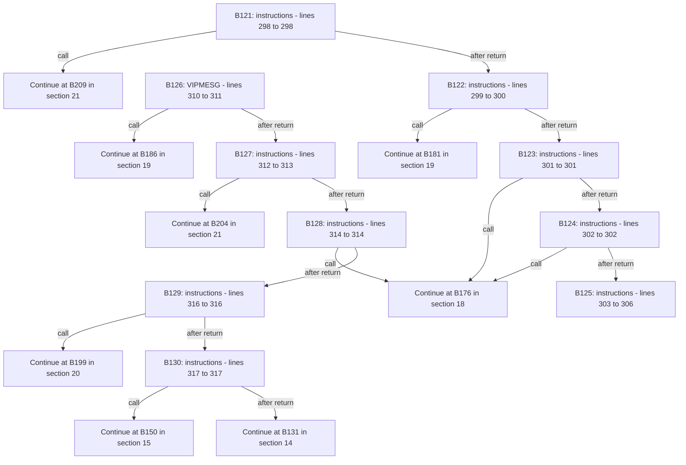

### B121

```asm
ACALL KEYPAD
```

### B122

```asm
MOV 35H,A
ACALL WCHR
```

### B123

```asm
ACALL DELAY
```

### B124

```asm
ACALL DELAY
```

### B125

Return to the instruction following the active call.

```asm
MOV A,35H
SUBB A,#30H
MOV 30H,A
ret
```

### B126

```asm
mov a, #80H
acall cmd
```

### B127

```asm
mov dptr, #VIPP
acall wstr
```

### B128

```asm
acall delay
```

### B129

```asm
acall clear
```

### B130

```asm
acall menu2
```

## Section 14

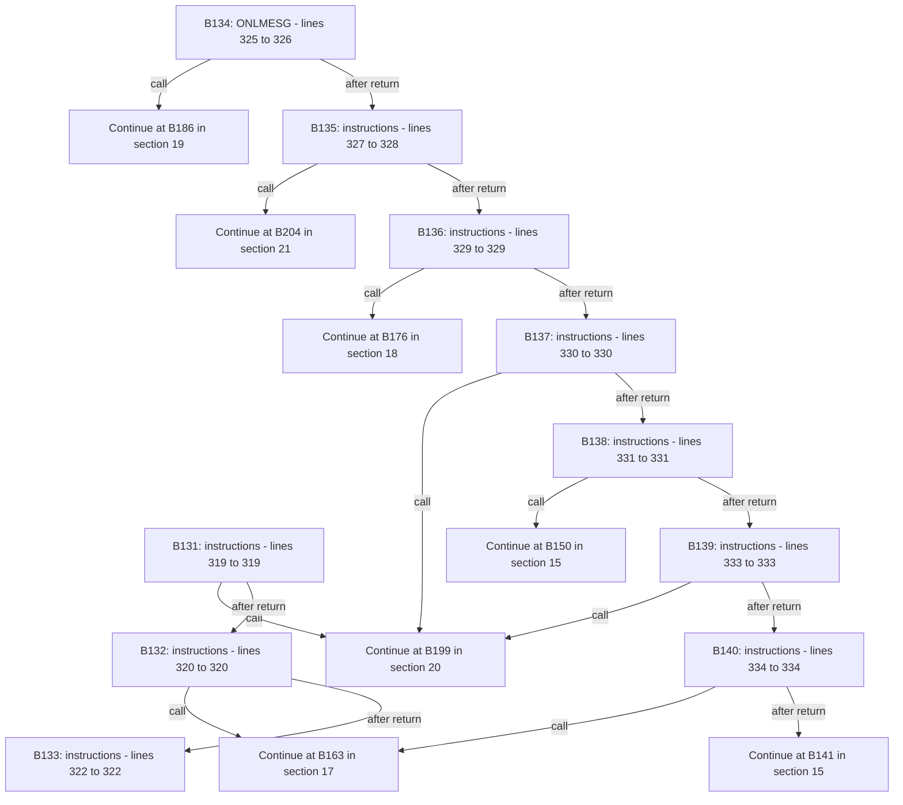

### B131

```asm
acall clear
```

### B132

```asm
acall dura
```

### B133

Return to the instruction following the active call.

```asm
ret
```

### B134

```asm
mov a, #80H
acall cmd
```

### B135

```asm
mov dptr, #onl
acall wstr
```

### B136

```asm
acall delay
```

### B137

```asm
acall clear
```

### B138

```asm
acall menu2
```

### B139

```asm
acall clear
```

### B140

```asm
acall dura
```

## Section 15

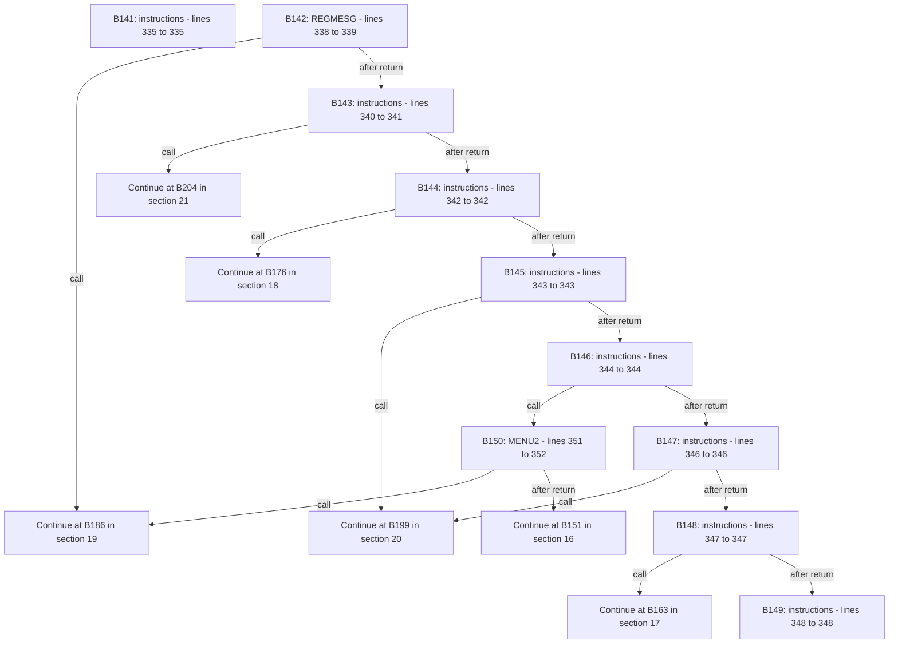

### B141

Return to the instruction following the active call.

```asm
ret
```

### B142

```asm
mov a, #80H
acall cmd
```

### B143

```asm
mov dptr, #reg
acall wstr
```

### B144

```asm
acall delay
```

### B145

```asm
acall clear
```

### B146

```asm
acall menu2
```

### B147

```asm
acall clear
```

### B148

```asm
acall dura
```

### B149

Return to the instruction following the active call.

```asm
ret
```

### B150

```asm
mov a, #80H
acall cmd
```

## Section 16

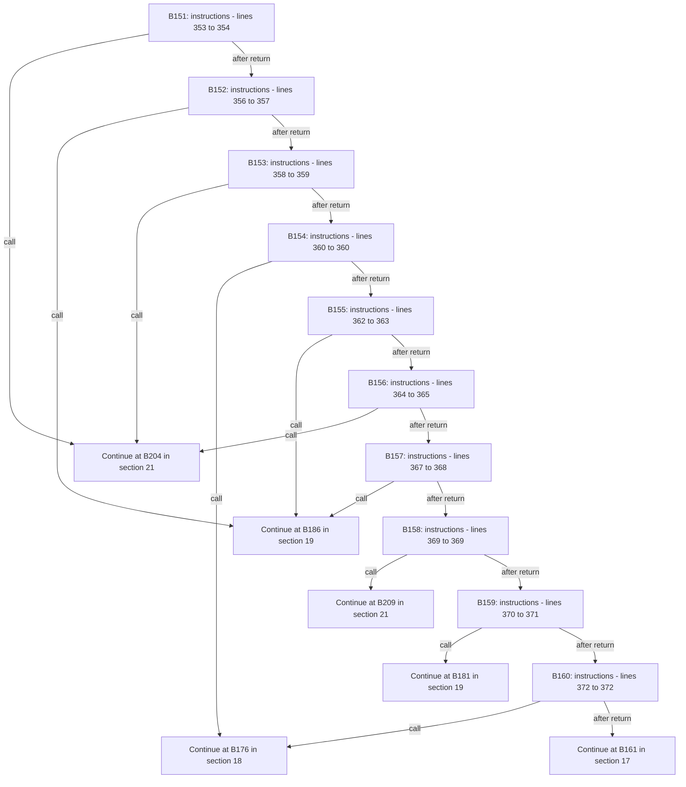

### B151

```asm
mov dptr, #sel
acall wstr
```

### B152

```asm
mov a,#0c0h
acall cmd
```

### B153

```asm
mov dptr, #op2
acall wstr
```

### B154

```asm
acall delay
```

### B155

```asm
mov a, #80H
acall cmd
```

### B156

```asm
mov dptr, #SPACE
acall wstr
```

### B157

```asm
mov a, #80H
acall cmd
```

### B158

```asm
ACALL KEYPAD
```

### B159

```asm
MOV 35H,A
ACALL WCHR
```

### B160

```asm
ACALL DELAY
```

## Section 17

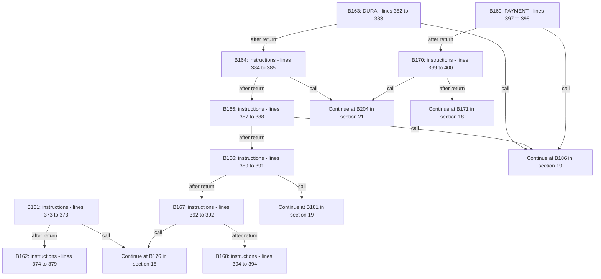

### B161

```asm
ACALL DELAY
```

### B162

Return to the instruction following the active call.

```asm
MOV A,35H
SUBB A,#30H
MOV 31H,A
RET
```

### B163

```asm
mov a, #80H
acall cmd
```

### B164

```asm
mov dptr, #dur
acall wstr
```

### B165

```asm
mov a,#0c0h
acall cmd
```

### B166

```asm
mov a,31h
add a,#30h
acall wchr
```

### B167

```asm
acall delay
```

### B168

Return to the instruction following the active call.

```asm
ret
```

### B169

```asm
mov a, #80H
acall cmd
```

### B170

```asm
mov dptr, #pay
acall wstr
```

## Section 18

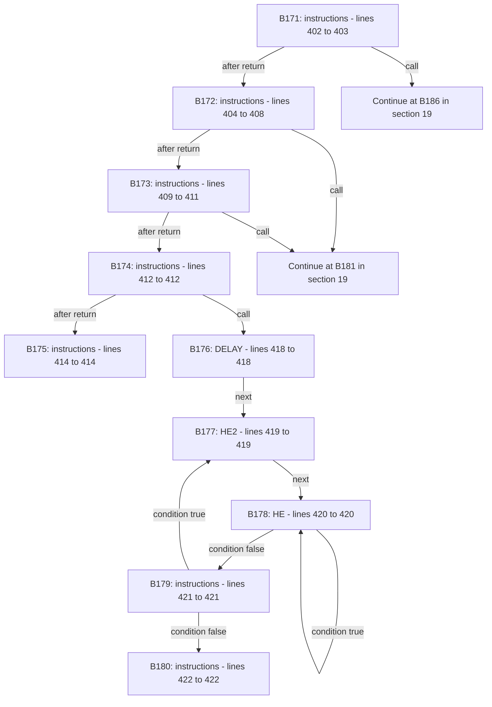

### B171

```asm
mov a,#0c0h
acall cmd
```

### B172

```asm
mov a,32h
mov b,#0Ah
div ab
add a,#30h
acall wchr
```

### B173

```asm
mov a,b
add a,#30h
acall wchr
```

### B174

```asm
acall delay
```

### B175

Return to the instruction following the active call.

```asm
ret
```

### B176

```asm
MOV R1,#100
```

### B177

```asm
MOV R0,#100
```

### B178

```asm
DJNZ R0,he
```

### B179

```asm
djnz r1,he2
```

### B180

Return to the instruction following the active call.

```asm
RET
```

## Section 19

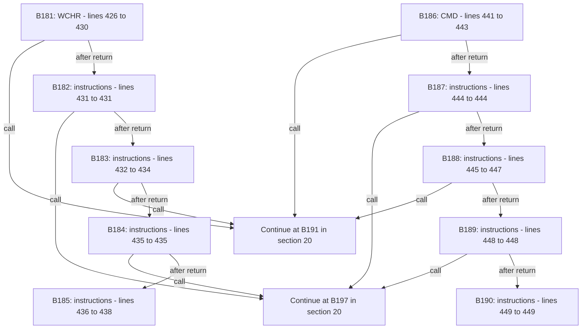

### B181

```asm
PUSH ACC
PUSH B
SETB P1.3
MOV B,A
ACALL COMMON
```

### B182

```asm
ACALL LDELAY
```

### B183

```asm
MOV A,B
SWAP A
ACALL COMMON
```

### B184

```asm
ACALL LDELAY
```

### B185

Return to the instruction following the active call.

```asm
POP B
POP ACC
RET
```

### B186

```asm
CLR P1.3
MOV B,A
ACALL COMMON
```

### B187

```asm
ACALL LDELAY
```

### B188

```asm
MOV A,B
SWAP A
ACALL COMMON
```

### B189

```asm
ACALL LDELAY
```

### B190

Return to the instruction following the active call.

```asm
RET
```

## Section 20

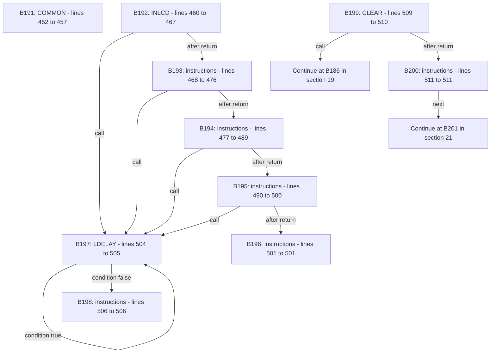

### B191

Return to the instruction following the active call.

```asm
ANL a,#11110000B
ANL P1, #00001111B
ORL P1,A
SETB P1.2
CLR P1.2
RET
```

### B192

```asm
CLR P1.3
CLR P1.7
CLR P1.6
SETB P1.5
CLR P1.4
SETB P1.2
CLR P1.2
ACALL LDELAY
```

### B193

```asm
SETB P1.2
CLR P1.2
SETB P1.7
CLR P1.6
CLR P1.5
CLR P1.4
SETB P1.2
CLR P1.2
ACALL LDELAY
```

### B194

```asm
CLR P1.7
CLR P1.6
CLR P1.5
CLR P1.4
SETB P1.2
CLR P1.2
SETB P1.7
SETB P1.6
SETB P1.5
SETB P1.4
SETB P1.2
CLR P1.2
ACALL LDELAY
```

### B195

```asm
CLR P1.7
CLR P1.6
CLR P1.5
CLR P1.4
SETB P1.2
CLR P1.2
SETB P1.6
SETB P1.5
SETB P1.2
CLR P1.2
ACALL LDELAY
```

### B196

Return to the instruction following the active call.

```asm
RET
```

### B197

```asm
MOV R0, #50
DJNZ R0, $
```

### B198

Return to the instruction following the active call.

```asm
RET
```

### B199

```asm
MOV A,#01H
ACALL CMD
```

### B200

```asm
MOV R7,#14
```

## Section 21

```mermaid
flowchart TD
B200["B201: WAIT - lines 512 to 512"]
B201["B202: instructions - lines 513 to 513"]
B202["B203: instructions - lines 514 to 514"]
B203["B204: WSTR - lines 517 to 517"]
B204["B205: CONT1 - lines 519 to 521"]
B205["B206: PRINT - lines 523 to 523"]
B206["B207: instructions - lines 524 to 525"]
B207["B208: EXIT1 - lines 526 to 527"]
B208["B209: KEYPAD - lines 533 to 533"]
B209["B210: K1 - lines 534 to 537"]
B200 -->|call| B196
B200 -->|after return| B201
B201 -->|condition true| B200
B201 -->|condition false| B202
B203 -->|next| B204
B204 -->|condition true| B207
B204 -->|condition false| B205
B205 -->|call| B180
B205 -->|after return| B206
B206 -->|jump| B204
B208 -->|next| B209
B209 -->|condition true| B209
B209 -->|condition false| B210
B196["Continue at B197 in section 20"]
B180["Continue at B181 in section 19"]
B210["Continue at B211 in section 22"]
```

### B201

```asm
ACALL LDELAY
```

### B202

```asm
DJNZ R7,WAIT
```

### B203

Return to the instruction following the active call.

```asm
ret
```

### B204

```asm
PUSH    ACC
```

### B205

```asm
CLR     A
MOVC    A,@A+DPTR
JZ Exit1
```

### B206

```asm
ACALL    WCHR
```

### B207

```asm
INC DPTR
AJMP    CONT1
```

### B208

Return to the instruction following the active call.

```asm
POP     ACC
RET
```

### B209

```asm
MOV P0,#01110000B
```

### B210

```asm
MOV P0,#01110000B
MOV A,P0
ANL A,#01110000B
CJNE A,#01110000B,K1
```

## Section 22

```mermaid
flowchart TD
B210["B211: K2 - lines 539 to 541"]
B211["B212: instructions - lines 542 to 542"]
B212["B213: OVER1 - lines 544 to 547"]
B213["B214: instructions - lines 548 to 551"]
B214["B215: instructions - lines 552 to 555"]
B215["B216: instructions - lines 556 to 559"]
B216["B217: instructions - lines 560 to 560"]
B217["B218: ROW_0 - lines 561 to 562"]
B218["B219: ROW_1 - lines 563 to 564"]
B219["B220: ROW_2 - lines 565 to 566"]
B210 -->|condition true| B212
B210 -->|condition false| B211
B211 -->|jump| B210
B212 -->|condition true| B217
B212 -->|condition false| B213
B213 -->|condition true| B218
B213 -->|condition false| B214
B214 -->|condition true| B219
B214 -->|condition false| B215
B215 -->|condition true| B220
B215 -->|condition false| B216
B216 -->|jump| B210
B217 -->|jump| B221
B218 -->|jump| B221
B219 -->|jump| B221
B220["Continue at B221 in section 23"]
B221["Continue at B222 in section 23"]
```

### B211

```asm
MOV A,P0
ANL A,#01110000B
CJNE A,#01110000B,OVER1
```

### B212

```asm
SJMP K2
```

### B213

```asm
MOV P0,#01111110B
MOV A,P0
ANL A,#01110000B
CJNE A,#01110000B,ROW_0
```

### B214

```asm
MOV P0,#01111101B
MOV A,P0
ANL A,#01110000B
CJNE A,#01110000B,ROW_1
```

### B215

```asm
MOV P0,#01111011B
MOV A,P0
ANL A,#01110000B
CJNE A,#01110000B,ROW_2
```

### B216

```asm
MOV P0,#01110111B
MOV A,P0
ANL A,#01110000B
CJNE A,#01110000B,ROW_3
```

### B217

```asm
LJMP K2
```

### B218

```asm
MOV DPTR,#KCODE0
SJMP FIND
```

### B219

```asm
MOV DPTR,#KCODE1
SJMP FIND
```

### B220

```asm
MOV DPTR,#KCODE2
SJMP FIND
```

## Section 23

```mermaid
flowchart TD
B220["B221: ROW_3 - lines 567 to 567"]
B221["B222: FIND - lines 569 to 569"]
B222["B223: FIND1 - lines 571 to 572"]
B223["B224: instructions - lines 573 to 574"]
B224["B225: MATCH - lines 575 to 577"]
B220 -->|next| B221
B221 -->|next| B222
B222 -->|condition true| B224
B222 -->|condition false| B223
B223 -->|jump| B222
```

### B221

```asm
MOV DPTR,#KCODE3
```

### B222

```asm
RLC A
```

### B223

```asm
RLC A
JNC MATCH
```

### B224

```asm
INC DPTR
SJMP FIND1
```

### B225

Return to the instruction following the active call.

```asm
CLR A
MOVC A,@A+DPTR
RET
```
