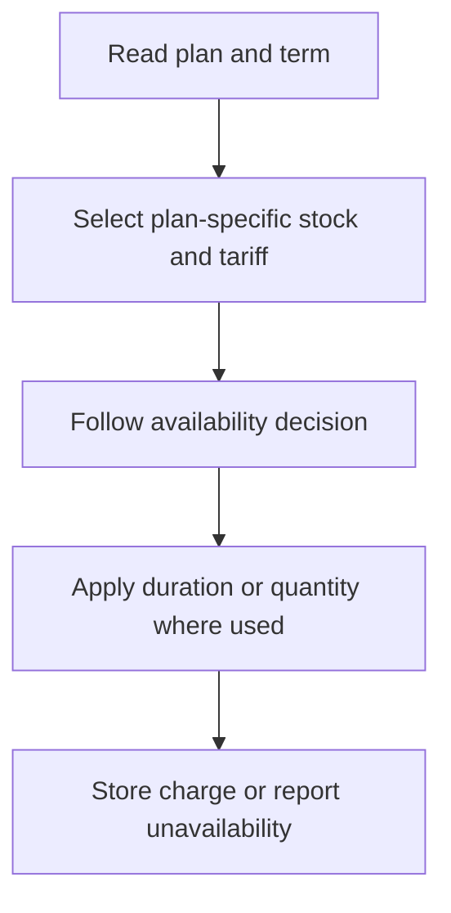
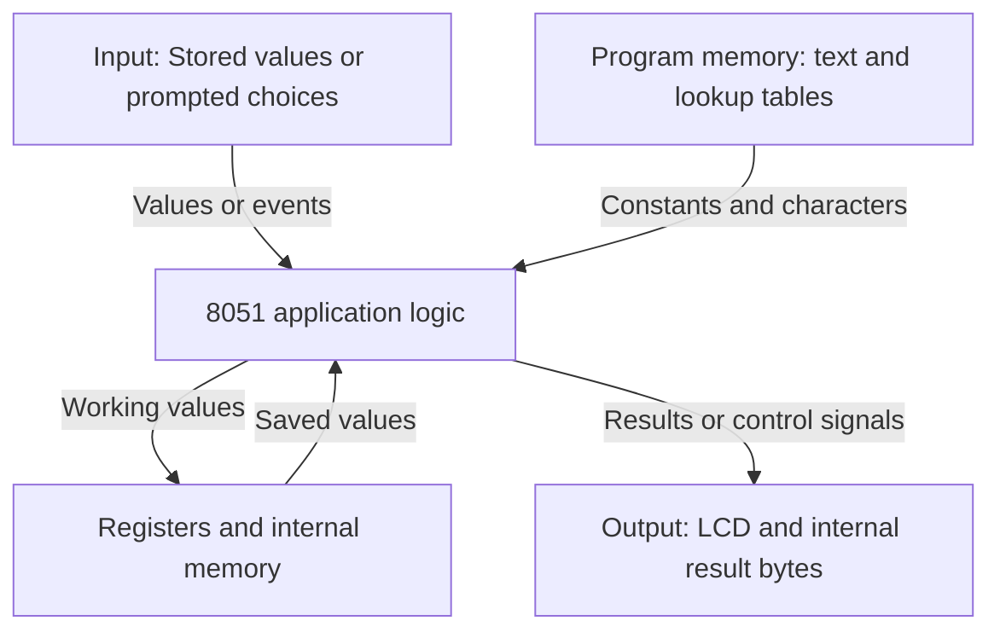

# Gym Membership Booking

[Group overview](../../README.md) · [Compare implementations](../README.md)

Select a membership plan and billing term, then use the corresponding price and availability.

**Implementation:** LCD Membership Duration Modified

**Input:** stored values or prompted choices.  
**Output:** LCD and internal result bytes.

## Inputs and results

| Parameter | Description |
| --- | --- |
| Input | VIP, online, or regular plan; monthly or yearly term; duration or quantity where requested |
| Output | Membership charge and the relevant stock or availability result |

## Worked example

The VIP monthly tariff is 35 before multiplying by any requested quantity or duration.

### Calculation details

Select the VIP monthly plan with one membership and available stock. Follow the monthly branch and inspect the selected tariff. The monthly VIP price is 35 decimal (23H) before any quantity multiplication.

## Program operation

1. Read plan and term.
2. Select plan-specific stock and tariff.
3. Follow availability decision.
4. Apply duration or quantity where used.
5. Store charge or report unavailability.

### Functional flowchart

[Detailed control flow](source-flow.md)

### Simplified block diagram

**Port registers:** `P1`, `P1.2`, `P1.3`, `P1.4`, `P1.5`, `P1.6`, `P1.7`.

## Technical limitations

No additional defect was recorded in the earlier source review. This is not evidence of a successful build or hardware test.

## Build and test

1. Open the [assembly source](source.asm) in an 8051 assembler or simulator.
2. Review the technical limitations and configure the peripherals required by this implementation.
3. Check the expected result using the example inputs.
