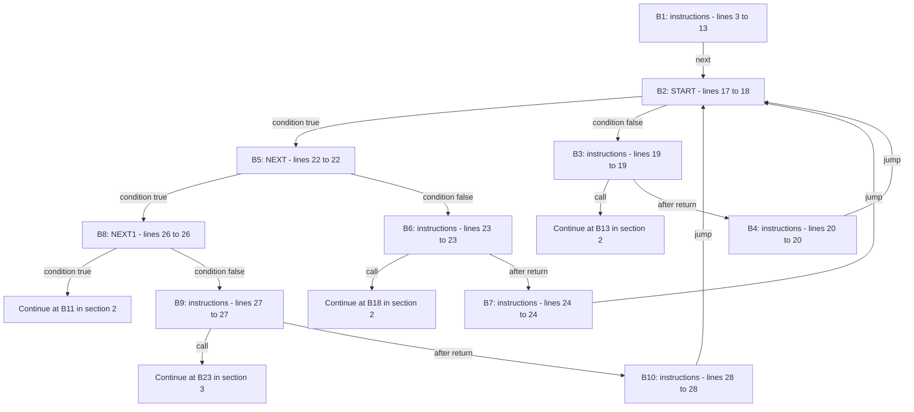
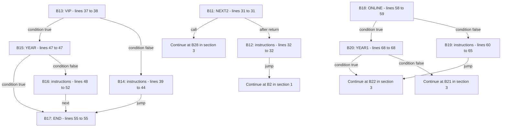
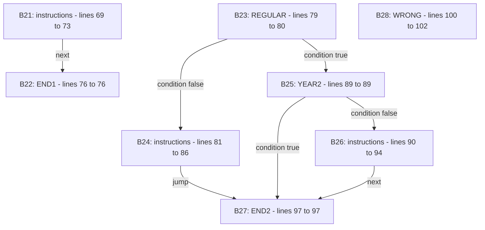

# Program Control Flow

[Back to project](README.md)

Control-flow blocks are indexed by source line. Calls resume at the instruction following the call if the subroutine returns normally.

## Entry locations

- `ORG 000H` begins at B1.

## Navigation

[Section 1](#section-1) · [Section 2](#section-2) · [Section 3](#section-3)

## Section 1



### B1

```asm
MOV 40H,#5
MOV 41H,#5
MOV 42H,#30
MOV 43H,#30
MOV 44H,#20
MOV 45H,#20
MOV 30H,#2
MOV R2,#1
MOV 31H,#2
MOV 32H,#0
MOV 33H,#0
```

### B2

```asm
MOV A,30H
CJNE A,#1,NEXT
```

### B3

```asm
ACALL VIP
```

### B4

```asm
AJMP START
```

### B5

```asm
CJNE A,#2,NEXT1
```

### B6

```asm
ACALL ONLINE
```

### B7

```asm
AJMP START
```

### B8

```asm
CJNE A,#3,NEXT2
```

### B9

```asm
ACALL REGULAR
```

### B10

```asm
AJMP START
```

## Section 2



### B11

```asm
ACALL WRONG
```

### B12

```asm
AJMP START
```

### B13

```asm
MOV A,R2
CJNE A,#1,YEAR
```

### B14

```asm
MOV A,#35
MOV B,31H
MUL AB
MOV 32H,A
MOV 33H,B
SJMP END
```

### B15

```asm
CJNE A,#2, END
```

### B16

```asm
MOV A,#99
MOV B,31H
MUL AB
MOV 32H,A
MOV 33H,B
```

### B17

Return to the instruction following the active call.

```asm
RET
```

### B18

```asm
MOV A,R2
CJNE A,#1,YEAR1
```

### B19

```asm
MOV A,#5
MOV B,31H
MUL AB
MOV 32H,A
MOV 33H,B
SJMP END1
```

### B20

```asm
CJNE A,#2, END1
```

## Section 3



### B21

```asm
MOV A,#30
MOV B,31H
MUL AB
MOV 32H,A
MOV 33H,B
```

### B22

Return to the instruction following the active call.

```asm
RET
```

### B23

```asm
MOV A,R2
CJNE A,#1,YEAR2
```

### B24

```asm
MOV A,#10
MOV B,31H
MUL AB
MOV 32H,A
MOV 33H,B
SJMP END2
```

### B25

```asm
CJNE A,#2, END2
```

### B26

```asm
MOV A,#70
MOV B,31H
MUL AB
MOV 32H,A
MOV 33H,B
```

### B27

Return to the instruction following the active call.

```asm
RET
```

### B28

Return to the instruction following the active call.

```asm
MOV 32H,#0
MOV 33H,#0
RET
```
