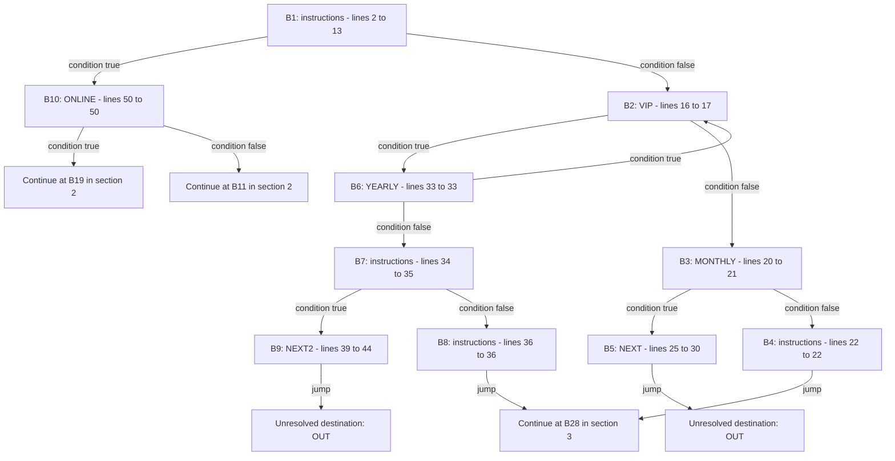
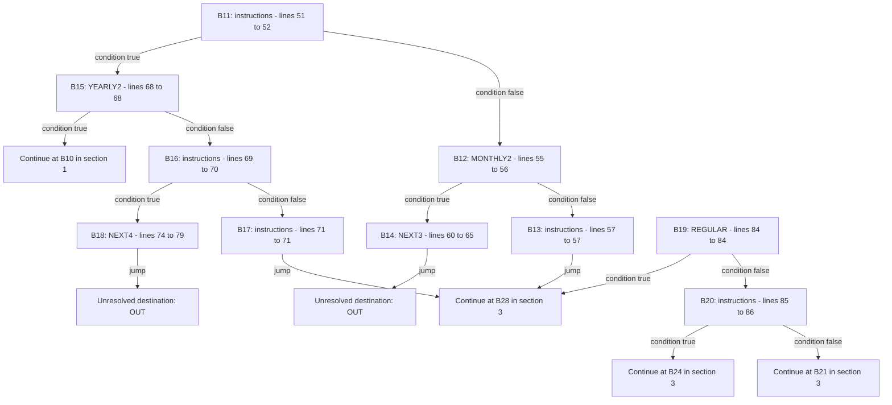
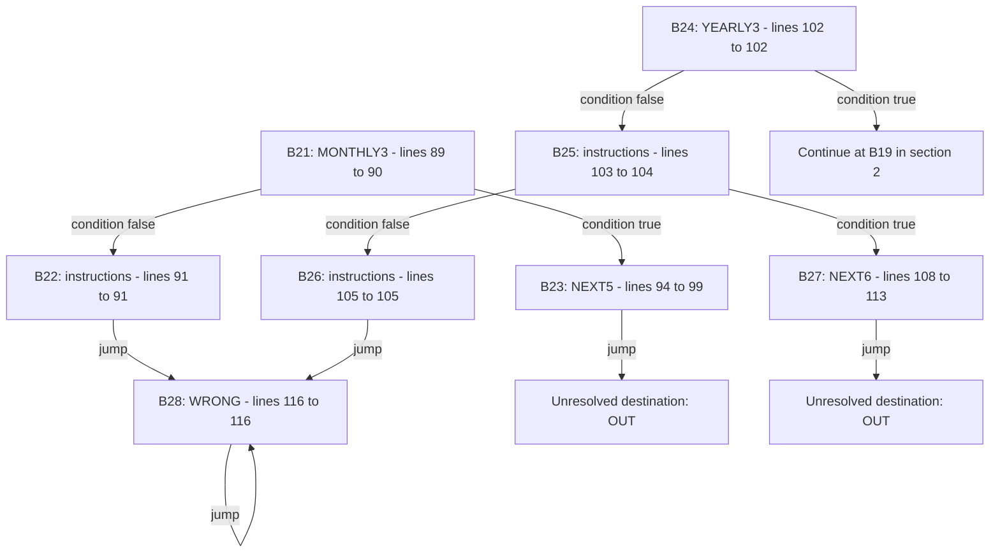

# Program Control Flow

[Back to project](README.md)

Control-flow blocks are indexed by source line. Calls resume at the instruction following the call if the subroutine returns normally.

## Entry locations

- `ORG 0H` begins at B1.

## Navigation

[Section 1](#section-1) · [Section 2](#section-2) · [Section 3](#section-3)

## Destinations requiring review

`OUT`. A repeated label is also unresolved because it has more than one candidate target.

## Section 1



### B1

```asm
MOV 30H,#2
MOV 31H,#1
MOV 32H,#0
MOV 40H,#5
MOV 41H,#5
MOV 42H,#30
MOV 43H,#30
MOV 44H,#20
MOV 45H,#20
MOV A,30H
CJNE A,#1,ONLINE
```

### B2

```asm
MOV A,31H
CJNE A,#1,YEARLY
```

### B3

```asm
MOV R1,40H
DJNZ R1,NEXT
```

### B4

```asm
SJMP WRONG
```

### B5

```asm
CLR A
DEC 40H
MOV DPTR,#VIPM
MOVC A,@A+DPTR
MOV 32H,A
SJMP OUT
```

### B6

```asm
CJNE A,#2,VIP
```

### B7

```asm
MOV R2,41H
DJNZ R2,NEXT2
```

### B8

```asm
SJMP WRONG
```

### B9

```asm
CLR A
DEC 41H
MOV DPTR,#VIPY
MOVC A,@A+DPTR
MOV 32H,A
SJMP OUT
```

### B10

```asm
CJNE A,#2,REGULAR
```

## Section 2



### B11

```asm
MOV A,31H
CJNE A,#1,YEARLY2
```

### B12

```asm
MOV R1,42H
DJNZ R1,NEXT3
```

### B13

```asm
SJMP WRONG
```

### B14

```asm
CLR A
DEC 42H
MOV DPTR,#ONM
MOVC A,@A+DPTR
MOV 32H,A
SJMP OUT
```

### B15

```asm
CJNE A,#2,ONLINE
```

### B16

```asm
MOV R2,43H
DJNZ R2,NEXT4
```

### B17

```asm
SJMP WRONG
```

### B18

```asm
CLR A
DEC 43H
MOV DPTR,#ONY
MOVC A,@A+DPTR
MOV 32H,A
SJMP OUT
```

### B19

```asm
CJNE A,#3,WRONG
```

### B20

```asm
MOV A,31H
CJNE A,#1,YEARLY3
```

## Section 3



### B21

```asm
MOV R1,44H
DJNZ R1,NEXT5
```

### B22

```asm
SJMP WRONG
```

### B23

```asm
CLR A
DEC 44H
MOV DPTR,#REGM
MOVC A,@A+DPTR
MOV 32H,A
SJMP OUT
```

### B24

```asm
CJNE A,#2,REGULAR
```

### B25

```asm
MOV R2,45H
DJNZ R2,NEXT6
```

### B26

```asm
SJMP WRONG
```

### B27

```asm
CLR A
DEC 45H
MOV DPTR,#REGY
MOVC A,@A+DPTR
MOV 32H,A
SJMP OUT
```

### B28

```asm
SJMP $
```
