# Program Control Flow

[Back to project](README.md)

Control-flow blocks are indexed by source line. Calls resume at the instruction following the call if the subroutine returns normally.

## Entry locations

- `ORG 00H` begins at B1.

## Navigation

[Section 1](#section-1) · [Section 2](#section-2) · [Section 3](#section-3) · [Section 4](#section-4) · [Section 5](#section-5) · [Section 6](#section-6) · [Section 7](#section-7) · [Section 8](#section-8) · [Section 9](#section-9) · [Section 10](#section-10) · [Section 11](#section-11) · [Section 12](#section-12) · [Section 13](#section-13) · [Section 14](#section-14) · [Section 15](#section-15) · [Section 16](#section-16) · [Section 17](#section-17) · [Section 18](#section-18) · [Section 19](#section-19) · [Section 20](#section-20) · [Section 21](#section-21)

## Section 1

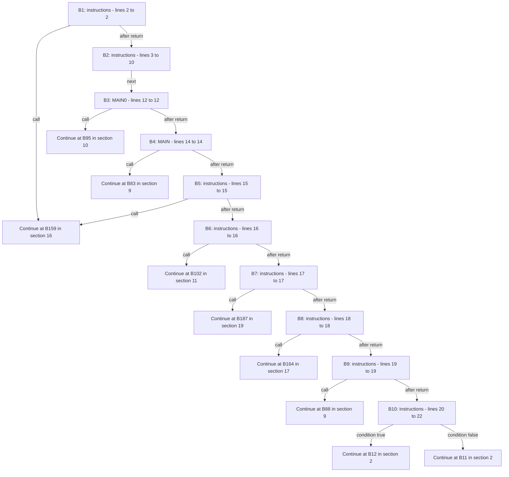

### B1

```asm
ACALL INLCD
```

### B2

```asm
MOV 30H,#2
MOV 31H,#2
MOV 32H,#1
MOV 33H,#1
MOV 34H,#4
MOV 35H,#0
MOV 36H,#0
```

### B3

```asm
ACALL FN1
```

### B4

```asm
ACALL FLASH
```

### B5

```asm
ACALL INLCD
```

### B6

```asm
ACALL FN2
```

### B7

```asm
ACALL KEYPAD
```

### B8

```asm
ACALL WCHR
```

### B9

```asm
ACALL DELAY
```

### B10

```asm
MOV 30H,A
CJNE A,#'1',CAT2
```

## Section 2

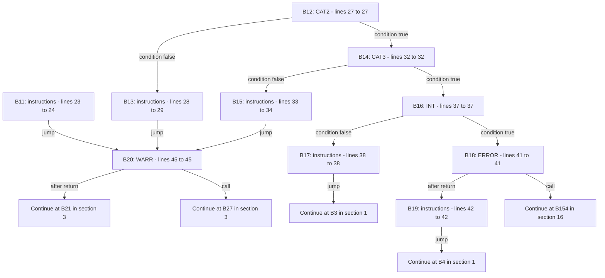

### B11

```asm
MOV 36H,#35
AJMP WARR
```

### B12

```asm
CJNE A,#'2',CAT3
```

### B13

```asm
MOV 36H,#28
AJMP WARR
```

### B14

```asm
CJNE A,#'3',INT
```

### B15

```asm
MOV 36H,#44
AJMP WARR
```

### B16

```asm
CJNE A,#'#',ERROR
```

### B17

```asm
LJMP MAIN0
```

### B18

```asm
ACALL ERRR
```

### B19

```asm
SJMP MAIN
```

### B20

```asm
ACALL INSURANCE
```

## Section 3

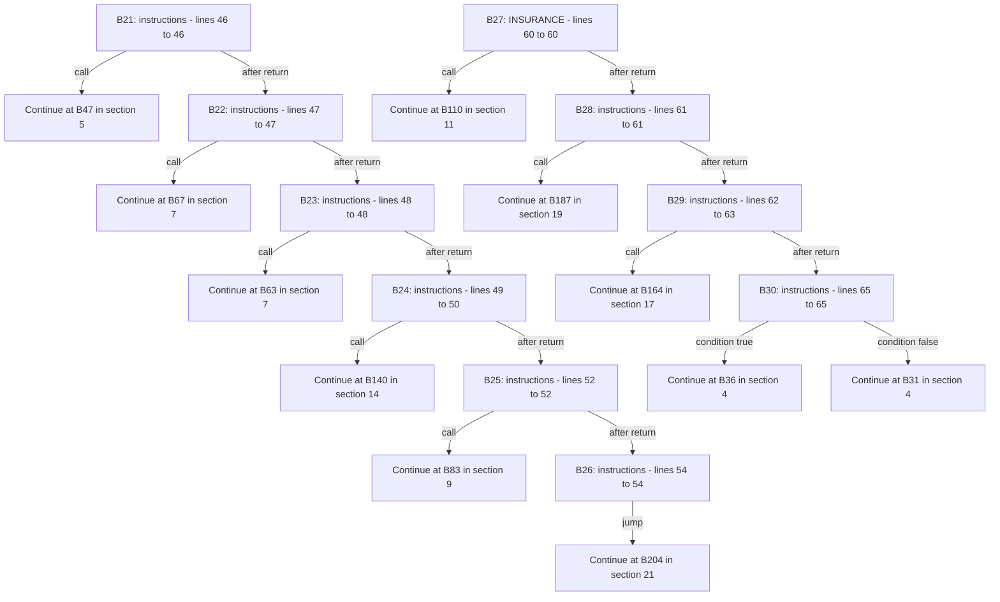

### B21

```asm
ACALL ABROADINSURNCE
```

### B22

```asm
ACALL MEMBERSHIP
```

### B23

```asm
ACALL SUBSCRIPTION
```

### B24

```asm
MOV 35H,36H
ACALL SHOWCOST
```

### B25

```asm
ACALL FLASH
```

### B26

```asm
AJMP ENDD
```

### B27

```asm
ACALL FN3
```

### B28

```asm
ACALL KEYPAD
```

### B29

```asm
MOV 31H,A
ACALL WCHR
```

### B30

```asm
CJNE A,#'1',TWOYEAR
```

## Section 4

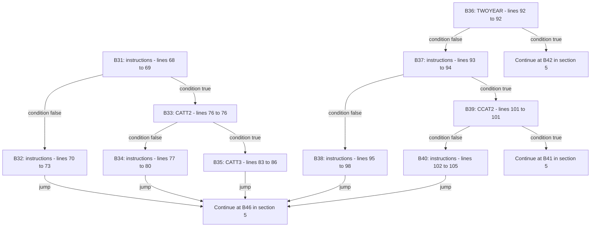

### B31

```asm
MOV A,30H
CJNE A,#1,CATT2
```

### B32

```asm
MOV A,36H
ADD A,#5
MOV 36H,A
SJMP BACK
```

### B33

```asm
CJNE A,#'2',CATT3
```

### B34

```asm
MOV A,36H
ADD A,#7
MOV 36H,A
SJMP BACK
```

### B35

```asm
MOV A,36H
ADD A,#12
MOV 36H,A
SJMP BACK
```

### B36

```asm
CJNE A,#'2',INT1
```

### B37

```asm
MOV A,30H
CJNE A,#1,CCAT2
```

### B38

```asm
MOV A,36H
ADD A,#11
MOV 36H,A
SJMP BACK
```

### B39

```asm
CJNE A,#2,CCAT3
```

### B40

```asm
MOV A,36H
ADD A,#18
MOV 36H,A
SJMP BACK
```

## Section 5

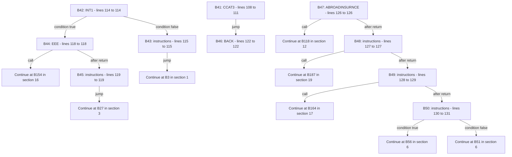

### B41

```asm
MOV A,36H
ADD A,#20
MOV 36H,A
SJMP BACK
```

### B42

```asm
CJNE A,#'#',EEE
```

### B43

```asm
LJMP MAIN0
```

### B44

```asm
ACALL ERRR
```

### B45

```asm
SJMP INSURANCE
```

### B46

Return to the instruction following the active call.

```asm
RET
```

### B47

```asm
ACALL FN4
```

### B48

```asm
ACALL KEYPAD
```

### B49

```asm
MOV 32H,A
ACALL WCHR
```

### B50

```asm
MOV A,32H
CJNE A,#'1',NO
```

## Section 6


### B51

```asm
MOV A,30H
CJNE A,#1,CAT22
```

### B52

```asm
MOV A,36H
ADD A,#13
MOV 36H,A
SJMP BACK1
```

### B53

```asm
CJNE A,#2,CAT33
```

### B54

```asm
MOV A,36H
ADD A,#22
MOV 36H,A
SJMP BACK1
```

### B55

```asm
MOV A,36H
ADD A,#25
MOV 36H,A
SJMP BACK1
```

### B56

```asm
CJNE A,#'2',INT2
```

### B57

```asm
SJMP BACK1
```

### B58

```asm
CJNE A,#'#',EERR
```

### B59

```asm
LJMP MAIN0
```

### B60

```asm
ACALL ERRR
```

## Section 7

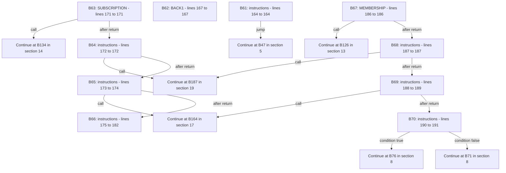

### B61

```asm
SJMP ABROADINSURNCE
```

### B62

Return to the instruction following the active call.

```asm
RET
```

### B63

```asm
ACALL FN6
```

### B64

```asm
ACALL KEYPAD
```

### B65

```asm
MOV 34H,A
ACALL WCHR
```

### B66

Return to the instruction following the active call.

```asm
MOV A,34H
SUBB A,#30H
MOV 34H,A
MOV A,36H
SUBB A,34H
MOV 36H,A
RET
```

### B67

```asm
ACALL FN5
```

### B68

```asm
ACALL KEYPAD
```

### B69

```asm
MOV 33H,A
ACALL WCHR
```

### B70

```asm
MOV A,33H
CJNE A,#'1',NO2
```

## Section 8

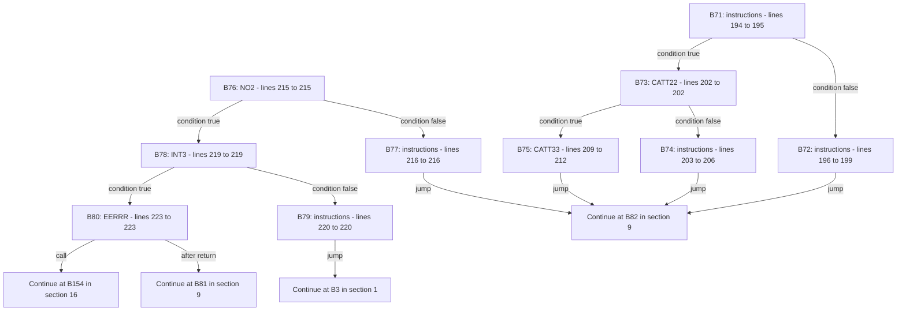

### B71

```asm
MOV A,30H
CJNE A,#1,CATT22
```

### B72

```asm
MOV A,36H
SUBB A,#8
MOV 36H,A
SJMP BACK3
```

### B73

```asm
CJNE A,#2,CATT33
```

### B74

```asm
MOV A,36H
SUBB A,#10
MOV 36H,A
SJMP BACK3
```

### B75

```asm
MOV A,36H
SUBB A,#15
MOV 36H,A
SJMP BACK3
```

### B76

```asm
CJNE A,#'2',INT3
```

### B77

```asm
SJMP BACK3
```

### B78

```asm
CJNE A,#'#',EERRR
```

### B79

```asm
LJMP MAIN0
```

### B80

```asm
ACALL ERRR
```

## Section 9

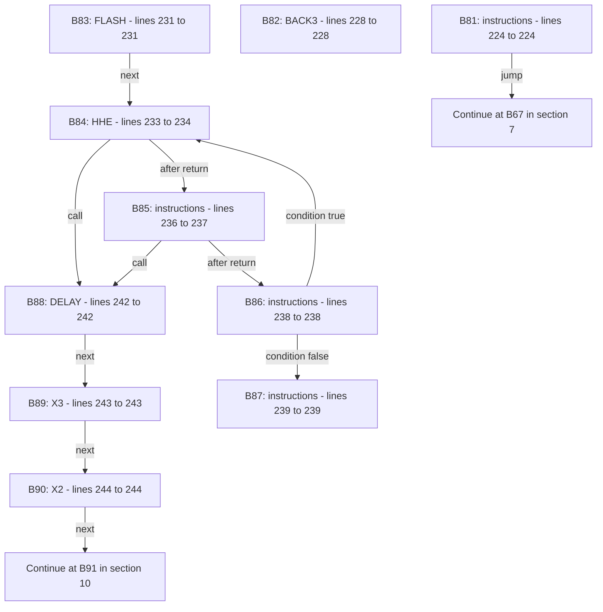

### B81

```asm
SJMP MEMBERSHIP
```

### B82

Return to the instruction following the active call.

```asm
RET
```

### B83

```asm
MOV R7,#5
```

### B84

```asm
MOV P1,#0H
ACALL DELAY
```

### B85

```asm
MOV P1,#0FFH
ACALL DELAY
```

### B86

```asm
DJNZ R7,HHE
```

### B87

Return to the instruction following the active call.

```asm
RET
```

### B88

```asm
MOV	R5,#2
```

### B89

```asm
MOV	R4,#20
```

### B90

```asm
MOV	R3,#250
```

## Section 10

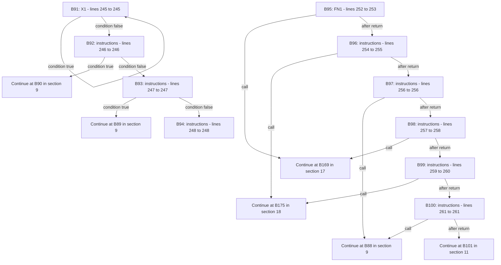

### B91

```asm
DJNZ	R3,X1
```

### B92

```asm
DJNZ	R4,X2
```

### B93

```asm
DJNZ	R5,X3
```

### B94

Return to the instruction following the active call.

```asm
RET
```

### B95

```asm
MOV A, #80H
ACALL CMD
```

### B96

```asm
MOV DPTR, #STR1
ACALL WSTR
```

### B97

```asm
ACALL DELAY
```

### B98

```asm
MOV A, #0C0H
ACALL CMD
```

### B99

```asm
MOV DPTR, #STR2
ACALL WSTR
```

### B100

```asm
ACALL DELAY
```

## Section 11

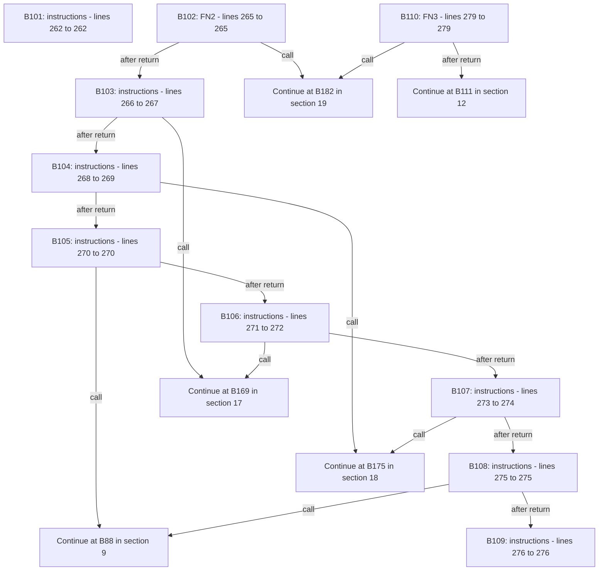

### B101

Return to the instruction following the active call.

```asm
RET
```

### B102

```asm
ACALL CLEAR
```

### B103

```asm
MOV A, #80H
ACALL CMD
```

### B104

```asm
MOV DPTR, #STR3
ACALL WSTR
```

### B105

```asm
ACALL DELAY
```

### B106

```asm
MOV A, #0C0H
ACALL CMD
```

### B107

```asm
MOV DPTR, #STR4
ACALL WSTR
```

### B108

```asm
ACALL DELAY
```

### B109

Return to the instruction following the active call.

```asm
RET
```

### B110

```asm
ACALL CLEAR
```

## Section 12

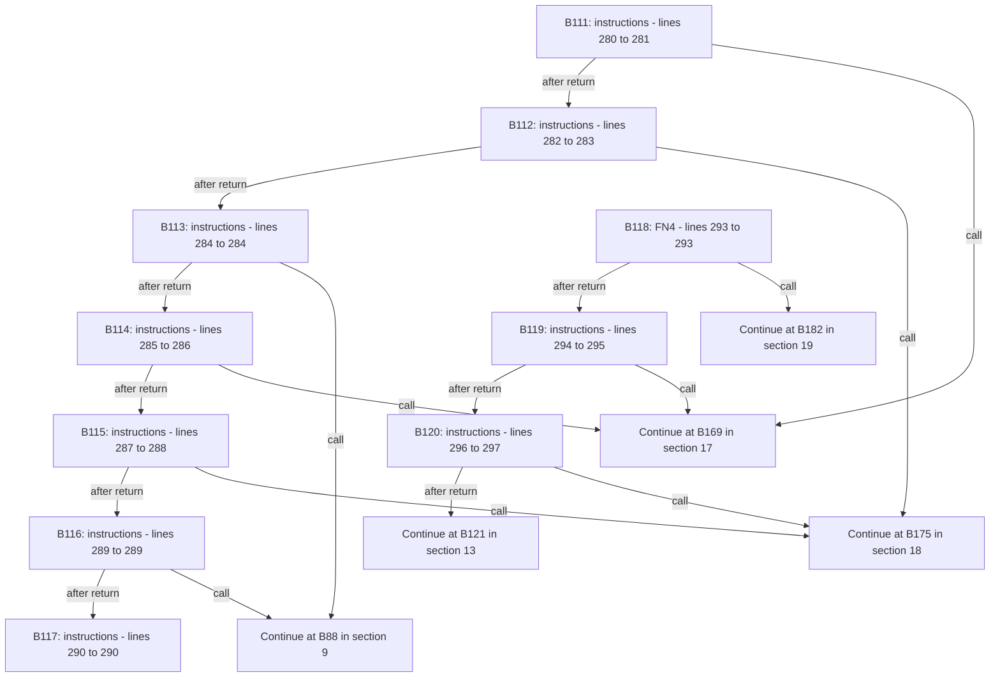

### B111

```asm
MOV A, #80H
ACALL CMD
```

### B112

```asm
MOV DPTR, #STR5
ACALL WSTR
```

### B113

```asm
ACALL DELAY
```

### B114

```asm
MOV A, #0C0H
ACALL CMD
```

### B115

```asm
MOV DPTR, #STR6
ACALL WSTR
```

### B116

```asm
ACALL DELAY
```

### B117

Return to the instruction following the active call.

```asm
RET
```

### B118

```asm
ACALL CLEAR
```

### B119

```asm
MOV A, #80H
ACALL CMD
```

### B120

```asm
MOV DPTR, #STR7
ACALL WSTR
```

## Section 13

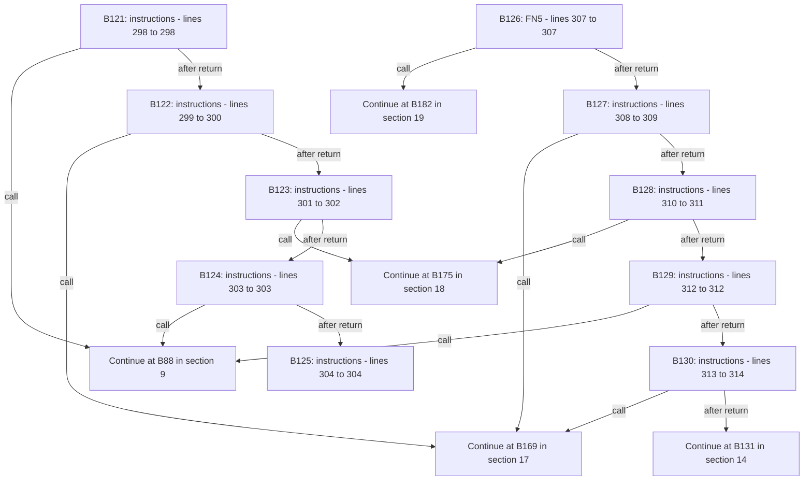

### B121

```asm
ACALL DELAY
```

### B122

```asm
MOV A, #0C0H
ACALL CMD
```

### B123

```asm
MOV DPTR, #ANSWER
ACALL WSTR
```

### B124

```asm
ACALL DELAY
```

### B125

Return to the instruction following the active call.

```asm
RET
```

### B126

```asm
ACALL CLEAR
```

### B127

```asm
MOV A, #80H
ACALL CMD
```

### B128

```asm
MOV DPTR, #STR8
ACALL WSTR
```

### B129

```asm
ACALL DELAY
```

### B130

```asm
MOV A, #0C0H
ACALL CMD
```

## Section 14

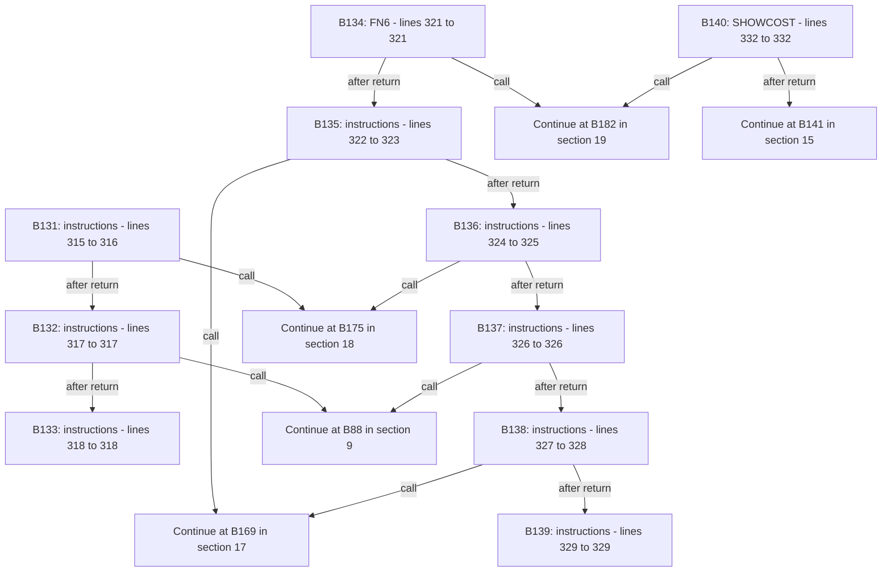

### B131

```asm
MOV DPTR, #ANSWER
ACALL WSTR
```

### B132

```asm
ACALL DELAY
```

### B133

Return to the instruction following the active call.

```asm
RET
```

### B134

```asm
ACALL CLEAR
```

### B135

```asm
MOV A, #80H
ACALL CMD
```

### B136

```asm
MOV DPTR, #STR9
ACALL WSTR
```

### B137

```asm
ACALL DELAY
```

### B138

```asm
MOV A, #0C0H
ACALL CMD
```

### B139

Return to the instruction following the active call.

```asm
RET
```

### B140

```asm
ACALL CLEAR
```

## Section 15

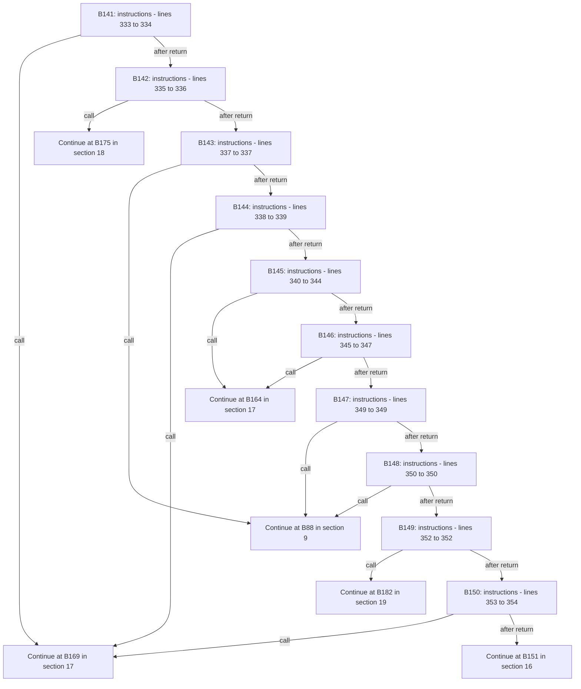

### B141

```asm
MOV A, #80H
ACALL CMD
```

### B142

```asm
MOV DPTR, #STR10
ACALL WSTR
```

### B143

```asm
ACALL DELAY
```

### B144

```asm
MOV A, #0C0H
ACALL CMD
```

### B145

```asm
MOV A,35H
MOV B,#10
DIV AB
ADD A,#30H
ACALL WCHR
```

### B146

```asm
MOV A,B
ADD A,#30H
ACALL WCHR
```

### B147

```asm
ACALL DELAY
```

### B148

```asm
ACALL DELAY
```

### B149

```asm
ACALL CLEAR
```

### B150

```asm
MOV A, #80H
ACALL CMD
```

## Section 16

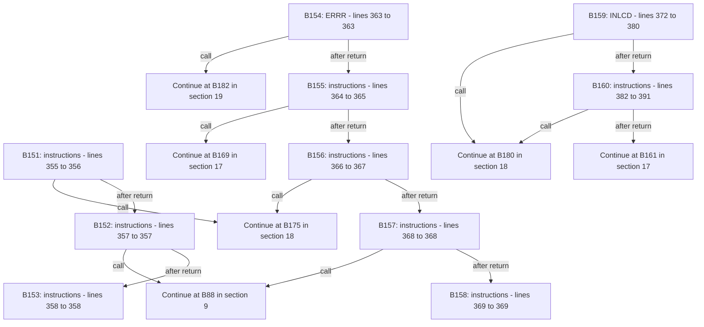

### B151

```asm
MOV DPTR, #THANKS
ACALL WSTR
```

### B152

```asm
ACALL DELAY
```

### B153

Return to the instruction following the active call.

```asm
RET
```

### B154

```asm
ACALL CLEAR
```

### B155

```asm
MOV A, #80H
ACALL CMD
```

### B156

```asm
MOV DPTR, #ERR
ACALL WSTR
```

### B157

```asm
ACALL DELAY
```

### B158

Return to the instruction following the active call.

```asm
RET
```

### B159

```asm
CLR P1.3
CLR P1.7
CLR P1.6
SETB P1.5
CLR P1.4
SETB P1.2
CLR P1.2
ACALL LDELAY
```

### B160

```asm
SETB P1.2
CLR P1.2
SETB P1.7
CLR P1.6
CLR P1.5
CLR P1.4
SETB P1.2
CLR P1.2
ACALL LDELAY
```

## Section 17

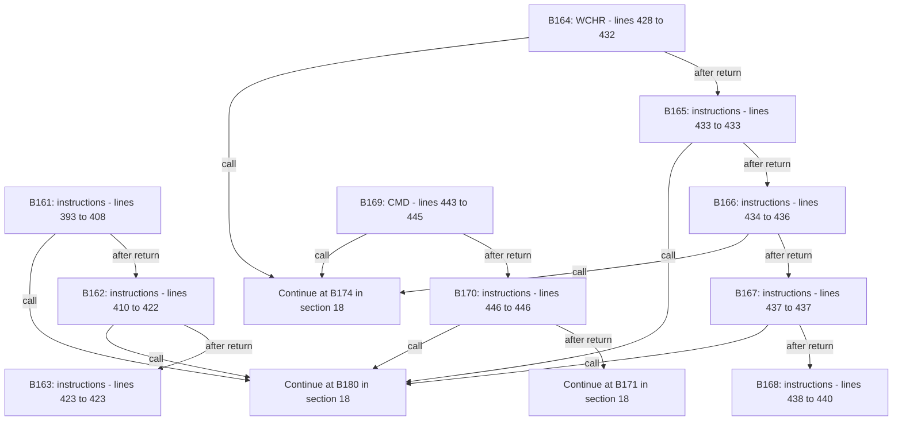

### B161

```asm
CLR P1.7
CLR P1.6
CLR P1.5
CLR P1.4
SETB P1.2
CLR P1.2
SETB P1.7
SETB P1.6
SETB P1.5
SETB P1.4
SETB P1.2
CLR P1.2
ACALL LDELAY
```

### B162

```asm
CLR P1.7
CLR P1.6
CLR P1.5
CLR P1.4
SETB P1.2
CLR P1.2
SETB P1.6
SETB P1.5
SETB P1.2
CLR P1.2
ACALL LDELAY
```

### B163

Return to the instruction following the active call.

```asm
RET
```

### B164

```asm
PUSH ACC
PUSH B
SETB P1.3
MOV B,A
ACALL COMMON
```

### B165

```asm
ACALL LDELAY
```

### B166

```asm
MOV A,B
SWAP A
ACALL COMMON
```

### B167

```asm
ACALL LDELAY
```

### B168

Return to the instruction following the active call.

```asm
POP B
POP ACC
RET
```

### B169

```asm
CLR P1.3
MOV B,A
ACALL COMMON
```

### B170

```asm
ACALL LDELAY
```

## Section 18

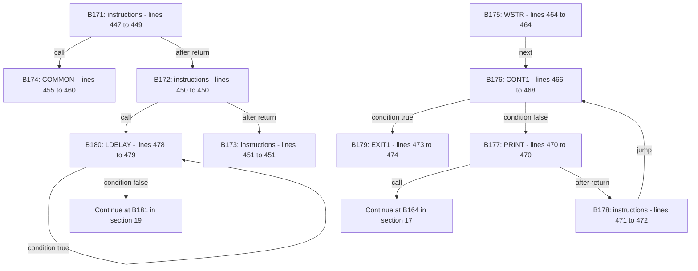

### B171

```asm
MOV A,B
SWAP A
ACALL COMMON
```

### B172

```asm
ACALL LDELAY
```

### B173

Return to the instruction following the active call.

```asm
RET
```

### B174

Return to the instruction following the active call.

```asm
ANL a,#11110000B
ANL P1, #00001111B
ORL P1,A
SETB P1.2
CLR P1.2
RET
```

### B175

```asm
PUSH    ACC
```

### B176

```asm
CLR     A
MOVC    A,@A+DPTR
JZ Exit1
```

### B177

```asm
ACALL    WCHR
```

### B178

```asm
INC DPTR
AJMP    CONT1
```

### B179

Return to the instruction following the active call.

```asm
POP     ACC
RET
```

### B180

```asm
MOV R0, #50
DJNZ R0, $
```

## Section 19

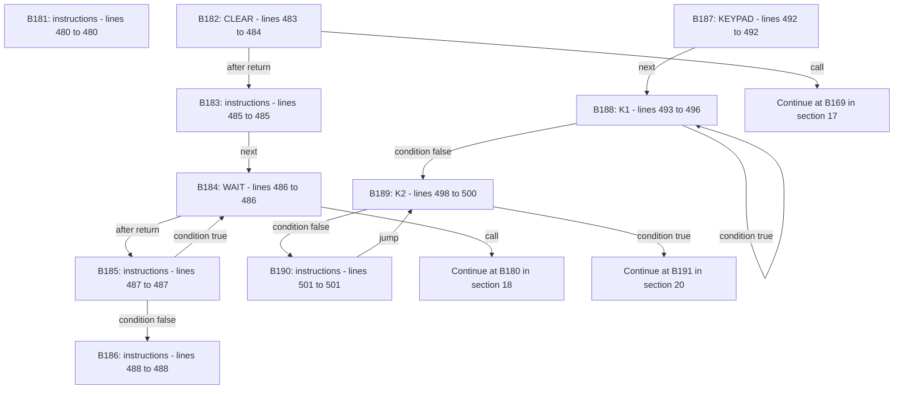

### B181

Return to the instruction following the active call.

```asm
RET
```

### B182

```asm
MOV A,#01H
ACALL CMD
```

### B183

```asm
MOV R7,#14
```

### B184

```asm
ACALL LDELAY
```

### B185

```asm
DJNZ R7,WAIT
```

### B186

Return to the instruction following the active call.

```asm
RET
```

### B187

```asm
MOV P0,#01110000B
```

### B188

```asm
MOV P0,#01110000B
MOV A,P0
ANL A,#01110000B
CJNE A,#01110000B,K1
```

### B189

```asm
MOV A,P0
ANL A,#01110000B
CJNE A,#01110000B,OVER1
```

### B190

```asm
SJMP K2
```

## Section 20

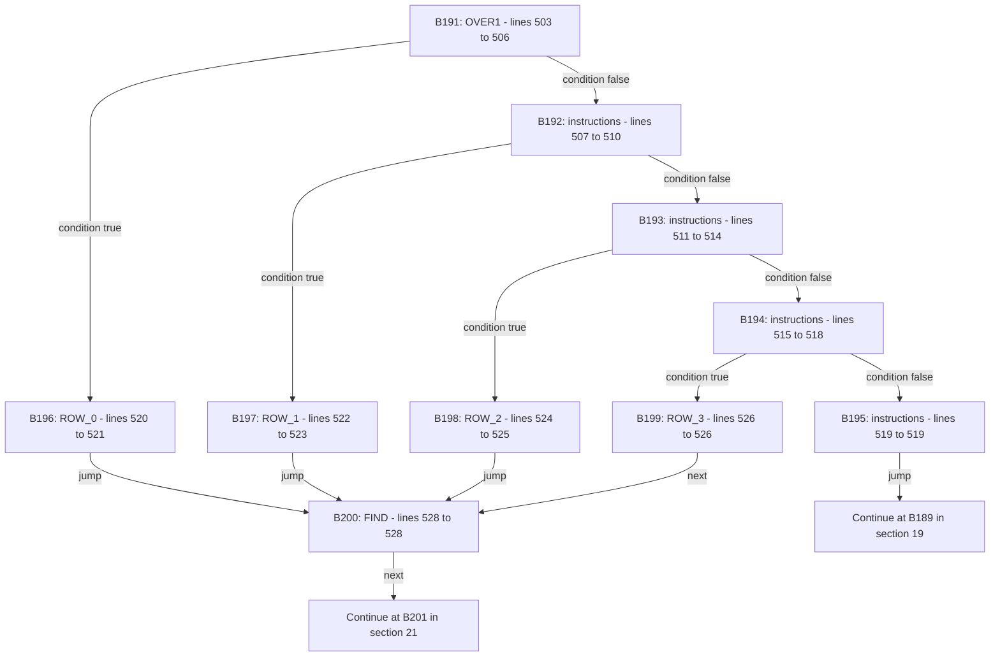

### B191

```asm
MOV P0,#01111110B
MOV A,P0
ANL A,#01110000B
CJNE A,#01110000B,ROW_0
```

### B192

```asm
MOV P0,#01111101B
MOV A,P0
ANL A,#01110000B
CJNE A,#01110000B,ROW_1
```

### B193

```asm
MOV P0,#01111011B
MOV A,P0
ANL A,#01110000B
CJNE A,#01110000B,ROW_2
```

### B194

```asm
MOV P0,#01110111B
MOV A,P0
ANL A,#01110000B
CJNE A,#01110000B,ROW_3
```

### B195

```asm
LJMP K2
```

### B196

```asm
MOV DPTR,#KCODE0
SJMP FIND
```

### B197

```asm
MOV DPTR,#KCODE1
SJMP FIND
```

### B198

```asm
MOV DPTR,#KCODE2
SJMP FIND
```

### B199

```asm
MOV DPTR,#KCODE3
```

### B200

```asm
RLC A
```

## Section 21

```mermaid
flowchart TD
B200["B201: FIND1 - lines 530 to 531"]
B201["B202: instructions - lines 532 to 533"]
B202["B203: MATCH - lines 534 to 536"]
B203["B204: ENDD - lines 574 to 574"]
B200 -->|condition true| B202
B200 -->|condition false| B201
B201 -->|jump| B200
B203 -->|jump| B203
```

### B201

```asm
RLC A
JNC MATCH
```

### B202

```asm
INC DPTR
SJMP FIND1
```

### B203

Return to the instruction following the active call.

```asm
CLR A
MOVC A,@A+DPTR
RET
```

### B204

```asm
sjmp $
```
