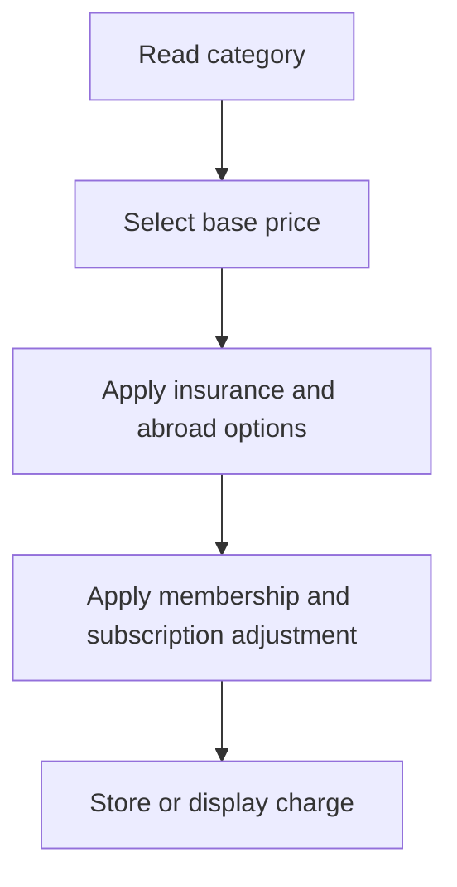
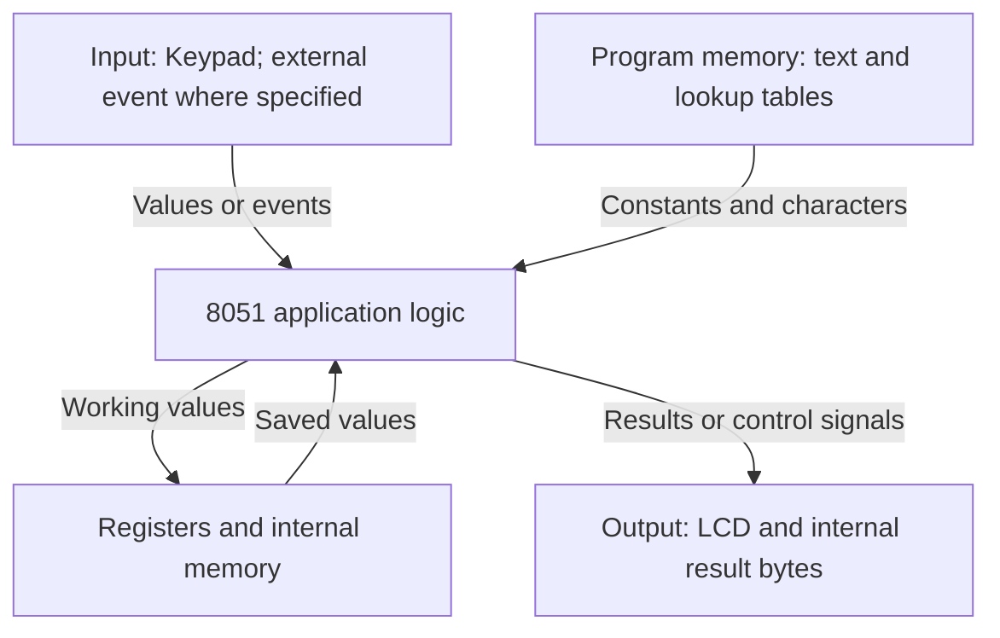

# Insurance Quotation

[Group overview](../../README.md) · [Compare implementations](../README.md)

Calculate an example policy price from a category and selected options.

**Implementation:** Keypad Policy Options

**Input:** keypad.  
**Output:** LCD and internal result bytes.

## Inputs and results

| Parameter | Description |
| --- | --- |
| Input | Category, insurance options, membership, and subscription value |
| Output | The calculated charge |

## Worked example

One preset case starts at 28, adds 18 and 22, then subtracts 10 and 4: the result is 54. The keypad case below may use different options.

### Calculation details

Enter category 2, warranty option 1, abroad option 2, membership option 2 and subscription digit 4. With carry clear at numeric conversion, the category selects 28 and the warranty adds 7. The two disabled options leave 35. The subscription routine subtracts 4, leaving 31 (1FH) as the final cost at 35H.

## Program operation

1. Read category.
2. Select base price.
3. Apply insurance and abroad options.
4. Apply membership and subscription adjustment.
5. Store or display charge.

### Functional flowchart

[Detailed control flow](source-flow.md)

### Simplified block diagram

**Port registers:** `P0`, `P0.4`, `P0.6`, `P1`, `P1.2`, `P1.3`, `P1.4`, `P1.5`, `P1.6`, `P1.7`.

## Technical limitations

No additional defect was recorded in the earlier source review. This is not evidence of a successful build or hardware test.

## Build and test

1. Open the [assembly source](source.asm) in an 8051 assembler or simulator.
2. Review the technical limitations and configure the peripherals required by this implementation.
3. Check the expected result using the example inputs.
