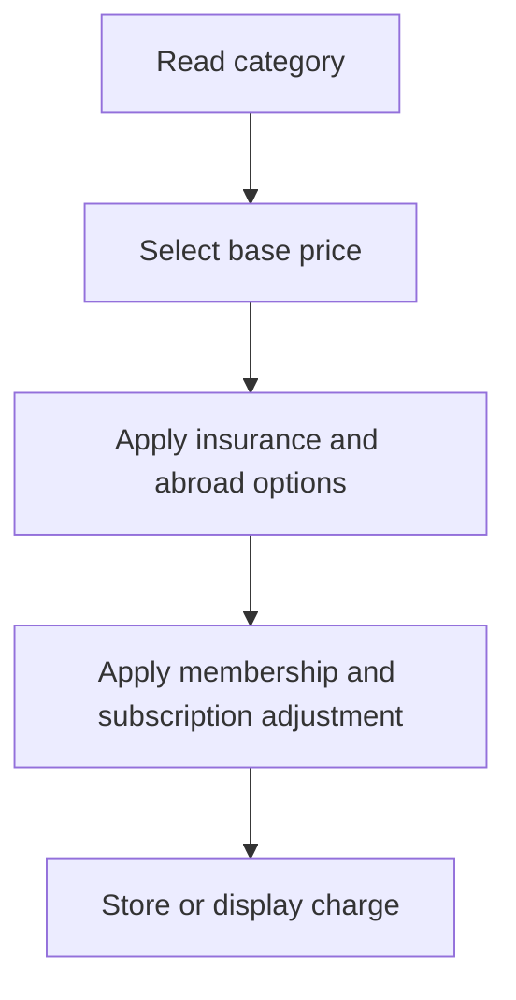
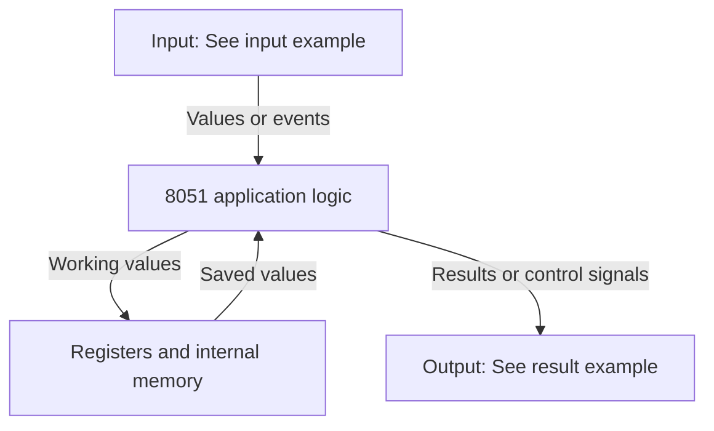

# Insurance Quotation

[Group overview](../../README.md) · [Compare implementations](../README.md)

Calculate an example policy price from a category and selected options.

**Implementation:** Led Policy Pricing Draft

**Input:** see input example.  
**Output:** see result example.

## Inputs and results

| Parameter | Description |
| --- | --- |
| Input | Category, insurance options, membership, and subscription value |
| Output | The calculated charge |

## Worked example

One preset case starts at 28, adds 18 and 22, then subtracts 10 and 4: the result is 54. The keypad case below may use different options.

### Calculation details

Use the bundled category 2, insurance option 2, abroad option 1, membership 1 and subscription value 4. The base 28 gains 18 and 22, becoming 68. The membership routine subtracts 10 and the subscription routine subtracts 4. The final cost is 54 (36H hexadecimal) in RAM 35H. For the revision with an incomplete FLASH operand, this is the pricing-path result after bypassing that draft routine.

## Program operation

1. Read category.
2. Select base price.
3. Apply insurance and abroad options.
4. Apply membership and subscription adjustment.
5. Store or display charge.

### Functional flowchart

[Detailed control flow](source-flow.md)

### Simplified block diagram

**Port registers:** `P1`.

## Technical limitations

- has an incomplete operand in `MOV R7,#`.

## Build and test

1. Open the [assembly source](source.asm) in an 8051 assembler or simulator.
2. Review the technical limitations and configure the peripherals required by this implementation.
3. Check the expected result using the example inputs.
