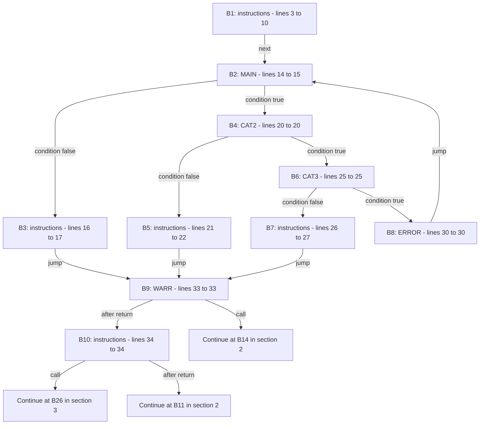
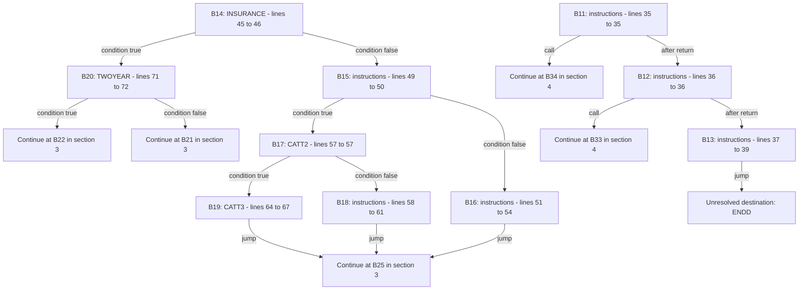
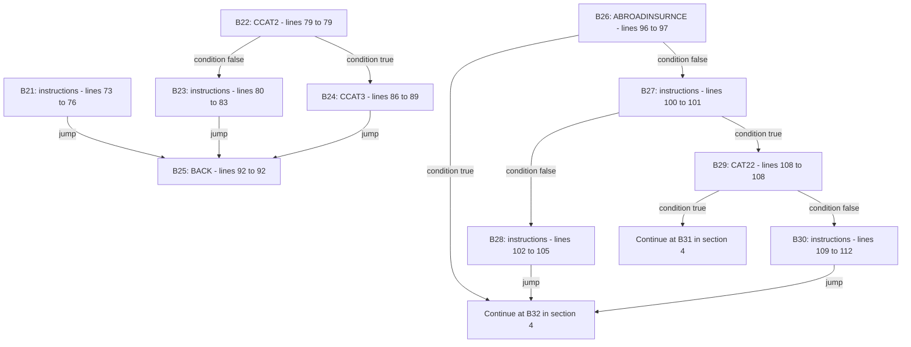
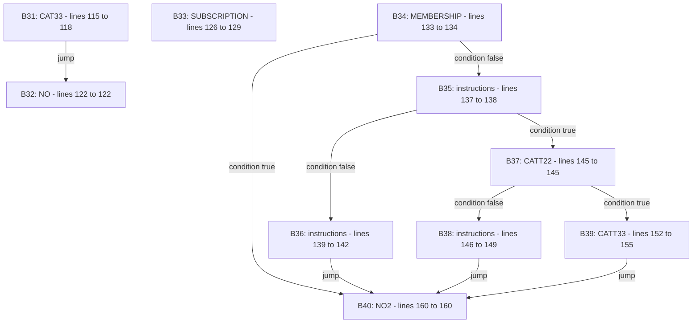

# Program Control Flow

[Back to project](README.md)

Control-flow blocks are indexed by source line. Calls resume at the instruction following the call if the subroutine returns normally.

## Entry locations

- `ORG 00H` begins at B1.

## Navigation

[Section 1](#section-1) · [Section 2](#section-2) · [Section 3](#section-3) · [Section 4](#section-4)

## Destinations requiring review

`ENDD`. A repeated label is also unresolved because it has more than one candidate target.

## Section 1



### B1

```asm
MOV 30H,#2
MOV 31H,#2
MOV 32H,#1
MOV 33H,#1
MOV 34H,#4
MOV 35H,#0
MOV 36H,#0
```

### B2

```asm
MOV A,30H
CJNE A,#1,CAT2
```

### B3

```asm
MOV 36H,#35
AJMP WARR
```

### B4

```asm
CJNE A,#2,CAT3
```

### B5

```asm
MOV 36H,#28
AJMP WARR
```

### B6

```asm
CJNE A,#3,ERROR
```

### B7

```asm
MOV 36H,#44
AJMP WARR
```

### B8

```asm
SJMP MAIN
```

### B9

```asm
ACALL INSURANCE
```

### B10

```asm
ACALL ABROADINSURNCE
```

## Section 2



### B11

```asm
ACALL MEMBERSHIP
```

### B12

```asm
ACALL SUBSCRIPTION
```

### B13

```asm
MOV 35H,36H
AJMP ENDD
```

### B14

```asm
MOV A,31H
CJNE A,#1,TWOYEAR
```

### B15

```asm
MOV A,30H
CJNE A,#1,CATT2
```

### B16

```asm
MOV A,36H
ADD A,#5
MOV 36H,A
SJMP BACK
```

### B17

```asm
CJNE A,#2,CATT3
```

### B18

```asm
MOV A,36H
ADD A,#7
MOV 36H,A
SJMP BACK
```

### B19

```asm
MOV A,36H
ADD A,#12
MOV 36H,A
SJMP BACK
```

### B20

```asm
MOV A,30H
CJNE A,#1,CCAT2
```

## Section 3



### B21

```asm
MOV A,36H
ADD A,#11
MOV 36H,A
SJMP BACK
```

### B22

```asm
CJNE A,#2,CCAT3
```

### B23

```asm
MOV A,36H
ADD A,#18
MOV 36H,A
SJMP BACK
```

### B24

```asm
MOV A,36H
ADD A,#20
MOV 36H,A
SJMP BACK
```

### B25

Return to the instruction following the active call.

```asm
RET
```

### B26

```asm
MOV A,32H
CJNE A,#1,NO
```

### B27

```asm
MOV A,30H
CJNE A,#1,CAT22
```

### B28

```asm
MOV A,36H
ADD A,#13
MOV 36H,A
SJMP BACK1
```

### B29

```asm
CJNE A,#2,CAT33
```

### B30

```asm
MOV A,36H
ADD A,#22
MOV 36H,A
SJMP BACK1
```

## Section 4



### B31

```asm
MOV A,36H
ADD A,#25
MOV 36H,A
SJMP BACK1
```

### B32

Return to the instruction following the active call.

```asm
RET
```

### B33

Return to the instruction following the active call.

```asm
MOV A,36H
SUBB A,34H
MOV 36H,A
RET
```

### B34

```asm
MOV A,33H
CJNE A,#1,NO2
```

### B35

```asm
MOV A,30H
CJNE A,#1,CATT22
```

### B36

```asm
MOV A,36H
SUBB A,#8
MOV 36H,A
SJMP BACK3
```

### B37

```asm
CJNE A,#2,CATT33
```

### B38

```asm
MOV A,36H
SUBB A,#10
MOV 36H,A
SJMP BACK3
```

### B39

```asm
MOV A,36H
SUBB A,#15
MOV 36H,A
SJMP BACK3
```

### B40

Return to the instruction following the active call.

```asm
RET
```
