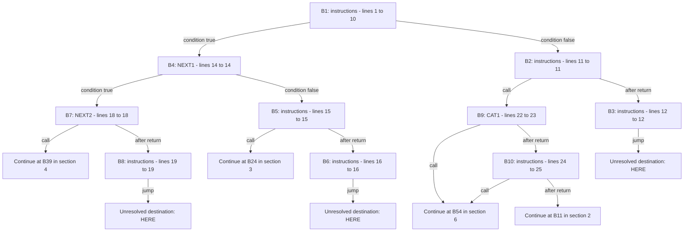
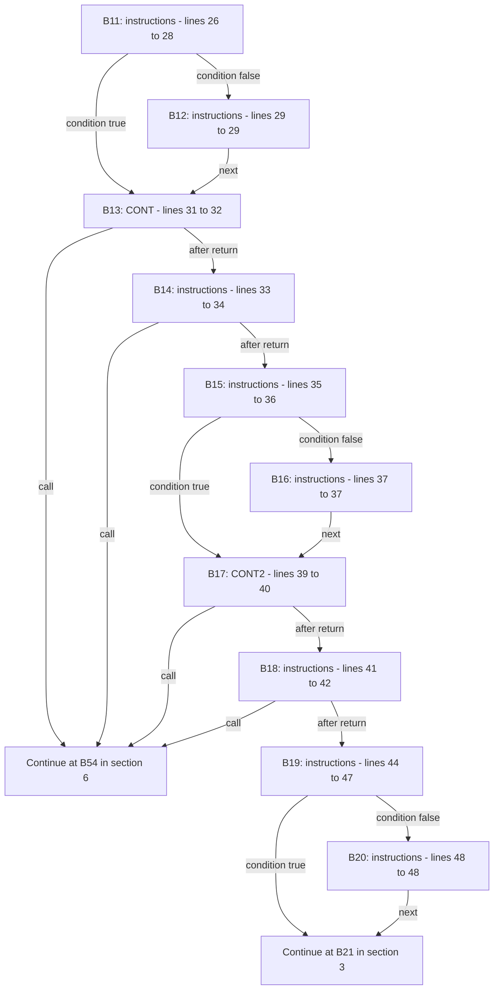
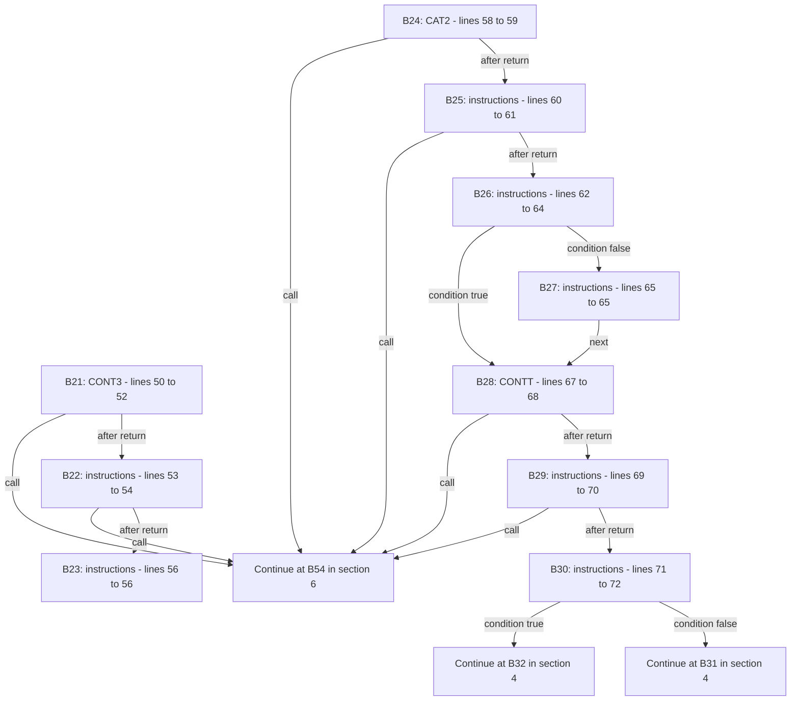
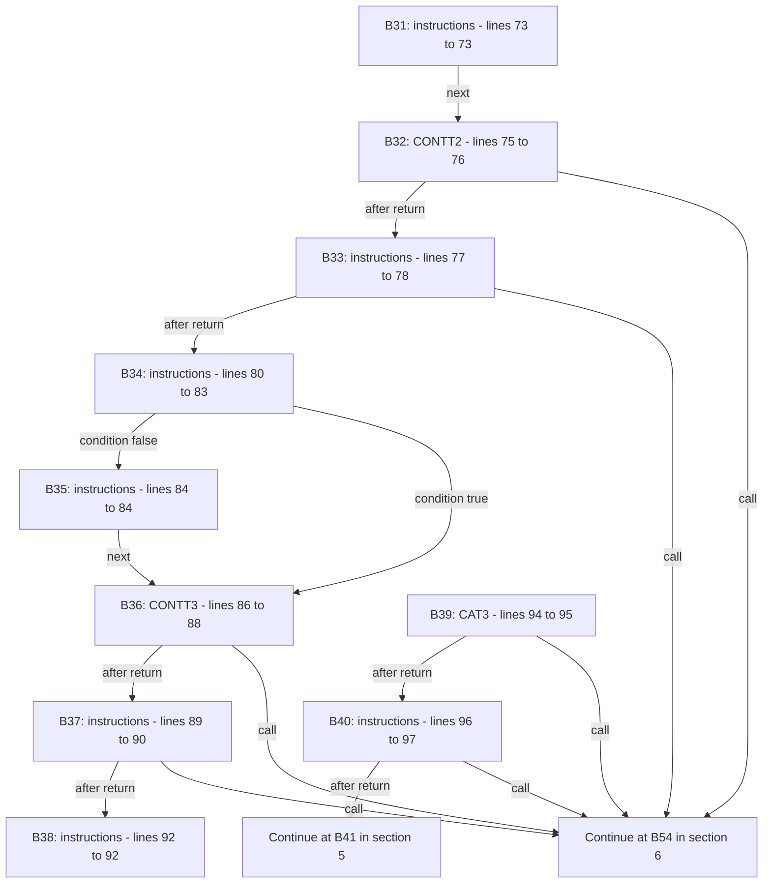
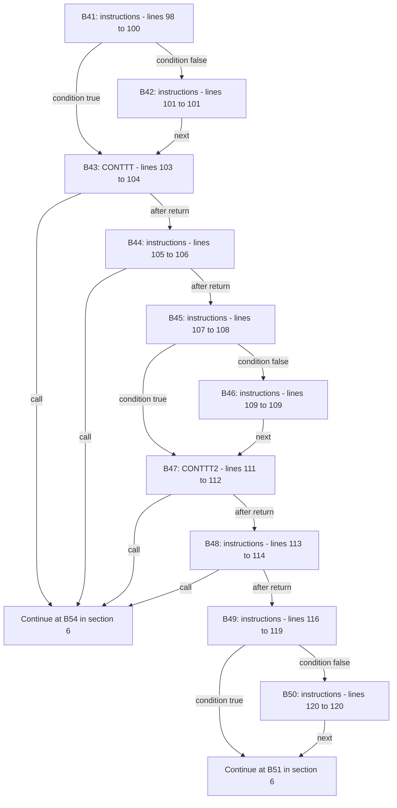
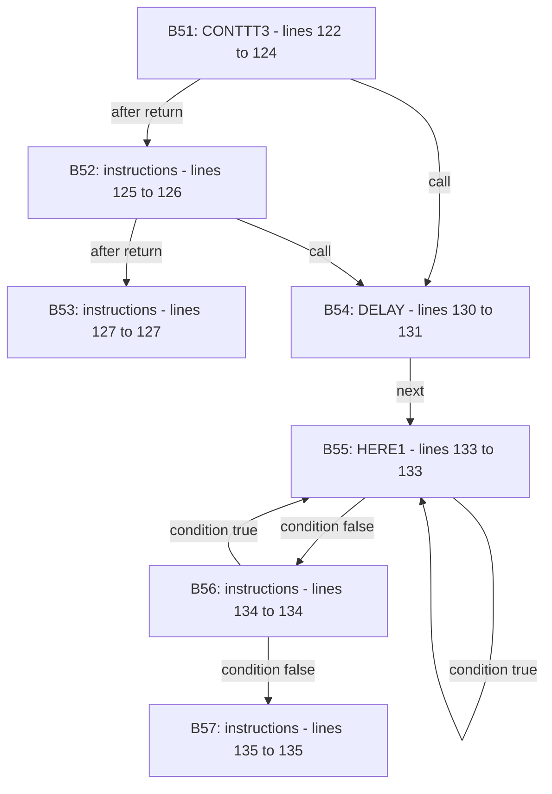

# Program Control Flow

[Back to project](README.md)

Control-flow blocks are indexed by source line. Calls resume at the instruction following the call if the subroutine returns normally.

## Entry locations

Start from the first executable block or the entry selected by the calling application.

## Navigation

[Section 1](#section-1) · [Section 2](#section-2) · [Section 3](#section-3) · [Section 4](#section-4) · [Section 5](#section-5) · [Section 6](#section-6)

## Destinations requiring review

`HERE`. A repeated label is also unresolved because it has more than one candidate target.

## Section 1



### B1

```asm
MOV 30H,#1
MOV 31H,#1
MOV 32H,#2
MOV 33H,#2
MOV 34H,#1
MOV P1,00H
MOV P1,#0FFH
MOV A,30H
CJNE A,#1,NEXT1
```

### B2

```asm
ACALL CAT1
```

### B3

```asm
AJMP HERE
```

### B4

```asm
CJNE A,#2,NEXT2
```

### B5

```asm
ACALL CAT2
```

### B6

```asm
AJMP HERE
```

### B7

```asm
ACALL CAT3
```

### B8

```asm
AJMP HERE
```

### B9

```asm
CLR P1.0
ACALL DELAY
```

### B10

```asm
SETB P1.0
ACALL DELAY
```

## Section 2



### B11

```asm
MOV A,#38
MOV R0,31H
CJNE R0,#1,CONT
```

### B12

```asm
ADD A,#8
```

### B13

```asm
CLR P1.0
ACALL DELAY
```

### B14

```asm
SETB P1.0
ACALL DELAY
```

### B15

```asm
MOV R0,32H
CJNE R0,#1,CONT2
```

### B16

```asm
ADD A,#10
```

### B17

```asm
CLR P1.0
ACALL DELAY
```

### B18

```asm
SETB P1.0
ACALL DELAY
```

### B19

```asm
MOV B,33H
MUL AB
MOV R0,34H
CJNE R0,#1,CONT3
```

### B20

```asm
SUBB A, #5
```

## Section 3



### B21

```asm
MOV 35H,A
CLR P1.0
ACALL DELAY
```

### B22

```asm
SETB P1.0
ACALL DELAY
```

### B23

Return to the instruction following the active call.

```asm
RET
```

### B24

```asm
CLR P1.1
ACALL DELAY
```

### B25

```asm
SETB P1.1
ACALL DELAY
```

### B26

```asm
MOV A,#45
MOV R0,31H
CJNE R0,#1,CONTT
```

### B27

```asm
ADD A,#10
```

### B28

```asm
CLR P1.1
ACALL DELAY
```

### B29

```asm
SETB P1.1
ACALL DELAY
```

### B30

```asm
MOV R0,32H
CJNE R0,#1,CONTT2
```

## Section 4



### B31

```asm
ADD A,#15
```

### B32

```asm
CLR P1.1
ACALL DELAY
```

### B33

```asm
SETB P1.1
ACALL DELAY
```

### B34

```asm
MOV B,33H
MUL AB
MOV R0,34H
CJNE R0,#1,CONTT3
```

### B35

```asm
SUBB A, #8
```

### B36

```asm
MOV 35H,A
CLR P1.1
ACALL DELAY
```

### B37

```asm
SETB P1.1
ACALL DELAY
```

### B38

Return to the instruction following the active call.

```asm
RET
```

### B39

```asm
CLR P1.2
ACALL DELAY
```

### B40

```asm
SETB P1.2
ACALL DELAY
```

## Section 5



### B41

```asm
MOV A,#66
MOV R0,31H
CJNE R0,#1,CONTTT
```

### B42

```asm
ADD A,#12
```

### B43

```asm
CLR P1.2
ACALL DELAY
```

### B44

```asm
SETB P1.2
ACALL DELAY
```

### B45

```asm
MOV R0,32H
CJNE R0,#1,CONTTT2
```

### B46

```asm
ADD A,#18
```

### B47

```asm
CLR P1.2
ACALL DELAY
```

### B48

```asm
SETB P1.2
ACALL DELAY
```

### B49

```asm
MOV B,33H
MUL AB
MOV R0,34H
CJNE R0,#1,CONTTT3
```

### B50

```asm
SUBB A, #15
```

## Section 6



### B51

```asm
MOV 35H,A
CLR P1.2
ACALL DELAY
```

### B52

```asm
SETB P1.2
ACALL DELAY
```

### B53

Return to the instruction following the active call.

```asm
RET
```

### B54

```asm
MOV R1,#100
MOV R0,#10
```

### B55

```asm
DJNZ R1,HERE2
```

### B56

```asm
DJNZ R0,HERE1
```

### B57

Return to the instruction following the active call.

```asm
RET
```
