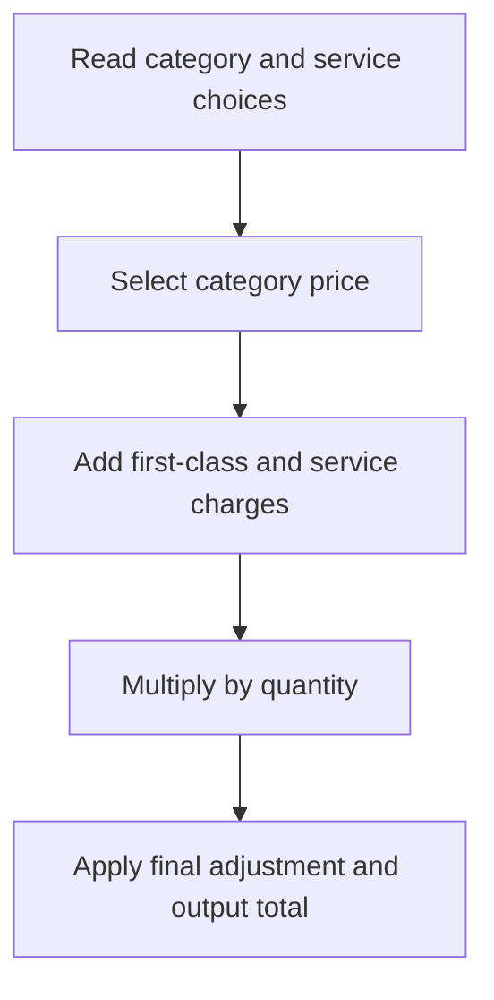
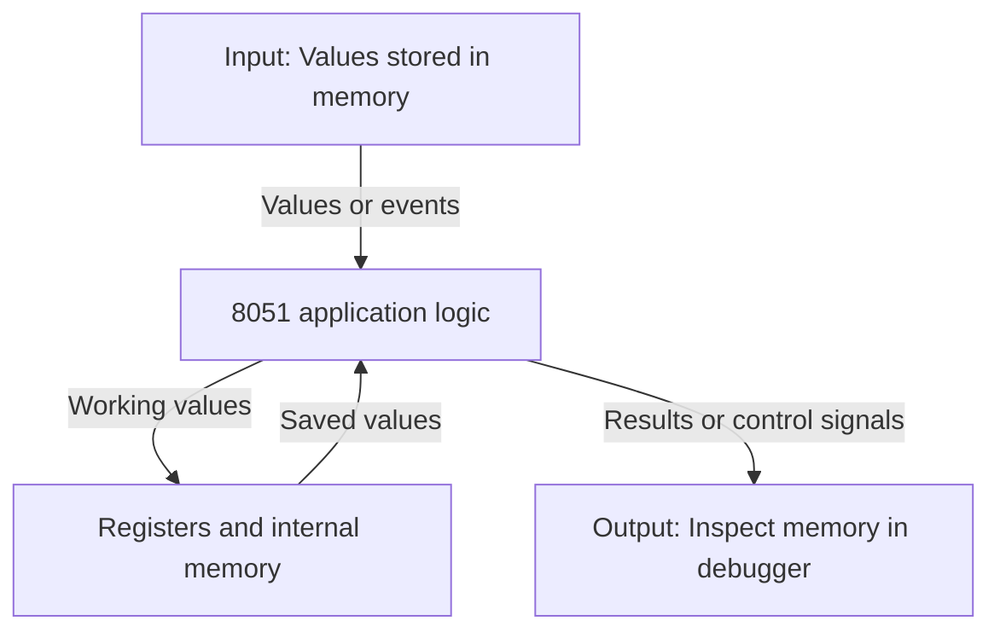

# Category-Based Service Pricing

[Group overview](../../README.md) · [Compare implementations](../README.md)

Calculate a service charge from a category, optional extras, quantity, and a final adjustment.

**Implementation:** Memory Category Alternate Discount

**Input:** values stored in memory.  
**Output:** inspect memory in debugger.

## Inputs and results

| Parameter | Description |
| --- | --- |
| Input | Category, first-class and service choices, quantity, and membership choice |
| Output | A total charge |

## Worked example

For the documented category-1 route: base 38 + extras 8 + 10 = 56 per item; quantity 2 gives 112 before any final discount.

### Calculation details

Exercise category 1 with service flags 31H = 1 and 32H = 1, quantity 33H = 2, and 34H = 2 to skip the final discount. The base is 38, the two additions are 8 and 10, and multiplying 56 by 2 gives 112. Inspect 35H for 70H at the end of that category path.

## Program operation

1. Read category and service choices.
2. Select category price.
3. Add first-class and service charges.
4. Multiply by quantity.
5. Apply final adjustment and output total.

### Functional flowchart

[Detailed control flow](source-flow.md)

### Simplified block diagram

Results are available in memory without a display.

## Technical limitations

No additional defect was recorded in the earlier source review. This is not evidence of a successful build or hardware test.

## Build and test

1. Open the [assembly source](source.asm) in an 8051 assembler or simulator.
2. Review the technical limitations and configure the peripherals required by this implementation.
3. Check the expected result using the example inputs.
