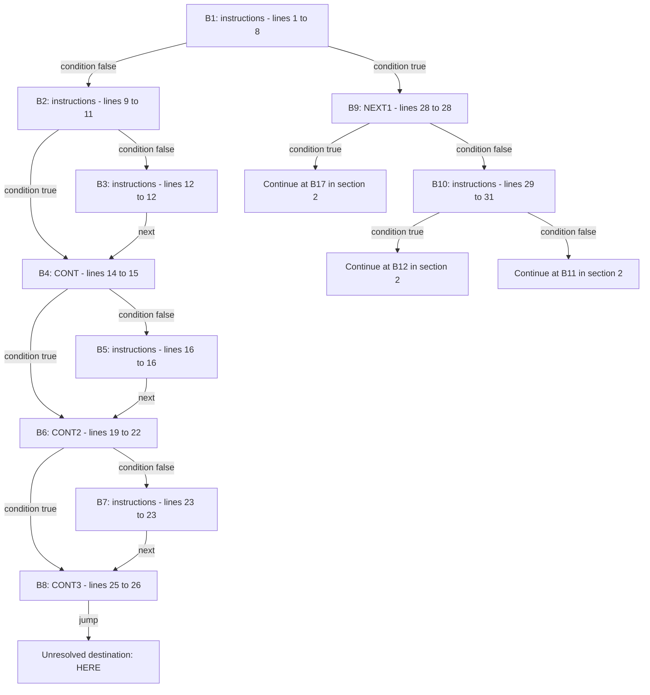
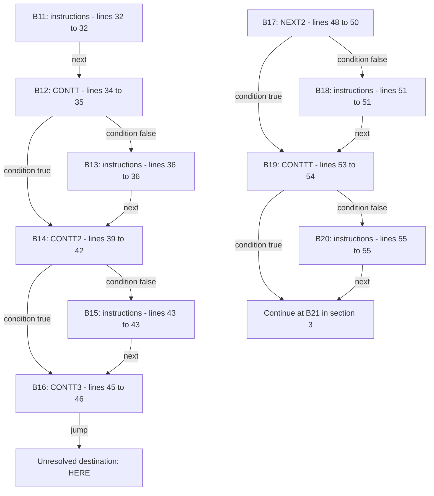
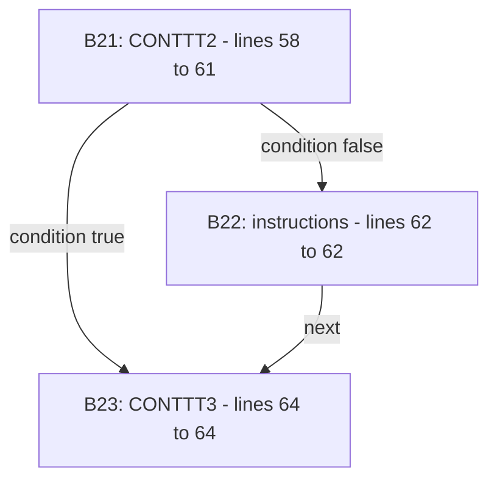

# Program Control Flow

[Back to project](README.md)

Control-flow blocks are indexed by source line. Calls resume at the instruction following the call if the subroutine returns normally.

## Entry locations

Start from the first executable block or the entry selected by the calling application.

## Navigation

[Section 1](#section-1) · [Section 2](#section-2) · [Section 3](#section-3)

## Destinations requiring review

`HERE`. A repeated label is also unresolved because it has more than one candidate target.

## Section 1



### B1

```asm
MOV 30H,#2
MOV 31H,#1
MOV 32H,#2
MOV 33H,#2
MOV 34H,#1
MOV A,30H
CJNE A,#1,NEXT1
```

### B2

```asm
MOV A,#38
MOV R0,31H
CJNE R0,#1,CONT
```

### B3

```asm
ADD A,#8
```

### B4

```asm
MOV R0,32H
CJNE R0,#1,CONT2
```

### B5

```asm
ADD A,#10
```

### B6

```asm
MOV B,33H
MUL AB
MOV R0,34H
CJNE R0,#1,CONT3
```

### B7

```asm
SUBB A, #5
```

### B8

```asm
MOV 35H,A
AJMP HERE
```

### B9

```asm
CJNE A,#2,NEXT2
```

### B10

```asm
MOV A,#45
MOV R0,31H
CJNE R0,#1,CONTT
```

## Section 2



### B11

```asm
ADD A,#10
```

### B12

```asm
MOV R0,32H
CJNE R0,#1,CONTT2
```

### B13

```asm
ADD A,#15
```

### B14

```asm
MOV B,33H
MUL AB
MOV R0,34H
CJNE R0,#1,CONTT3
```

### B15

```asm
SUBB A, #8
```

### B16

```asm
MOV 35H,A
AJMP HERE
```

### B17

```asm
MOV A,#66
MOV R0,31H
CJNE R0,#1,CONTTT
```

### B18

```asm
ADD A,#12
```

### B19

```asm
MOV R0,32H
CJNE R0,#1,CONTTT2
```

### B20

```asm
ADD A,#18
```

## Section 3



### B21

```asm
MOV B,33H
MUL AB
MOV R0,34H
CJNE R0,#1,CONTTT3
```

### B22

```asm
SUBB A, #15
```

### B23

```asm
MOV 35H,A
```
