# Program Control Flow

[Back to project](README.md)

Control-flow blocks are indexed by source line. Calls resume at the instruction following the call if the subroutine returns normally.

## Entry locations

- `ORG 00H` begins at B1.
- `ORG 0013H` begins at B2.

## Navigation

[Section 1](#section-1) · [Section 2](#section-2) · [Section 3](#section-3) · [Section 4](#section-4) · [Section 5](#section-5) · [Section 6](#section-6) · [Section 7](#section-7) · [Section 8](#section-8) · [Section 9](#section-9) · [Section 10](#section-10) · [Section 11](#section-11) · [Section 12](#section-12) · [Section 13](#section-13) · [Section 14](#section-14) · [Section 15](#section-15) · [Section 16](#section-16) · [Section 17](#section-17) · [Section 18](#section-18) · [Section 19](#section-19) · [Section 20](#section-20) · [Section 21](#section-21) · [Section 22](#section-22) · [Section 23](#section-23) · [Section 24](#section-24) · [Section 25](#section-25) · [Section 26](#section-26) · [Section 27](#section-27) · [Section 28](#section-28)

## Section 1

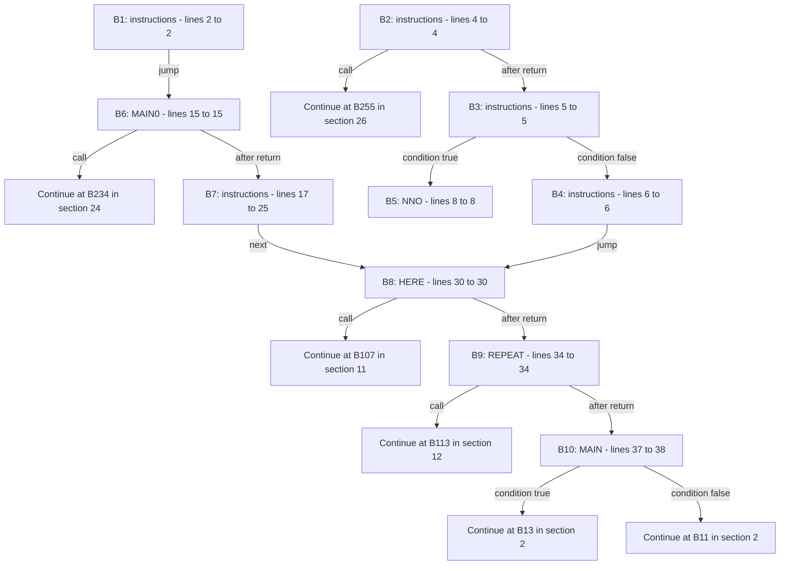

### B1

```asm
SJMP MAIN0
```

### B2

```asm
ACALL KEYPAD
```

### B3

```asm
CJNE A,#'#',NNO
```

### B4

```asm
LJMP HERE
```

### B5

Resume the interrupted program.

```asm
RETI
```

### B6

```asm
ACALL INLCD
```

### B7

```asm
MOV IE,#10000100B
SETB IT1
MOV 30H,#3
MOV 31H,#2
MOV 32H,#1
MOV 33H,#2
MOV 34H,#2
MOV 35H,#1
MOV 36H,#0
```

### B8

```asm
ACALL WELCOME
```

### B9

```asm
ACALL MENU1
```

### B10

```asm
MOV A,30H
CJNE A,#1,BEAND2
```

## Section 2

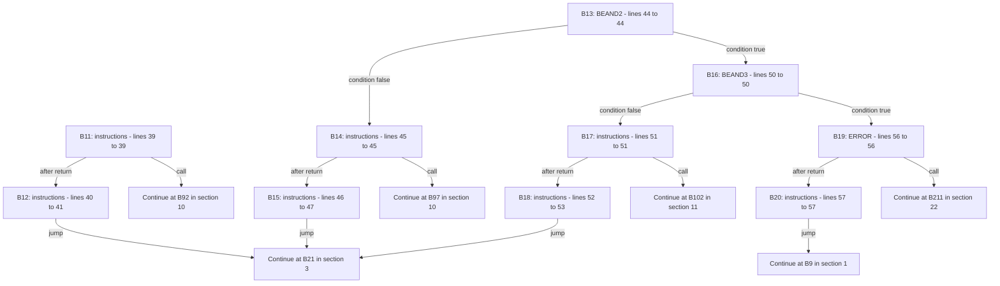

### B11

```asm
ACALL FLASH1
```

### B12

```asm
MOV 36H,#63
AJMP WARR
```

### B13

```asm
CJNE A,#2,BEAND3
```

### B14

```asm
ACALL FLASH2
```

### B15

```asm
MOV 36H,#55
AJMP WARR
```

### B16

```asm
CJNE A,#3,ERROR
```

### B17

```asm
ACALL FLASH3
```

### B18

```asm
MOV 36H,#70
AJMP WARR
```

### B19

```asm
ACALL ERRORR
```

### B20

```asm
SJMP REPEAT
```

## Section 3

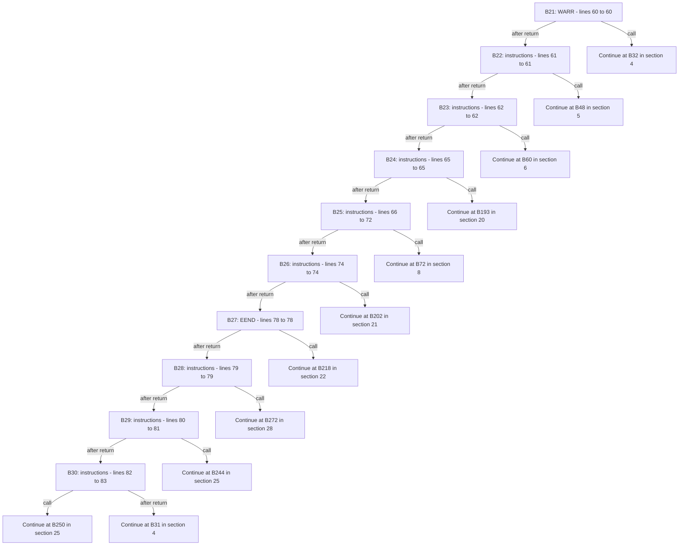

### B21

```asm
ACALL WARRENTLY
```

### B22

```asm
ACALL MAINTANACE
```

### B23

```asm
ACALL DELIVERY
```

### B24

```asm
ACALL TVNUMB
```

### B25

```asm
MOV B,34H
MOV A,36H
MUL AB
MOV 36H,A
ACALL MEMBERSHIP
```

### B26

```asm
ACALL PAYMENT
```

### B27

```asm
ACALL REPEAT_AGAIN
```

### B28

```asm
ACALL CLEAR
```

### B29

```asm
MOV A, #80H
ACALL CMD
```

### B30

```asm
MOV dptr, #MESG19
ACALL wstr
```

## Section 4

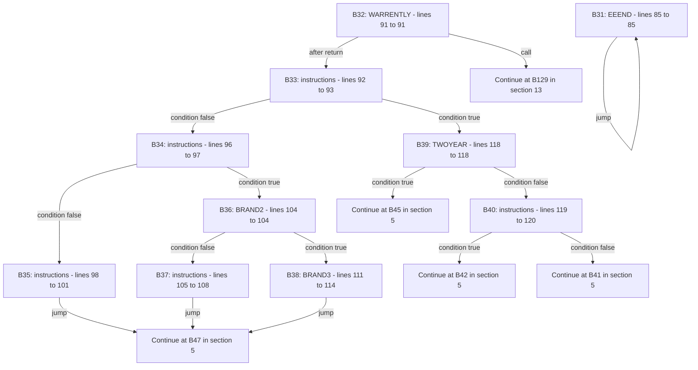

### B31

```asm
SJMP EEEND
```

### B32

```asm
ACALL WARMSG
```

### B33

```asm
MOV A,31H
CJNE A,#1,TWOYEAR
```

### B34

```asm
MOV A,30H
CJNE A,#1,BRAND2
```

### B35

```asm
MOV A,36H
ADD A,#4
MOV 36H,A
SJMP BACK
```

### B36

```asm
CJNE A,#2,BRAND3
```

### B37

```asm
MOV A,36H
ADD A,#2
MOV 36H,A
SJMP BACK
```

### B38

```asm
MOV A,36H
ADD A,#8
MOV 36H,A
SJMP BACK
```

### B39

```asm
CJNE A,#2,ERR
```

### B40

```asm
MOV A,30H
CJNE A,#1,BRRAND2
```

## Section 5

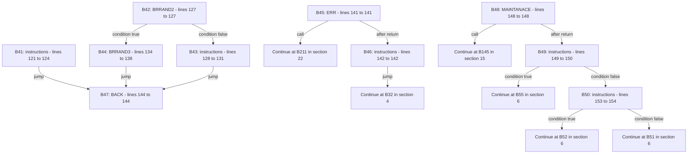

### B41

```asm
MOV A,36H
ADD A,#7
MOV 36H,A
SJMP BACK
```

### B42

```asm
CJNE A,#2,BRRAND3
```

### B43

```asm
MOV A,36H
ADD A,#3
MOV 36H,A
SJMP BACK
```

### B44

```asm
MOV 36H,#77
MOV A,36H
ADD A,#11
MOV 36H,A
SJMP BACK
```

### B45

```asm
ACALL ERRORR
```

### B46

```asm
SJMP WARRENTLY
```

### B47

Return to the instruction following the active call.

```asm
RET
```

### B48

```asm
ACALL MAIMSG
```

### B49

```asm
MOV A,32H
CJNE A,#1,NO
```

### B50

```asm
MOV A,30H
CJNE A,#1,BRRANDD2
```

## Section 6

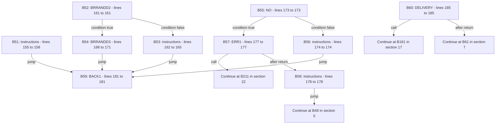

### B51

```asm
MOV A,36H
ADD A,#4
MOV 36H,A
SJMP BACK1
```

### B52

```asm
CJNE A,#2,BRRANDD3
```

### B53

```asm
MOV A,36H
ADD A,#3
MOV 36H,A
SJMP BACK1
```

### B54

```asm
MOV A,36H
ADD A,#7
MOV 36H,A
SJMP BACK1
```

### B55

```asm
CJNE A,#2,ERR1
```

### B56

```asm
SJMP BACK1
```

### B57

```asm
ACALL ERRORR
```

### B58

```asm
SJMP MAINTANACE
```

### B59

Return to the instruction following the active call.

```asm
RET
```

### B60

```asm
ACALL DELMSG
```

## Section 7

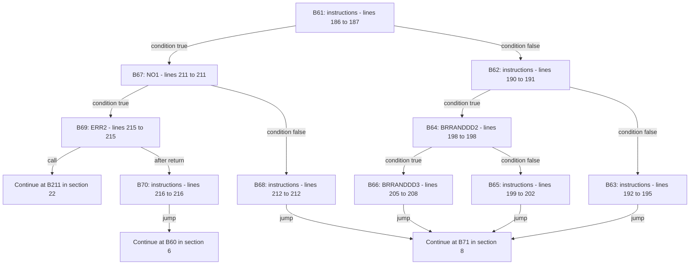

### B61

```asm
MOV A,33H
CJNE A,#1,NO1
```

### B62

```asm
MOV A,30H
CJNE A,#1,BRRANDDD2
```

### B63

```asm
MOV A,36H
ADD A,#2
MOV 36H,A
SJMP BACK2
```

### B64

```asm
CJNE A,#2,BRRANDDD3
```

### B65

```asm
MOV A,36H
ADD A,#3
MOV 36H,A
SJMP BACK2
```

### B66

```asm
MOV A,36H
ADD A,#3
MOV 36H,A
SJMP BACK2
```

### B67

```asm
CJNE A,#2,ERR2
```

### B68

```asm
SJMP BACK2
```

### B69

```asm
ACALL ERRORR
```

### B70

```asm
SJMP DELIVERY
```

## Section 8

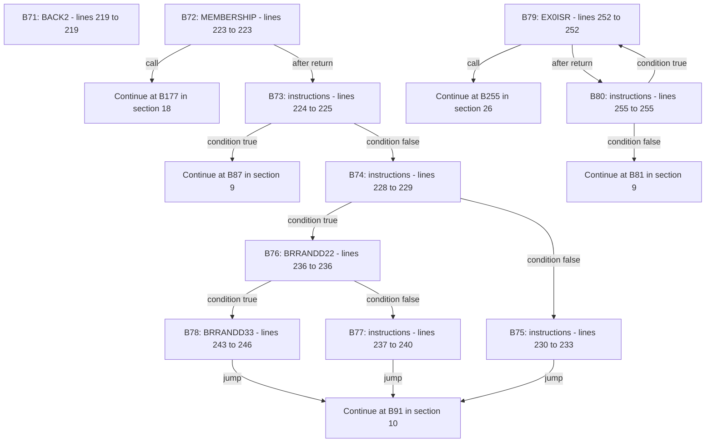

### B71

Return to the instruction following the active call.

```asm
RET
```

### B72

```asm
ACALL MEMMSG
```

### B73

```asm
MOV A,35H
CJNE A,#1,NO2
```

### B74

```asm
MOV A,30H
CJNE A,#1,BRRANDD22
```

### B75

```asm
MOV A,36H
SUBB A,#15
MOV 36H,A
SJMP BACK3
```

### B76

```asm
CJNE A,#2,BRRANDD33
```

### B77

```asm
MOV A,36H
SUBB A,#17
MOV 36H,A
SJMP BACK3
```

### B78

```asm
MOV A,36H
SUBB A,#22
MOV 36H,A
SJMP BACK3
```

### B79

```asm
ACALL KEYPAD
```

### B80

```asm
cjne A,#'#',again
```

## Section 9

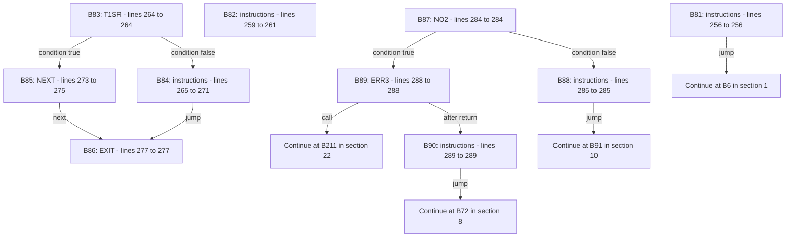

### B81

```asm
ljmp main0
```

### B82

Resume the interrupted program.

```asm
CLR P3.6
SETB P3.6
RETI
```

### B83

```asm
DJNZ R7,NEXT
```

### B84

```asm
CLR TR1
CLR ET1
SETB P1.3
CLR P3.6
SETB P3.6
SJMP EXIT
```

### B85

```asm
MOV TL1,#0CAH
MOV TH1,#27H
SETB TR1
```

### B86

Resume the interrupted program.

```asm
RETI
```

### B87

```asm
CJNE A,#2,ERR3
```

### B88

```asm
SJMP BACK3
```

### B89

```asm
ACALL ERRORR
```

### B90

```asm
SJMP MEMBERSHIP
```

## Section 10

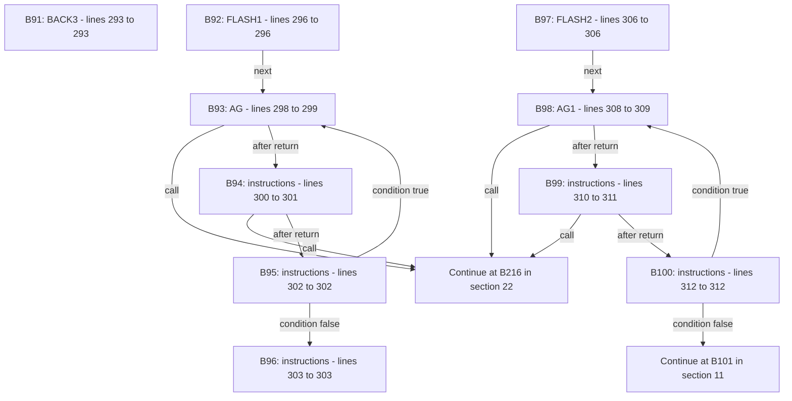

### B91

Return to the instruction following the active call.

```asm
RET
```

### B92

```asm
MOV R7,#5
```

### B93

```asm
MOV P1,#11101111B
ACALL DELAY
```

### B94

```asm
MOV P1,#11111111B
ACALL DELAY
```

### B95

```asm
DJNZ R7,AG
```

### B96

Return to the instruction following the active call.

```asm
RET
```

### B97

```asm
MOV R7,#5
```

### B98

```asm
MOV P1,#11110111B
ACALL DELAY
```

### B99

```asm
MOV P1,#11111111B
ACALL DELAY
```

### B100

```asm
DJNZ R7,AG1
```

## Section 11

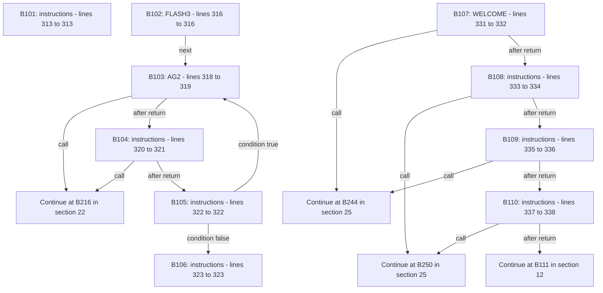

### B101

Return to the instruction following the active call.

```asm
RET
```

### B102

```asm
MOV R7,#5
```

### B103

```asm
MOV P1,#11111011B
ACALL DELAY
```

### B104

```asm
MOV P1,#11111111B
ACALL DELAY
```

### B105

```asm
DJNZ R7,AG2
```

### B106

Return to the instruction following the active call.

```asm
RET
```

### B107

```asm
mov a, #80H
acall cmd
```

### B108

```asm
mov dptr, #MESG1
acall wstr
```

### B109

```asm
mov a,#0c0h
acall cmd
```

### B110

```asm
mov dptr, #MESG2
acall wstr
```

## Section 12

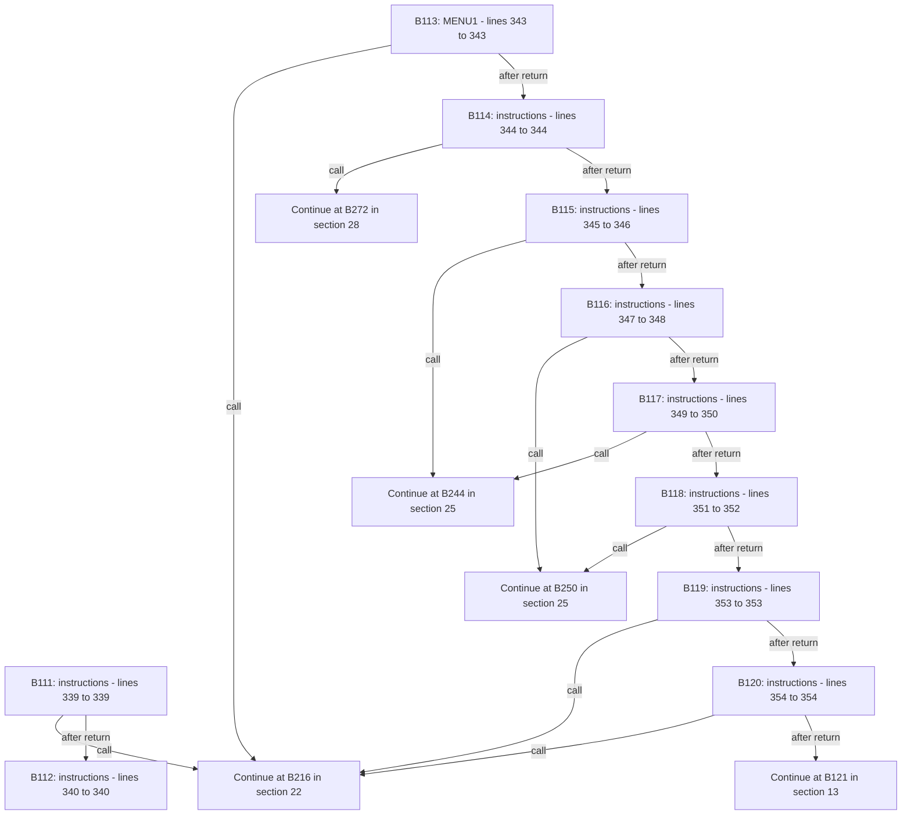

### B111

```asm
ACALL DELAY
```

### B112

Return to the instruction following the active call.

```asm
ret
```

### B113

```asm
ACALL DELAY
```

### B114

```asm
ACALL CLEAR
```

### B115

```asm
mov a, #80H
acall cmd
```

### B116

```asm
mov dptr, #MESG3
acall wstr
```

### B117

```asm
mov a,#0c0h
acall cmd
```

### B118

```asm
mov dptr, #MESG4
acall wstr
```

### B119

```asm
ACALL DELAY
```

### B120

```asm
ACALL DELAY
```

## Section 13

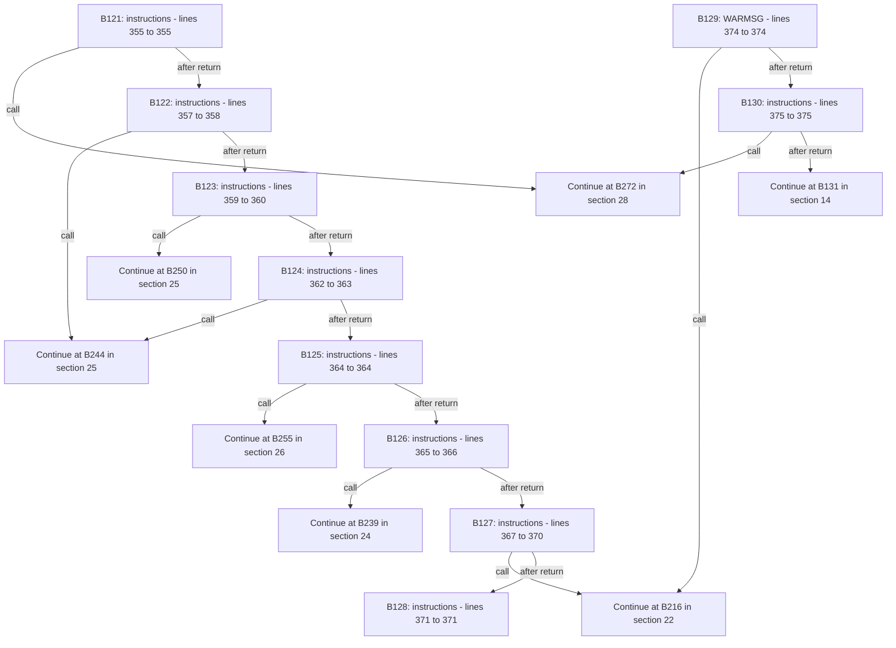

### B121

```asm
ACALL CLEAR
```

### B122

```asm
mov a, #80H
acall cmd
```

### B123

```asm
mov dptr, #MESG5
acall wstr
```

### B124

```asm
mov a, #0C3H
acall cmd
```

### B125

```asm
ACALL KEYPAD
```

### B126

```asm
MOV 30H,A
acall wchr
```

### B127

```asm
MOV A,30H
SUBB A,#30H
MOV 30H,A
ACALL DELAY
```

### B128

Return to the instruction following the active call.

```asm
RET
```

### B129

```asm
ACALL DELAY
```

### B130

```asm
ACALL CLEAR
```

## Section 14

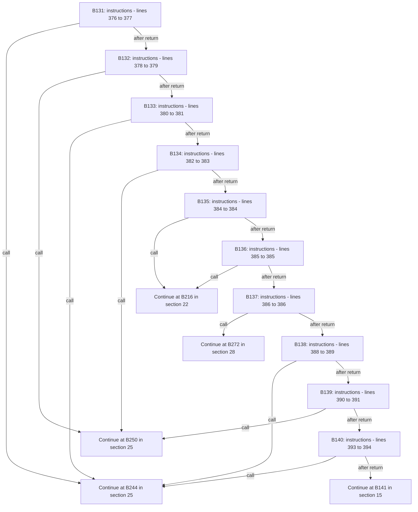

### B131

```asm
mov a, #80H
acall cmd
```

### B132

```asm
mov dptr, #MESG6
acall wstr
```

### B133

```asm
mov a,#0c0h
acall cmd
```

### B134

```asm
mov dptr, #MESG7
acall wstr
```

### B135

```asm
ACALL DELAY
```

### B136

```asm
ACALL DELAY
```

### B137

```asm
ACALL CLEAR
```

### B138

```asm
mov a, #80H
acall cmd
```

### B139

```asm
mov dptr, #MESG8
acall wstr
```

### B140

```asm
mov a, #0C3H
acall cmd
```

## Section 15

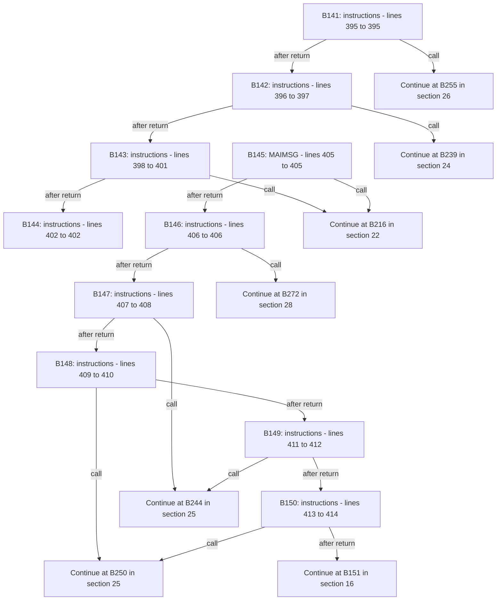

### B141

```asm
ACALL KEYPAD
```

### B142

```asm
MOV 31H,A
acall wchr
```

### B143

```asm
MOV A,31H
SUBB A,#30H
MOV 31H,A
ACALL DELAY
```

### B144

Return to the instruction following the active call.

```asm
RET
```

### B145

```asm
ACALL DELAY
```

### B146

```asm
ACALL CLEAR
```

### B147

```asm
mov a, #80H
acall cmd
```

### B148

```asm
mov dptr, #MESG9
acall wstr
```

### B149

```asm
mov a,#0c0h
acall cmd
```

### B150

```asm
mov dptr, #MESG10
acall wstr
```

## Section 16

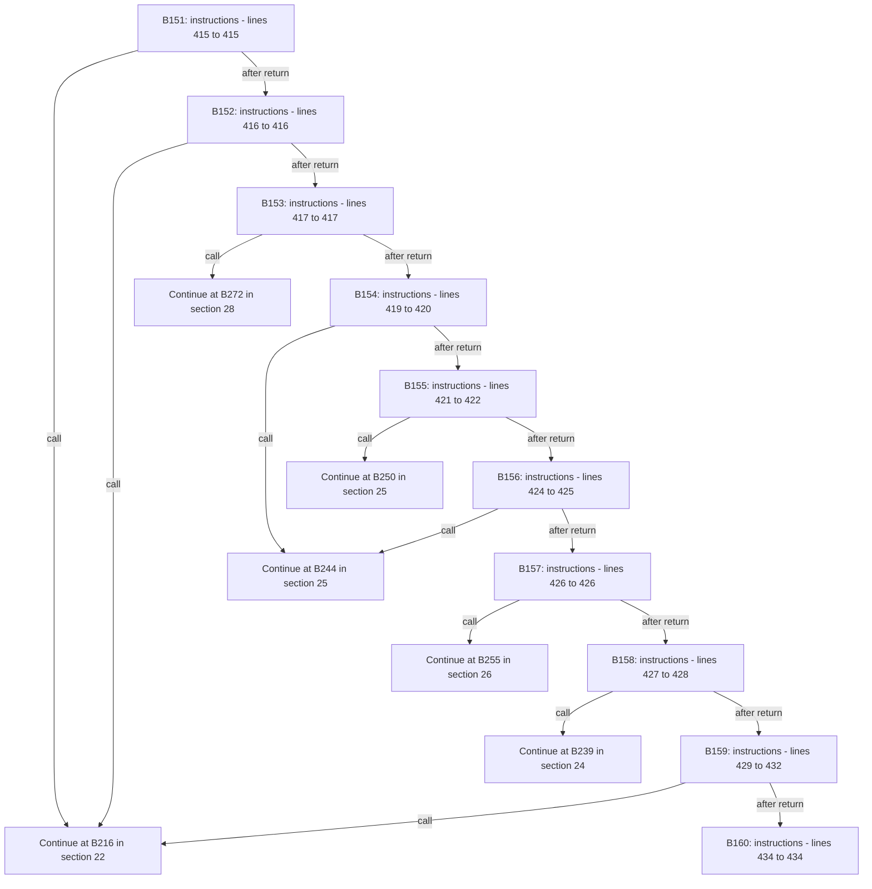

### B151

```asm
ACALL DELAY
```

### B152

```asm
ACALL DELAY
```

### B153

```asm
ACALL CLEAR
```

### B154

```asm
mov a, #80H
acall cmd
```

### B155

```asm
mov dptr, #MESG8
acall wstr
```

### B156

```asm
mov a, #0C3H
acall cmd
```

### B157

```asm
ACALL KEYPAD
```

### B158

```asm
MOV 32H,A
acall wchr
```

### B159

```asm
MOV A,32H
SUBB A,#30H
MOV 32H,A
ACALL DELAY
```

### B160

Return to the instruction following the active call.

```asm
RET
```

## Section 17

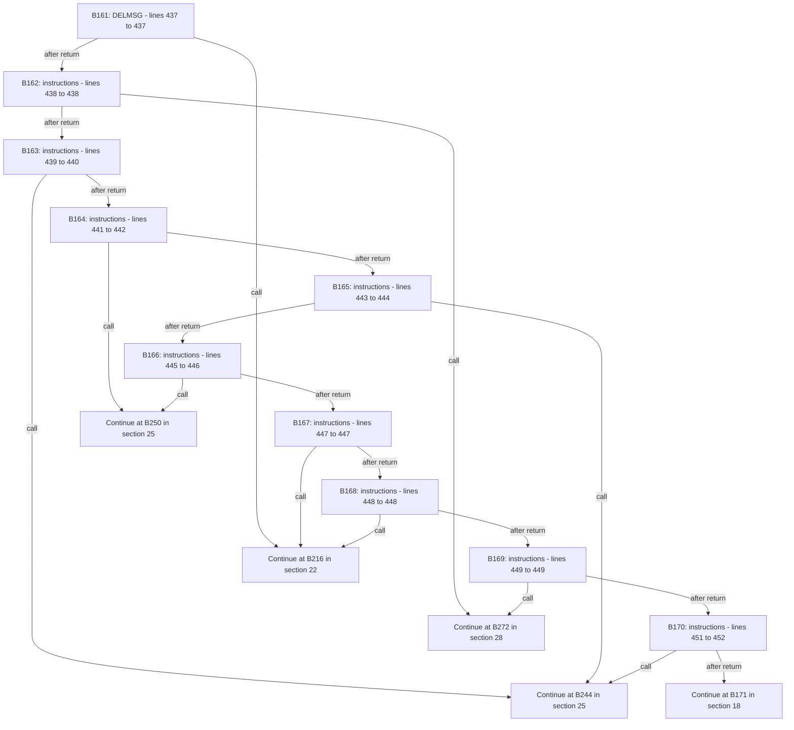

### B161

```asm
ACALL DELAY
```

### B162

```asm
ACALL CLEAR
```

### B163

```asm
mov a, #80H
acall cmd
```

### B164

```asm
mov dptr, #MESG11
acall wstr
```

### B165

```asm
mov a,#0c0h
acall cmd
```

### B166

```asm
mov dptr, #MESG10
acall wstr
```

### B167

```asm
ACALL DELAY
```

### B168

```asm
ACALL DELAY
```

### B169

```asm
ACALL CLEAR
```

### B170

```asm
mov a, #80H
acall cmd
```

## Section 18

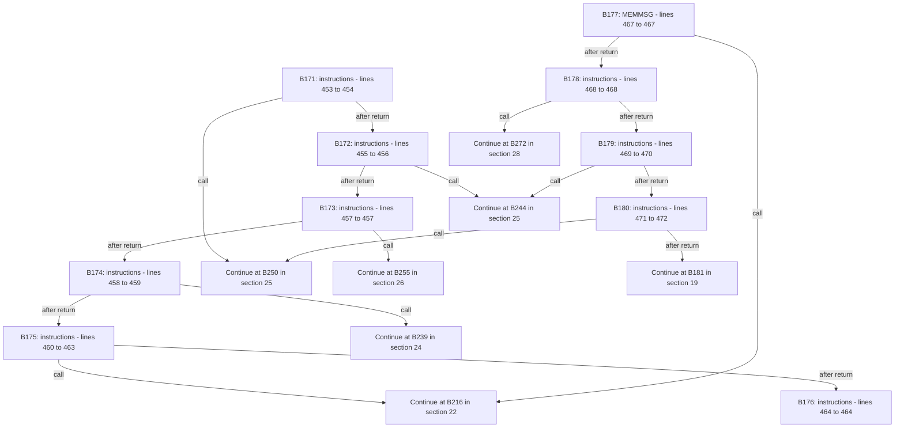

### B171

```asm
mov dptr, #MESG8
acall wstr
```

### B172

```asm
mov a, #0C3H
acall cmd
```

### B173

```asm
ACALL KEYPAD
```

### B174

```asm
MOV 33H,A
acall wchr
```

### B175

```asm
MOV A,33H
SUBB A,#30H
MOV 33H,A
ACALL DELAY
```

### B176

Return to the instruction following the active call.

```asm
RET
```

### B177

```asm
ACALL DELAY
```

### B178

```asm
ACALL CLEAR
```

### B179

```asm
mov a, #80H
acall cmd
```

### B180

```asm
mov dptr, #MESG12
acall wstr
```

## Section 19

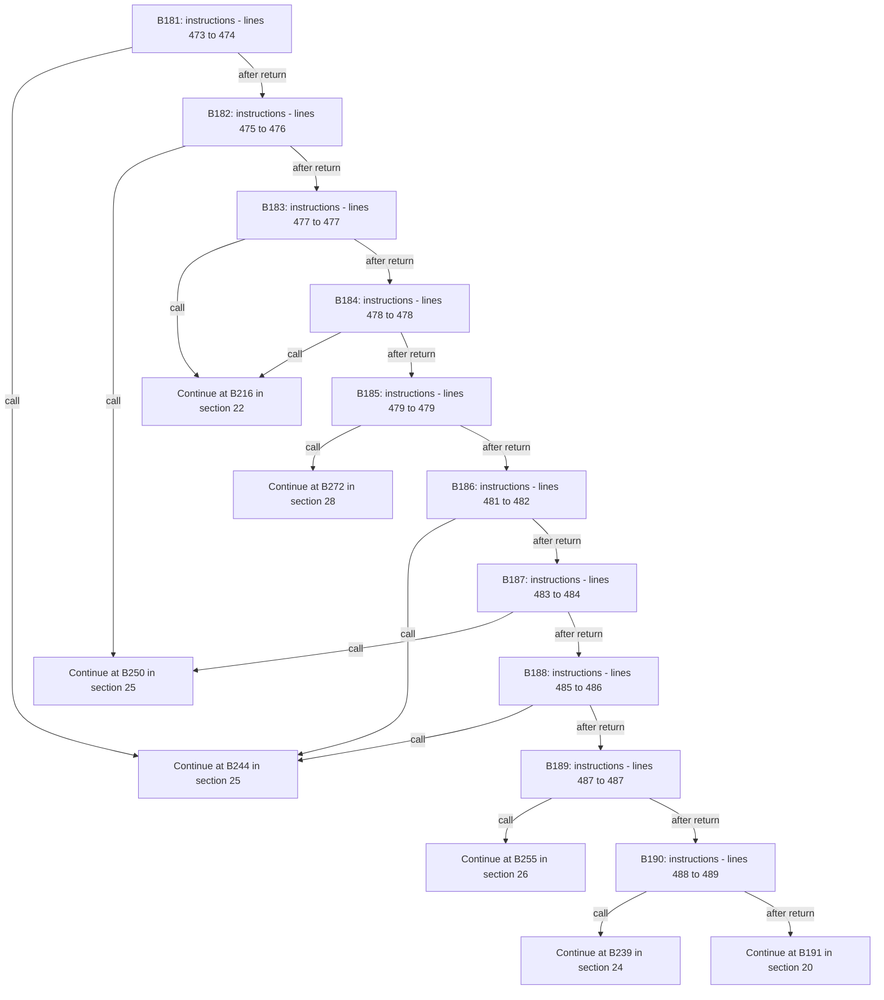

### B181

```asm
mov a,#0c0h
acall cmd
```

### B182

```asm
mov dptr, #MESG10
acall wstr
```

### B183

```asm
ACALL DELAY
```

### B184

```asm
ACALL DELAY
```

### B185

```asm
ACALL CLEAR
```

### B186

```asm
mov a, #80H
acall cmd
```

### B187

```asm
mov dptr, #MESG8
acall wstr
```

### B188

```asm
mov a, #0C3H
acall cmd
```

### B189

```asm
ACALL KEYPAD
```

### B190

```asm
MOV 35H,A
acall wchr
```

## Section 20

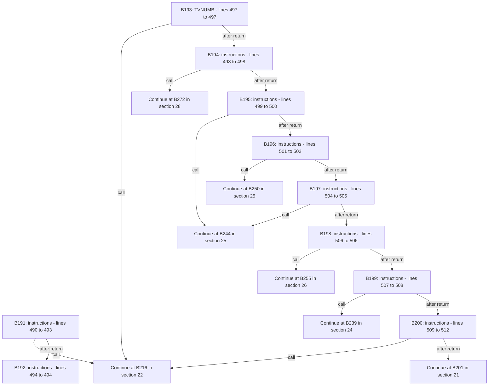

### B191

```asm
MOV A,35H
SUBB A,#30H
MOV 35H,A
ACALL DELAY
```

### B192

Return to the instruction following the active call.

```asm
RET
```

### B193

```asm
ACALL DELAY
```

### B194

```asm
ACALL CLEAR
```

### B195

```asm
mov a, #80H
acall cmd
```

### B196

```asm
mov dptr, #MESG13
acall wstr
```

### B197

```asm
mov a, #0C3H
acall cmd
```

### B198

```asm
ACALL KEYPAD
```

### B199

```asm
MOV 34H,A
acall wchr
```

### B200

```asm
MOV A,34H
SUBB A,#30H
MOV 34H,A
ACALL DELAY
```

## Section 21

```mermaid
flowchart TD
B200["B201: instructions - lines 513 to 513"]
B201["B202: PAYMENT - lines 516 to 516"]
B202["B203: instructions - lines 517 to 517"]
B203["B204: instructions - lines 518 to 519"]
B204["B205: instructions - lines 520 to 521"]
B205["B206: instructions - lines 522 to 523"]
B206["B207: instructions - lines 524 to 531"]
B207["B208: instructions - lines 532 to 534"]
B208["B209: instructions - lines 535 to 537"]
B209["B210: instructions - lines 539 to 539"]
B201 -->|call| B215
B201 -->|after return| B202
B202 -->|call| B271
B202 -->|after return| B203
B203 -->|call| B243
B203 -->|after return| B204
B204 -->|call| B249
B204 -->|after return| B205
B205 -->|call| B243
B205 -->|after return| B206
B206 -->|call| B238
B206 -->|after return| B207
B207 -->|call| B238
B207 -->|after return| B208
B208 -->|call| B238
B208 -->|after return| B209
B215["Continue at B216 in section 22"]
B271["Continue at B272 in section 28"]
B243["Continue at B244 in section 25"]
B249["Continue at B250 in section 25"]
B238["Continue at B239 in section 24"]
```

### B201

Return to the instruction following the active call.

```asm
RET
```

### B202

```asm
ACALL DELAY
```

### B203

```asm
ACALL CLEAR
```

### B204

```asm
mov a, #80H
acall cmd
```

### B205

```asm
mov dptr, #MESG14
acall wstr
```

### B206

```asm
mov a, #0C3H
acall cmd
```

### B207

```asm
MOV A,36H
MOV B,#10
DIV AB
MOV R3,B
MOV B,#10
DIV AB
ADD A,#30H
acall wchr
```

### B208

```asm
MOV A,B
ADD A,#30H
acall wchr
```

### B209

```asm
MOV A,R3
ADD A,#30H
acall wchr
```

### B210

Return to the instruction following the active call.

```asm
RET
```

## Section 22

```mermaid
flowchart TD
B210["B211: ERRORR - lines 542 to 542"]
B211["B212: instructions - lines 543 to 543"]
B212["B213: instructions - lines 544 to 545"]
B213["B214: instructions - lines 546 to 547"]
B214["B215: instructions - lines 548 to 548"]
B215["B216: DELAY - lines 552 to 553"]
B216["B217: instructions - lines 554 to 554"]
B217["B218: REPEAT_AGAIN - lines 558 to 558"]
B218["B219: instructions - lines 559 to 559"]
B219["B220: instructions - lines 560 to 561"]
B210 -->|call| B215
B210 -->|after return| B211
B211 -->|call| B271
B211 -->|after return| B212
B212 -->|call| B243
B212 -->|after return| B213
B213 -->|call| B249
B213 -->|after return| B214
B215 -->|condition true| B215
B215 -->|condition false| B216
B217 -->|call| B215
B217 -->|after return| B218
B218 -->|call| B271
B218 -->|after return| B219
B219 -->|call| B243
B219 -->|after return| B220
B271["Continue at B272 in section 28"]
B243["Continue at B244 in section 25"]
B249["Continue at B250 in section 25"]
B220["Continue at B221 in section 23"]
```

### B211

```asm
ACALL DELAY
```

### B212

```asm
ACALL CLEAR
```

### B213

```asm
mov a, #80H
acall cmd
```

### B214

```asm
mov dptr, #MESG15
acall wstr
```

### B215

Return to the instruction following the active call.

```asm
RET
```

### B216

```asm
MOV R0, #200
DJNZ R0, $
```

### B217

Return to the instruction following the active call.

```asm
RET
```

### B218

```asm
ACALL DELAY
```

### B219

```asm
ACALL CLEAR
```

### B220

```asm
mov a, #80H
acall cmd
```

## Section 23

```mermaid
flowchart TD
B220["B221: instructions - lines 562 to 563"]
B221["B222: instructions - lines 564 to 565"]
B222["B223: instructions - lines 566 to 567"]
B223["B224: instructions - lines 568 to 568"]
B224["B225: instructions - lines 569 to 569"]
B225["B226: instructions - lines 570 to 570"]
B226["B227: EXI - lines 572 to 572"]
B227["B228: INT - lines 575 to 575"]
B228["B229: instructions - lines 576 to 576"]
B229["B230: instructions - lines 577 to 577"]
B220 -->|call| B249
B220 -->|after return| B221
B221 -->|call| B243
B221 -->|after return| B222
B222 -->|call| B249
B222 -->|after return| B223
B223 -->|call| B254
B223 -->|after return| B224
B224 -->|condition true| B226
B224 -->|condition false| B225
B225 -->|jump| B8
B227 -->|call| B215
B227 -->|after return| B228
B228 -->|call| B271
B228 -->|after return| B229
B229 -->|call| B215
B229 -->|after return| B230
B249["Continue at B250 in section 25"]
B243["Continue at B244 in section 25"]
B254["Continue at B255 in section 26"]
B8["Continue at B9 in section 1"]
B215["Continue at B216 in section 22"]
B271["Continue at B272 in section 28"]
B230["Continue at B231 in section 24"]
```

### B221

```asm
mov dptr, #MESG17
acall wstr
```

### B222

```asm
mov a, #0C0H
acall cmd
```

### B223

```asm
mov dptr, #MESG18
acall wstr
```

### B224

```asm
ACALL KEYPAD
```

### B225

```asm
CJNE A,#'1',EXI
```

### B226

```asm
LJMP REPEAT
```

### B227

Return to the instruction following the active call.

```asm
RET
```

### B228

```asm
ACALL DELAY
```

### B229

```asm
ACALL CLEAR
```

### B230

```asm
ACALL DELAY
```

## Section 24

```mermaid
flowchart TD
B230["B231: instructions - lines 578 to 579"]
B231["B232: instructions - lines 580 to 581"]
B232["B233: instructions - lines 583 to 586"]
B233["B234: INLCD - lines 590 to 598"]
B234["B235: instructions - lines 600 to 609"]
B235["B236: instructions - lines 611 to 626"]
B236["B237: instructions - lines 628 to 640"]
B237["B238: instructions - lines 641 to 641"]
B238["B239: WCHR - lines 646 to 650"]
B239["B240: instructions - lines 651 to 651"]
B230 -->|call| B243
B230 -->|after return| B231
B231 -->|call| B249
B231 -->|after return| B232
B233 -->|call| B215
B233 -->|after return| B234
B234 -->|call| B215
B234 -->|after return| B235
B235 -->|call| B215
B235 -->|after return| B236
B236 -->|call| B215
B236 -->|after return| B237
B238 -->|call| B248
B238 -->|after return| B239
B239 -->|call| B215
B239 -->|after return| B240
B243["Continue at B244 in section 25"]
B249["Continue at B250 in section 25"]
B215["Continue at B216 in section 22"]
B248["Continue at B249 in section 25"]
B240["Continue at B241 in section 25"]
```

### B231

```asm
mov a, #80H
acall cmd
```

### B232

```asm
mov dptr, #MESG16
acall wstr
```

### B233

Return to the instruction following the active call.

```asm
CLR P3.6
SETB P3.6
RET
```

### B234

```asm
CLR P1.3
CLR P1.7
CLR P1.6
SETB P1.5
CLR P1.4
SETB P1.2
CLR P1.2
ACALL DELAY
```

### B235

```asm
SETB P1.2
CLR P1.2
SETB P1.7
CLR P1.6
CLR P1.5
CLR P1.4
SETB P1.2
CLR P1.2
ACALL DELAY
```

### B236

```asm
CLR P1.7
CLR P1.6
CLR P1.5
CLR P1.4
SETB P1.2
CLR P1.2
SETB P1.7
SETB P1.6
SETB P1.5
SETB P1.4
SETB P1.2
CLR P1.2
ACALL DELAY
```

### B237

```asm
CLR P1.7
CLR P1.6
CLR P1.5
CLR P1.4
SETB P1.2
CLR P1.2
SETB P1.6
SETB P1.5
SETB P1.2
CLR P1.2
ACALL DELAY
```

### B238

Return to the instruction following the active call.

```asm
RET
```

### B239

```asm
PUSH ACC
PUSH B
SETB P1.3
MOV B,A
ACALL COMMON
```

### B240

```asm
ACALL DELAY
```

## Section 25

```mermaid
flowchart TD
B240["B241: instructions - lines 652 to 654"]
B241["B242: instructions - lines 655 to 655"]
B242["B243: instructions - lines 656 to 658"]
B243["B244: CMD - lines 661 to 663"]
B244["B245: instructions - lines 664 to 664"]
B245["B246: instructions - lines 665 to 667"]
B246["B247: instructions - lines 668 to 668"]
B247["B248: instructions - lines 669 to 669"]
B248["B249: COMMON - lines 673 to 678"]
B249["B250: WSTR - lines 682 to 682"]
B240 -->|call| B248
B240 -->|after return| B241
B241 -->|call| B215
B241 -->|after return| B242
B243 -->|call| B248
B243 -->|after return| B244
B244 -->|call| B215
B244 -->|after return| B245
B245 -->|call| B248
B245 -->|after return| B246
B246 -->|call| B215
B246 -->|after return| B247
B249 -->|next| B250
B215["Continue at B216 in section 22"]
B250["Continue at B251 in section 26"]
```

### B241

```asm
MOV A,B
SWAP A
ACALL COMMON
```

### B242

```asm
ACALL DELAY
```

### B243

Return to the instruction following the active call.

```asm
POP B
POP ACC
RET
```

### B244

```asm
CLR P1.3
MOV B,A
ACALL COMMON
```

### B245

```asm
ACALL DELAY
```

### B246

```asm
MOV A,B
SWAP A
ACALL COMMON
```

### B247

```asm
ACALL DELAY
```

### B248

Return to the instruction following the active call.

```asm
RET
```

### B249

Return to the instruction following the active call.

```asm
ANL a,#11110000B
ANL P1, #00001111B
ORL P1,A
SETB P1.2
CLR P1.2
RET
```

### B250

```asm
PUSH    ACC
```

## Section 26

```mermaid
flowchart TD
B250["B251: CONT1 - lines 684 to 686"]
B251["B252: PRINT - lines 688 to 688"]
B252["B253: instructions - lines 689 to 690"]
B253["B254: EXIT1 - lines 691 to 692"]
B254["B255: KEYPAD - lines 698 to 698"]
B255["B256: K1 - lines 699 to 702"]
B256["B257: K2 - lines 704 to 706"]
B257["B258: instructions - lines 707 to 707"]
B258["B259: OVER1 - lines 709 to 712"]
B259["B260: instructions - lines 713 to 716"]
B250 -->|condition true| B253
B250 -->|condition false| B251
B251 -->|call| B238
B251 -->|after return| B252
B252 -->|jump| B250
B254 -->|next| B255
B255 -->|condition true| B255
B255 -->|condition false| B256
B256 -->|condition true| B258
B256 -->|condition false| B257
B257 -->|jump| B256
B258 -->|condition true| B263
B258 -->|condition false| B259
B259 -->|condition true| B264
B259 -->|condition false| B260
B238["Continue at B239 in section 24"]
B263["Continue at B264 in section 27"]
B264["Continue at B265 in section 27"]
B260["Continue at B261 in section 27"]
```

### B251

```asm
CLR     A
MOVC    A,@A+DPTR
JZ Exit1
```

### B252

```asm
ACALL    WCHR
```

### B253

```asm
INC DPTR
AJMP    CONT1
```

### B254

Return to the instruction following the active call.

```asm
POP     ACC
RET
```

### B255

```asm
MOV P0,#01110000B
```

### B256

```asm
MOV P0,#01110000B
MOV A,P0
ANL A,#01110000B
CJNE A,#01110000B,K1
```

### B257

```asm
MOV A,P0
ANL A,#01110000B
CJNE A,#01110000B,OVER1
```

### B258

```asm
SJMP K2
```

### B259

```asm
MOV P0,#01111110B
MOV A,P0
ANL A,#01110000B
CJNE A,#01110000B,ROW_0
```

### B260

```asm
MOV P0,#01111101B
MOV A,P0
ANL A,#01110000B
CJNE A,#01110000B,ROW_1
```

## Section 27

```mermaid
flowchart TD
B260["B261: instructions - lines 717 to 720"]
B261["B262: instructions - lines 721 to 724"]
B262["B263: instructions - lines 725 to 725"]
B263["B264: ROW_0 - lines 726 to 727"]
B264["B265: ROW_1 - lines 728 to 729"]
B265["B266: ROW_2 - lines 730 to 731"]
B266["B267: ROW_3 - lines 732 to 732"]
B267["B268: FIND - lines 734 to 734"]
B268["B269: FIND1 - lines 736 to 737"]
B269["B270: instructions - lines 738 to 739"]
B260 -->|condition true| B265
B260 -->|condition false| B261
B261 -->|condition true| B266
B261 -->|condition false| B262
B262 -->|jump| B256
B263 -->|jump| B267
B264 -->|jump| B267
B265 -->|jump| B267
B266 -->|next| B267
B267 -->|next| B268
B268 -->|condition true| B270
B268 -->|condition false| B269
B269 -->|jump| B268
B256["Continue at B257 in section 26"]
B270["Continue at B271 in section 28"]
```

### B261

```asm
MOV P0,#01111011B
MOV A,P0
ANL A,#01110000B
CJNE A,#01110000B,ROW_2
```

### B262

```asm
MOV P0,#01110111B
MOV A,P0
ANL A,#01110000B
CJNE A,#01110000B,ROW_3
```

### B263

```asm
LJMP K2
```

### B264

```asm
MOV DPTR,#KCODE0
SJMP FIND
```

### B265

```asm
MOV DPTR,#KCODE1
SJMP FIND
```

### B266

```asm
MOV DPTR,#KCODE2
SJMP FIND
```

### B267

```asm
MOV DPTR,#KCODE3
```

### B268

```asm
RLC A
```

### B269

```asm
RLC A
JNC MATCH
```

### B270

```asm
INC DPTR
SJMP FIND1
```

## Section 28

```mermaid
flowchart TD
B270["B271: MATCH - lines 740 to 742"]
B271["B272: CLEAR - lines 745 to 746"]
B272["B273: instructions - lines 747 to 747"]
B273["B274: WAIT - lines 748 to 748"]
B274["B275: instructions - lines 749 to 749"]
B275["B276: instructions - lines 750 to 750"]
B271 -->|call| B243
B271 -->|after return| B272
B272 -->|next| B273
B273 -->|call| B215
B273 -->|after return| B274
B274 -->|condition true| B273
B274 -->|condition false| B275
B243["Continue at B244 in section 25"]
B215["Continue at B216 in section 22"]
```

### B271

Return to the instruction following the active call.

```asm
CLR A
MOVC A,@A+DPTR
RET
```

### B272

```asm
MOV A,#01H
ACALL CMD
```

### B273

```asm
MOV R7,#14
```

### B274

```asm
ACALL DELAY
```

### B275

```asm
DJNZ R7,WAIT
```

### B276

Return to the instruction following the active call.

```asm
ret
```
