# Program Control Flow

[Back to project](README.md)

Control-flow blocks are indexed by source line. Calls resume at the instruction following the call if the subroutine returns normally.

## Entry locations

- `ORG 00H` begins at B1.

## Navigation

[Section 1](#section-1) · [Section 2](#section-2) · [Section 3](#section-3) · [Section 4](#section-4) · [Section 5](#section-5) · [Section 6](#section-6) · [Section 7](#section-7) · [Section 8](#section-8) · [Section 9](#section-9) · [Section 10](#section-10) · [Section 11](#section-11) · [Section 12](#section-12) · [Section 13](#section-13) · [Section 14](#section-14) · [Section 15](#section-15) · [Section 16](#section-16) · [Section 17](#section-17) · [Section 18](#section-18) · [Section 19](#section-19) · [Section 20](#section-20) · [Section 21](#section-21) · [Section 22](#section-22) · [Section 23](#section-23)

## Section 1

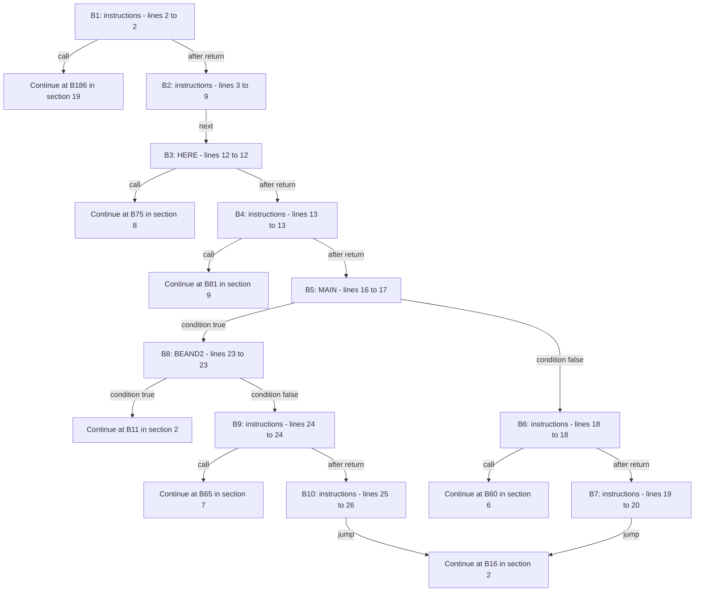

### B1

```asm
ACALL INLCD
```

### B2

```asm
MOV 30H,#3
MOV 31H,#2
MOV 32H,#1
MOV 33H,#2
MOV 34H,#2
MOV 35H,#1
MOV 36H,#0
```

### B3

```asm
ACALL WELCOME
```

### B4

```asm
ACALL MENU1
```

### B5

```asm
MOV A,30H
CJNE A,#1,BEAND2
```

### B6

```asm
ACALL FLASH1
```

### B7

```asm
MOV 36H,#63
AJMP WARR
```

### B8

```asm
CJNE A,#2,BEAND3
```

### B9

```asm
ACALL FLASH2
```

### B10

```asm
MOV 36H,#55
AJMP WARR
```

## Section 2

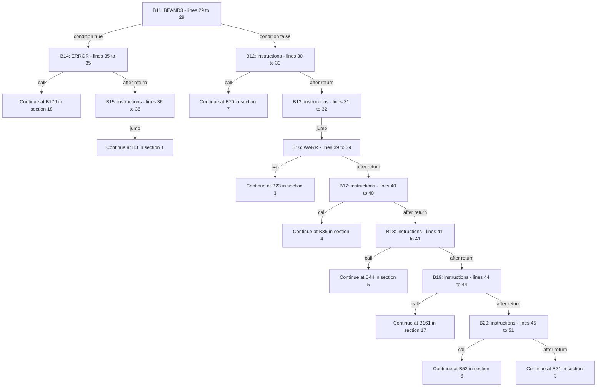

### B11

```asm
CJNE A,#3,ERROR
```

### B12

```asm
ACALL FLASH3
```

### B13

```asm
MOV 36H,#70
AJMP WARR
```

### B14

```asm
ACALL ERRORR
```

### B15

```asm
SJMP HERE
```

### B16

```asm
ACALL WARRENTLY
```

### B17

```asm
ACALL MAINTANACE
```

### B18

```asm
ACALL DELIVERY
```

### B19

```asm
ACALL TVNUMB
```

### B20

```asm
MOV B,34H
MOV A,36H
MUL AB
MOV 36H,A
ACALL MEMBERSHIP
```

## Section 3

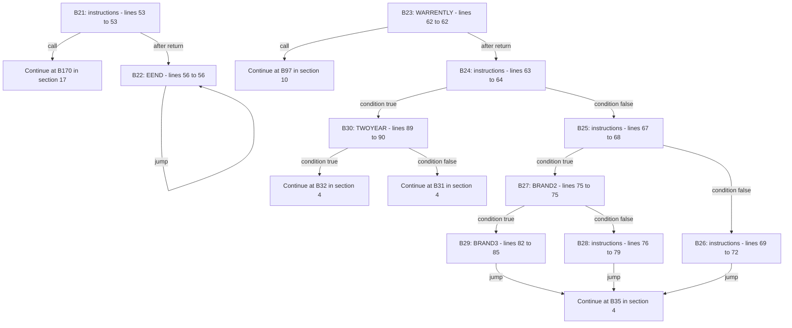

### B21

```asm
ACALL PAYMENT
```

### B22

```asm
SJMP EEND
```

### B23

```asm
ACALL WARMSG
```

### B24

```asm
MOV A,31H
CJNE A,#1,TWOYEAR
```

### B25

```asm
MOV A,30H
CJNE A,#1,BRAND2
```

### B26

```asm
MOV A,36H
ADD A,#4
MOV 36H,A
SJMP BACK
```

### B27

```asm
CJNE A,#2,BRAND3
```

### B28

```asm
MOV A,36H
ADD A,#2
MOV 36H,A
SJMP BACK
```

### B29

```asm
MOV A,36H
ADD A,#8
MOV 36H,A
SJMP BACK
```

### B30

```asm
MOV A,30H
CJNE A,#1,BRRAND2
```

## Section 4

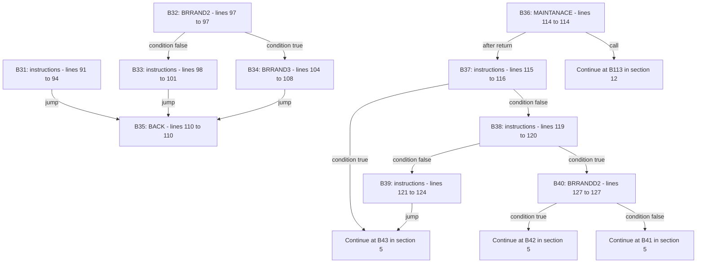

### B31

```asm
MOV A,36H
ADD A,#7
MOV 36H,A
SJMP BACK
```

### B32

```asm
CJNE A,#2,BRRAND3
```

### B33

```asm
MOV A,36H
ADD A,#3
MOV 36H,A
SJMP BACK
```

### B34

```asm
MOV 36H,#77
MOV A,36H
ADD A,#11
MOV 36H,A
SJMP BACK
```

### B35

Return to the instruction following the active call.

```asm
RET
```

### B36

```asm
ACALL MAIMSG
```

### B37

```asm
MOV A,32H
CJNE A,#1,NO
```

### B38

```asm
MOV A,30H
CJNE A,#1,BRRANDD2
```

### B39

```asm
MOV A,36H
ADD A,#4
MOV 36H,A
SJMP BACK1
```

### B40

```asm
CJNE A,#2,BRRANDD3
```

## Section 5

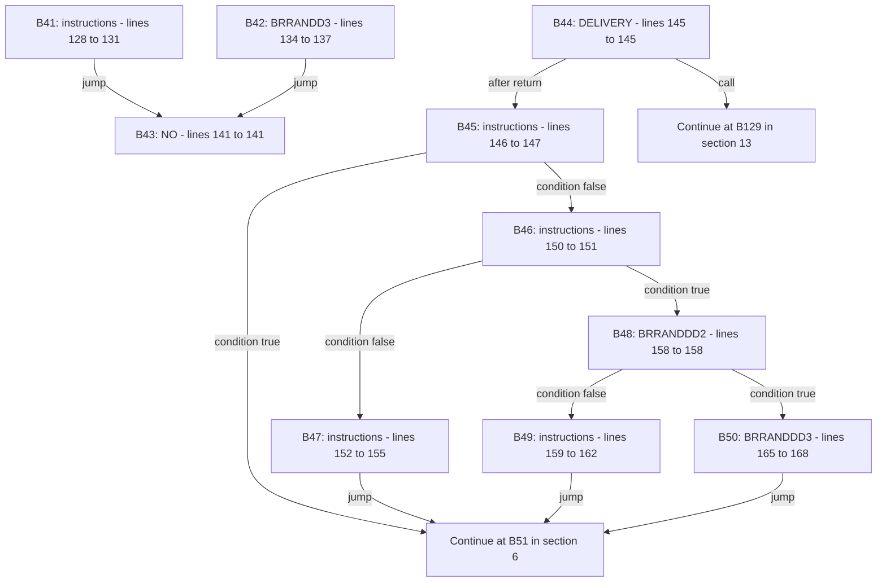

### B41

```asm
MOV A,36H
ADD A,#3
MOV 36H,A
SJMP BACK1
```

### B42

```asm
MOV A,36H
ADD A,#7
MOV 36H,A
SJMP BACK1
```

### B43

Return to the instruction following the active call.

```asm
RET
```

### B44

```asm
ACALL DELMSG
```

### B45

```asm
MOV A,33H
CJNE A,#1,NO1
```

### B46

```asm
MOV A,30H
CJNE A,#1,BRRANDDD2
```

### B47

```asm
MOV A,36H
ADD A,#2
MOV 36H,A
SJMP BACK2
```

### B48

```asm
CJNE A,#2,BRRANDDD3
```

### B49

```asm
MOV A,36H
ADD A,#3
MOV 36H,A
SJMP BACK2
```

### B50

```asm
MOV A,36H
ADD A,#3
MOV 36H,A
SJMP BACK2
```

## Section 6

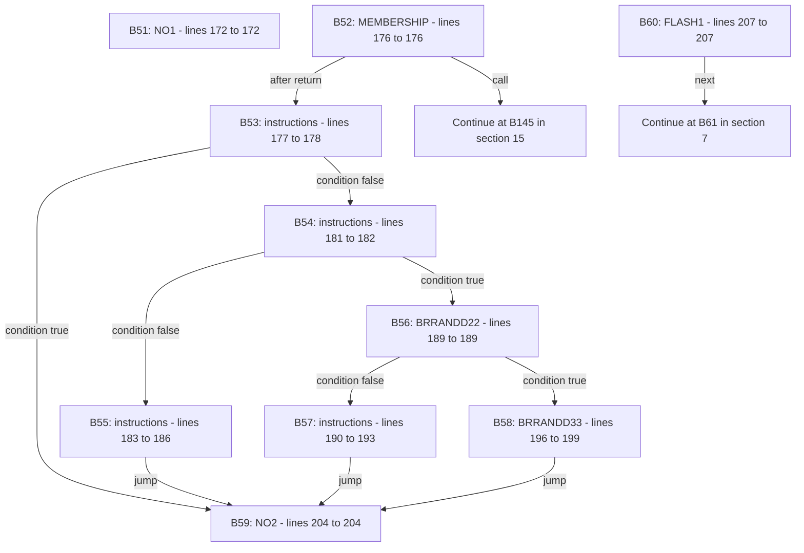

### B51

Return to the instruction following the active call.

```asm
RET
```

### B52

```asm
ACALL MEMMSG
```

### B53

```asm
MOV A,35H
CJNE A,#1,NO2
```

### B54

```asm
MOV A,30H
CJNE A,#1,BRRANDD22
```

### B55

```asm
MOV A,36H
SUBB A,#15
MOV 36H,A
SJMP BACK3
```

### B56

```asm
CJNE A,#2,BRRANDD33
```

### B57

```asm
MOV A,36H
SUBB A,#17
MOV 36H,A
SJMP BACK3
```

### B58

```asm
MOV A,36H
SUBB A,#22
MOV 36H,A
SJMP BACK3
```

### B59

Return to the instruction following the active call.

```asm
RET
```

### B60

```asm
MOV R7,#5
```

## Section 7

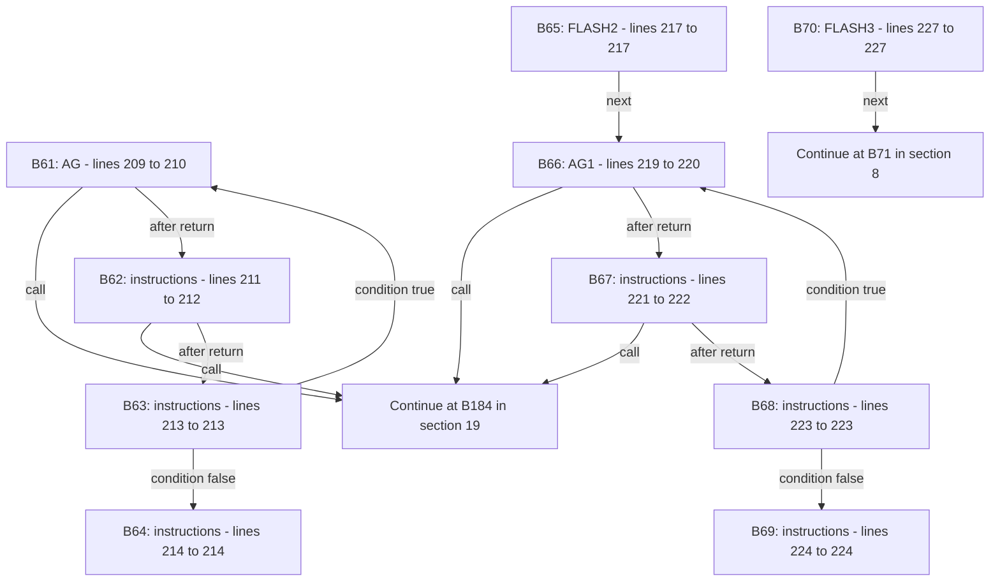

### B61

```asm
MOV P1,#11101111B
ACALL DELAY
```

### B62

```asm
MOV P1,#11111111B
ACALL DELAY
```

### B63

```asm
DJNZ R7,AG
```

### B64

Return to the instruction following the active call.

```asm
RET
```

### B65

```asm
MOV R7,#5
```

### B66

```asm
MOV P1,#11110111B
ACALL DELAY
```

### B67

```asm
MOV P1,#11111111B
ACALL DELAY
```

### B68

```asm
DJNZ R7,AG1
```

### B69

Return to the instruction following the active call.

```asm
RET
```

### B70

```asm
MOV R7,#5
```

## Section 8

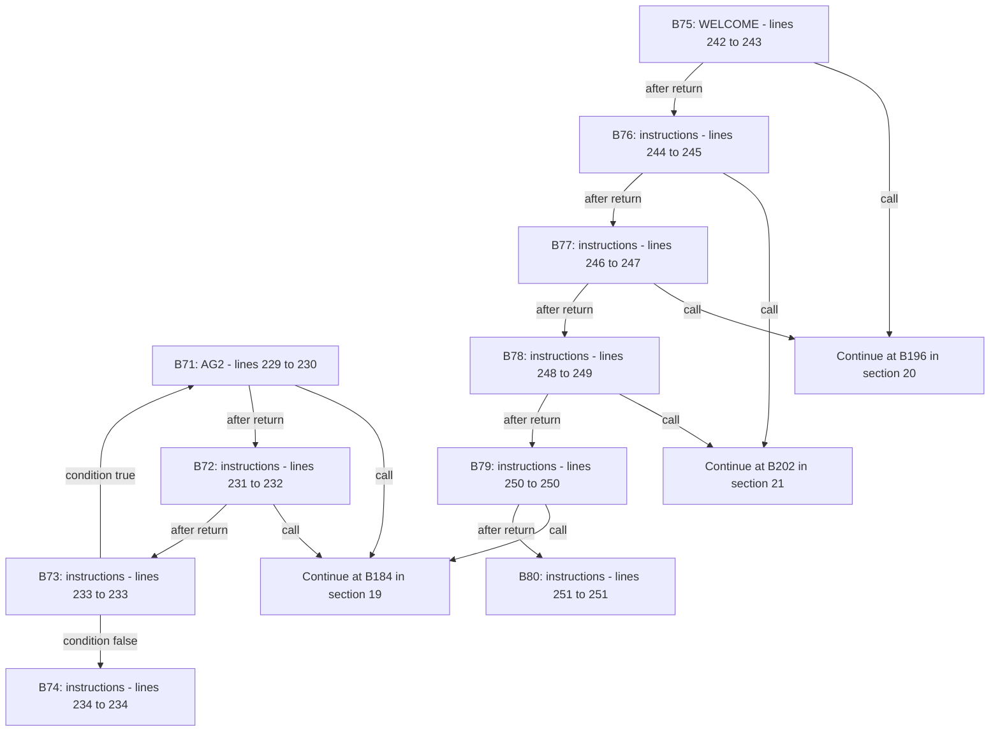

### B71

```asm
MOV P1,#11111011B
ACALL DELAY
```

### B72

```asm
MOV P1,#11111111B
ACALL DELAY
```

### B73

```asm
DJNZ R7,AG2
```

### B74

Return to the instruction following the active call.

```asm
RET
```

### B75

```asm
mov a, #80H
acall cmd
```

### B76

```asm
mov dptr, #MESG1
acall wstr
```

### B77

```asm
mov a,#0c0h
acall cmd
```

### B78

```asm
mov dptr, #MESG2
acall wstr
```

### B79

```asm
ACALL DELAY
```

### B80

Return to the instruction following the active call.

```asm
ret
```

## Section 9

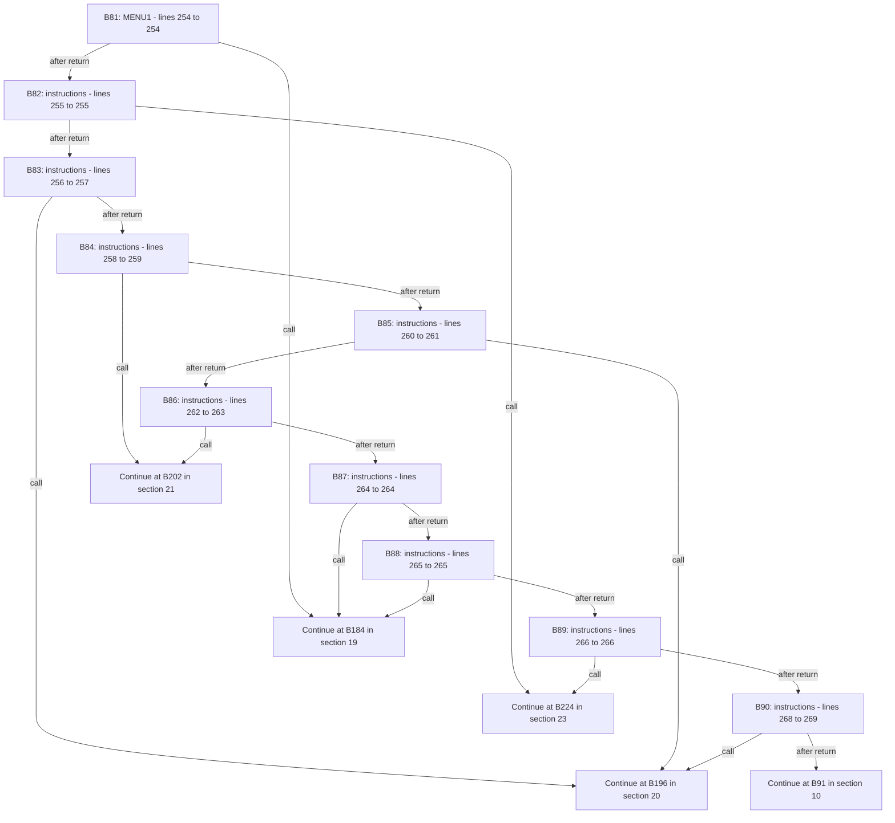

### B81

```asm
ACALL DELAY
```

### B82

```asm
ACALL CLEAR
```

### B83

```asm
mov a, #80H
acall cmd
```

### B84

```asm
mov dptr, #MESG3
acall wstr
```

### B85

```asm
mov a,#0c0h
acall cmd
```

### B86

```asm
mov dptr, #MESG4
acall wstr
```

### B87

```asm
ACALL DELAY
```

### B88

```asm
ACALL DELAY
```

### B89

```asm
ACALL CLEAR
```

### B90

```asm
mov a, #80H
acall cmd
```

## Section 10

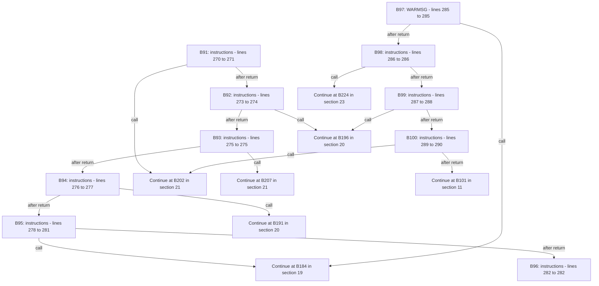

### B91

```asm
mov dptr, #MESG5
acall wstr
```

### B92

```asm
mov a, #0C3H
acall cmd
```

### B93

```asm
ACALL KEYPAD
```

### B94

```asm
MOV 30H,A
acall wchr
```

### B95

```asm
MOV A,30H
SUBB A,#30H
MOV 30H,A
ACALL DELAY
```

### B96

Return to the instruction following the active call.

```asm
RET
```

### B97

```asm
ACALL DELAY
```

### B98

```asm
ACALL CLEAR
```

### B99

```asm
mov a, #80H
acall cmd
```

### B100

```asm
mov dptr, #MESG6
acall wstr
```

## Section 11

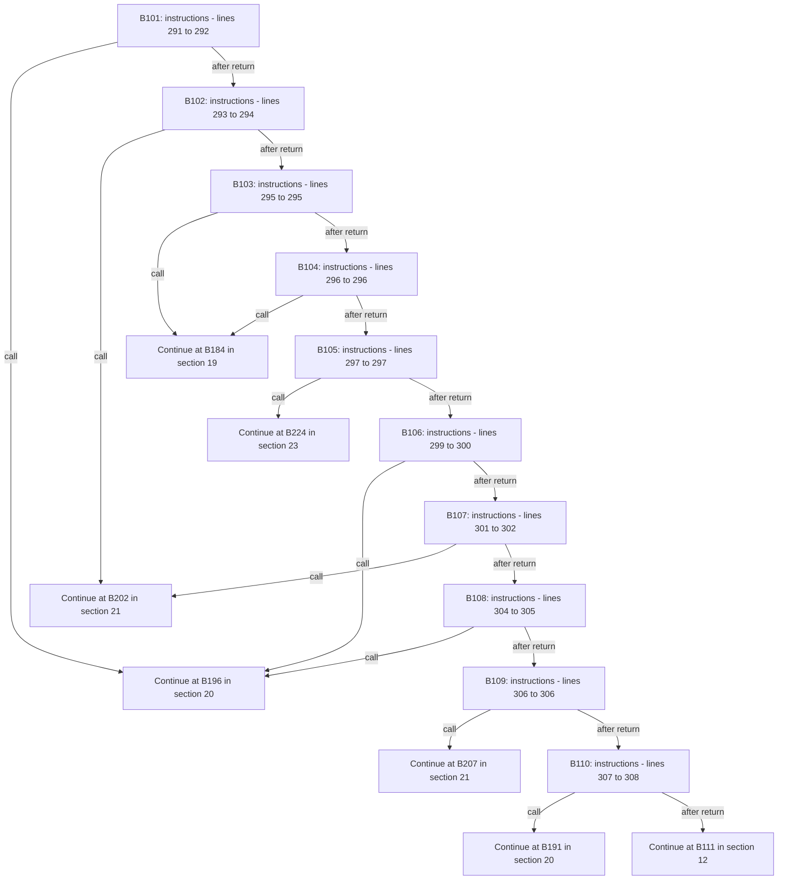

### B101

```asm
mov a,#0c0h
acall cmd
```

### B102

```asm
mov dptr, #MESG7
acall wstr
```

### B103

```asm
ACALL DELAY
```

### B104

```asm
ACALL DELAY
```

### B105

```asm
ACALL CLEAR
```

### B106

```asm
mov a, #80H
acall cmd
```

### B107

```asm
mov dptr, #MESG8
acall wstr
```

### B108

```asm
mov a, #0C3H
acall cmd
```

### B109

```asm
ACALL KEYPAD
```

### B110

```asm
MOV 31H,A
acall wchr
```

## Section 12

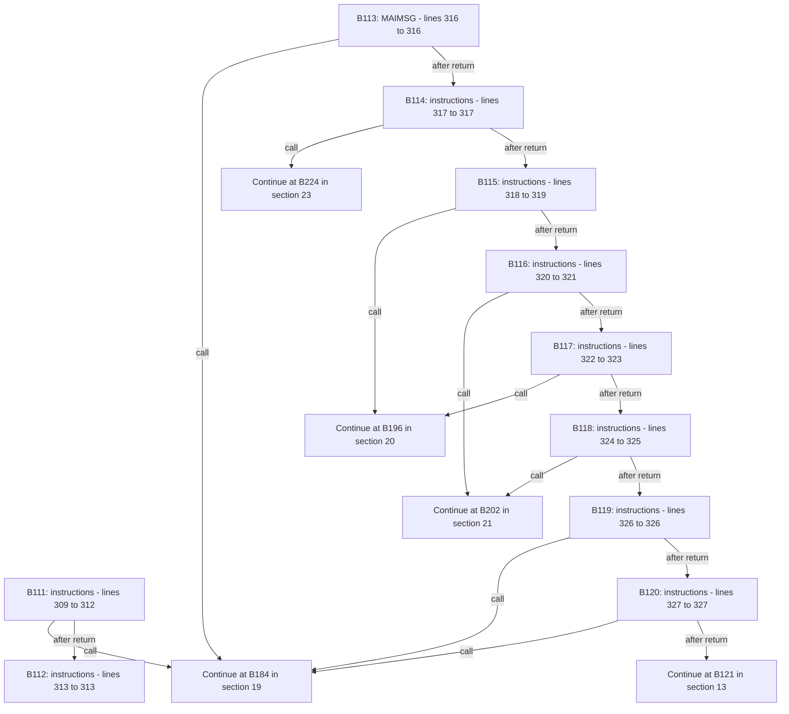

### B111

```asm
MOV A,31H
SUBB A,#30H
MOV 31H,A
ACALL DELAY
```

### B112

Return to the instruction following the active call.

```asm
RET
```

### B113

```asm
ACALL DELAY
```

### B114

```asm
ACALL CLEAR
```

### B115

```asm
mov a, #80H
acall cmd
```

### B116

```asm
mov dptr, #MESG9
acall wstr
```

### B117

```asm
mov a,#0c0h
acall cmd
```

### B118

```asm
mov dptr, #MESG10
acall wstr
```

### B119

```asm
ACALL DELAY
```

### B120

```asm
ACALL DELAY
```

## Section 13

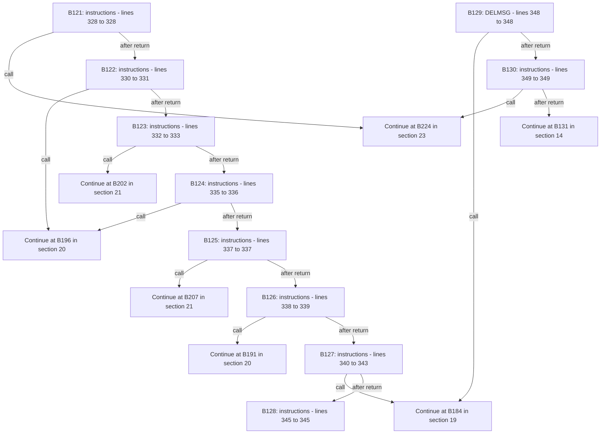

### B121

```asm
ACALL CLEAR
```

### B122

```asm
mov a, #80H
acall cmd
```

### B123

```asm
mov dptr, #MESG8
acall wstr
```

### B124

```asm
mov a, #0C3H
acall cmd
```

### B125

```asm
ACALL KEYPAD
```

### B126

```asm
MOV 32H,A
acall wchr
```

### B127

```asm
MOV A,32H
SUBB A,#30H
MOV 32H,A
ACALL DELAY
```

### B128

Return to the instruction following the active call.

```asm
RET
```

### B129

```asm
ACALL DELAY
```

### B130

```asm
ACALL CLEAR
```

## Section 14

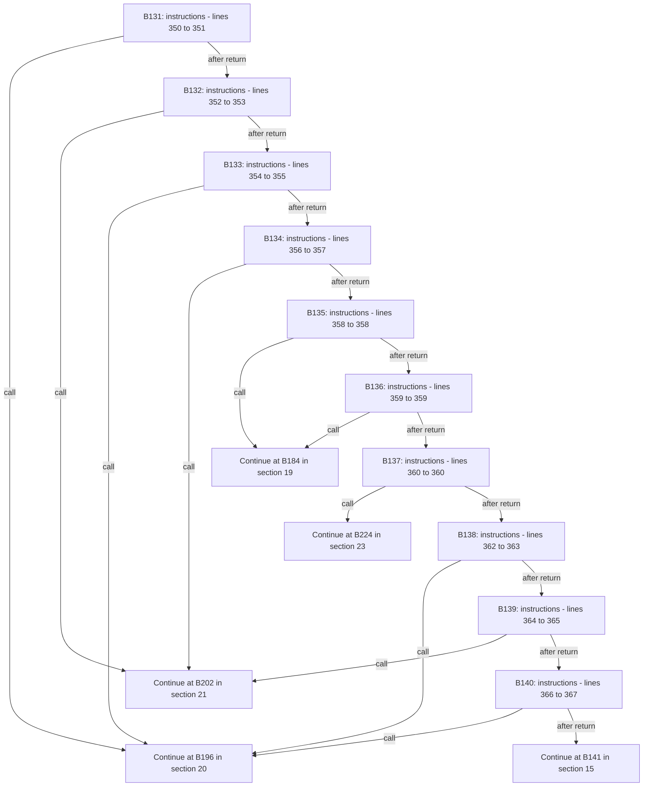

### B131

```asm
mov a, #80H
acall cmd
```

### B132

```asm
mov dptr, #MESG11
acall wstr
```

### B133

```asm
mov a,#0c0h
acall cmd
```

### B134

```asm
mov dptr, #MESG10
acall wstr
```

### B135

```asm
ACALL DELAY
```

### B136

```asm
ACALL DELAY
```

### B137

```asm
ACALL CLEAR
```

### B138

```asm
mov a, #80H
acall cmd
```

### B139

```asm
mov dptr, #MESG8
acall wstr
```

### B140

```asm
mov a, #0C3H
acall cmd
```

## Section 15

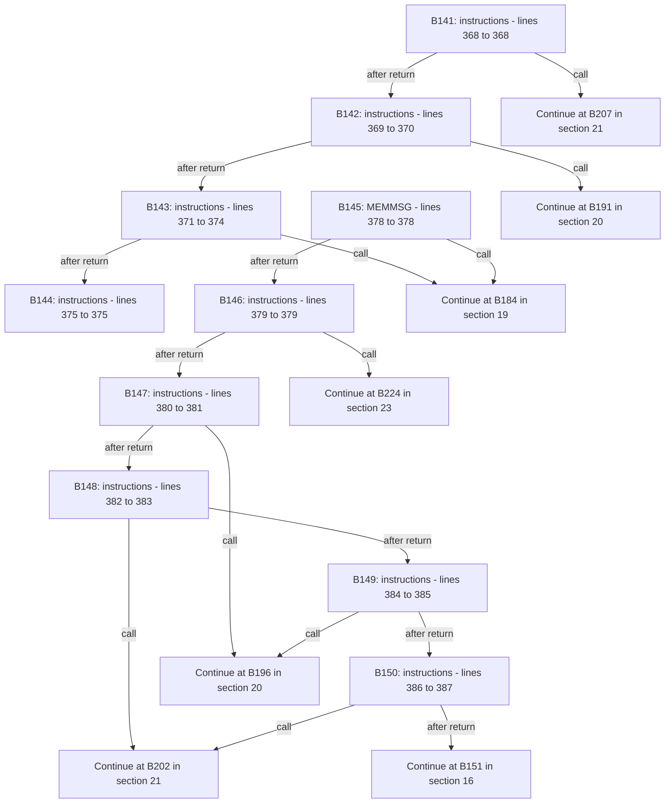

### B141

```asm
ACALL KEYPAD
```

### B142

```asm
MOV 33H,A
acall wchr
```

### B143

```asm
MOV A,33H
SUBB A,#30H
MOV 33H,A
ACALL DELAY
```

### B144

Return to the instruction following the active call.

```asm
RET
```

### B145

```asm
ACALL DELAY
```

### B146

```asm
ACALL CLEAR
```

### B147

```asm
mov a, #80H
acall cmd
```

### B148

```asm
mov dptr, #MESG12
acall wstr
```

### B149

```asm
mov a,#0c0h
acall cmd
```

### B150

```asm
mov dptr, #MESG10
acall wstr
```

## Section 16

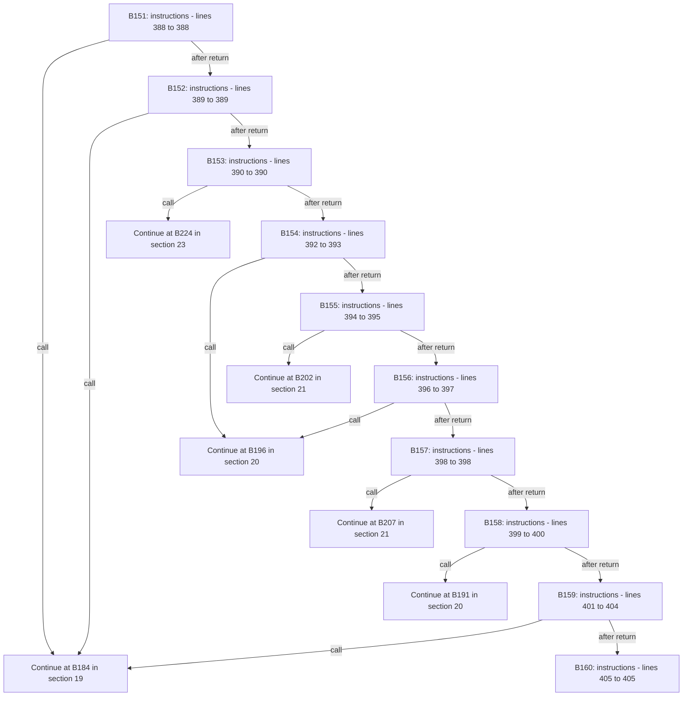

### B151

```asm
ACALL DELAY
```

### B152

```asm
ACALL DELAY
```

### B153

```asm
ACALL CLEAR
```

### B154

```asm
mov a, #80H
acall cmd
```

### B155

```asm
mov dptr, #MESG8
acall wstr
```

### B156

```asm
mov a, #0C3H
acall cmd
```

### B157

```asm
ACALL KEYPAD
```

### B158

```asm
MOV 35H,A
acall wchr
```

### B159

```asm
MOV A,35H
SUBB A,#30H
MOV 35H,A
ACALL DELAY
```

### B160

Return to the instruction following the active call.

```asm
RET
```

## Section 17

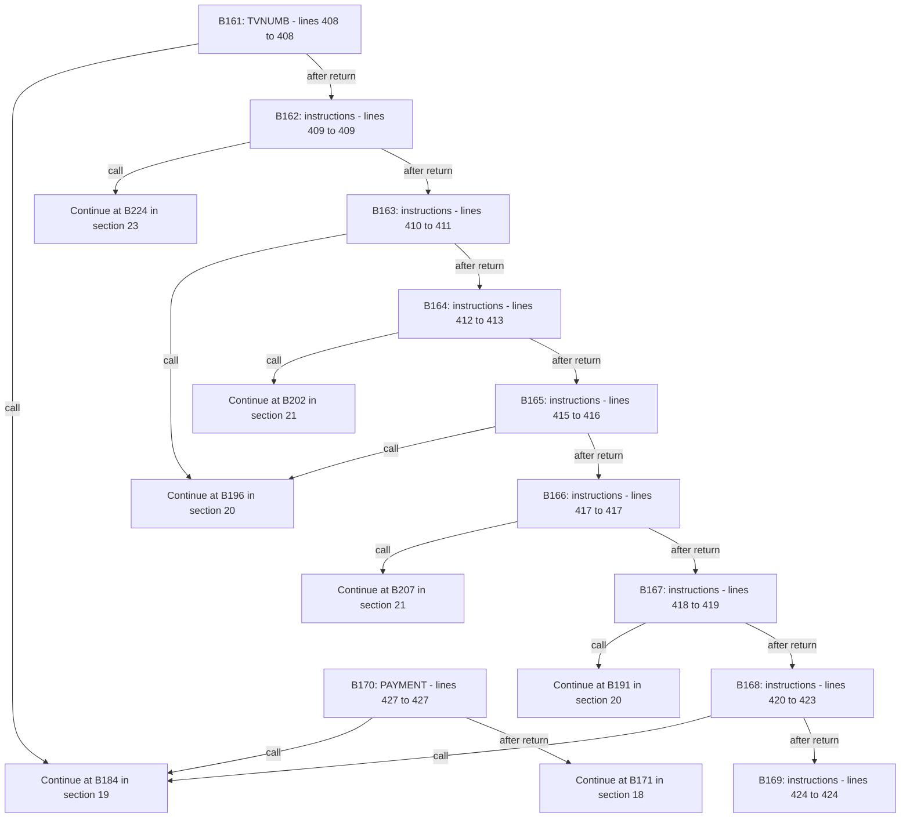

### B161

```asm
ACALL DELAY
```

### B162

```asm
ACALL CLEAR
```

### B163

```asm
mov a, #80H
acall cmd
```

### B164

```asm
mov dptr, #MESG13
acall wstr
```

### B165

```asm
mov a, #0C3H
acall cmd
```

### B166

```asm
ACALL KEYPAD
```

### B167

```asm
MOV 34H,A
acall wchr
```

### B168

```asm
MOV A,34H
SUBB A,#30H
MOV 34H,A
ACALL DELAY
```

### B169

Return to the instruction following the active call.

```asm
RET
```

### B170

```asm
ACALL DELAY
```

## Section 18

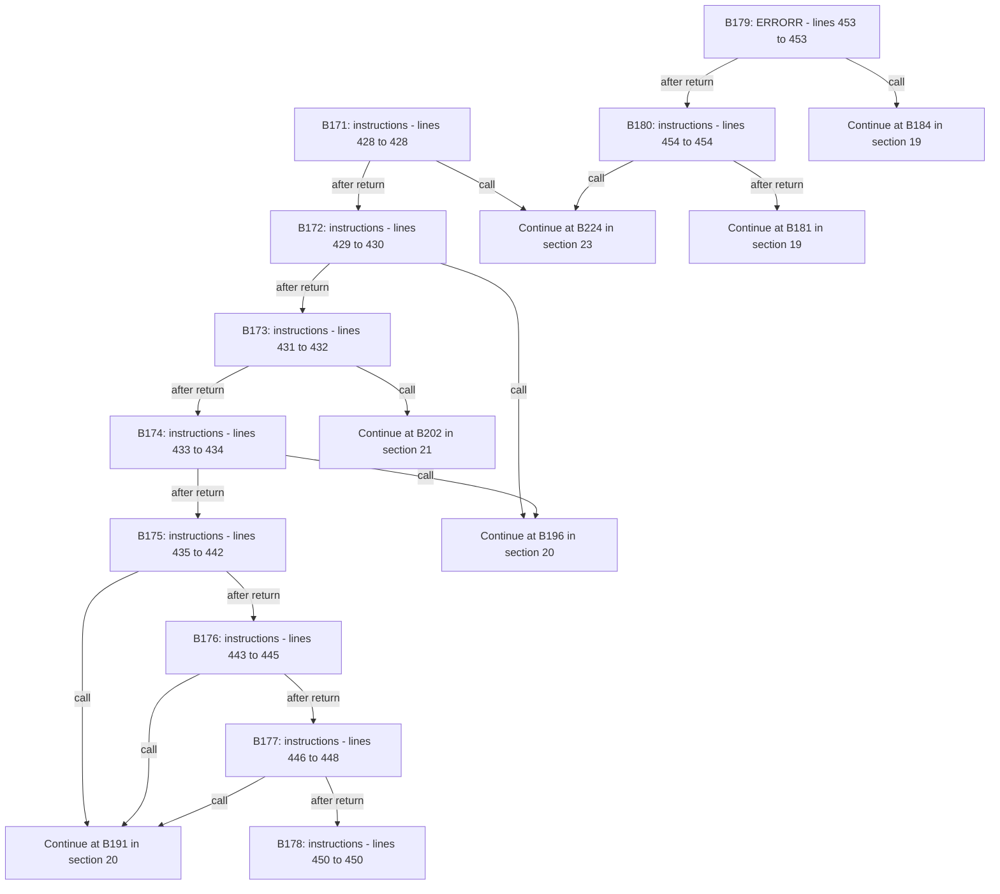

### B171

```asm
ACALL CLEAR
```

### B172

```asm
mov a, #80H
acall cmd
```

### B173

```asm
mov dptr, #MESG14
acall wstr
```

### B174

```asm
mov a, #0C3H
acall cmd
```

### B175

```asm
MOV A,36H
MOV B,#10
DIV AB
MOV R3,B
MOV B,#10
DIV AB
ADD A,#30H
acall wchr
```

### B176

```asm
MOV A,B
ADD A,#30H
acall wchr
```

### B177

```asm
MOV A,R3
ADD A,#30H
acall wchr
```

### B178

Return to the instruction following the active call.

```asm
RET
```

### B179

```asm
ACALL DELAY
```

### B180

```asm
ACALL CLEAR
```

## Section 19

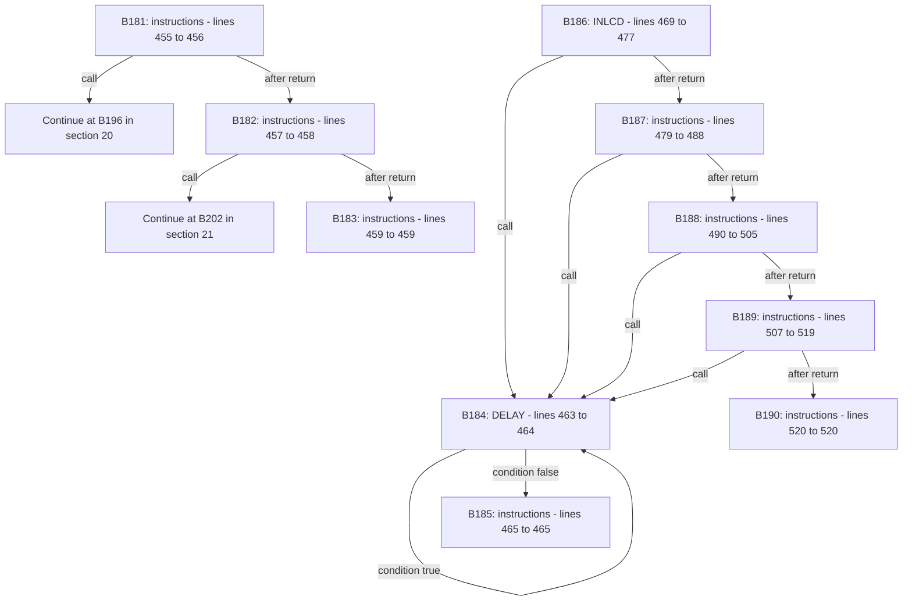

### B181

```asm
mov a, #80H
acall cmd
```

### B182

```asm
mov dptr, #MESG15
acall wstr
```

### B183

Return to the instruction following the active call.

```asm
RET
```

### B184

```asm
MOV R0, #200
DJNZ R0, $
```

### B185

Return to the instruction following the active call.

```asm
RET
```

### B186

```asm
CLR P1.3
CLR P1.7
CLR P1.6
SETB P1.5
CLR P1.4
SETB P1.2
CLR P1.2
ACALL DELAY
```

### B187

```asm
SETB P1.2
CLR P1.2
SETB P1.7
CLR P1.6
CLR P1.5
CLR P1.4
SETB P1.2
CLR P1.2
ACALL DELAY
```

### B188

```asm
CLR P1.7
CLR P1.6
CLR P1.5
CLR P1.4
SETB P1.2
CLR P1.2
SETB P1.7
SETB P1.6
SETB P1.5
SETB P1.4
SETB P1.2
CLR P1.2
ACALL DELAY
```

### B189

```asm
CLR P1.7
CLR P1.6
CLR P1.5
CLR P1.4
SETB P1.2
CLR P1.2
SETB P1.6
SETB P1.5
SETB P1.2
CLR P1.2
ACALL DELAY
```

### B190

Return to the instruction following the active call.

```asm
RET
```

## Section 20

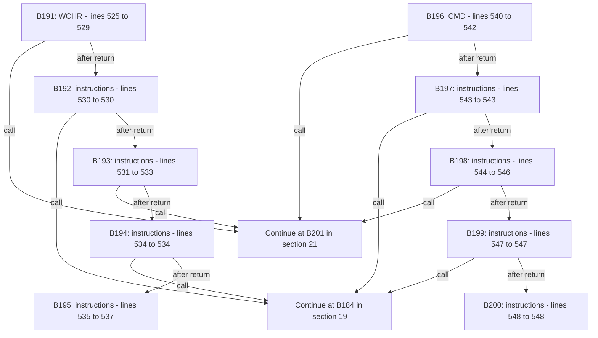

### B191

```asm
PUSH ACC
PUSH B
SETB P1.3
MOV B,A
ACALL COMMON
```

### B192

```asm
ACALL DELAY
```

### B193

```asm
MOV A,B
SWAP A
ACALL COMMON
```

### B194

```asm
ACALL DELAY
```

### B195

Return to the instruction following the active call.

```asm
POP B
POP ACC
RET
```

### B196

```asm
CLR P1.3
MOV B,A
ACALL COMMON
```

### B197

```asm
ACALL DELAY
```

### B198

```asm
MOV A,B
SWAP A
ACALL COMMON
```

### B199

```asm
ACALL DELAY
```

### B200

Return to the instruction following the active call.

```asm
RET
```

## Section 21

```mermaid
flowchart TD
B200["B201: COMMON - lines 552 to 557"]
B201["B202: WSTR - lines 561 to 561"]
B202["B203: CONT1 - lines 563 to 565"]
B203["B204: PRINT - lines 567 to 567"]
B204["B205: instructions - lines 568 to 569"]
B205["B206: EXIT1 - lines 570 to 571"]
B206["B207: KEYPAD - lines 577 to 577"]
B207["B208: K1 - lines 578 to 581"]
B208["B209: K2 - lines 583 to 585"]
B209["B210: instructions - lines 586 to 586"]
B201 -->|next| B202
B202 -->|condition true| B205
B202 -->|condition false| B203
B203 -->|call| B190
B203 -->|after return| B204
B204 -->|jump| B202
B206 -->|next| B207
B207 -->|condition true| B207
B207 -->|condition false| B208
B208 -->|condition true| B210
B208 -->|condition false| B209
B209 -->|jump| B208
B190["Continue at B191 in section 20"]
B210["Continue at B211 in section 22"]
```

### B201

Return to the instruction following the active call.

```asm
ANL a,#11110000B
ANL P1, #00001111B
ORL P1,A
SETB P1.2
CLR P1.2
RET
```

### B202

```asm
PUSH    ACC
```

### B203

```asm
CLR     A
MOVC    A,@A+DPTR
JZ Exit1
```

### B204

```asm
ACALL    WCHR
```

### B205

```asm
INC DPTR
AJMP    CONT1
```

### B206

Return to the instruction following the active call.

```asm
POP     ACC
RET
```

### B207

```asm
MOV P0,#01110000B
```

### B208

```asm
MOV P0,#01110000B
MOV A,P0
ANL A,#01110000B
CJNE A,#01110000B,K1
```

### B209

```asm
MOV A,P0
ANL A,#01110000B
CJNE A,#01110000B,OVER1
```

### B210

```asm
SJMP K2
```

## Section 22

```mermaid
flowchart TD
B210["B211: OVER1 - lines 588 to 591"]
B211["B212: instructions - lines 592 to 595"]
B212["B213: instructions - lines 596 to 599"]
B213["B214: instructions - lines 600 to 603"]
B214["B215: instructions - lines 604 to 604"]
B215["B216: ROW_0 - lines 605 to 606"]
B216["B217: ROW_1 - lines 607 to 608"]
B217["B218: ROW_2 - lines 609 to 610"]
B218["B219: ROW_3 - lines 611 to 611"]
B219["B220: FIND - lines 613 to 613"]
B210 -->|condition true| B215
B210 -->|condition false| B211
B211 -->|condition true| B216
B211 -->|condition false| B212
B212 -->|condition true| B217
B212 -->|condition false| B213
B213 -->|condition true| B218
B213 -->|condition false| B214
B214 -->|jump| B208
B215 -->|jump| B219
B216 -->|jump| B219
B217 -->|jump| B219
B218 -->|next| B219
B219 -->|next| B220
B208["Continue at B209 in section 21"]
B220["Continue at B221 in section 23"]
```

### B211

```asm
MOV P0,#01111110B
MOV A,P0
ANL A,#01110000B
CJNE A,#01110000B,ROW_0
```

### B212

```asm
MOV P0,#01111101B
MOV A,P0
ANL A,#01110000B
CJNE A,#01110000B,ROW_1
```

### B213

```asm
MOV P0,#01111011B
MOV A,P0
ANL A,#01110000B
CJNE A,#01110000B,ROW_2
```

### B214

```asm
MOV P0,#01110111B
MOV A,P0
ANL A,#01110000B
CJNE A,#01110000B,ROW_3
```

### B215

```asm
LJMP K2
```

### B216

```asm
MOV DPTR,#KCODE0
SJMP FIND
```

### B217

```asm
MOV DPTR,#KCODE1
SJMP FIND
```

### B218

```asm
MOV DPTR,#KCODE2
SJMP FIND
```

### B219

```asm
MOV DPTR,#KCODE3
```

### B220

```asm
RLC A
```

## Section 23

```mermaid
flowchart TD
B220["B221: FIND1 - lines 615 to 616"]
B221["B222: instructions - lines 617 to 618"]
B222["B223: MATCH - lines 619 to 621"]
B223["B224: CLEAR - lines 624 to 625"]
B224["B225: instructions - lines 626 to 626"]
B225["B226: WAIT - lines 627 to 627"]
B226["B227: instructions - lines 628 to 628"]
B227["B228: instructions - lines 629 to 629"]
B220 -->|condition true| B222
B220 -->|condition false| B221
B221 -->|jump| B220
B223 -->|call| B195
B223 -->|after return| B224
B224 -->|next| B225
B225 -->|call| B183
B225 -->|after return| B226
B226 -->|condition true| B225
B226 -->|condition false| B227
B195["Continue at B196 in section 20"]
B183["Continue at B184 in section 19"]
```

### B221

```asm
RLC A
JNC MATCH
```

### B222

```asm
INC DPTR
SJMP FIND1
```

### B223

Return to the instruction following the active call.

```asm
CLR A
MOVC A,@A+DPTR
RET
```

### B224

```asm
MOV A,#01H
ACALL CMD
```

### B225

```asm
MOV R7,#14
```

### B226

```asm
ACALL DELAY
```

### B227

```asm
DJNZ R7,WAIT
```

### B228

Return to the instruction following the active call.

```asm
ret
```
