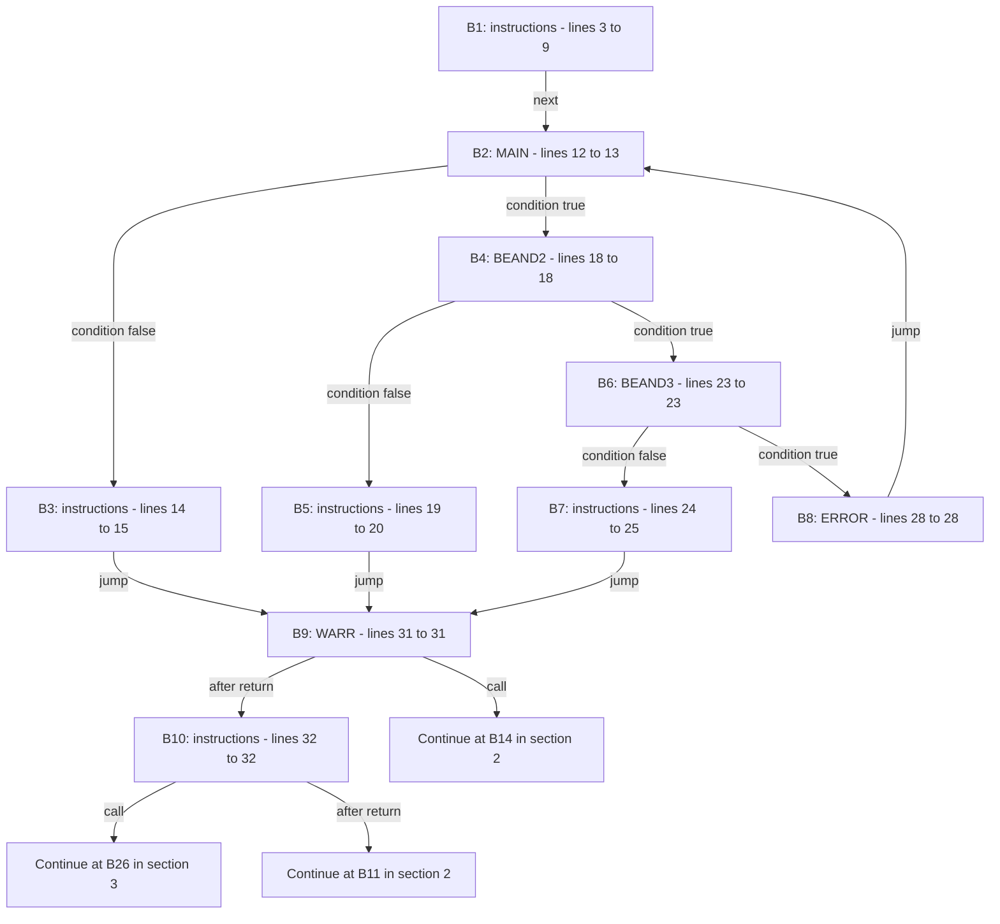
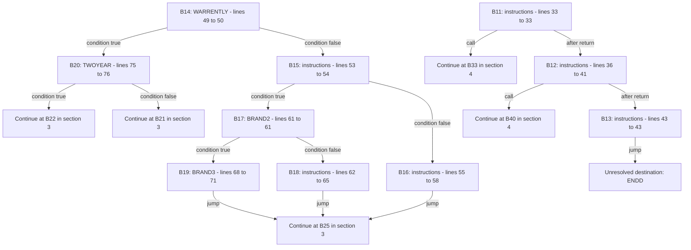
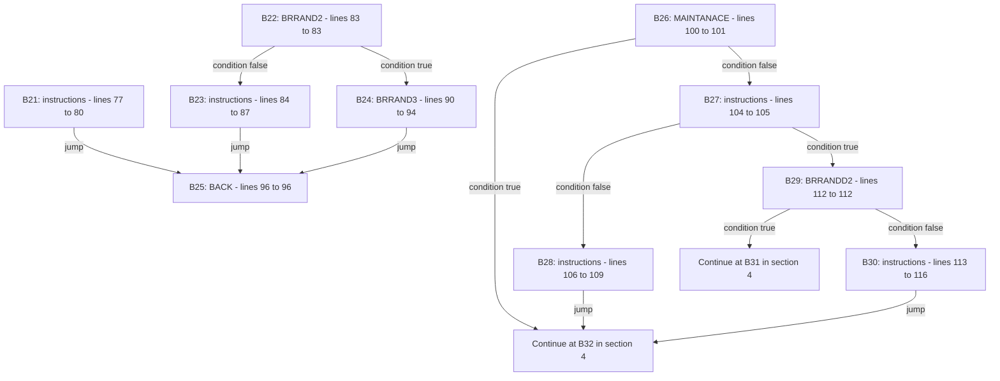
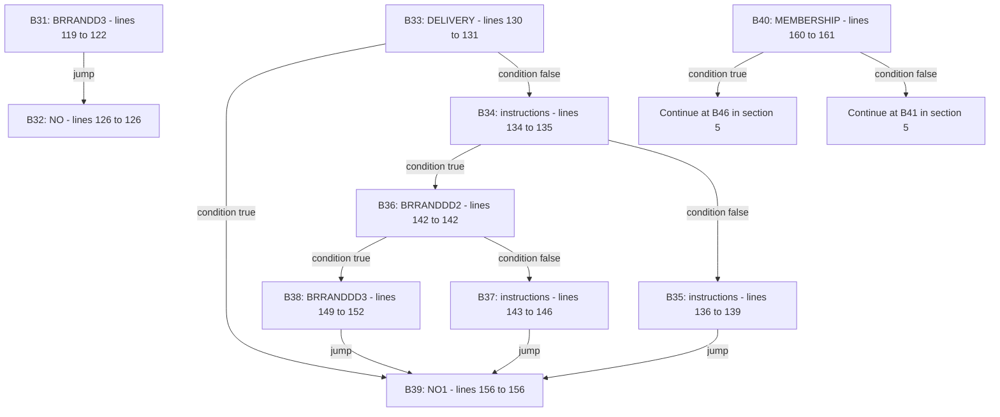
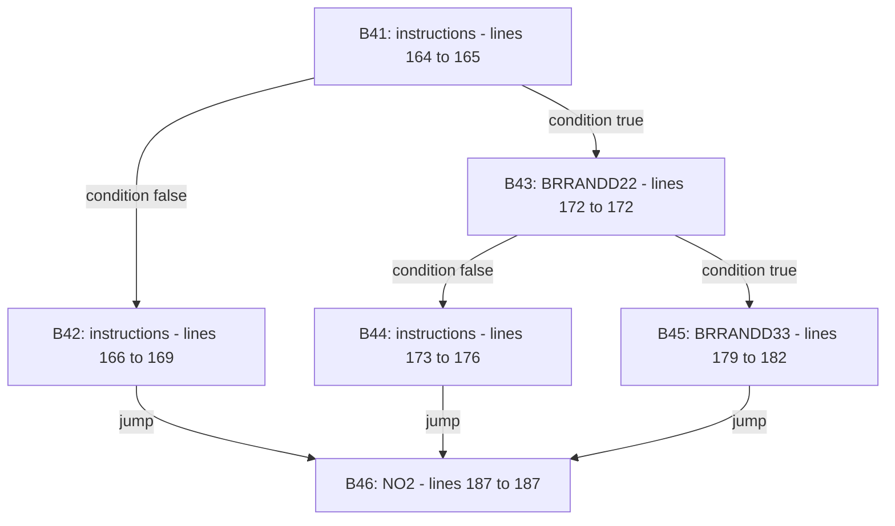

# Program Control Flow

[Back to project](README.md)

Control-flow blocks are indexed by source line. Calls resume at the instruction following the call if the subroutine returns normally.

## Entry locations

- `ORG 00H` begins at B1.

## Navigation

[Section 1](#section-1) · [Section 2](#section-2) · [Section 3](#section-3) · [Section 4](#section-4) · [Section 5](#section-5)

## Destinations requiring review

`ENDD`. A repeated label is also unresolved because it has more than one candidate target.

## Section 1



### B1

```asm
MOV 30H,#2
MOV 31H,#2
MOV 32H,#1
MOV 33H,#2
MOV 34H,#2
MOV 35H,#1
MOV 36H,#0
```

### B2

```asm
MOV A,30H
CJNE A,#1,BEAND2
```

### B3

```asm
MOV 36H,#63
AJMP WARR
```

### B4

```asm
CJNE A,#2,BEAND3
```

### B5

```asm
MOV 36H,#55
AJMP WARR
```

### B6

```asm
CJNE A,#3,ERROR
```

### B7

```asm
MOV 36H,#70
AJMP WARR
```

### B8

```asm
SJMP MAIN
```

### B9

```asm
ACALL WARRENTLY
```

### B10

```asm
ACALL MAINTANACE
```

## Section 2



### B11

```asm
ACALL DELIVERY
```

### B12

```asm
MOV B,34H
MOV A,36H
MUL AB
MOV 36H,A
ACALL MEMBERSHIP
```

### B13

```asm
AJMP ENDD
```

### B14

```asm
MOV A,31H
CJNE A,#1,TWOYEAR
```

### B15

```asm
MOV A,30H
CJNE A,#1,BRAND2
```

### B16

```asm
MOV A,36H
ADD A,#4
MOV 36H,A
SJMP BACK
```

### B17

```asm
CJNE A,#2,BRAND3
```

### B18

```asm
MOV A,36H
ADD A,#2
MOV 36H,A
SJMP BACK
```

### B19

```asm
MOV A,36H
ADD A,#8
MOV 36H,A
SJMP BACK
```

### B20

```asm
MOV A,30H
CJNE A,#1,BRRAND2
```

## Section 3



### B21

```asm
MOV A,36H
ADD A,#7
MOV 36H,A
SJMP BACK
```

### B22

```asm
CJNE A,#2,BRRAND3
```

### B23

```asm
MOV A,36H
ADD A,#3
MOV 36H,A
SJMP BACK
```

### B24

```asm
MOV 36H,#77
MOV A,36H
ADD A,#11
MOV 36H,A
SJMP BACK
```

### B25

Return to the instruction following the active call.

```asm
RET
```

### B26

```asm
MOV A,32H
CJNE A,#1,NO
```

### B27

```asm
MOV A,30H
CJNE A,#1,BRRANDD2
```

### B28

```asm
MOV A,36H
ADD A,#4
MOV 36H,A
SJMP BACK1
```

### B29

```asm
CJNE A,#2,BRRANDD3
```

### B30

```asm
MOV A,36H
ADD A,#3
MOV 36H,A
SJMP BACK1
```

## Section 4



### B31

```asm
MOV A,36H
ADD A,#7
MOV 36H,A
SJMP BACK1
```

### B32

Return to the instruction following the active call.

```asm
RET
```

### B33

```asm
MOV A,33H
CJNE A,#1,NO1
```

### B34

```asm
MOV A,30H
CJNE A,#1,BRRANDDD2
```

### B35

```asm
MOV A,36H
ADD A,#2
MOV 36H,A
SJMP BACK2
```

### B36

```asm
CJNE A,#2,BRRANDDD3
```

### B37

```asm
MOV A,36H
ADD A,#3
MOV 36H,A
SJMP BACK2
```

### B38

```asm
MOV A,36H
ADD A,#3
MOV 36H,A
SJMP BACK2
```

### B39

Return to the instruction following the active call.

```asm
RET
```

### B40

```asm
MOV A,35H
CJNE A,#1,NO2
```

## Section 5



### B41

```asm
MOV A,30H
CJNE A,#1,BRRANDD22
```

### B42

```asm
MOV A,36H
SUBB A,#15
MOV 36H,A
SJMP BACK3
```

### B43

```asm
CJNE A,#2,BRRANDD33
```

### B44

```asm
MOV A,36H
SUBB A,#17
MOV 36H,A
SJMP BACK3
```

### B45

```asm
MOV A,36H
SUBB A,#22
MOV 36H,A
SJMP BACK3
```

### B46

Return to the instruction following the active call.

```asm
RET
```
