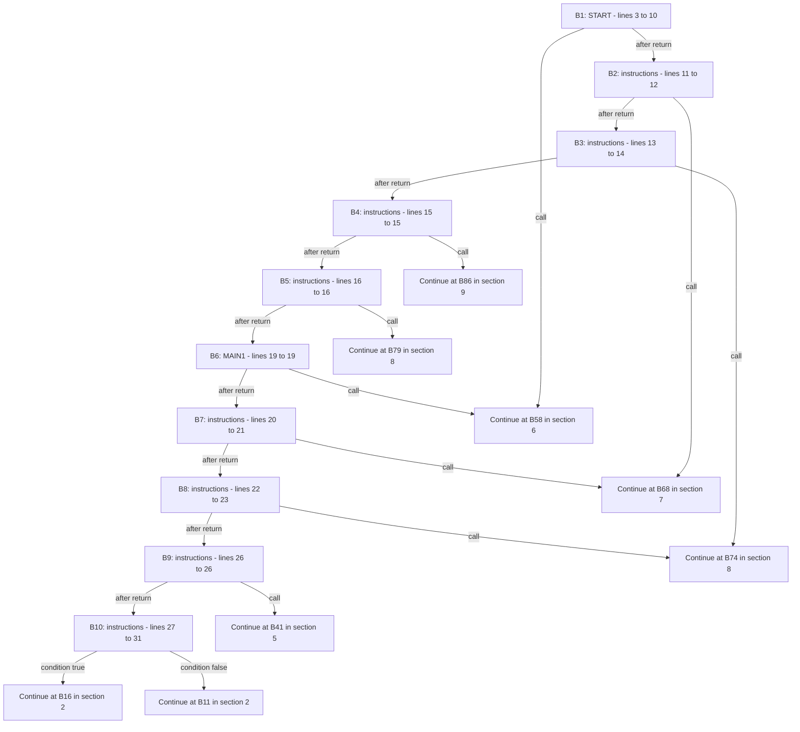
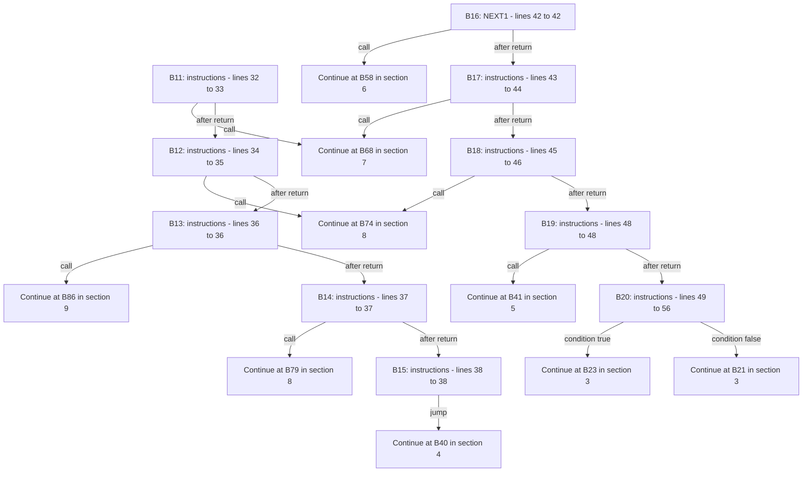
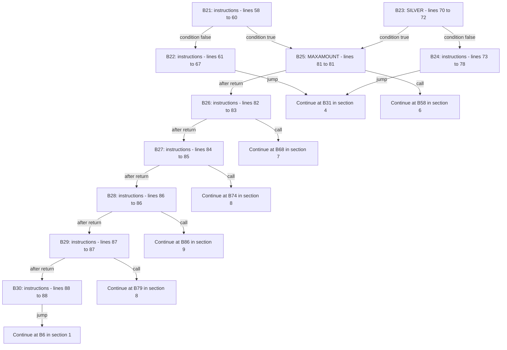
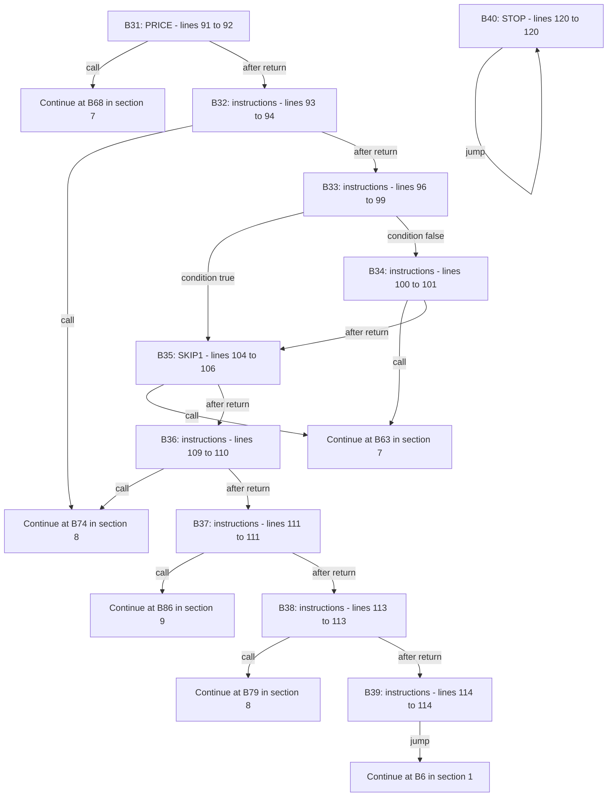
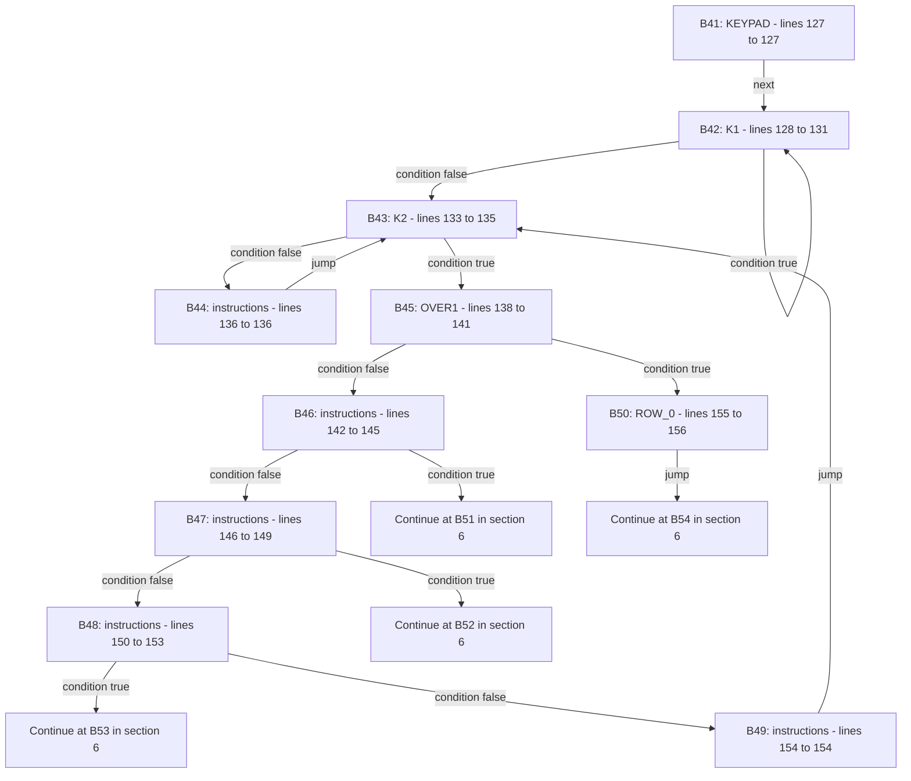
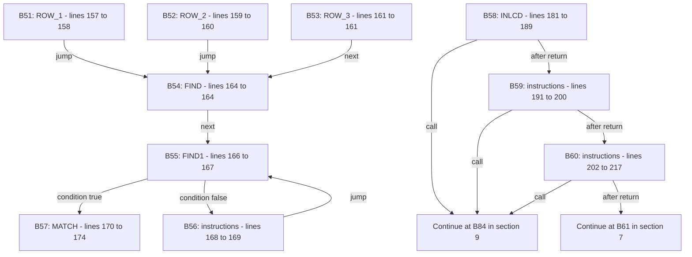
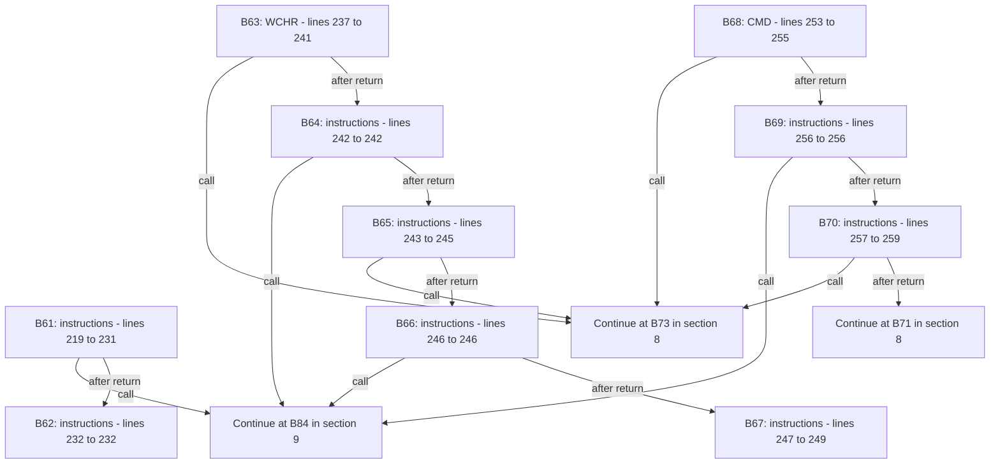
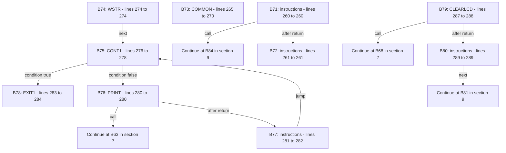
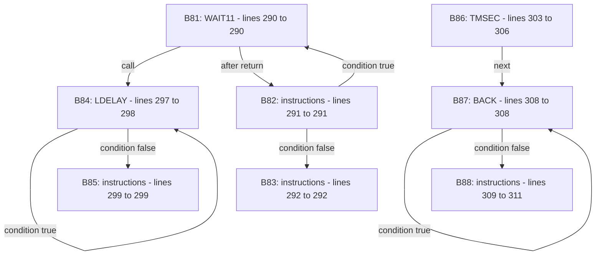

# Program Control Flow

[Back to project](README.md)

Control-flow blocks are indexed by source line. Calls resume at the instruction following the call if the subroutine returns normally.

## Entry locations

- `ORG 0H` begins at B1.

## Navigation

[Section 1](#section-1) · [Section 2](#section-2) · [Section 3](#section-3) · [Section 4](#section-4) · [Section 5](#section-5) · [Section 6](#section-6) · [Section 7](#section-7) · [Section 8](#section-8) · [Section 9](#section-9)

## Section 1



### B1

```asm
MOV 33H,#9
MOV 43H,#5
MOV 34H,#9
MOV 44H,#3
ACALL INLCD
```

### B2

```asm
MOV A,#80H
ACALL CMD
```

### B3

```asm
MOV DPTR,#STR1
ACALL WSTR
```

### B4

```asm
ACALL TMSEC
```

### B5

```asm
ACALL ClearLCD
```

### B6

```asm
ACALL INLCD
```

### B7

```asm
MOV A,#80H
ACALL CMD
```

### B8

```asm
MOV DPTR,#STR2
ACALL WSTR
```

### B9

```asm
ACALL KEYPAD
```

### B10

```asm
SUBB A,#30H
MOV 30H,A
MOV R5,30H
CJNE R5,#3,NEXT1
```

## Section 2



### B11

```asm
MOV A,#80H
ACALL CMD
```

### B12

```asm
MOV DPTR, #STR7
ACALL WSTR
```

### B13

```asm
ACALL TMSEC
```

### B14

```asm
ACALL ClearLCD
```

### B15

```asm
LJMP STOP
```

### B16

```asm
ACALL INLCD
```

### B17

```asm
MOV A,#80H
ACALL CMD
```

### B18

```asm
MOV DPTR,#STR3
ACALL WSTR
```

### B19

```asm
ACALL KEYPAD
```

### B20

```asm
SUBB A,#30H
MOV 40H,A
MOV R7,30H
MOV R6,40H
CJNE R7,#1,SILVER
```

## Section 3



### B21

```asm
MOV A,33H
SUBB A,R6
JB  ACC.7,MAXAMOUNT
```

### B22

```asm
MOV 33H,A
MOV A,R6
MOV B,43H
MUL AB
MOV 50H,A
SJMP PRICE
```

### B23

```asm
MOV A,34H
SUBB A,R6
JB  ACC.7,MAXAMOUNT
```

### B24

```asm
MOV 34H,A
MOV A,R6
MOV B,44H
MUL AB
MOV 50H,A
SJMP PRICE
```

### B25

```asm
ACALL INLCD
```

### B26

```asm
MOV A,#80H
ACALL CMD
```

### B27

```asm
MOV DPTR,#STR6
ACALL WSTR
```

### B28

```asm
ACALL TMSEC
```

### B29

```asm
ACALL ClearLCD
```

### B30

```asm
AJMP MAIN1
```

## Section 4



### B31

```asm
MOV A,#0c0H
ACALL CMD
```

### B32

```asm
MOV DPTR,#STR4
ACALL WSTR
```

### B33

```asm
MOV A,50H
MOV B,#10
DIV AB
JZ SKIP1
```

### B34

```asm
ADD A,#30H
ACALL WCHR
```

### B35

```asm
MOV A,B
ADD A,#30H
ACALL WCHR
```

### B36

```asm
MOV DPTR,#STR5
ACALL WSTR
```

### B37

```asm
ACALL TMSEC
```

### B38

```asm
ACALL ClearLCD
```

### B39

```asm
AJMP MAIN1
```

### B40

```asm
SJMP STOP
```

## Section 5



### B41

```asm
MOV P0,#01110000B
```

### B42

```asm
MOV P0,#01110000B
MOV A,P0
ANL A,#01110000B
CJNE A,#01110000B,K1
```

### B43

```asm
MOV A,P0
ANL A,#01110000B
CJNE A,#01110000B,OVER1
```

### B44

```asm
SJMP K2
```

### B45

```asm
MOV P0,#01111110B
MOV A,P0
ANL A,#01110000B
CJNE A,#01110000B,ROW_0
```

### B46

```asm
MOV P0,#01111101B
MOV A,P0
ANL A,#01110000B
CJNE A,#01110000B,ROW_1
```

### B47

```asm
MOV P0,#01111011B
MOV A,P0
ANL A,#01110000B
CJNE A,#01110000B,ROW_2
```

### B48

```asm
MOV P0,#01110111B
MOV A,P0
ANL A,#01110000B
CJNE A,#01110000B,ROW_3
```

### B49

```asm
LJMP K2
```

### B50

```asm
MOV DPTR,#KCODE0
SJMP FIND
```

## Section 6



### B51

```asm
MOV DPTR,#KCODE1
SJMP FIND
```

### B52

```asm
MOV DPTR,#KCODE2
SJMP FIND
```

### B53

```asm
MOV DPTR,#KCODE3
```

### B54

```asm
RLC A
```

### B55

```asm
RLC A
JNC MATCH
```

### B56

```asm
INC DPTR
SJMP FIND1
```

### B57

Return to the instruction following the active call.

```asm
CLR A
MOVC A,@A+DPTR
RET
```

### B58

```asm
CLR P1.3
CLR P1.7
CLR P1.6
SETB P1.5
CLR P1.4
SETB P1.2
CLR P1.2
ACALL LDELAY
```

### B59

```asm
SETB P1.2
CLR P1.2
SETB P1.7
CLR P1.6
CLR P1.5
CLR P1.4
SETB P1.2
CLR P1.2
ACALL LDELAY
```

### B60

```asm
CLR P1.7
CLR P1.6
CLR P1.5
CLR P1.4
SETB P1.2
CLR P1.2
SETB P1.7
SETB P1.6
SETB P1.5
SETB P1.4
SETB P1.2
CLR P1.2
ACALL LDELAY
```

## Section 7



### B61

```asm
CLR P1.7
CLR P1.6
CLR P1.5
CLR P1.4
SETB P1.2
CLR P1.2
SETB P1.6
SETB P1.5
SETB P1.2
CLR P1.2
ACALL LDELAY
```

### B62

Return to the instruction following the active call.

```asm
RET
```

### B63

```asm
PUSH ACC
PUSH B
SETB P1.3
MOV B,A
ACALL COMMON
```

### B64

```asm
ACALL LDELAY
```

### B65

```asm
MOV A,B
SWAP A
ACALL COMMON
```

### B66

```asm
ACALL LDELAY
```

### B67

Return to the instruction following the active call.

```asm
POP B
POP ACC
RET
```

### B68

```asm
CLR P1.3
MOV B,A
ACALL COMMON
```

### B69

```asm
ACALL LDELAY
```

### B70

```asm
MOV A,B
SWAP A
ACALL COMMON
```

## Section 8



### B71

```asm
ACALL LDELAY
```

### B72

Return to the instruction following the active call.

```asm
RET
```

### B73

Return to the instruction following the active call.

```asm
ANL a,#11110000B
ANL P1, #00001111B
ORL P1,A
SETB P1.2
CLR P1.2
RET
```

### B74

```asm
PUSH    ACC
```

### B75

```asm
CLR     A
MOVC    A,@A+DPTR
JZ Exit1
```

### B76

```asm
ACALL    WCHR
```

### B77

```asm
INC DPTR
AJMP    CONT1
```

### B78

Return to the instruction following the active call.

```asm
POP     ACC
RET
```

### B79

```asm
MOV A,#01H
ACALL CMD
```

### B80

```asm
MOV R7,#14
```

## Section 9



### B81

```asm
ACALL LDELAY
```

### B82

```asm
DJNZ R7,WAIT11
```

### B83

Return to the instruction following the active call.

```asm
RET
```

### B84

```asm
MOV R0, #50
DJNZ R0, $
```

### B85

Return to the instruction following the active call.

```asm
RET
```

### B86

```asm
MOV   TMOD,#21H
MOV   TL0,#0CAH
MOV   TH0,#27H
SETB  TR0
```

### B87

```asm
JNB   TF0,BACK
```

### B88

Return to the instruction following the active call.

```asm
CLR   TR0
CLR   TF0
RET
```
