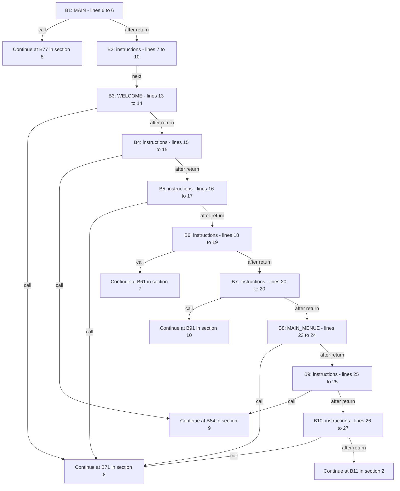
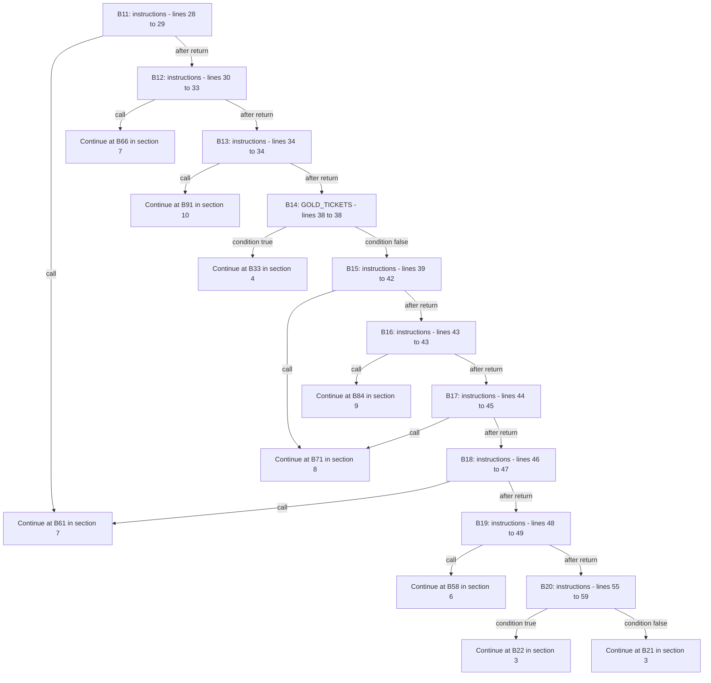
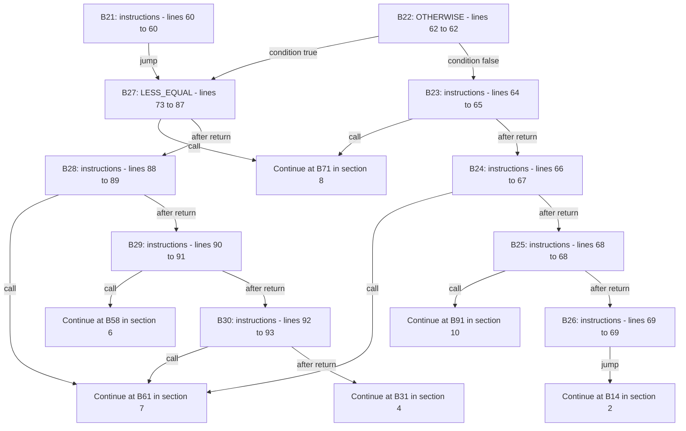
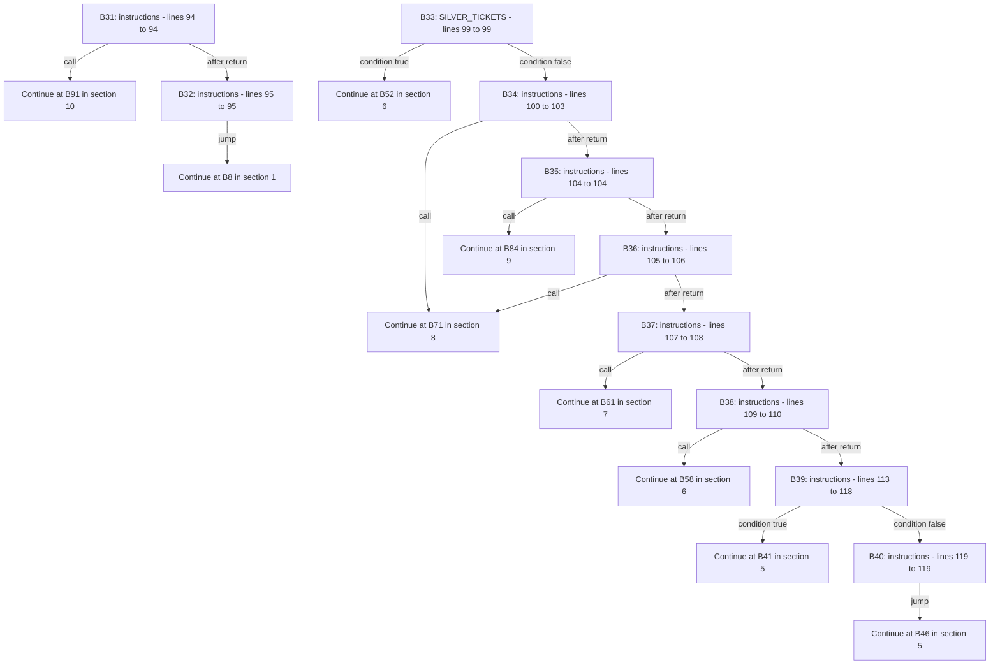
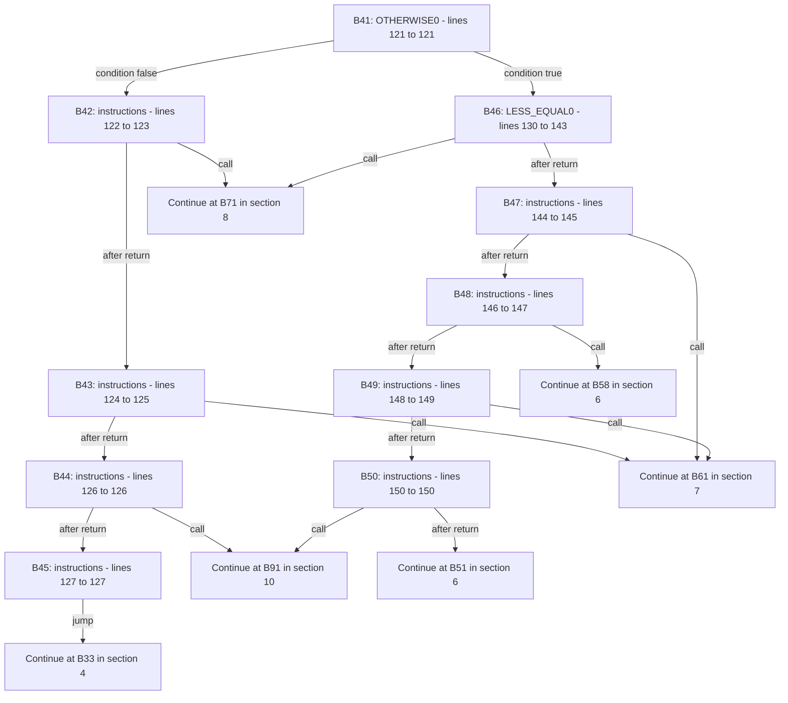
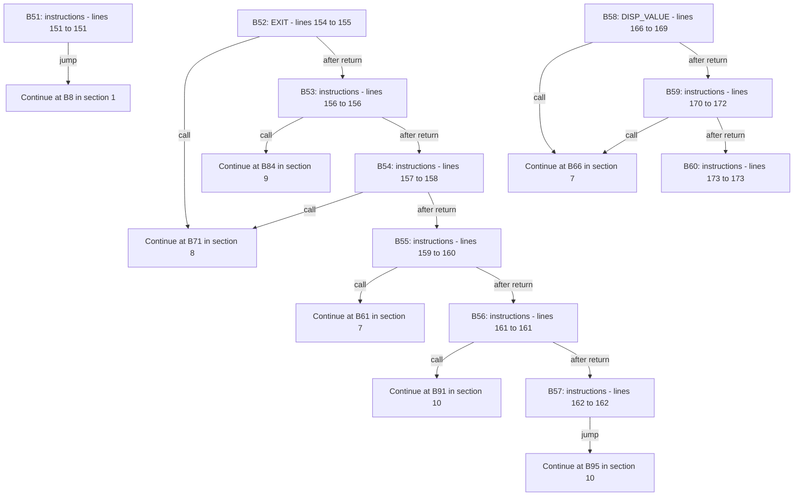
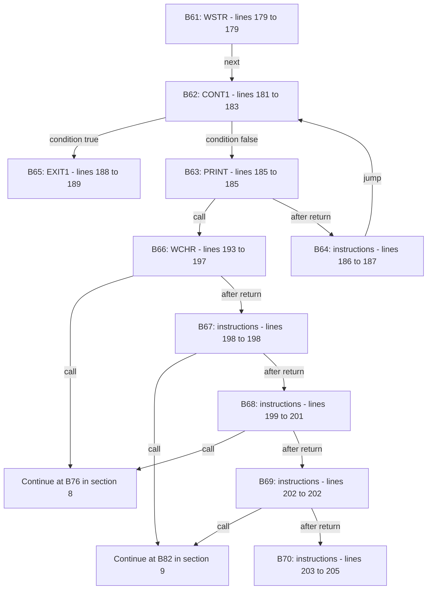
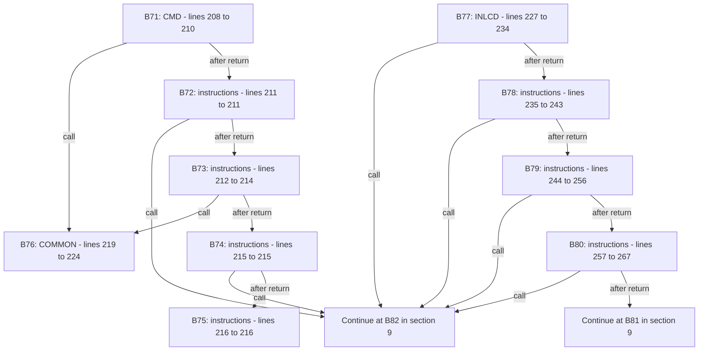
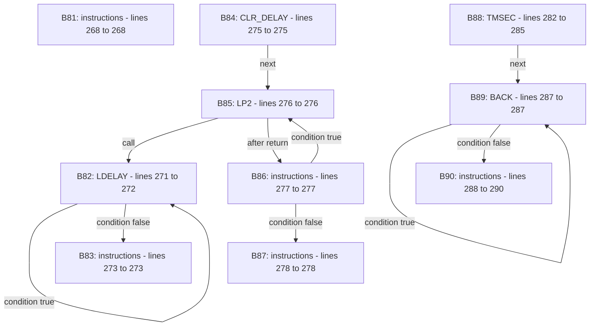
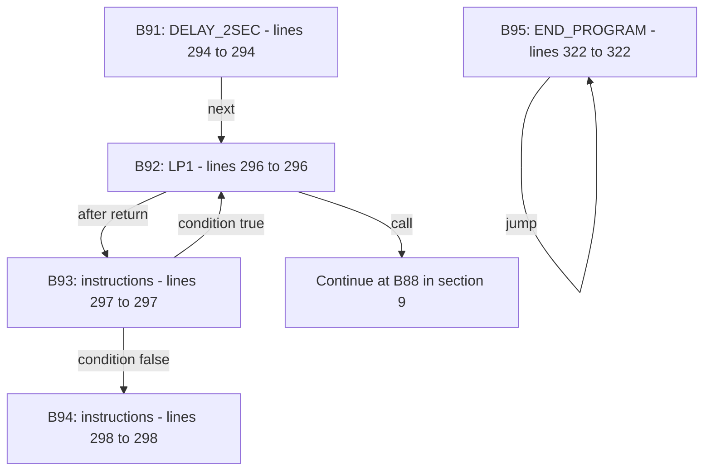

# Program Control Flow

[Back to project](README.md)

Control-flow blocks are indexed by source line. Calls resume at the instruction following the call if the subroutine returns normally.

## Entry locations

- `ORG 00H` begins at B1.

## Navigation

[Section 1](#section-1) · [Section 2](#section-2) · [Section 3](#section-3) · [Section 4](#section-4) · [Section 5](#section-5) · [Section 6](#section-6) · [Section 7](#section-7) · [Section 8](#section-8) · [Section 9](#section-9) · [Section 10](#section-10)

## Section 1



### B1

```asm
ACALL INLCD
```

### B2

```asm
MOV 30H,#01H
MOV 33H,#09H
MOV 34H,#09H
MOV 40H,#04H
```

### B3

```asm
MOV A, #1H
ACALL CMD
```

### B4

```asm
ACALL CLR_DELAY
```

### B5

```asm
MOV A,#80H
ACALL CMD
```

### B6

```asm
MOV DPTR, #WELCOME_MSG
ACALL WSTR
```

### B7

```asm
ACALL DELAY_2SEC
```

### B8

```asm
MOV A, #1H
ACALL CMD
```

### B9

```asm
ACALL CLR_DELAY
```

### B10

```asm
MOV A,#80H
ACALL CMD
```

## Section 2



### B11

```asm
MOV DPTR, #MENUE_MSG
ACALL WSTR
```

### B12

```asm
MOV A, 30H
MOV R2, A
ADD A, #30H
ACALL WCHR
```

### B13

```asm
ACALL DELAY_2SEC
```

### B14

```asm
CJNE R2, #1, SILVER_TICKETS
```

### B15

```asm
MOV A, 40H
MOV R1, A
MOV A, #1H
ACALL CMD
```

### B16

```asm
ACALL CLR_DELAY
```

### B17

```asm
MOV A,#80H
ACALL CMD
```

### B18

```asm
MOV DPTR, #TICKETS_MSG
ACALL WSTR
```

### B19

```asm
MOV  A,R1
ACALL DISP_VALUE
```

### B20

```asm
MOV A,33H
MOV B,A
MOV R3,A
MOV A,R1
CJNE A, B, OTHERWISE
```

## Section 3



### B21

```asm
SJMP LESS_EQUAL
```

### B22

```asm
JC LESS_EQUAL
```

### B23

```asm
MOV A,#0C0H
ACALL CMD
```

### B24

```asm
MOV DPTR, #Sorry_MSG
ACALL WSTR
```

### B25

```asm
ACALL DELAY_2SEC
```

### B26

```asm
SJMP GOLD_TICKETS
```

### B27

```asm
MOV A, R3
CLR C
SUBB A,R1
MOV 33H,A
MOV A,R1
MOV B, A
CLR A
MOV DPTR, #GOLD_Price
MOVC A, @A+DPTR
MUL AB
MOV 50H,A
MOV R4, A
MOV A,#0C0H
ACALL CMD
```

### B28

```asm
MOV DPTR, #TICKETS_MSG2
ACALL WSTR
```

### B29

```asm
MOV A, R4
ACALL DISP_VALUE
```

### B30

```asm
MOV DPTR, #TICKETS_MSG3
ACALL WSTR
```

## Section 4



### B31

```asm
ACALL DELAY_2SEC
```

### B32

```asm
LJMP MAIN_MENUE
```

### B33

```asm
CJNE R2, #2, EXIT
```

### B34

```asm
MOV A, 40H
MOV R1, A
MOV A, #1H
ACALL CMD
```

### B35

```asm
ACALL CLR_DELAY
```

### B36

```asm
MOV A,#80H
ACALL CMD
```

### B37

```asm
MOV DPTR, #TICKETS_MSG
ACALL WSTR
```

### B38

```asm
MOV A, R1
ACALL DISP_VALUE
```

### B39

```asm
MOV A,34H
MOV B,A
MOV R3,A
MOV A,R1
CJNE A, B,OTHERWISE0
```

### B40

```asm
SJMP LESS_EQUAL0
```

## Section 5



### B41

```asm
JC LESS_EQUAL0
```

### B42

```asm
MOV A,#0C0H
ACALL CMD
```

### B43

```asm
MOV DPTR, #Sorry_MSG
ACALL WSTR
```

### B44

```asm
ACALL DELAY_2SEC
```

### B45

```asm
SJMP SILVER_TICKETS
```

### B46

```asm
MOV A, R3
CLR C
SUBB A,R1
MOV 34H,A
MOV A,R1
MOV B, A
CLR A
MOV DPTR, #SILVER_Price
MOVC A, @A+DPTR
MUL AB
MOV 50H,A
MOV R4, A
MOV A,#0C0H
ACALL CMD
```

### B47

```asm
MOV DPTR, #TICKETS_MSG2
ACALL WSTR
```

### B48

```asm
MOV A, R4
ACALL DISP_VALUE
```

### B49

```asm
MOV DPTR, #TICKETS_MSG3
ACALL WSTR
```

### B50

```asm
ACALL DELAY_2SEC
```

## Section 6



### B51

```asm
LJMP MAIN_MENUE
```

### B52

```asm
MOV A, #1H
ACALL CMD
```

### B53

```asm
ACALL CLR_DELAY
```

### B54

```asm
MOV A,#80H
ACALL CMD
```

### B55

```asm
MOV DPTR, #Thanks_MSG
ACALL WSTR
```

### B56

```asm
ACALL DELAY_2SEC
```

### B57

```asm
LJMP END_PROGRAM
```

### B58

```asm
mov b, #10
Div ab
Add a , #30H
Acall WCHR
```

### B59

```asm
Mov a, b
Add a , #30H
Acall WCHR
```

### B60

Return to the instruction following the active call.

```asm
RET
```

## Section 7



### B61

```asm
PUSH ACC
```

### B62

```asm
CLR A
MOVC A,@A+DPTR
JZ Exit1
```

### B63

```asm
ACALL WCHR
```

### B64

```asm
INC DPTR
AJMP CONT1
```

### B65

Return to the instruction following the active call.

```asm
POP ACC
RET
```

### B66

```asm
PUSH ACC
PUSH B
SETB P1.3
MOV B,A
ACALL COMMON
```

### B67

```asm
ACALL LDELAY
```

### B68

```asm
MOV A,B
SWAP A
ACALL COMMON
```

### B69

```asm
ACALL LDELAY
```

### B70

Return to the instruction following the active call.

```asm
POP B
POP ACC
RET
```

## Section 8



### B71

```asm
CLR P1.3
MOV B,A
ACALL COMMON
```

### B72

```asm
ACALL LDELAY
```

### B73

```asm
MOV A,B
SWAP A
ACALL COMMON
```

### B74

```asm
ACALL LDELAY
```

### B75

Return to the instruction following the active call.

```asm
RET
```

### B76

Return to the instruction following the active call.

```asm
ANL a,#11110000B
ANL P1, #00001111B
ORL P1,A
SETB P1.2
CLR P1.2
RET
```

### B77

```asm
CLR P1.3
CLR P1.7
CLR P1.6
SETB P1.5
CLR P1.4
SETB P1.2
CLR P1.2
ACALL LDELAY
```

### B78

```asm
SETB P1.2
CLR P1.2
SETB P1.7
CLR P1.6
CLR P1.5
CLR P1.4
SETB P1.2
CLR P1.2
ACALL LDELAY
```

### B79

```asm
CLR P1.7
CLR P1.6
CLR P1.5
CLR P1.4
SETB P1.2
CLR P1.2
SETB P1.7
SETB P1.6
SETB P1.5
SETB P1.4
SETB P1.2
CLR P1.2
ACALL LDELAY
```

### B80

```asm
CLR P1.7
CLR P1.6
CLR P1.5
CLR P1.4
SETB P1.2
CLR P1.2
SETB P1.6
SETB P1.5
SETB P1.2
CLR P1.2
ACALL LDELAY
```

## Section 9



### B81

Return to the instruction following the active call.

```asm
RET
```

### B82

```asm
MOV R0, #50
DJNZ R0, $
```

### B83

Return to the instruction following the active call.

```asm
RET
```

### B84

```asm
MOV R7, #14
```

### B85

```asm
ACALL LDELAY
```

### B86

```asm
DJNZ R7, LP2
```

### B87

Return to the instruction following the active call.

```asm
RET
```

### B88

```asm
MOV TMOD,#01H
MOV TL0,#0DCH
MOV TH0,#6FH
SETB TR0
```

### B89

```asm
JNB TF0,BACK
```

### B90

Return to the instruction following the active call.

```asm
CLR TR0
CLR TF0
RET
```

## Section 10



### B91

```asm
MOV R0, #4
```

### B92

```asm
ACALL TMSEC
```

### B93

```asm
DJNZ R0, LP1
```

### B94

Return to the instruction following the active call.

```asm
RET
```

### B95

```asm
SJMP END_PROGRAM
```
