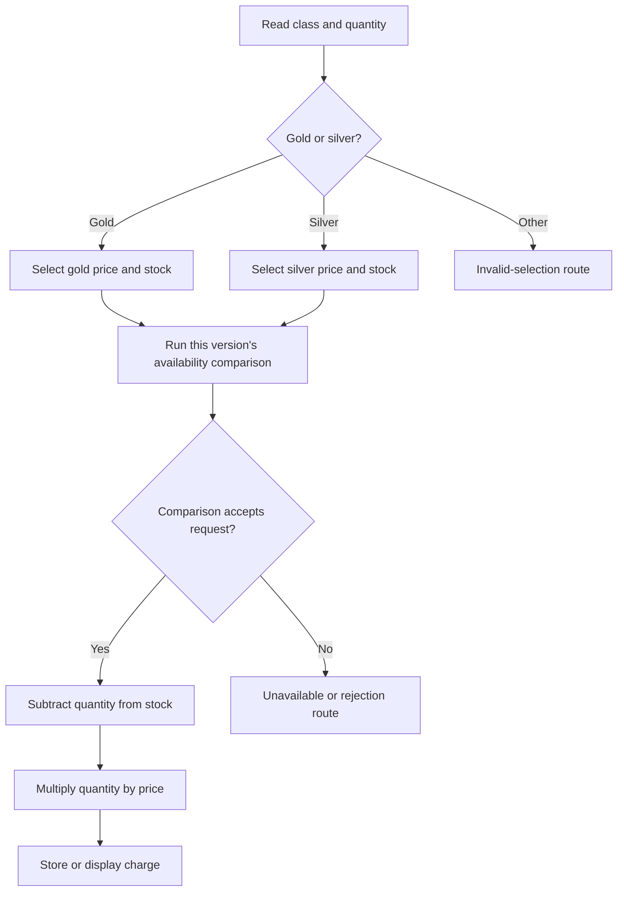
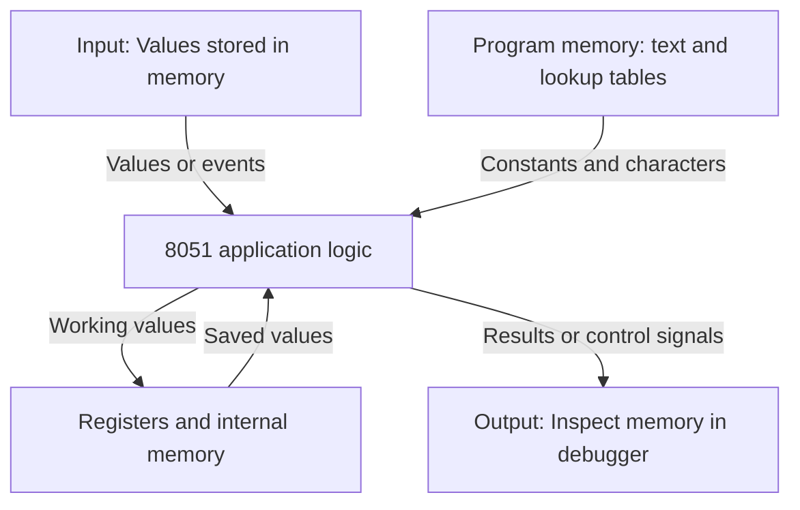

# Gold and Silver Ticket Booking

[Group overview](../../README.md) · [Compare implementations](../README.md)

Select gold or silver tickets, calculate the charge, and update the stored number of tickets.

**Implementation:** Memory Gold Stock Comparison

**Input:** values stored in memory.  
**Output:** inspect memory in debugger.

## Inputs and results

| Parameter | Description |
| --- | --- |
| Input | Ticket class, requested quantity, and available stock |
| Output | Total price and remaining stock, or an unavailable message |

## Worked example

With 9 gold tickets in stock, price 5, and a request for 2: charge 10 and remaining stock 7.

### Calculation details

The defaults select gold, six tickets, and a stock of nine. The code subtracts 6 from 9 and stores 3 at 33H. MOVC reads the gold price 5, and MUL AB gives 30. Observe 1EH at 50H. For an overlarge request the comparison mistakenly checks the stock against itself.

## Program operation

### Functional flowchart

[Detailed control flow](source-flow.md)

### Simplified block diagram

Results are available in memory without a display.

## Technical limitations

- The gold branch compares R3 with B after loading both from the stock byte. That test cannot detect a request above the available stock.

## Build and test

1. Open the [assembly source](source.asm) in an 8051 assembler or simulator.
2. Review the technical limitations and configure the peripherals required by this implementation.
3. Check the expected result using the example inputs.
