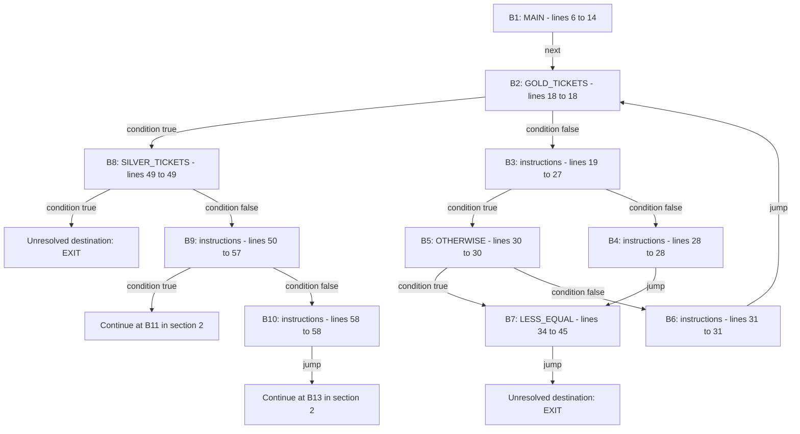
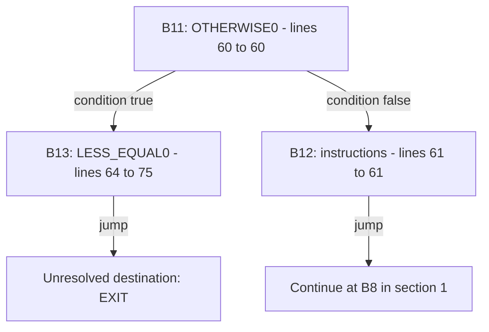

# Program Control Flow

[Back to project](README.md)

Control-flow blocks are indexed by source line. Calls resume at the instruction following the call if the subroutine returns normally.

## Entry locations

- `ORG 00H` begins at B1.

## Navigation

[Section 1](#section-1) · [Section 2](#section-2)

## Destinations requiring review

`EXIT`. A repeated label is also unresolved because it has more than one candidate target.

## Section 1



### B1

```asm
MOV 30H,#01H
MOV 33H,#09H
MOV 34H,#09H
MOV 40H,#06H
MOV A, 30H
MOV R2, A
```

### B2

```asm
CJNE R2, #1, SILVER_TICKETS
```

### B3

```asm
MOV A, 40H
MOV R1, A
MOV A,33H
MOV B,A
MOV R3,A
MOV A,R3
CJNE A, B, OTHERWISE
```

### B4

```asm
SJMP LESS_EQUAL
```

### B5

```asm
JC LESS_EQUAL
```

### B6

```asm
SJMP GOLD_TICKETS
```

### B7

```asm
MOV A, R3
CLR C
SUBB A,R1
MOV 33H,A
MOV A,R1
MOV B, A
CLR A
MOV DPTR, #GOLD_Price
MOVC A, @A+DPTR
MUL AB
MOV 50H,A
SJMP EXIT
```

### B8

```asm
CJNE R2, #2, EXIT
```

### B9

```asm
MOV A, 40H
MOV R1, A
MOV A,34H
MOV B,A
MOV R3,A
MOV A,R1
CJNE A, B,OTHERWISE0
```

### B10

```asm
SJMP LESS_EQUAL0
```

## Section 2



### B11

```asm
JC LESS_EQUAL0
```

### B12

```asm
SJMP SILVER_TICKETS
```

### B13

```asm
MOV A, R3
CLR C
SUBB A,R1
MOV 34H,A
MOV A,R1
MOV B, A
CLR A
MOV DPTR, #SILVER_Price
MOVC A, @A+DPTR
MUL AB
MOV 50H,A
SJMP EXIT
```
