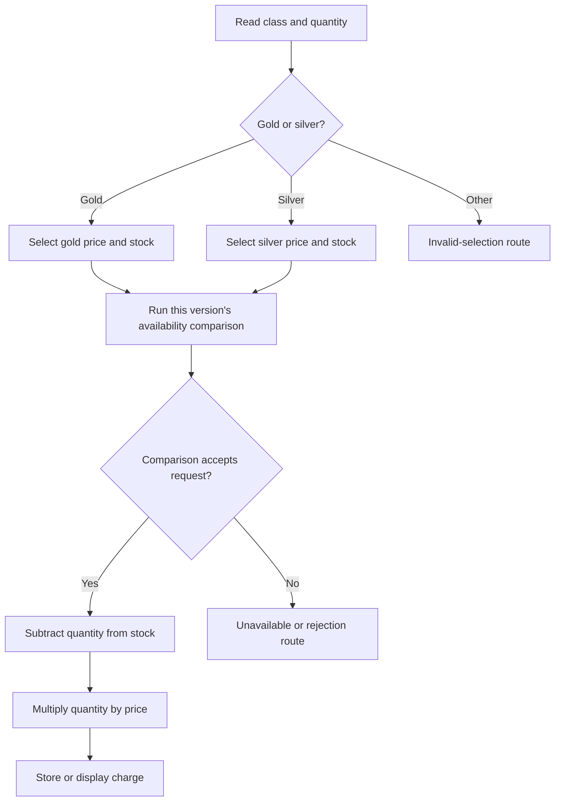
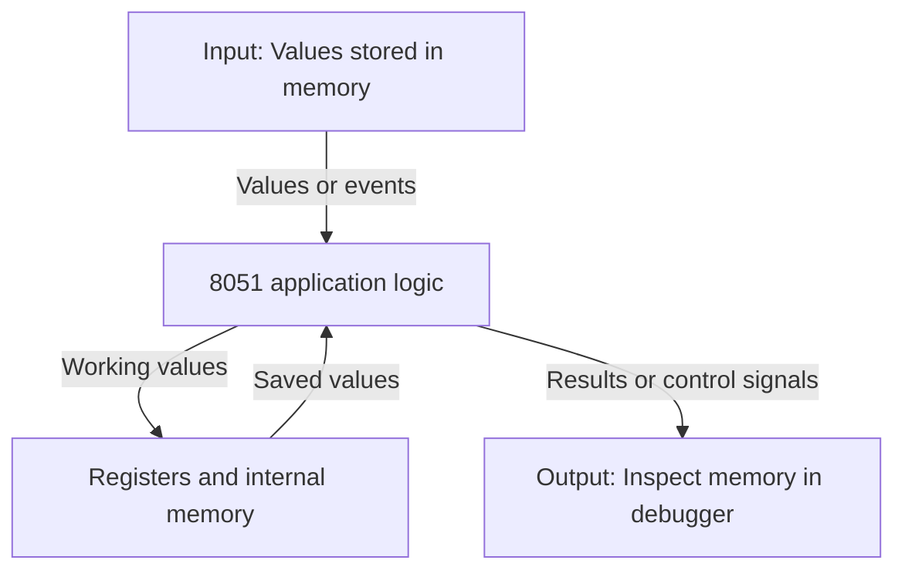

# Gold and Silver Ticket Booking

[Group overview](../../README.md) · [Compare implementations](../README.md)

Select gold or silver tickets, calculate the charge, and update the stored number of tickets.

**Implementation:** Memory Silver Ticket Order

**Input:** values stored in memory.  
**Output:** inspect memory in debugger.

## Inputs and results

| Parameter | Description |
| --- | --- |
| Input | Ticket class, requested quantity, and available stock |
| Output | Total price and remaining stock, or an unavailable message |

## Worked example

With 9 gold tickets in stock, price 5, and a request for 2: charge 10 and remaining stock 7.

### Calculation details

Reset with the supplied silver choice 2, requested quantity 4, silver stock 9 and silver price 3. CJNE sends control to SILVER with carry clear. SUBB leaves 5 tickets in 34H. MUL AB gives 4 × 3 = 12, and 50H contains 0CH at STOP.

## Program operation

### Functional flowchart

[Detailed control flow](source-flow.md)

### Simplified block diagram

Results are available in memory without a display.

## Technical limitations

No additional defect was recorded in the earlier source review. This is not evidence of a successful build or hardware test.

## Build and test

1. Open the [assembly source](source.asm) in an 8051 assembler or simulator.
2. Review the technical limitations and configure the peripherals required by this implementation.
3. Check the expected result using the example inputs.
