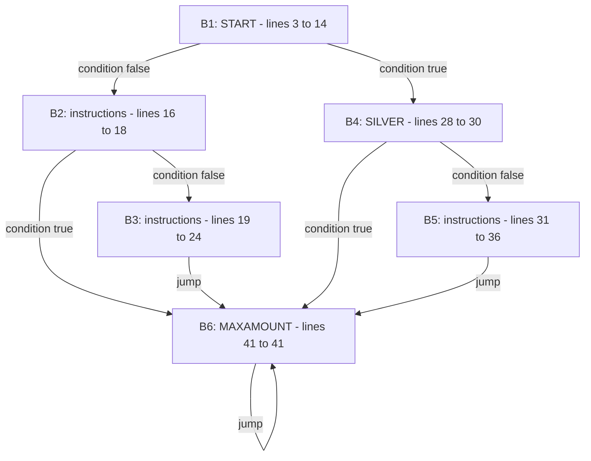

# Program Control Flow

[Back to project](README.md)

Control-flow blocks are indexed by source line. Calls resume at the instruction following the call if the subroutine returns normally.

## Entry locations

- `ORG 0H` begins at B1.

## Navigation

[Section 1](#section-1)

## Section 1



### B1

```asm
MOV 33H,#9
MOV 43H,#5
MOV 34H,#9
MOV 44H,#3
MOV 30H,#2
MOV 40H,#4
MOV R7,30H
MOV R6,40H
CJNE R7,#1,SILVER
```

### B2

```asm
MOV A,33H
SUBB A,R6
JB  ACC.7,MAXAMOUNT
```

### B3

```asm
MOV 33H,A
MOV A,R6
MOV B,43H
MUL AB
MOV 50H,A
SJMP STOP
```

### B4

```asm
MOV A,34H
SUBB A,R6
JB  ACC.7,MAXAMOUNT
```

### B5

```asm
MOV 34H,A
MOV A,R6
MOV B,44H
MUL AB
MOV 50H,A
SJMP STOP
```

### B6

```asm
SJMP STOP
```
