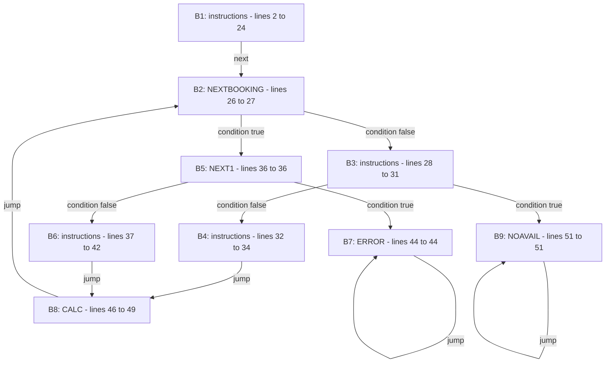

# Program Control Flow

[Back to project](README.md)

Control-flow blocks are indexed by source line. Calls resume at the instruction following the call if the subroutine returns normally.

## Entry locations

- `ORG 00H` begins at B1.

## Navigation

[Section 1](#section-1)

## Section 1



### B1

```asm
MOV 30H,#2
MOV 40H,#4
MOV 50H,#0
MOV 31H,#0
MOV 32H,#0
MOV 41H,#0
MOV 42H,#0
MOV DPTR,#GOLD
CLR A
MOVC A,@A+DPTR
MOV 31H,A
INC DPTR
CLR A
MOVC A,@A+DPTR
MOV 32H,A
MOV DPTR,#SILVER
CLR A
MOVC A,@A+DPTR
MOV 41H,A
INC DPTR
CLR A
MOVC A,@A+DPTR
MOV 42H,A
```

### B2

```asm
MOV A,30H
CJNE A,#1,NEXT1
```

### B3

```asm
MOV A,31H
CLR C
SUBB A,40H
JC NOAVAIL
```

### B4

```asm
MOV 31H,A
MOV B,32H
SJMP CALC
```

### B5

```asm
CJNE A,#2,ERROR
```

### B6

```asm
CLR C
MOV A,41H
SUBB A,40H
MOV 41H,A
MOV B,42H
SJMP CALC
```

### B7

```asm
SJMP $
```

### B8

```asm
MOV A,40H
MUL AB
MOV 50H,A
SJMP NEXTBOOKING
```

### B9

```asm
SJMP $
```
