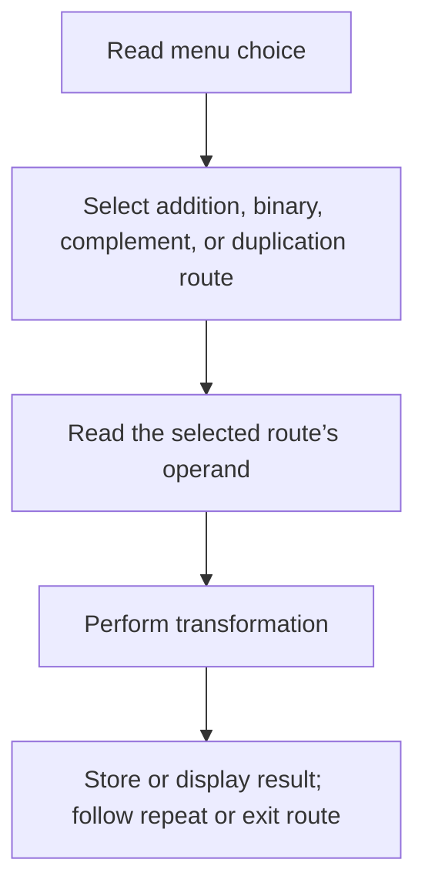
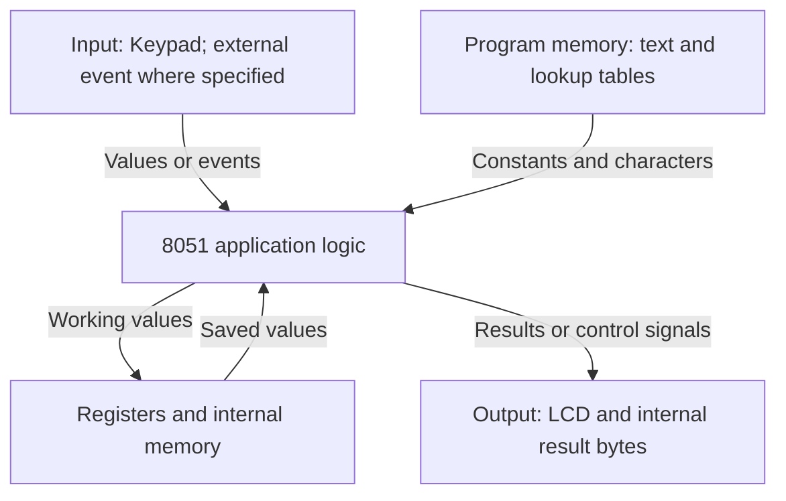

# Number and Bit Operations

[Group overview](../../README.md) · [Compare implementations](../README.md)

Use a menu to explore addition, binary display, bit complement, and duplication operations.

**Implementation:** Interrupt Bit Transformation Menu

**Input:** keypad.  
**Output:** LCD and internal result bytes.

## Inputs and results

| Parameter | Description |
| --- | --- |
| Input | A menu choice and the operand required by that choice |
| Output | The selected transformed value |

## Worked example

The complement of 11110000 is 00001111: every zero becomes one, and every one becomes zero.

### Calculation details

In the complement option use the assembled byte F0H (11110000 binary). CPL A flips all eight bits, leaving 0FH. In bit order from most to least significant, the complemented byte reads 00001111.

## Program operation

1. Read menu choice.
2. Select addition, binary, complement, or duplication route.
3. Read the selected route’s operand.
4. Perform transformation.
5. Store or display result; follow repeat or exit route.

### Functional flowchart

[Detailed control flow](source-flow.md)

### Simplified block diagram

**Port registers:** `P0`, `P0.0`, `P0.1`, `P0.2`, `P1.3`, `P2`, `P2.4`, `P2.7`.

## Technical limitations

No additional defect was recorded in the earlier source review. This is not evidence of a successful build or hardware test.

## Build and test

1. Open the [assembly source](source.a51) in an 8051 assembler or simulator.
2. Review the technical limitations and configure the peripherals required by this implementation.
3. Check the expected result using the example inputs.
