# Program Control Flow

[Back to project](README.md)

Control-flow blocks are indexed by source line. Calls resume at the instruction following the call if the subroutine returns normally.

## Entry locations

- `ORG 0000H` begins at B1.
- `ORG  0003H` begins at B2.
- `ORG 0030H` begins at B3.

## Navigation

[Section 1](#section-1) · [Section 2](#section-2) · [Section 3](#section-3) · [Section 4](#section-4) · [Section 5](#section-5) · [Section 6](#section-6) · [Section 7](#section-7) · [Section 8](#section-8) · [Section 9](#section-9) · [Section 10](#section-10) · [Section 11](#section-11) · [Section 12](#section-12) · [Section 13](#section-13) · [Section 14](#section-14) · [Section 15](#section-15) · [Section 16](#section-16) · [Section 17](#section-17) · [Section 18](#section-18) · [Section 19](#section-19) · [Section 20](#section-20) · [Section 21](#section-21) · [Section 22](#section-22) · [Section 23](#section-23) · [Section 24](#section-24) · [Section 25](#section-25) · [Section 26](#section-26) · [Section 27](#section-27) · [Section 28](#section-28) · [Section 29](#section-29) · [Section 30](#section-30) · [Section 31](#section-31) · [Section 32](#section-32) · [Section 33](#section-33)

## Lines outside the instruction parser

These may be assembler directives, macros, or malformed source; inspect them before building.

```asm
102: ////////////////////////////////////////////////////////////////////////////////////////////////////////////
140: ///////////OP1
248: ///////////////END OF OP1
250: ///////////////OP2
354: ////////////////////////OP3
441: ///////////////////////
464: /////////////////////OP4
529: /////////////////////////
```

## Section 1

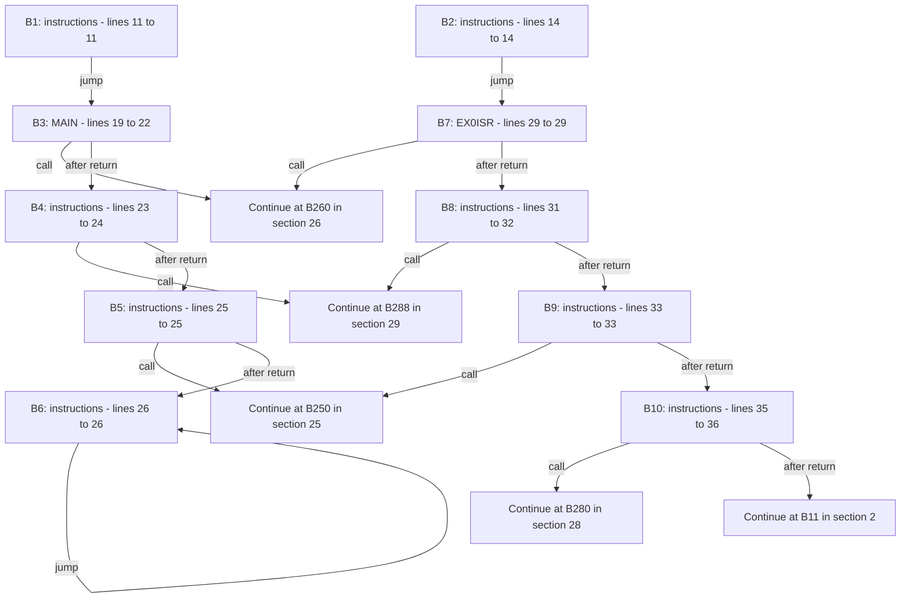

### B1

```asm
LJMP  MAIN
```

### B2

```asm
LJMP  EX0ISR
```

### B3

```asm
MOV 	TMOD,#00010001B
MOV  	IE,#10000001B
SETB   IT0
ACALL INLCD
```

### B4

```asm
MOV DPTR,#A16
ACALL WSTR
```

### B5

```asm
ACALL TIME
```

### B6

```asm
SJMP	$
```

### B7

```asm
ACALL INLCD
```

### B8

```asm
MOV DPTR,#A1
ACALL WSTR
```

### B9

```asm
ACALL TIME
```

### B10

```asm
MOV A,#0c0H
ACALL CMD
```

## Section 2

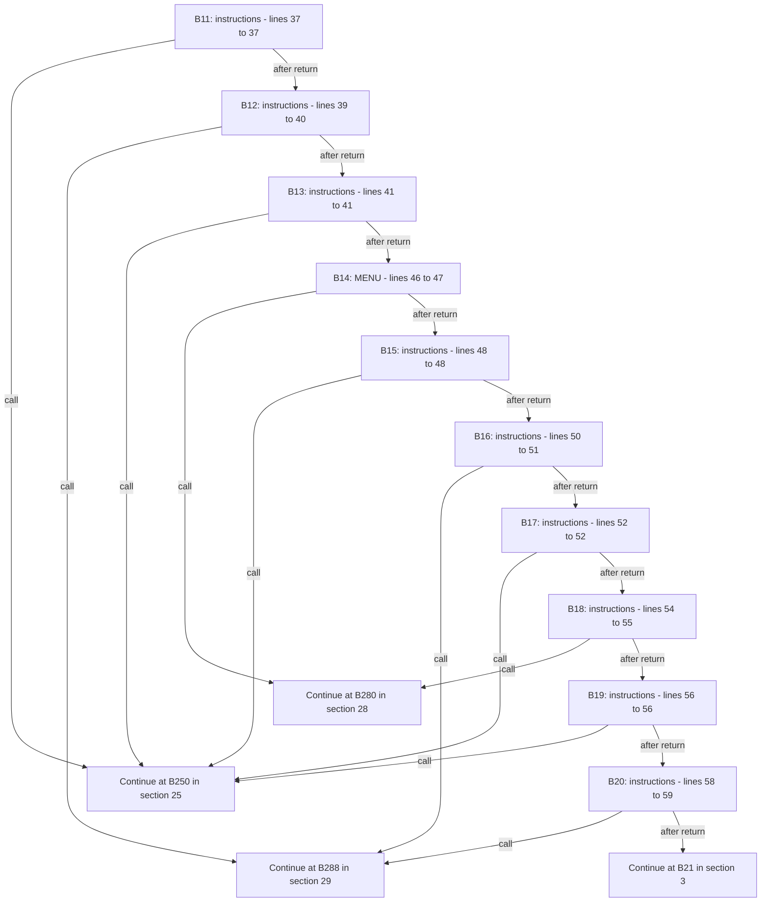

### B11

```asm
ACALL TIME
```

### B12

```asm
MOV DPTR,#A2
ACALL WSTR
```

### B13

```asm
ACALL TIME
```

### B14

```asm
MOV A,#1
ACALL CMD
```

### B15

```asm
ACALL TIME
```

### B16

```asm
MOV DPTR,#A3
ACALL WSTR
```

### B17

```asm
ACALL TIME
```

### B18

```asm
MOV A,#0c0H
ACALL CMD
```

### B19

```asm
ACALL TIME
```

### B20

```asm
MOV DPTR,#A4
ACALL WSTR
```

## Section 3

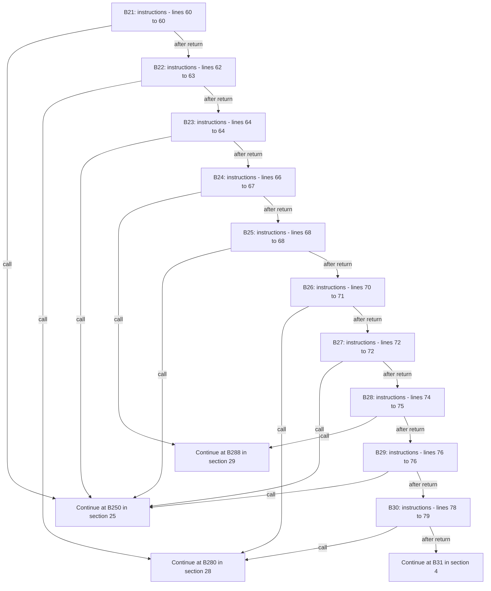

### B21

```asm
ACALL TIME
```

### B22

```asm
MOV A,#1
ACALL CMD
```

### B23

```asm
ACALL TIME
```

### B24

```asm
MOV DPTR,#A5
ACALL WSTR
```

### B25

```asm
ACALL TIME
```

### B26

```asm
MOV A,#0c0H
ACALL CMD
```

### B27

```asm
ACALL TIME
```

### B28

```asm
MOV DPTR,#A6
ACALL WSTR
```

### B29

```asm
ACALL TIME
```

### B30

```asm
MOV A,#1
ACALL CMD
```

## Section 4


### B31

```asm
ACALL TIME
```

### B32

```asm
MOV DPTR,#A7
ACALL WSTR
```

### B33

```asm
ACALL TIME
```

### B34

```asm
MOV A,#0c0H
ACALL CMD
```

### B35

```asm
ACALL TIME
```

### B36

```asm
MOV DPTR,#A8
ACALL WSTR
```

### B37

```asm
ACALL TIME
```

### B38

```asm
MOV A,#1
ACALL CMD
```

### B39

```asm
ACALL TIME
```

### B40

```asm
MOV DPTR,#A9
ACALL WSTR
```

## Section 5

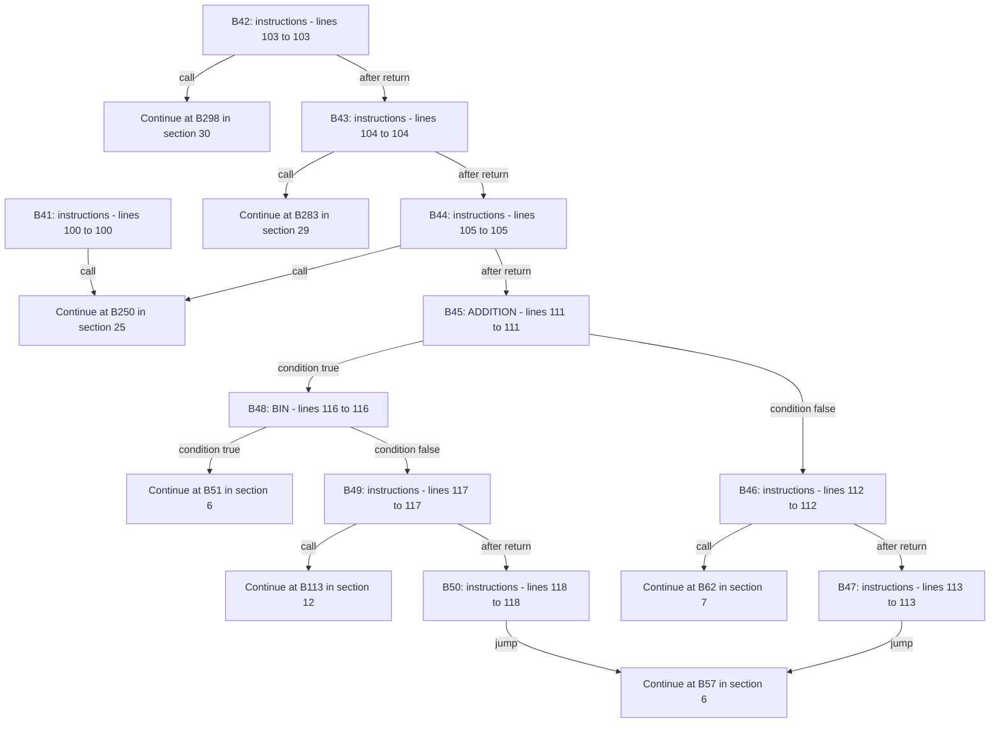

### B41

```asm
ACALL TIME
```

### B42

```asm
ACALL KEYPAD
```

### B43

```asm
ACALL WCHR
```

### B44

```asm
ACALL TIME
```

### B45

```asm
CJNE A,#'A',BIN
```

### B46

```asm
ACALL ADDOP
```

### B47

```asm
AJMP EXIT
```

### B48

```asm
CJNE A,#'B',COMP
```

### B49

```asm
ACALL BINR
```

### B50

```asm
AJMP EXIT
```

## Section 6

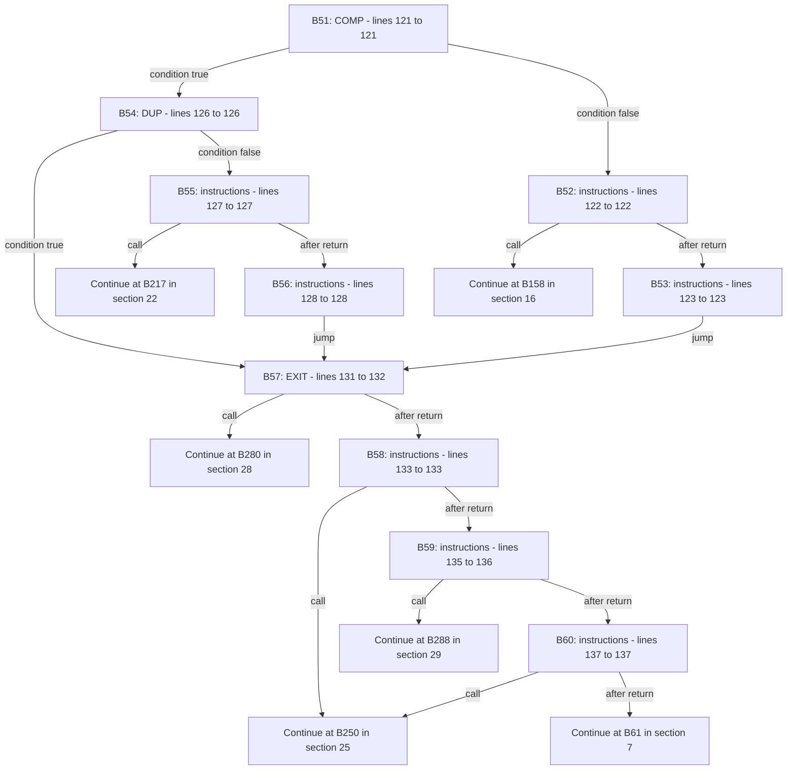

### B51

```asm
CJNE A,#'C',DUP
```

### B52

```asm
ACALL COMPLEMENT
```

### B53

```asm
AJMP EXIT
```

### B54

```asm
CJNE A,#'D',EXIT
```

### B55

```asm
ACALL DUPLICATE
```

### B56

```asm
AJMP EXIT
```

### B57

```asm
MOV A,#1
ACALL CMD
```

### B58

```asm
ACALL TIME
```

### B59

```asm
MOV DPTR,#A11
ACALL WSTR
```

### B60

```asm
ACALL TIME
```

## Section 7

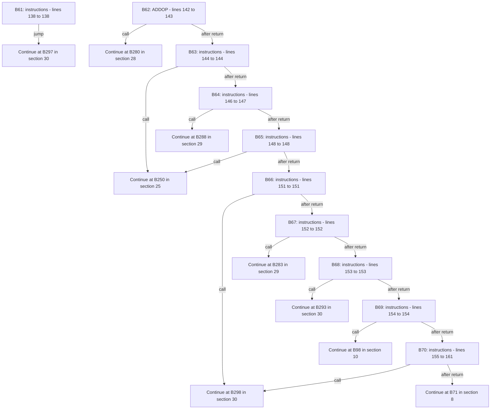

### B61

```asm
AJMP OUT
```

### B62

```asm
MOV A,#1
ACALL CMD
```

### B63

```asm
ACALL TIME
```

### B64

```asm
MOV DPTR,#A10
ACALL WSTR
```

### B65

```asm
ACALL TIME
```

### B66

```asm
ACALL KEYPAD
```

### B67

```asm
ACALL WCHR
```

### B68

```asm
ACALL LDELAY
```

### B69

```asm
ACALL CHECK
```

### B70

```asm
CLR C
SUBB A,#30H
MOV B,#10
MUL AB
MOV R1,A
ACALL KEYPAD
```

## Section 8

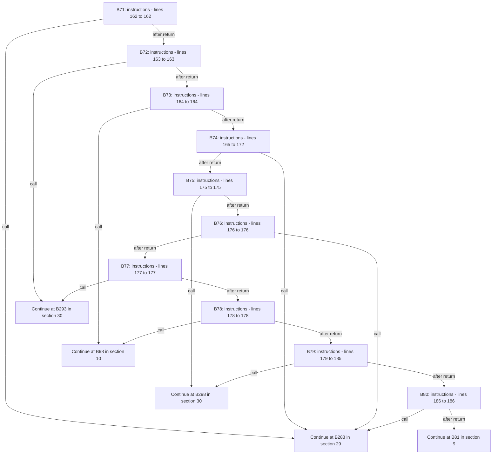

### B71

```asm
ACALL WCHR
```

### B72

```asm
ACALL LDELAY
```

### B73

```asm
ACALL CHECK
```

### B74

```asm
CLR C
SUBB A,#30H
ADD A,R1
MOV R2,A
MOV A,#' '
ACALL WCHR
```

### B75

```asm
ACALL KEYPAD
```

### B76

```asm
ACALL WCHR
```

### B77

```asm
ACALL LDELAY
```

### B78

```asm
ACALL CHECK
```

### B79

```asm
CLR C
SUBB A,#30H
MOV B,#10
MUL AB
MOV R1,A
ACALL KEYPAD
```

### B80

```asm
ACALL WCHR
```

## Section 9

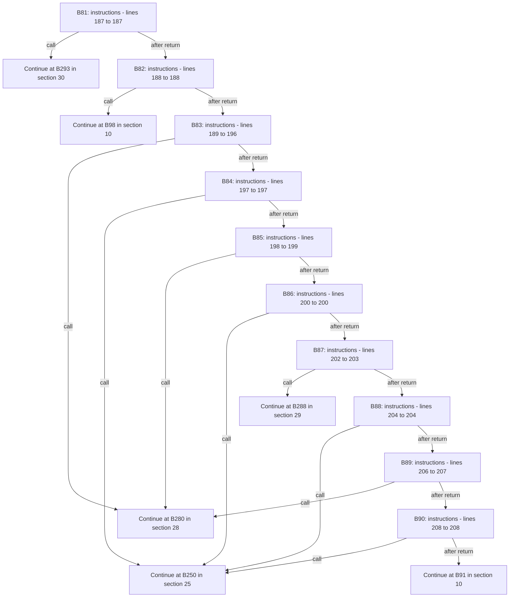

### B81

```asm
ACALL LDELAY
```

### B82

```asm
ACALL CHECK
```

### B83

```asm
CLR C
SUBB A,#30H
ADD A,R1
MOV R3,A
MOV A,#1
ACALL CMD
```

### B84

```asm
ACALL TIME
```

### B85

```asm
MOV A,#80H
ACALL CMD
```

### B86

```asm
ACALL TIME
```

### B87

```asm
MOV DPTR,#A12
ACALL WSTR
```

### B88

```asm
ACALL TIME
```

### B89

```asm
MOV A,#0c0H
ACALL CMD
```

### B90

```asm
ACALL TIME
```

## Section 10

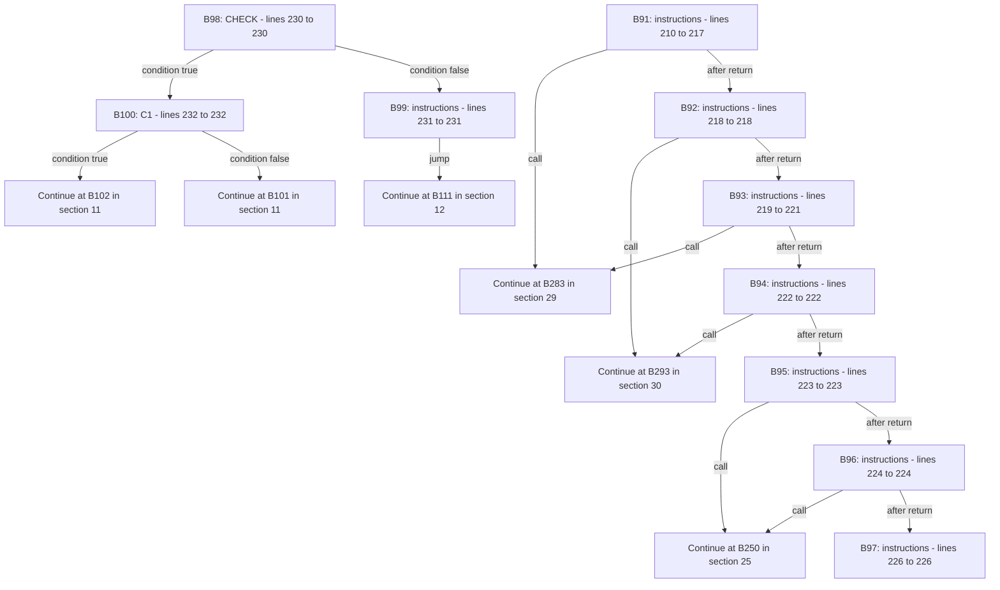

### B91

```asm
MOV A,R2
ADD A,R3
MOV B,#10
DIV AB
ADD A,#30H
ACALL WCHR
```

### B92

```asm
ACALL LDELAY
```

### B93

```asm
MOV A,B
ADD A,#30H
ACALL WCHR
```

### B94

```asm
ACALL LDELAY
```

### B95

```asm
ACALL TIME
```

### B96

```asm
ACALL TIME
```

### B97

Resume the interrupted program.

```asm
RETI
```

### B98

```asm
CJNE A,#'#',C1
```

### B99

```asm
AJMP ERRORA
```

### B100

```asm
CJNE A,#'*',C2
```

## Section 11

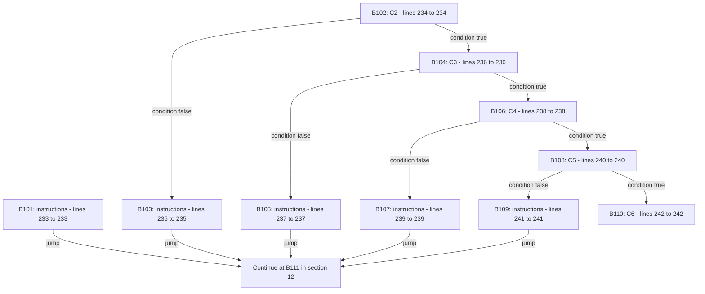

### B101

```asm
AJMP ERRORA
```

### B102

```asm
CJNE A,#'A',C3
```

### B103

```asm
AJMP ERRORA
```

### B104

```asm
CJNE A,#'B',C4
```

### B105

```asm
AJMP ERRORA
```

### B106

```asm
CJNE A,#'C',C5
```

### B107

```asm
AJMP ERRORA
```

### B108

```asm
CJNE A,#'D',C6
```

### B109

```asm
AJMP ERRORA
```

### B110

Return to the instruction following the active call.

```asm
RET
```

## Section 12

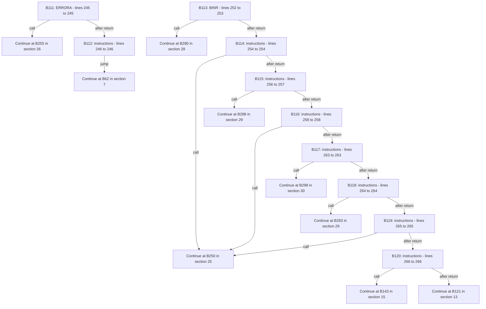

### B111

```asm
ACALL RLED
```

### B112

```asm
AJMP ADDOP
```

### B113

```asm
MOV A,#1
ACALL CMD
```

### B114

```asm
ACALL TIME
```

### B115

```asm
MOV DPTR,#A10
ACALL WSTR
```

### B116

```asm
ACALL TIME
```

### B117

```asm
ACALL KEYPAD
```

### B118

```asm
ACALL WCHR
```

### B119

```asm
ACALL TIME
```

### B120

```asm
ACALL BINCHECK
```

## Section 13

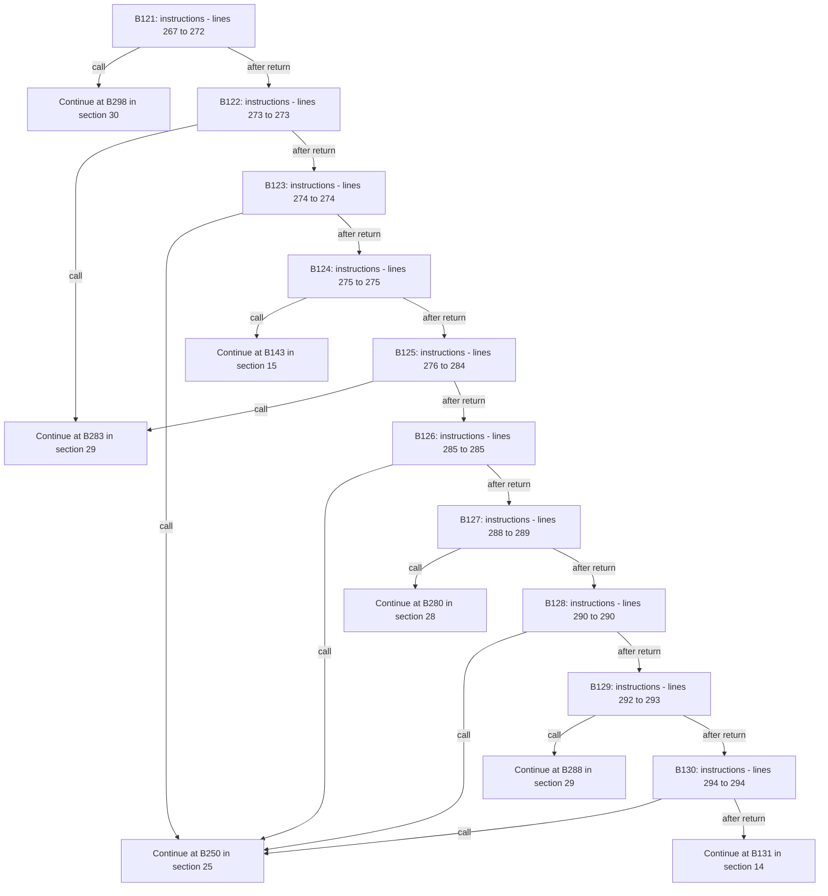

### B121

```asm
CLR C
SUBB A,#30H
SWAP A
MOV R1,A
ACALL KEYPAD
```

### B122

```asm
ACALL WCHR
```

### B123

```asm
ACALL TIME
```

### B124

```asm
ACALL BINCHECK
```

### B125

```asm
CLR C
SUBB A,#30H
ADD A,R1
MOV R1,A
MOV 70H,R1
MOV A,#'H'
ACALL WCHR
```

### B126

```asm
ACALL TIME
```

### B127

```asm
MOV A,#0c0H
ACALL CMD
```

### B128

```asm
ACALL TIME
```

### B129

```asm
MOV DPTR,#A13
ACALL WSTR
```

### B130

```asm
ACALL TIME
```

## Section 14

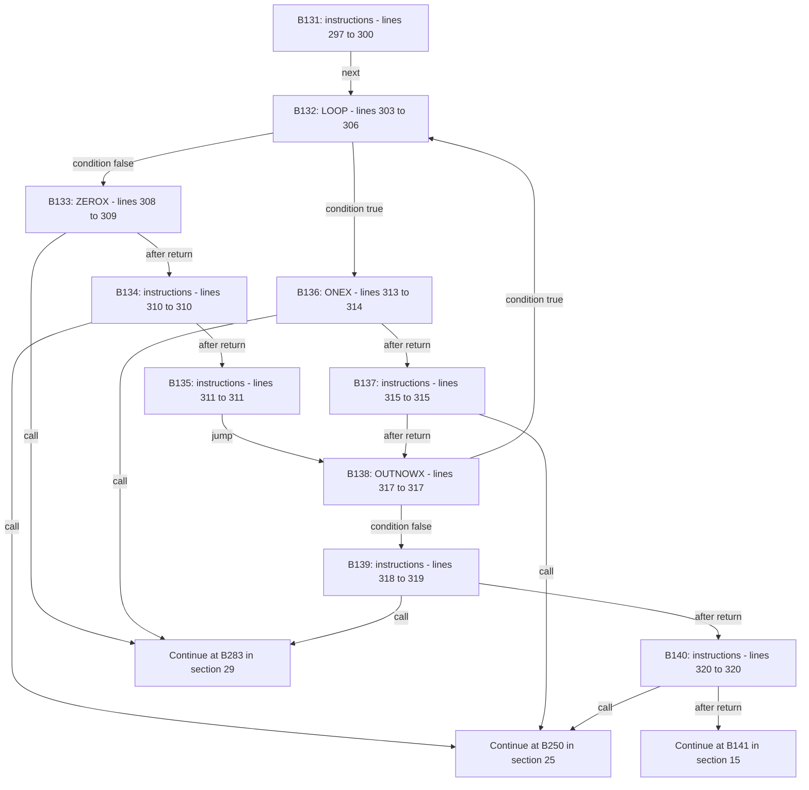

### B131

```asm
MOV A,70H
MOV R1,70H
MOV R7,#8
```

### B132

```asm
MOV A,R1
RLC A
MOV R1,A
JC ONEX
```

### B133

```asm
MOV A,#'0'
ACALL WCHR
```

### B134

```asm
ACALL TIME
```

### B135

```asm
SJMP OUTNOWX
```

### B136

```asm
MOV A,#'1'
ACALL WCHR
```

### B137

```asm
ACALL TIME
```

### B138

```asm
DJNZ R7,LOOP
```

### B139

```asm
MOV A,#'B'
ACALL WCHR
```

### B140

```asm
ACALL TIME
```

## Section 15

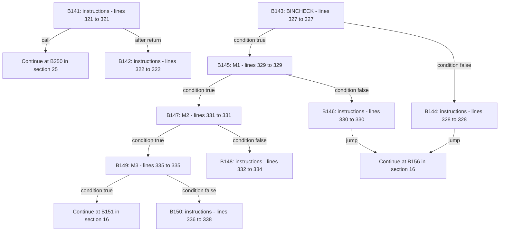

### B141

```asm
ACALL TIME
```

### B142

Resume the interrupted program.

```asm
RETI
```

### B143

```asm
CJNE A,#'#',M1
```

### B144

```asm
AJMP ERRORB
```

### B145

```asm
CJNE A,#'*',M2
```

### B146

```asm
AJMP ERRORB
```

### B147

```asm
CJNE A,#'A',M3
```

### B148

Return to the instruction following the active call.

```asm
MOV A,#0AH
ADD A,#30H
RET
```

### B149

```asm
CJNE A,#'B',M4
```

### B150

Return to the instruction following the active call.

```asm
MOV A,#0BH
ADD A,#30H
RET
```

## Section 16

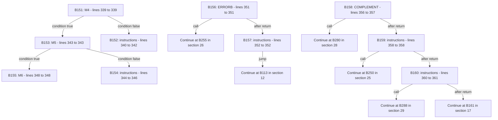

### B151

```asm
CJNE A,#'C',M5
```

### B152

Return to the instruction following the active call.

```asm
MOV A,#0CH
ADD A,#30H
RET
```

### B153

```asm
CJNE A,#'D',M6
```

### B154

Return to the instruction following the active call.

```asm
MOV A,#0DH
ADD A,#30H
RET
```

### B155

Return to the instruction following the active call.

```asm
RET
```

### B156

```asm
ACALL RLED
```

### B157

```asm
AJMP BINR
```

### B158

```asm
MOV A,#1
ACALL CMD
```

### B159

```asm
ACALL TIME
```

### B160

```asm
MOV DPTR,#A10
ACALL WSTR
```

## Section 17

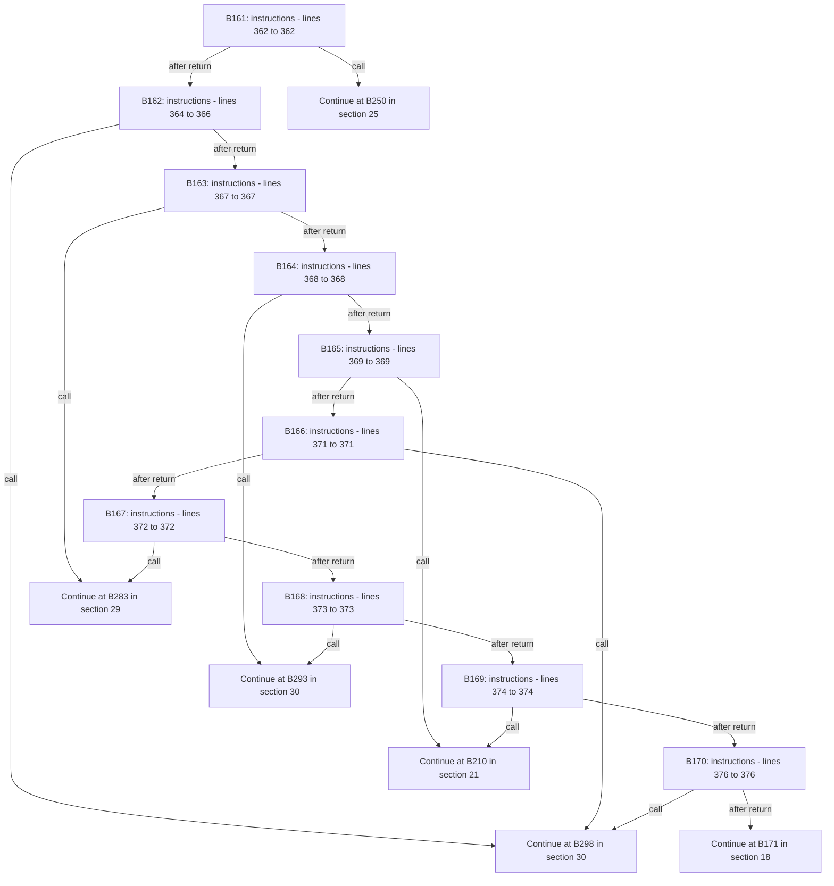

### B161

```asm
ACALL TIME
```

### B162

```asm
MOV R1,#0
ACALL KEYPAD
```

### B163

```asm
ACALL WCHR
```

### B164

```asm
ACALL LDELAY
```

### B165

```asm
ACALL ROTATE
```

### B166

```asm
ACALL KEYPAD
```

### B167

```asm
ACALL WCHR
```

### B168

```asm
ACALL LDELAY
```

### B169

```asm
ACALL ROTATE
```

### B170

```asm
ACALL KEYPAD
```

## Section 18

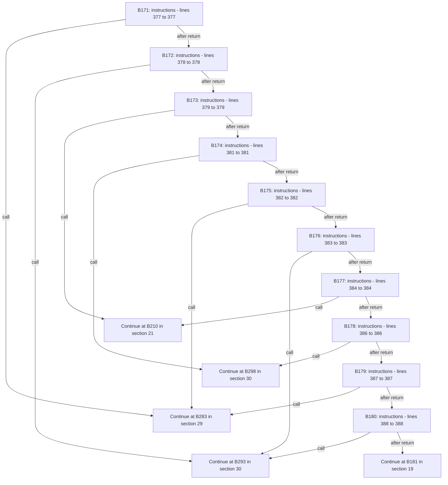

### B171

```asm
ACALL WCHR
```

### B172

```asm
ACALL LDELAY
```

### B173

```asm
ACALL ROTATE
```

### B174

```asm
ACALL KEYPAD
```

### B175

```asm
ACALL WCHR
```

### B176

```asm
ACALL LDELAY
```

### B177

```asm
ACALL ROTATE
```

### B178

```asm
ACALL KEYPAD
```

### B179

```asm
ACALL WCHR
```

### B180

```asm
ACALL LDELAY
```

## Section 19


### B181

```asm
ACALL ROTATE
```

### B182

```asm
ACALL KEYPAD
```

### B183

```asm
ACALL WCHR
```

### B184

```asm
ACALL LDELAY
```

### B185

```asm
ACALL ROTATE
```

### B186

```asm
ACALL KEYPAD
```

### B187

```asm
ACALL WCHR
```

### B188

```asm
ACALL LDELAY
```

### B189

```asm
ACALL ROTATE
```

### B190

```asm
ACALL KEYPAD
```

## Section 20

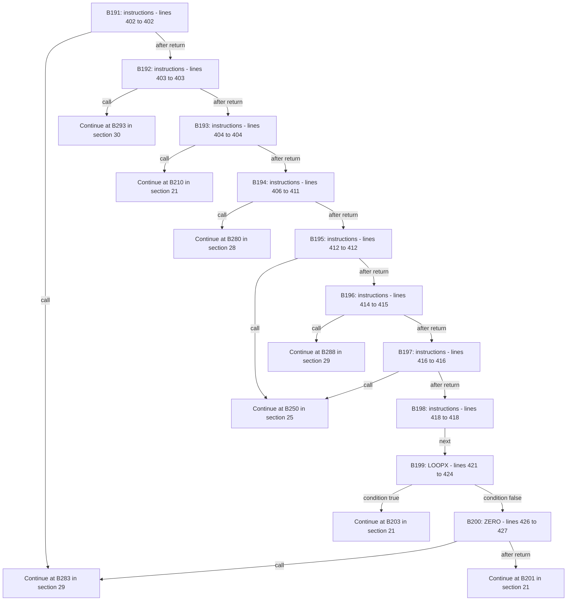

### B191

```asm
ACALL WCHR
```

### B192

```asm
ACALL LDELAY
```

### B193

```asm
ACALL ROTATE
```

### B194

```asm
MOV A,R1
CPL A
MOV R1,A
MOV A,#0c0H
ACALL CMD
```

### B195

```asm
ACALL TIME
```

### B196

```asm
MOV DPTR,#A14
ACALL WSTR
```

### B197

```asm
ACALL TIME
```

### B198

```asm
MOV R7,#8
```

### B199

```asm
MOV A,R1
RLC A
MOV R1,A
JC ONE
```

### B200

```asm
MOV A,#'0'
ACALL WCHR
```

## Section 21

```mermaid
flowchart TD
B200["B201: instructions - lines 428 to 428"]
B201["B202: instructions - lines 429 to 429"]
B202["B203: ONE - lines 431 to 432"]
B203["B204: instructions - lines 433 to 433"]
B204["B205: OUTNOW - lines 435 to 435"]
B205["B206: instructions - lines 436 to 437"]
B206["B207: instructions - lines 438 to 438"]
B207["B208: instructions - lines 439 to 439"]
B208["B209: instructions - lines 440 to 440"]
B209["B210: ROTATE - lines 444 to 444"]
B200 -->|call| B249
B200 -->|after return| B201
B201 -->|jump| B204
B202 -->|call| B282
B202 -->|after return| B203
B203 -->|call| B249
B203 -->|after return| B204
B204 -->|condition true| B198
B204 -->|condition false| B205
B205 -->|call| B282
B205 -->|after return| B206
B206 -->|call| B249
B206 -->|after return| B207
B207 -->|call| B249
B207 -->|after return| B208
B209 -->|condition true| B211
B209 -->|condition false| B210
B249["Continue at B250 in section 25"]
B282["Continue at B283 in section 29"]
B198["Continue at B199 in section 20"]
B211["Continue at B212 in section 22"]
B210["Continue at B211 in section 22"]
```

### B201

```asm
ACALL TIME
```

### B202

```asm
SJMP OUTNOW
```

### B203

```asm
MOV A,#'1'
ACALL WCHR
```

### B204

```asm
ACALL TIME
```

### B205

```asm
DJNZ R7,LOOPX
```

### B206

```asm
MOV A,#'B'
ACALL WCHR
```

### B207

```asm
ACALL TIME
```

### B208

```asm
ACALL TIME
```

### B209

Resume the interrupted program.

```asm
RETI
```

### B210

```asm
CJNE A,#'0',NEXTCHECK
```

## Section 22

```mermaid
flowchart TD
B210["B211: instructions - lines 445 to 449"]
B211["B212: NEXTCHECK - lines 451 to 451"]
B212["B213: instructions - lines 452 to 455"]
B213["B214: OUTY - lines 457 to 457"]
B214["B215: ERRORX - lines 460 to 460"]
B215["B216: instructions - lines 461 to 461"]
B216["B217: DUPLICATE - lines 466 to 467"]
B217["B218: instructions - lines 468 to 468"]
B218["B219: instructions - lines 470 to 471"]
B219["B220: instructions - lines 472 to 472"]
B210 -->|jump| B213
B211 -->|condition true| B214
B211 -->|condition false| B212
B212 -->|next| B213
B214 -->|call| B254
B214 -->|after return| B215
B215 -->|jump| B157
B216 -->|call| B279
B216 -->|after return| B217
B217 -->|call| B249
B217 -->|after return| B218
B218 -->|call| B287
B218 -->|after return| B219
B219 -->|call| B249
B219 -->|after return| B220
B254["Continue at B255 in section 26"]
B157["Continue at B158 in section 16"]
B279["Continue at B280 in section 28"]
B249["Continue at B250 in section 25"]
B287["Continue at B288 in section 29"]
B220["Continue at B221 in section 23"]
```

### B211

```asm
CLR C
MOV A,R1
RLC A
MOV R1,A
SJMP OUTY
```

### B212

```asm
CJNE A,#'1',ERRORX
```

### B213

```asm
SETB C
MOV A,R1
RLC A
MOV R1,A
```

### B214

Return to the instruction following the active call.

```asm
RET
```

### B215

```asm
ACALL RLED
```

### B216

```asm
AJMP COMPLEMENT
```

### B217

```asm
MOV A,#1
ACALL CMD
```

### B218

```asm
ACALL TIME
```

### B219

```asm
MOV DPTR,#A10
ACALL WSTR
```

### B220

```asm
ACALL TIME
```

## Section 23

```mermaid
flowchart TD
B220["B221: instructions - lines 477 to 477"]
B221["B222: instructions - lines 478 to 478"]
B222["B223: instructions - lines 479 to 479"]
B223["B224: instructions - lines 480 to 486"]
B224["B225: instructions - lines 487 to 487"]
B225["B226: instructions - lines 489 to 490"]
B226["B227: instructions - lines 491 to 491"]
B227["B228: instructions - lines 493 to 500"]
B228["B229: instructions - lines 501 to 501"]
B229["B230: instructions - lines 502 to 504"]
B220 -->|call| B297
B220 -->|after return| B221
B221 -->|call| B282
B221 -->|after return| B222
B222 -->|call| B234
B222 -->|after return| B223
B223 -->|call| B279
B223 -->|after return| B224
B224 -->|call| B249
B224 -->|after return| B225
B225 -->|call| B287
B225 -->|after return| B226
B226 -->|call| B249
B226 -->|after return| B227
B227 -->|call| B282
B227 -->|after return| B228
B228 -->|call| B292
B228 -->|after return| B229
B229 -->|call| B282
B229 -->|after return| B230
B297["Continue at B298 in section 30"]
B282["Continue at B283 in section 29"]
B234["Continue at B235 in section 24"]
B279["Continue at B280 in section 28"]
B249["Continue at B250 in section 25"]
B287["Continue at B288 in section 29"]
B292["Continue at B293 in section 30"]
B230["Continue at B231 in section 24"]
```

### B221

```asm
ACALL KEYPAD
```

### B222

```asm
ACALL WCHR
```

### B223

```asm
ACALL CHECK2
```

### B224

```asm
CLR C
SUBB A,#30H
MOV R1,A
MOV A,#0c0H
ACALL CMD
```

### B225

```asm
ACALL TIME
```

### B226

```asm
MOV DPTR,#A15
ACALL WSTR
```

### B227

```asm
ACALL TIME
```

### B228

```asm
MOV A,R1
MOV B,A
ADD A,B
MOV B,#10
DIV AB
ADD A,#30H
ACALL WCHR
```

### B229

```asm
ACALL LDELAY
```

### B230

```asm
MOV A,B
ADD A,#30H
ACALL WCHR
```

## Section 24

```mermaid
flowchart TD
B230["B231: instructions - lines 505 to 505"]
B231["B232: instructions - lines 506 to 506"]
B232["B233: instructions - lines 507 to 507"]
B233["B234: instructions - lines 508 to 508"]
B234["B235: CHECK2 - lines 512 to 512"]
B235["B236: instructions - lines 513 to 513"]
B236["B237: F1 - lines 514 to 514"]
B237["B238: instructions - lines 515 to 515"]
B238["B239: F2 - lines 516 to 516"]
B239["B240: instructions - lines 517 to 517"]
B230 -->|call| B292
B230 -->|after return| B231
B231 -->|call| B249
B231 -->|after return| B232
B232 -->|call| B249
B232 -->|after return| B233
B234 -->|condition true| B236
B234 -->|condition false| B235
B235 -->|jump| B247
B236 -->|condition true| B238
B236 -->|condition false| B237
B237 -->|jump| B247
B238 -->|condition true| B240
B238 -->|condition false| B239
B239 -->|jump| B247
B292["Continue at B293 in section 30"]
B249["Continue at B250 in section 25"]
B247["Continue at B248 in section 25"]
B240["Continue at B241 in section 25"]
```

### B231

```asm
ACALL LDELAY
```

### B232

```asm
ACALL TIME
```

### B233

```asm
ACALL TIME
```

### B234

Resume the interrupted program.

```asm
RETI
```

### B235

```asm
CJNE A,#'#',F1
```

### B236

```asm
AJMP ERRORD
```

### B237

```asm
CJNE A,#'*',F2
```

### B238

```asm
AJMP ERRORD
```

### B239

```asm
CJNE A,#'A',F3
```

### B240

```asm
AJMP ERRORD
```

## Section 25

```mermaid
flowchart TD
B240["B241: F3 - lines 518 to 518"]
B241["B242: instructions - lines 519 to 519"]
B242["B243: F4 - lines 520 to 520"]
B243["B244: instructions - lines 521 to 521"]
B244["B245: F5 - lines 522 to 522"]
B245["B246: instructions - lines 523 to 523"]
B246["B247: F6 - lines 524 to 524"]
B247["B248: ERRORD - lines 527 to 527"]
B248["B249: instructions - lines 528 to 528"]
B249["B250: TIME - lines 536 to 536"]
B240 -->|condition true| B242
B240 -->|condition false| B241
B241 -->|jump| B247
B242 -->|condition true| B244
B242 -->|condition false| B243
B243 -->|jump| B247
B244 -->|condition true| B246
B244 -->|condition false| B245
B245 -->|jump| B247
B247 -->|call| B254
B247 -->|after return| B248
B248 -->|jump| B216
B249 -->|next| B250
B254["Continue at B255 in section 26"]
B216["Continue at B217 in section 22"]
B250["Continue at B251 in section 26"]
```

### B241

```asm
CJNE A,#'B',F4
```

### B242

```asm
AJMP ERRORD
```

### B243

```asm
CJNE A,#'C',F5
```

### B244

```asm
AJMP ERRORD
```

### B245

```asm
CJNE A,#'D',F6
```

### B246

```asm
AJMP ERRORD
```

### B247

Return to the instruction following the active call.

```asm
RET
```

### B248

```asm
ACALL RLED
```

### B249

```asm
AJMP DUPLICATE
```

### B250

```asm
MOV R6,#130
```

## Section 26

```mermaid
flowchart TD
B250["B251: T - lines 538 to 541"]
B251["B252: BACK - lines 543 to 543"]
B252["B253: instructions - lines 544 to 546"]
B253["B254: instructions - lines 547 to 547"]
B254["B255: RLED - lines 550 to 550"]
B255["B256: RLOOP - lines 552 to 553"]
B256["B257: instructions - lines 554 to 555"]
B257["B258: instructions - lines 556 to 556"]
B258["B259: instructions - lines 557 to 557"]
B259["B260: INLCD - lines 563 to 564"]
B250 -->|next| B251
B251 -->|condition true| B251
B251 -->|condition false| B252
B252 -->|condition true| B250
B252 -->|condition false| B253
B254 -->|next| B255
B255 -->|call| B249
B255 -->|after return| B256
B256 -->|call| B249
B256 -->|after return| B257
B257 -->|condition true| B255
B257 -->|condition false| B258
B259 -->|next| B260
B249["Continue at B250 in section 25"]
B260["Continue at B261 in section 27"]
```

### B251

```asm
MOV TMOD,#21H
MOV TL0,#0EEH
MOV TH0,#0B7H
SETB TR0
```

### B252

```asm
JNB TF0,BACK
```

### B253

```asm
CLR TR0
CLR TF0
DJNZ R6,T
```

### B254

Return to the instruction following the active call.

```asm
RET
```

### B255

```asm
MOV R7,#3
```

### B256

```asm
CLR R
ACALL TIME
```

### B257

```asm
SETB R
ACALL TIME
```

### B258

```asm
DJNZ R7,RLOOP
```

### B259

Return to the instruction following the active call.

```asm
RET
```

### B260

```asm
PUSH 7
MOV R7,#20
```

## Section 27

```mermaid
flowchart TD
B260["B261: WAIT - lines 566 to 566"]
B261["B262: instructions - lines 567 to 567"]
B262["B263: instructions - lines 569 to 571"]
B263["B264: instructions - lines 572 to 572"]
B264["B265: instructions - lines 573 to 574"]
B265["B266: instructions - lines 575 to 576"]
B266["B267: instructions - lines 577 to 578"]
B267["B268: instructions - lines 579 to 580"]
B268["B269: instructions - lines 581 to 582"]
B269["B270: instructions - lines 583 to 584"]
B260 -->|call| B292
B260 -->|after return| B261
B261 -->|condition true| B260
B261 -->|condition false| B262
B262 -->|call| B279
B262 -->|after return| B263
B263 -->|call| B292
B263 -->|after return| B264
B264 -->|call| B279
B264 -->|after return| B265
B265 -->|call| B279
B265 -->|after return| B266
B266 -->|call| B279
B266 -->|after return| B267
B267 -->|call| B279
B267 -->|after return| B268
B268 -->|call| B279
B268 -->|after return| B269
B269 -->|call| B279
B269 -->|after return| B270
B292["Continue at B293 in section 30"]
B279["Continue at B280 in section 28"]
B270["Continue at B271 in section 28"]
```

### B261

```asm
ACALL LDELAY
```

### B262

```asm
DJNZ R7,WAIT
```

### B263

```asm
MOV P0,#00000111B
MOV A,#0011B
ACALL CMD
```

### B264

```asm
ACALL LDELAY
```

### B265

```asm
MOV A,#0011B
ACALL CMD
```

### B266

```asm
MOV A,#0011B
ACALL CMD
```

### B267

```asm
MOV A,#0010B
ACALL CMD
```

### B268

```asm
MOV A,#0010B
ACALL CMD
```

### B269

```asm
MOV A,#1000B
ACALL CMD
```

### B270

```asm
MOV A,#0000B
ACALL CMD
```

## Section 28

```mermaid
flowchart TD
B270["B271: instructions - lines 585 to 586"]
B271["B272: instructions - lines 587 to 588"]
B272["B273: instructions - lines 589 to 590"]
B273["B274: instructions - lines 591 to 591"]
B274["B275: instructions - lines 592 to 593"]
B275["B276: instructions - lines 594 to 595"]
B276["B277: instructions - lines 596 to 597"]
B277["B278: instructions - lines 598 to 599"]
B278["B279: instructions - lines 601 to 602"]
B279["B280: CMD - lines 606 to 612"]
B270 -->|call| B279
B270 -->|after return| B271
B271 -->|call| B279
B271 -->|after return| B272
B272 -->|call| B279
B272 -->|after return| B273
B273 -->|call| B292
B273 -->|after return| B274
B274 -->|call| B279
B274 -->|after return| B275
B275 -->|call| B279
B275 -->|after return| B276
B276 -->|call| B279
B276 -->|after return| B277
B277 -->|call| B279
B277 -->|after return| B278
B279 -->|call| B285
B279 -->|after return| B280
B292["Continue at B293 in section 30"]
B285["Continue at B286 in section 29"]
B280["Continue at B281 in section 29"]
```

### B271

```asm
MOV A,#1000B
ACALL CMD
```

### B272

```asm
MOV A,#0
ACALL CMD
```

### B273

```asm
MOV A,#0001B
ACALL CMD
```

### B274

```asm
ACALL LDELAY
```

### B275

```asm
MOV A,#0000B
ACALL CMD
```

### B276

```asm
MOV A,#0110B
ACALL CMD
```

### B277

```asm
MOV A,#0000B
ACALL CMD
```

### B278

```asm
MOV A,#1111B
ACALL CMD
```

### B279

Return to the instruction following the active call.

```asm
POP 7
RET
```

### B280

```asm
PUSH ACC
PUSH B
CLR RS
MOV B,A
SWAP A
ACALL COMMON
```

## Section 29

```mermaid
flowchart TD
B280["B281: instructions - lines 613 to 614"]
B281["B282: instructions - lines 616 to 618"]
B282["B283: WCHR - lines 621 to 627"]
B283["B284: instructions - lines 628 to 629"]
B284["B285: instructions - lines 631 to 633"]
B285["B286: COMMON - lines 636 to 643"]
B286["B287: instructions - lines 644 to 644"]
B287["B288: WSTR - lines 647 to 647"]
B288["B289: CONT1 - lines 649 to 651"]
B289["B290: instructions - lines 652 to 652"]
B280 -->|call| B285
B280 -->|after return| B281
B282 -->|call| B285
B282 -->|after return| B283
B283 -->|call| B285
B283 -->|after return| B284
B285 -->|call| B292
B285 -->|after return| B286
B287 -->|next| B288
B288 -->|condition true| B291
B288 -->|condition false| B289
B289 -->|call| B282
B289 -->|after return| B290
B292["Continue at B293 in section 30"]
B291["Continue at B292 in section 30"]
B290["Continue at B291 in section 30"]
```

### B281

```asm
MOV A,B
ACALL COMMON
```

### B282

Return to the instruction following the active call.

```asm
POP B
POP ACC
RET
```

### B283

```asm
PUSH ACC
PUSH B
SETB RS
MOV B,A
SWAP A
ACALL COMMON
```

### B284

```asm
MOV A,B
ACALL COMMON
```

### B285

Return to the instruction following the active call.

```asm
POP B
POP ACC
RET
```

### B286

```asm
CLR RW
SWAP A
ANL A,#11110000B
ANL P0,#00000111B
ORL P0,A
SETB EN
CLR EN
ACALL LDELAY
```

### B287

Return to the instruction following the active call.

```asm
RET
```

### B288

```asm
PUSH ACC
```

### B289

```asm
CLR A
MOVC A,@A+DPTR
JZ EXIT1
```

### B290

```asm
ACALL WCHR
```

## Section 30

```mermaid
flowchart TD
B290["B291: instructions - lines 653 to 654"]
B291["B292: EXIT1 - lines 656 to 657"]
B292["B293: LDELAY - lines 660 to 662"]
B293["B294: CON4 - lines 664 to 665"]
B294["B295: instructions - lines 666 to 666"]
B295["B296: instructions - lines 667 to 669"]
B296["B297: OUT - lines 675 to 675"]
B297["B298: KEYPAD - lines 678 to 678"]
B298["B299: K1 - lines 680 to 683"]
B299["B300: K2 - lines 685 to 685"]
B290 -->|jump| B288
B292 -->|next| B293
B293 -->|condition true| B293
B293 -->|condition false| B294
B294 -->|condition true| B293
B294 -->|condition false| B295
B296 -->|jump| B296
B297 -->|next| B298
B298 -->|condition true| B298
B298 -->|condition false| B299
B299 -->|call| B318
B299 -->|after return| B300
B288["Continue at B289 in section 29"]
B318["Continue at B319 in section 32"]
B300["Continue at B301 in section 31"]
```

### B291

```asm
INC DPTR
AJMP CONT1
```

### B292

Return to the instruction following the active call.

```asm
POP ACC
RET
```

### B293

```asm
PUSH 0
PUSH 1
MOV R1,#20
```

### B294

```asm
MOV R0,#250
DJNZ R0,$
```

### B295

```asm
DJNZ R1,CON4
```

### B296

Return to the instruction following the active call.

```asm
POP 1
POP 0
RET
```

### B297

```asm
SJMP OUT
```

### B298

```asm
MOV P2,#11110000B
```

### B299

```asm
MOV P2,#11110000B
MOV A,P2
ANL A,#11110000B
CJNE A,#11110000B,K1
```

### B300

```asm
ACALL TMSEC
```

## Section 31

```mermaid
flowchart TD
B300["B301: instructions - lines 686 to 688"]
B301["B302: instructions - lines 689 to 689"]
B302["B303: OVER - lines 692 to 692"]
B303["B304: instructions - lines 693 to 695"]
B304["B305: instructions - lines 696 to 696"]
B305["B306: OVER1 - lines 699 to 702"]
B306["B307: instructions - lines 704 to 707"]
B307["B308: instructions - lines 709 to 712"]
B308["B309: instructions - lines 714 to 717"]
B309["B310: instructions - lines 719 to 719"]
B300 -->|condition true| B302
B300 -->|condition false| B301
B301 -->|jump| B299
B302 -->|call| B318
B302 -->|after return| B303
B303 -->|condition true| B305
B303 -->|condition false| B304
B304 -->|jump| B299
B305 -->|condition true| B310
B305 -->|condition false| B306
B306 -->|condition true| B311
B306 -->|condition false| B307
B307 -->|condition true| B312
B307 -->|condition false| B308
B308 -->|condition true| B313
B308 -->|condition false| B309
B309 -->|jump| B299
B299["Continue at B300 in section 30"]
B318["Continue at B319 in section 32"]
B310["Continue at B311 in section 32"]
B311["Continue at B312 in section 32"]
B312["Continue at B313 in section 32"]
B313["Continue at B314 in section 32"]
```

### B301

```asm
MOV A,P2
ANL A,#11110000B
CJNE A,#11110000B,OVER
```

### B302

```asm
SJMP K2
```

### B303

```asm
ACALL TMSEC
```

### B304

```asm
MOV A,P2
ANL A,#11110000B
CJNE A,#11110000B,OVER1
```

### B305

```asm
SJMP K2
```

### B306

```asm
MOV P2,#11111110B
MOV A,P2
ANL A,#11110000B
CJNE A,#11110000B,ROW_0
```

### B307

```asm
MOV P2,#11111101B
MOV A,P2
ANL A,#11110000B
CJNE A,#11110000B,ROW_1
```

### B308

```asm
MOV P2,#11111011B
MOV A,P2
ANL A,#11110000B
CJNE A,#11110000B,ROW_2
```

### B309

```asm
MOV P2,#11110111B
MOV A,P2
ANL A,#11110000B
CJNE A,#11110000B,ROW_3
```

### B310

```asm
LJMP K2
```

## Section 32

```mermaid
flowchart TD
B310["B311: ROW_0 - lines 721 to 722"]
B311["B312: ROW_1 - lines 724 to 725"]
B312["B313: ROW_2 - lines 727 to 728"]
B313["B314: ROW_3 - lines 730 to 730"]
B314["B315: FIND - lines 733 to 733"]
B315["B316: FIND1 - lines 736 to 737"]
B316["B317: instructions - lines 738 to 739"]
B317["B318: MATCH - lines 742 to 744"]
B318["B319: TMSEC - lines 748 to 751"]
B319["B320: BACK32 - lines 753 to 753"]
B310 -->|jump| B314
B311 -->|jump| B314
B312 -->|jump| B314
B313 -->|next| B314
B314 -->|next| B315
B315 -->|condition true| B317
B315 -->|condition false| B316
B316 -->|jump| B315
B318 -->|next| B319
B319 -->|condition true| B319
B319 -->|condition false| B320
B320["Continue at B321 in section 33"]
```

### B311

```asm
MOV DPTR,#KCODE0
SJMP FIND
```

### B312

```asm
MOV DPTR,#KCODE1
SJMP FIND
```

### B313

```asm
MOV DPTR,#KCODE2
SJMP FIND
```

### B314

```asm
MOV DPTR,#KCODE3
```

### B315

```asm
SWAP A
```

### B316

```asm
RRC A
JNC MATCH
```

### B317

```asm
INC DPTR
SJMP FIND1
```

### B318

Return to the instruction following the active call.

```asm
CLR A
MOVC A,@A+DPTR
RET
```

### B319

```asm
MOV   TMOD,#00000001B
MOV   TL0,#0CAH
MOV   TH0,#27H
SETB  TR0
```

### B320

```asm
JNB   	TF0,BACK32
```

## Section 33

```mermaid
flowchart TD
B320["B321: instructions - lines 754 to 756"]
B321["B322: instructions - lines 759 to 759"]
```

### B321

Return to the instruction following the active call.

```asm
CLR   	TR0
CLR   	TF0
RET
```

### B322

Resume the interrupted program.

```asm
RETI
```
