# Program Control Flow

[Back to project](README.md)

Control-flow blocks are indexed by source line. Calls resume at the instruction following the call if the subroutine returns normally.

## Entry locations

- `ORG 0H` begins at B1.

## Navigation

[Section 1](#section-1) · [Section 2](#section-2) · [Section 3](#section-3) · [Section 4](#section-4) · [Section 5](#section-5) · [Section 6](#section-6) · [Section 7](#section-7) · [Section 8](#section-8) · [Section 9](#section-9) · [Section 10](#section-10) · [Section 11](#section-11) · [Section 12](#section-12) · [Section 13](#section-13) · [Section 14](#section-14) · [Section 15](#section-15) · [Section 16](#section-16) · [Section 17](#section-17) · [Section 18](#section-18) · [Section 19](#section-19) · [Section 20](#section-20) · [Section 21](#section-21) · [Section 22](#section-22) · [Section 23](#section-23) · [Section 24](#section-24) · [Section 25](#section-25)

## Lines outside the instruction parser

These may be assembler directives, macros, or malformed source; inspect them before building.

```asm
83: ////////////////////////////////////////////////////////////////////////////////////////////////////////////
117: ///////////OP1
201: ///////////////END OF OP1
203: ///////////////OP2
285: ////////////////////////OP3
363: ///////////////////////
365: /////////////////////OP4
424: /////////////////////////
```

## Section 1

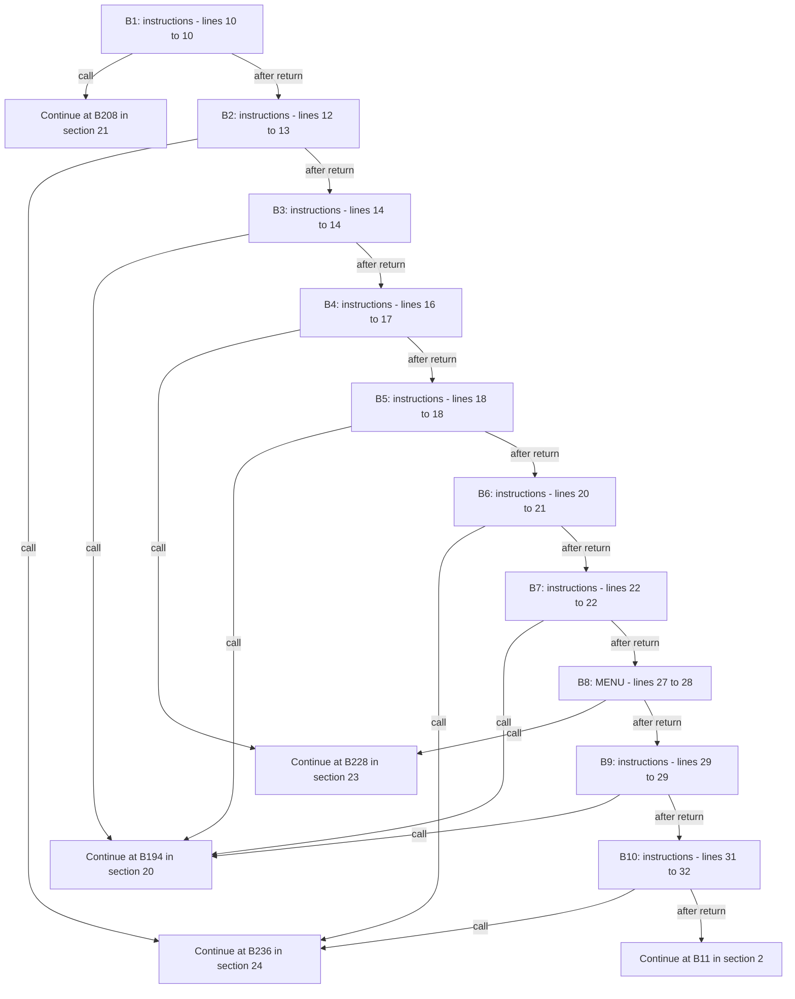

### B1

```asm
ACALL INLCD
```

### B2

```asm
MOV DPTR,#A1
ACALL WSTR
```

### B3

```asm
ACALL TIME
```

### B4

```asm
MOV A,#0C0H
ACALL CMD
```

### B5

```asm
ACALL TIME
```

### B6

```asm
MOV DPTR,#A2
ACALL WSTR
```

### B7

```asm
ACALL TIME
```

### B8

```asm
MOV A,#1
ACALL CMD
```

### B9

```asm
ACALL TIME
```

### B10

```asm
MOV DPTR,#A3
ACALL WSTR
```

## Section 2


### B11

```asm
ACALL TIME
```

### B12

```asm
MOV A,#0C0H
ACALL CMD
```

### B13

```asm
ACALL TIME
```

### B14

```asm
MOV DPTR,#A4
ACALL WSTR
```

### B15

```asm
ACALL TIME
```

### B16

```asm
MOV A,#1
ACALL CMD
```

### B17

```asm
ACALL TIME
```

### B18

```asm
MOV DPTR,#A5
ACALL WSTR
```

### B19

```asm
ACALL TIME
```

### B20

```asm
MOV A,#0C0H
ACALL CMD
```

## Section 3

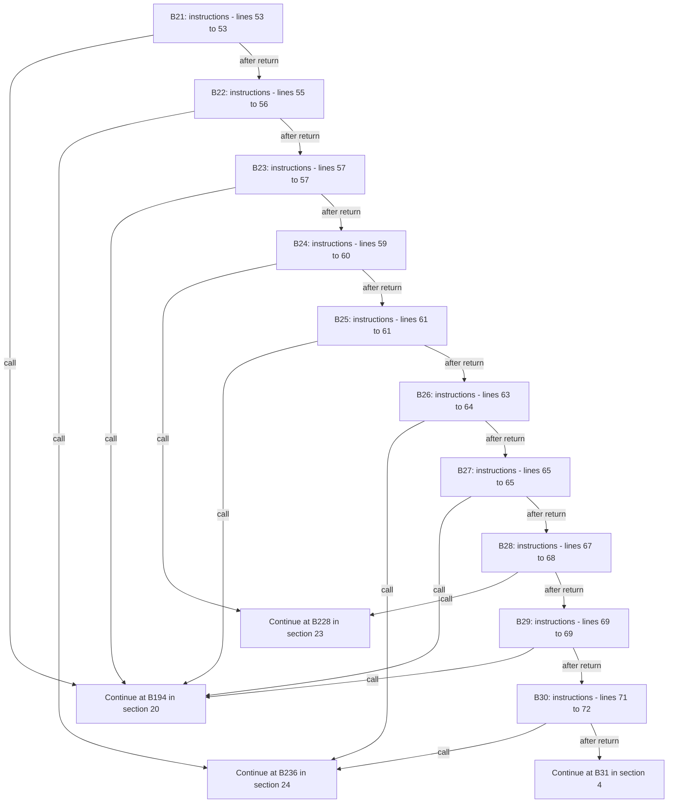

### B21

```asm
ACALL TIME
```

### B22

```asm
MOV DPTR,#A6
ACALL WSTR
```

### B23

```asm
ACALL TIME
```

### B24

```asm
MOV A,#1
ACALL CMD
```

### B25

```asm
ACALL TIME
```

### B26

```asm
MOV DPTR,#A7
ACALL WSTR
```

### B27

```asm
ACALL TIME
```

### B28

```asm
MOV A,#0C0H
ACALL CMD
```

### B29

```asm
ACALL TIME
```

### B30

```asm
MOV DPTR,#A8
ACALL WSTR
```

## Section 4

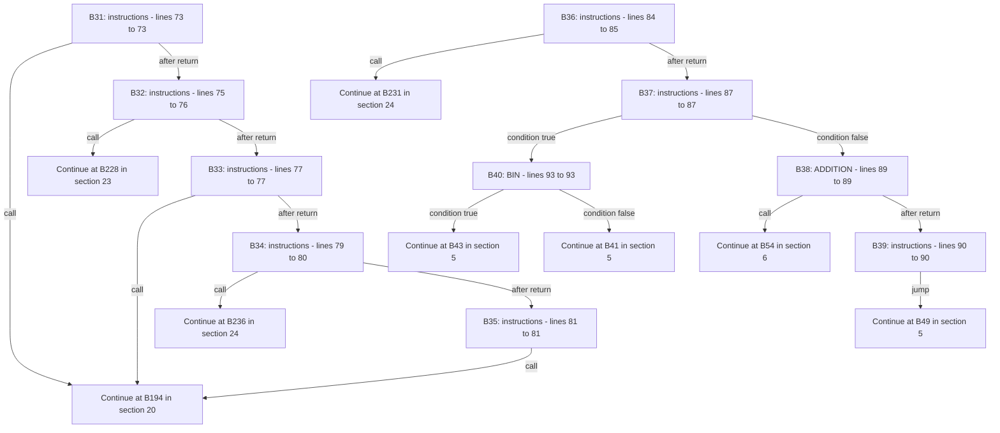

### B31

```asm
ACALL TIME
```

### B32

```asm
MOV A,#1
ACALL CMD
```

### B33

```asm
ACALL TIME
```

### B34

```asm
MOV DPTR,#A9
ACALL WSTR
```

### B35

```asm
ACALL TIME
```

### B36

```asm
MOV A,#'A'
ACALL WCHR
```

### B37

```asm
CJNE A,#'A',BIN
```

### B38

```asm
ACALL ADDOP
```

### B39

```asm
AJMP EXIT
```

### B40

```asm
CJNE A,#'B',COMP
```

## Section 5

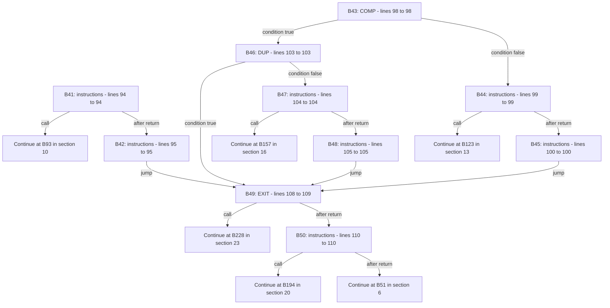

### B41

```asm
ACALL BINR
```

### B42

```asm
AJMP EXIT
```

### B43

```asm
CJNE A,#'C',DUP
```

### B44

```asm
ACALL COMPLEMENT
```

### B45

```asm
AJMP EXIT
```

### B46

```asm
CJNE A,#'D',EXIT
```

### B47

```asm
ACALL DUPLICATE
```

### B48

```asm
AJMP EXIT
```

### B49

```asm
MOV A,#1
ACALL CMD
```

### B50

```asm
ACALL TIME
```

## Section 6

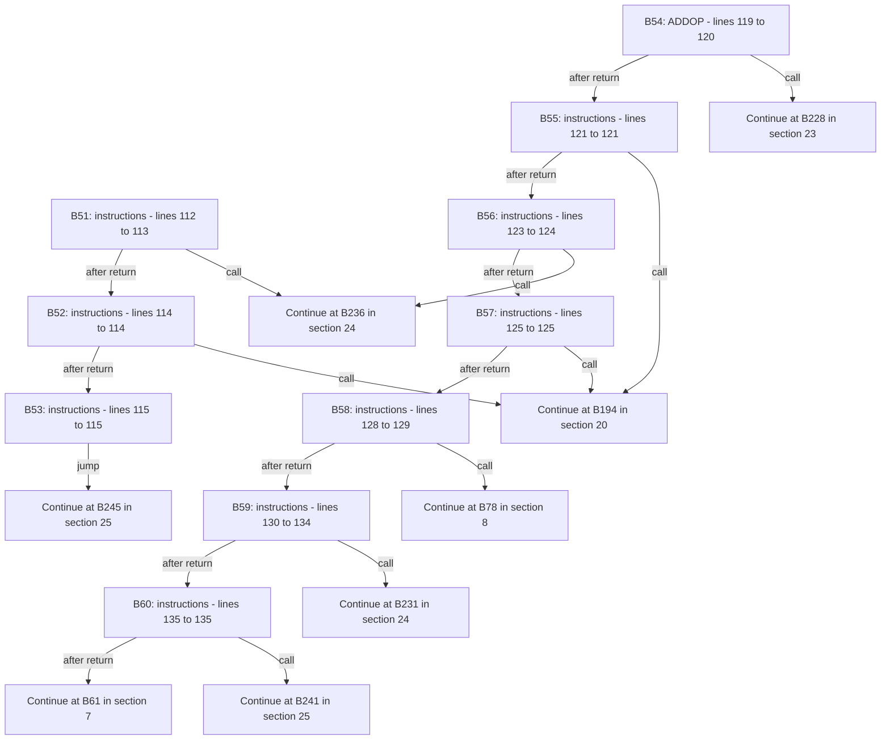

### B51

```asm
MOV DPTR,#A11
ACALL WSTR
```

### B52

```asm
ACALL TIME
```

### B53

```asm
AJMP OUT
```

### B54

```asm
MOV A,#1
ACALL CMD
```

### B55

```asm
ACALL TIME
```

### B56

```asm
MOV DPTR,#A10
ACALL WSTR
```

### B57

```asm
ACALL TIME
```

### B58

```asm
MOV A,#5
ACALL CHECK
```

### B59

```asm
MOV R1,A
MOV B,#10H
DIV AB
ADD A,#30H
ACALL WCHR
```

### B60

```asm
ACALL LDELAY
```

## Section 7

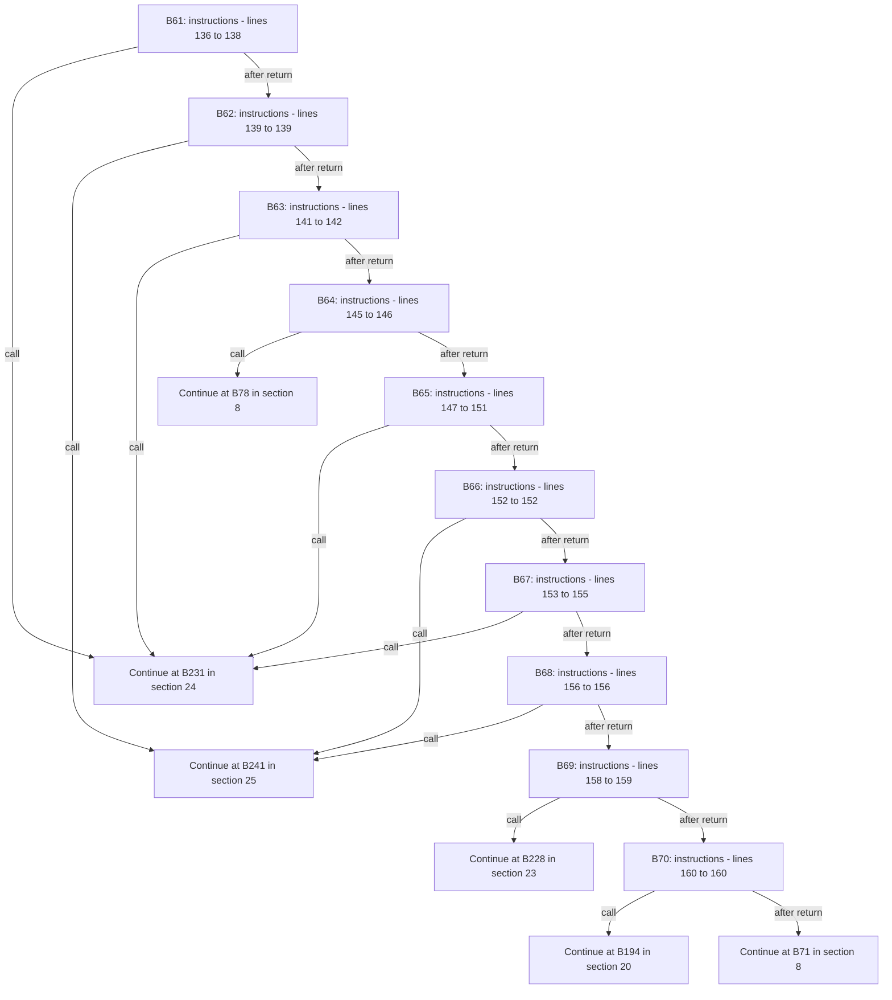

### B61

```asm
MOV A,B
ADD A,#30H
ACALL WCHR
```

### B62

```asm
ACALL LDELAY
```

### B63

```asm
MOV A,#' '
ACALL WCHR
```

### B64

```asm
MOV A,#6
ACALL CHECK
```

### B65

```asm
MOV R2,A
MOV B,#10H
DIV AB
ADD A,#30H
ACALL WCHR
```

### B66

```asm
ACALL LDELAY
```

### B67

```asm
MOV A,B
ADD A,#30H
ACALL WCHR
```

### B68

```asm
ACALL LDELAY
```

### B69

```asm
MOV A,#0C0H
ACALL CMD
```

### B70

```asm
ACALL TIME
```

## Section 8

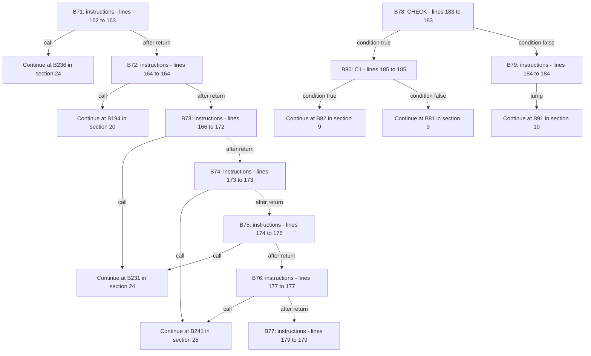

### B71

```asm
MOV DPTR,#A12
ACALL WSTR
```

### B72

```asm
ACALL TIME
```

### B73

```asm
MOV A,R2
ADD A,R1
MOV B,#10H
DIV AB
ADD A,#30H
ACALL WCHR
```

### B74

```asm
ACALL LDELAY
```

### B75

```asm
MOV A,B
ADD A,#30H
ACALL WCHR
```

### B76

```asm
ACALL LDELAY
```

### B77

Return to the instruction following the active call.

```asm
RET
```

### B78

```asm
CJNE A,#'#',C1
```

### B79

```asm
AJMP ERRORA
```

### B80

```asm
CJNE A,#'*',C2
```

## Section 9

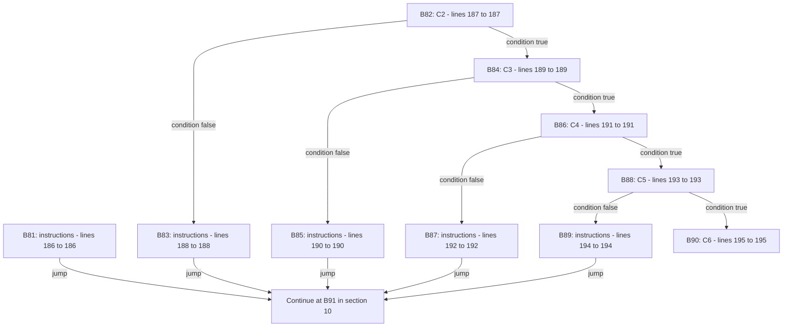

### B81

```asm
AJMP ERRORA
```

### B82

```asm
CJNE A,#0AH,C3
```

### B83

```asm
AJMP ERRORA
```

### B84

```asm
CJNE A,#0BH,C4
```

### B85

```asm
AJMP ERRORA
```

### B86

```asm
CJNE A,#0CH,C5
```

### B87

```asm
AJMP ERRORA
```

### B88

```asm
CJNE A,#0DH,C6
```

### B89

```asm
AJMP ERRORA
```

### B90

Return to the instruction following the active call.

```asm
RET
```

## Section 10

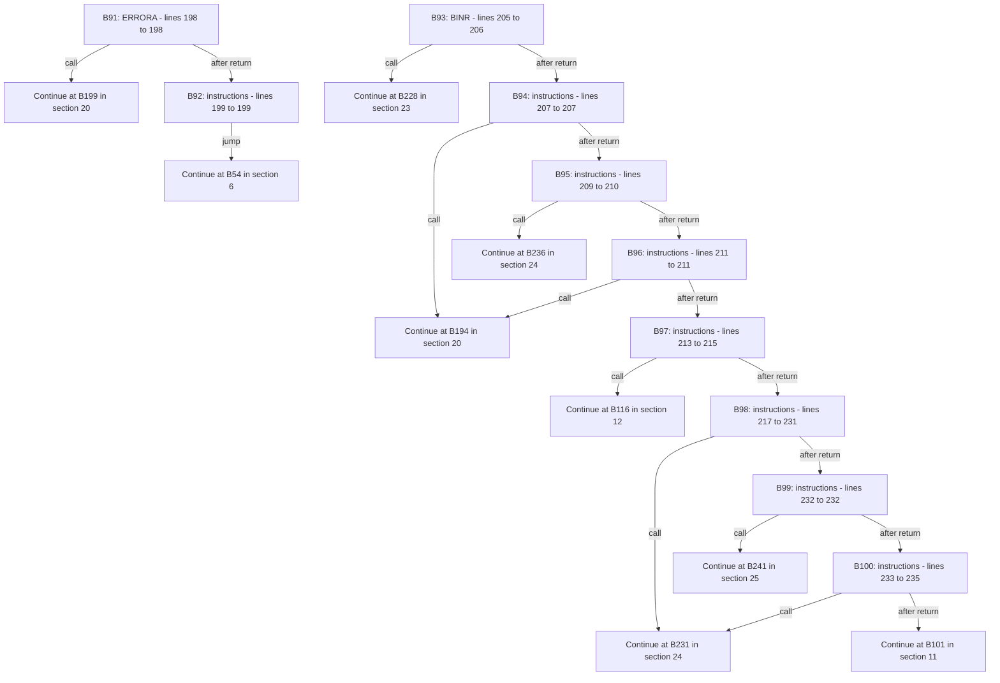

### B91

```asm
ACALL RLED
```

### B92

```asm
AJMP ADDOP
```

### B93

```asm
MOV A,#1
ACALL CMD
```

### B94

```asm
ACALL TIME
```

### B95

```asm
MOV DPTR,#A10
ACALL WSTR
```

### B96

```asm
ACALL TIME
```

### B97

```asm
MOV A,#55H
MOV R1,A
ACALL BINCHECK
```

### B98

```asm
ANL A,#0FH
MOV A,R2
MOV A,R1
SWAP A
ANL A,#0FH
MOV B,#10
MUL AB
ADD A,R2
MOV B,#10H
DIV AB
ADD A,#30H
ACALL WCHR
```

### B99

```asm
ACALL LDELAY
```

### B100

```asm
MOV A,B
ADD A,#30H
ACALL WCHR
```

## Section 11

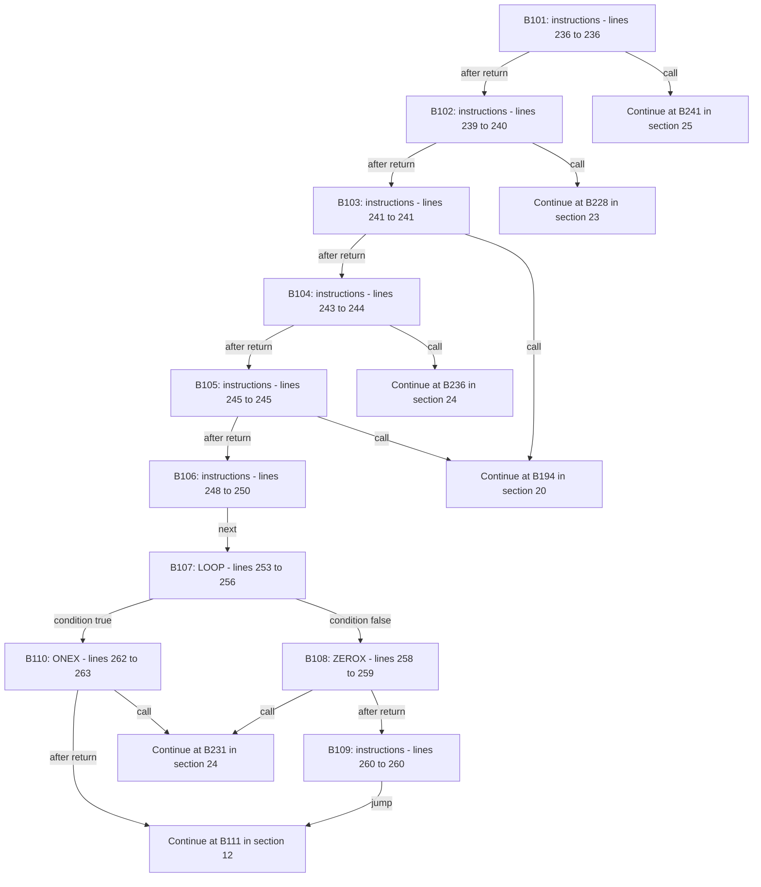

### B101

```asm
ACALL LDELAY
```

### B102

```asm
MOV A,#0C0H
ACALL CMD
```

### B103

```asm
ACALL TIME
```

### B104

```asm
MOV DPTR,#A13
ACALL WSTR
```

### B105

```asm
ACALL TIME
```

### B106

```asm
MOV A,R1
MOV R7,#8
```

### B107

```asm
MOV A,R1
RLC A
MOV R1,A
JC ONEX
```

### B108

```asm
MOV A,#'0'
ACALL WCHR
```

### B109

```asm
SJMP OUTNOWX
```

### B110

```asm
MOV A,#'1'
ACALL WCHR
```

## Section 12

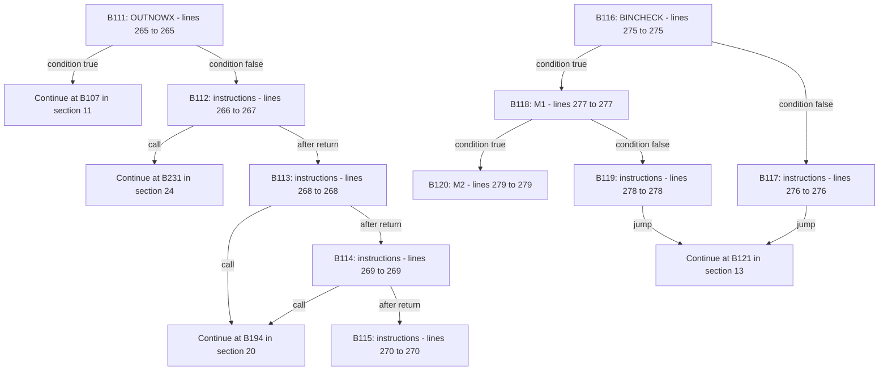

### B111

```asm
DJNZ R7,LOOP
```

### B112

```asm
MOV A,#'B'
ACALL WCHR
```

### B113

```asm
ACALL TIME
```

### B114

```asm
ACALL TIME
```

### B115

Return to the instruction following the active call.

```asm
RET
```

### B116

```asm
CJNE A,#'#',M1
```

### B117

```asm
AJMP ERRORB
```

### B118

```asm
CJNE A,#'*',M2
```

### B119

```asm
AJMP ERRORB
```

### B120

Return to the instruction following the active call.

```asm
RET
```

## Section 13

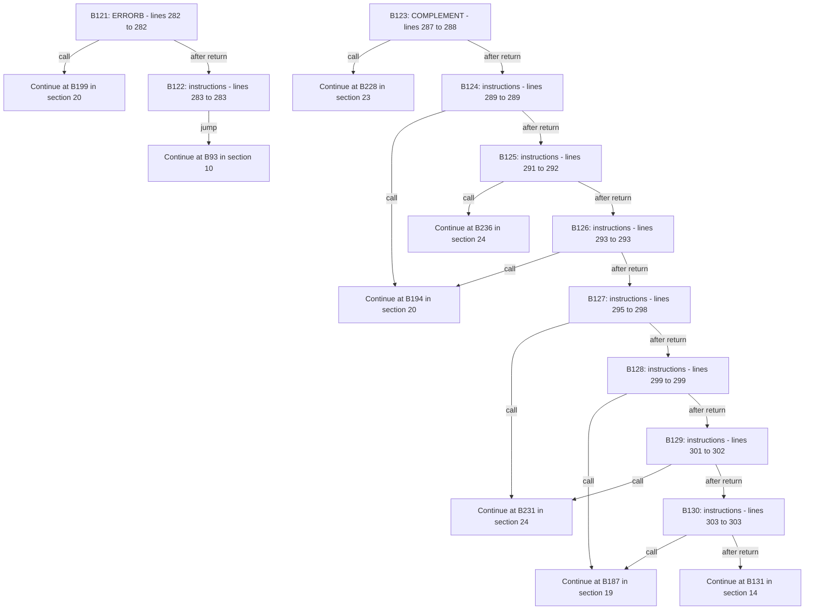

### B121

```asm
ACALL RLED
```

### B122

```asm
AJMP BINR
```

### B123

```asm
MOV A,#1
ACALL CMD
```

### B124

```asm
ACALL TIME
```

### B125

```asm
MOV DPTR,#A10
ACALL WSTR
```

### B126

```asm
ACALL TIME
```

### B127

```asm
MOV R1,#0
MOV A,#'1'
ACALL WCHR
```

### B128

```asm
ACALL ROTATE
```

### B129

```asm
MOV A,#'1'
ACALL WCHR
```

### B130

```asm
ACALL ROTATE
```

## Section 14

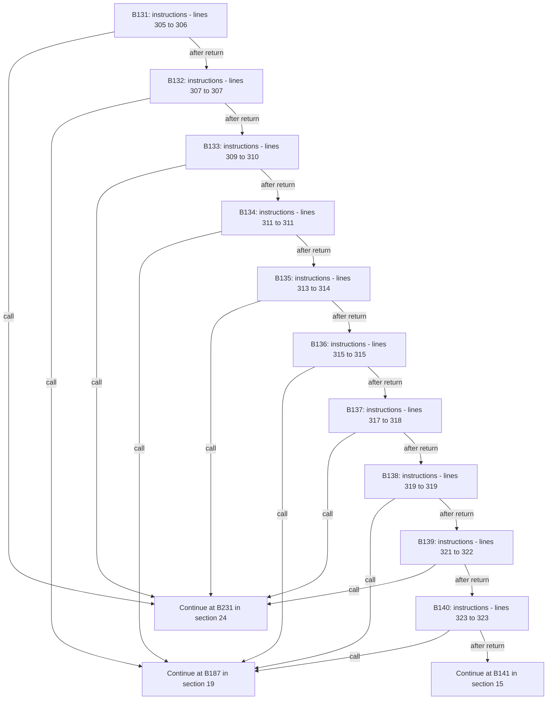

### B131

```asm
MOV A,#'1'
ACALL WCHR
```

### B132

```asm
ACALL ROTATE
```

### B133

```asm
MOV A,#'1'
ACALL WCHR
```

### B134

```asm
ACALL ROTATE
```

### B135

```asm
MOV A,#'0'
ACALL WCHR
```

### B136

```asm
ACALL ROTATE
```

### B137

```asm
MOV A,#'0'
ACALL WCHR
```

### B138

```asm
ACALL ROTATE
```

### B139

```asm
MOV A,#'0'
ACALL WCHR
```

### B140

```asm
ACALL ROTATE
```

## Section 15

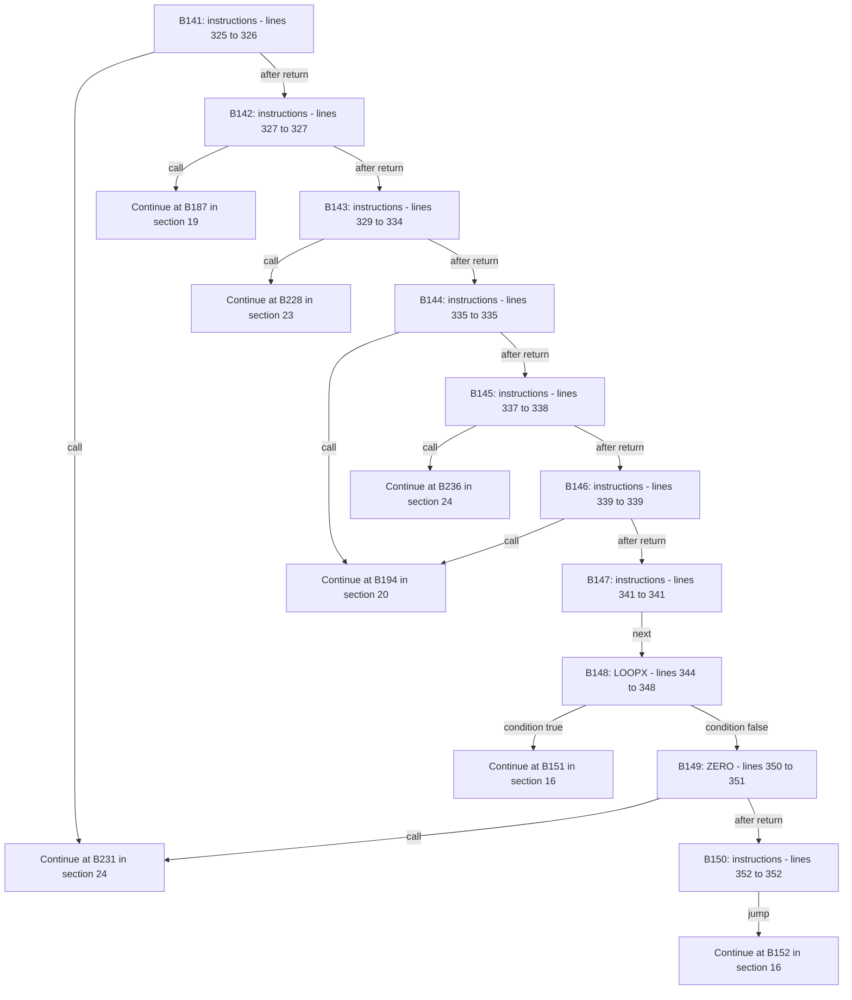

### B141

```asm
MOV A,#'0'
ACALL WCHR
```

### B142

```asm
ACALL ROTATE
```

### B143

```asm
MOV A,R1
CPL A
MOV R1,A
MOV A,#0C0H
ACALL CMD
```

### B144

```asm
ACALL TIME
```

### B145

```asm
MOV DPTR,#A14
ACALL WSTR
```

### B146

```asm
ACALL TIME
```

### B147

```asm
MOV R7,#8
```

### B148

```asm
MOV A,R1
RLC A
MOV R1,A
RLC A
JC ONE
```

### B149

```asm
MOV A,#'0'
ACALL WCHR
```

### B150

```asm
SJMP OUTNOW
```

## Section 16

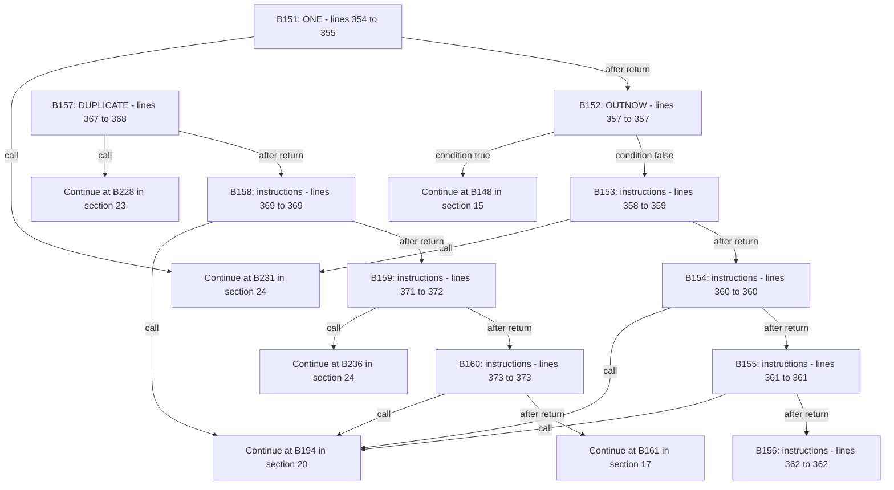

### B151

```asm
MOV A,#'1'
ACALL WCHR
```

### B152

```asm
DJNZ R7,LOOPX
```

### B153

```asm
MOV A,#'1'
ACALL WCHR
```

### B154

```asm
ACALL TIME
```

### B155

```asm
ACALL TIME
```

### B156

Return to the instruction following the active call.

```asm
RET
```

### B157

```asm
MOV A,#1
ACALL CMD
```

### B158

```asm
ACALL TIME
```

### B159

```asm
MOV DPTR,#A10
ACALL WSTR
```

### B160

```asm
ACALL TIME
```

## Section 17

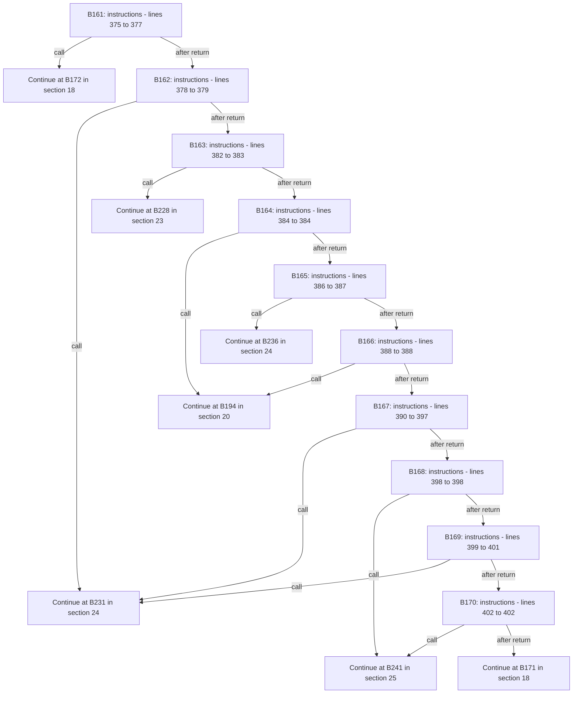

### B161

```asm
MOV A,#5
MOV R1,A
ACALL CHECK2
```

### B162

```asm
ADD A,#30H
ACALL WCHR
```

### B163

```asm
MOV A,#0C0H
ACALL CMD
```

### B164

```asm
ACALL TIME
```

### B165

```asm
MOV DPTR,#A15
ACALL WSTR
```

### B166

```asm
ACALL TIME
```

### B167

```asm
MOV A,R1
MOV B,A
ADD A,B
MOV B,#10H
DIV AB
ADD A,#30H
ACALL WCHR
```

### B168

```asm
ACALL LDELAY
```

### B169

```asm
MOV A,B
ADD A,#30H
ACALL WCHR
```

### B170

```asm
ACALL LDELAY
```

## Section 18

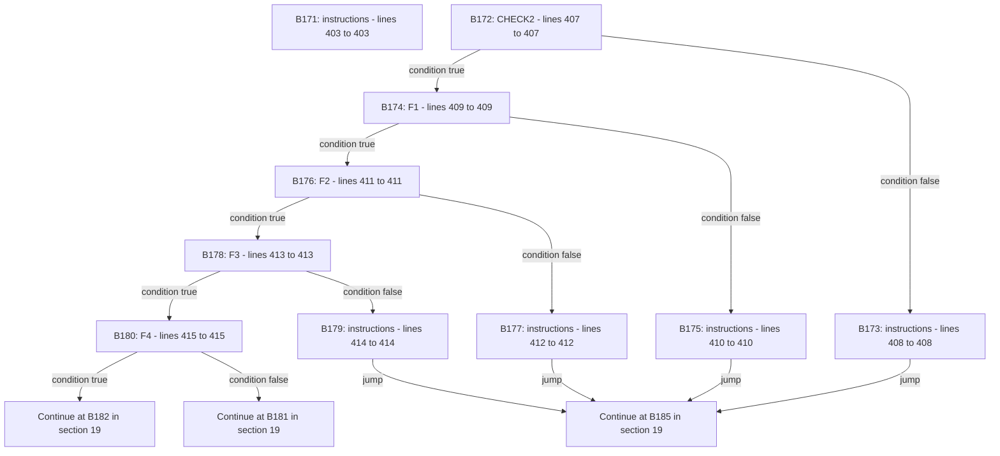

### B171

Return to the instruction following the active call.

```asm
RET
```

### B172

```asm
CJNE A,#'#',F1
```

### B173

```asm
AJMP ERRORD
```

### B174

```asm
CJNE A,#'*',F2
```

### B175

```asm
AJMP ERRORD
```

### B176

```asm
CJNE A,#'A',F3
```

### B177

```asm
AJMP ERRORD
```

### B178

```asm
CJNE A,#'B',F4
```

### B179

```asm
AJMP ERRORD
```

### B180

```asm
CJNE A,#'C',F5
```

## Section 19

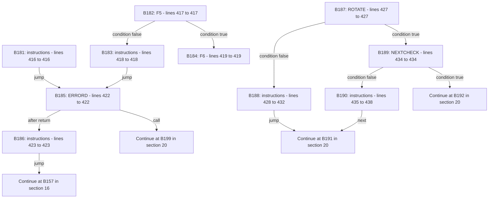

### B181

```asm
AJMP ERRORD
```

### B182

```asm
CJNE A,#'D',F6
```

### B183

```asm
AJMP ERRORD
```

### B184

Return to the instruction following the active call.

```asm
RET
```

### B185

```asm
ACALL RLED
```

### B186

```asm
AJMP DUPLICATE
```

### B187

```asm
CJNE A,#'0',NEXTCHECK
```

### B188

```asm
CLR C
MOV A,R1
RLC A
MOV R1,A
SJMP OUTY
```

### B189

```asm
CJNE A,#'1',ERRORX
```

### B190

```asm
SETB C
MOV A,R1
RLC A
MOV R1,A
```

## Section 20

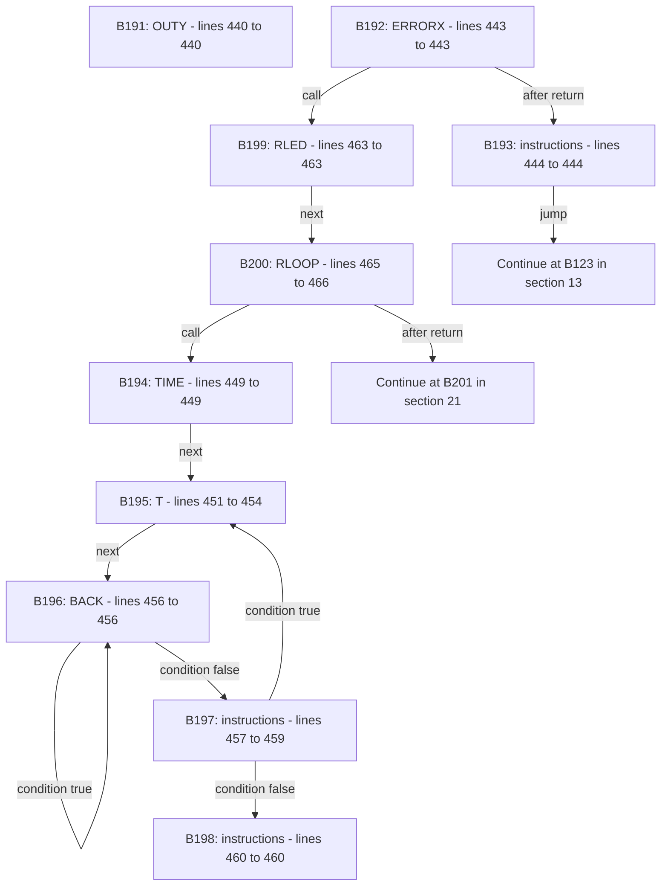

### B191

Return to the instruction following the active call.

```asm
RET
```

### B192

```asm
ACALL RLED
```

### B193

```asm
AJMP COMPLEMENT
```

### B194

```asm
MOV R6,#100
```

### B195

```asm
MOV TMOD,#21H
MOV TL0,#0EEH
MOV TH0,#0B7H
SETB TR0
```

### B196

```asm
JNB TF0,BACK
```

### B197

```asm
CLR TR0
CLR TF0
DJNZ R6,T
```

### B198

Return to the instruction following the active call.

```asm
RET
```

### B199

```asm
MOV R7,#3
```

### B200

```asm
CLR R
ACALL TIME
```

## Section 21

```mermaid
flowchart TD
B200["B201: instructions - lines 467 to 468"]
B201["B202: instructions - lines 469 to 469"]
B202["B203: instructions - lines 470 to 470"]
B203["B204: instructions - lines 473 to 480"]
B204["B205: instructions - lines 481 to 481"]
B205["B206: instructions - lines 482 to 484"]
B206["B207: instructions - lines 485 to 485"]
B207["B208: INLCD - lines 491 to 492"]
B208["B209: WAIT - lines 494 to 494"]
B209["B210: instructions - lines 495 to 495"]
B200 -->|call| B193
B200 -->|after return| B201
B201 -->|condition true| B199
B201 -->|condition false| B202
B203 -->|call| B230
B203 -->|after return| B204
B204 -->|call| B240
B204 -->|after return| B205
B205 -->|call| B230
B205 -->|after return| B206
B206 -->|call| B240
B206 -->|after return| B207
B207 -->|next| B208
B208 -->|call| B240
B208 -->|after return| B209
B209 -->|condition true| B208
B209 -->|condition false| B210
B193["Continue at B194 in section 20"]
B199["Continue at B200 in section 20"]
B230["Continue at B231 in section 24"]
B240["Continue at B241 in section 25"]
B210["Continue at B211 in section 22"]
```

### B201

```asm
SETB R
ACALL TIME
```

### B202

```asm
DJNZ R7,RLOOP
```

### B203

Return to the instruction following the active call.

```asm
RET
```

### B204

```asm
MOV B,#100
DIV AB
ADD A,#30H
MOV A,B
MOV B,#10H
DIV AB
ADD A,#30H
ACALL WCHR
```

### B205

```asm
ACALL LDELAY
```

### B206

```asm
MOV A,B
ADD A,#30H
ACALL WCHR
```

### B207

```asm
ACALL LDELAY
```

### B208

```asm
PUSH 7
MOV R7,#20
```

### B209

```asm
ACALL LDELAY
```

### B210

```asm
DJNZ R7,WAIT
```

## Section 22

```mermaid
flowchart TD
B210["B211: instructions - lines 497 to 499"]
B211["B212: instructions - lines 500 to 500"]
B212["B213: instructions - lines 501 to 502"]
B213["B214: instructions - lines 503 to 504"]
B214["B215: instructions - lines 505 to 506"]
B215["B216: instructions - lines 507 to 508"]
B216["B217: instructions - lines 509 to 510"]
B217["B218: instructions - lines 511 to 512"]
B218["B219: instructions - lines 513 to 514"]
B219["B220: instructions - lines 515 to 516"]
B210 -->|call| B227
B210 -->|after return| B211
B211 -->|call| B240
B211 -->|after return| B212
B212 -->|call| B227
B212 -->|after return| B213
B213 -->|call| B227
B213 -->|after return| B214
B214 -->|call| B227
B214 -->|after return| B215
B215 -->|call| B227
B215 -->|after return| B216
B216 -->|call| B227
B216 -->|after return| B217
B217 -->|call| B227
B217 -->|after return| B218
B218 -->|call| B227
B218 -->|after return| B219
B219 -->|call| B227
B219 -->|after return| B220
B227["Continue at B228 in section 23"]
B240["Continue at B241 in section 25"]
B220["Continue at B221 in section 23"]
```

### B211

```asm
MOV P0,#00000111B
MOV A,#0011B
ACALL CMD
```

### B212

```asm
ACALL LDELAY
```

### B213

```asm
MOV A,#0011B
ACALL CMD
```

### B214

```asm
MOV A,#0011B
ACALL CMD
```

### B215

```asm
MOV A,#0010B
ACALL CMD
```

### B216

```asm
MOV A,#0010B
ACALL CMD
```

### B217

```asm
MOV A,#1000B
ACALL CMD
```

### B218

```asm
MOV A,#0000B
ACALL CMD
```

### B219

```asm
MOV A,#1000B
ACALL CMD
```

### B220

```asm
MOV A,#0
ACALL CMD
```

## Section 23

```mermaid
flowchart TD
B220["B221: instructions - lines 517 to 518"]
B221["B222: instructions - lines 519 to 519"]
B222["B223: instructions - lines 520 to 521"]
B223["B224: instructions - lines 522 to 523"]
B224["B225: instructions - lines 524 to 525"]
B225["B226: instructions - lines 526 to 527"]
B226["B227: instructions - lines 529 to 530"]
B227["B228: CMD - lines 534 to 540"]
B228["B229: instructions - lines 541 to 542"]
B229["B230: instructions - lines 544 to 546"]
B220 -->|call| B227
B220 -->|after return| B221
B221 -->|call| B240
B221 -->|after return| B222
B222 -->|call| B227
B222 -->|after return| B223
B223 -->|call| B227
B223 -->|after return| B224
B224 -->|call| B227
B224 -->|after return| B225
B225 -->|call| B227
B225 -->|after return| B226
B227 -->|call| B233
B227 -->|after return| B228
B228 -->|call| B233
B228 -->|after return| B229
B240["Continue at B241 in section 25"]
B233["Continue at B234 in section 24"]
```

### B221

```asm
MOV A,#0001B
ACALL CMD
```

### B222

```asm
ACALL LDELAY
```

### B223

```asm
MOV A,#0000B
ACALL CMD
```

### B224

```asm
MOV A,#0110B
ACALL CMD
```

### B225

```asm
MOV A,#0000B
ACALL CMD
```

### B226

```asm
MOV A,#1111B
ACALL CMD
```

### B227

Return to the instruction following the active call.

```asm
POP 7
RET
```

### B228

```asm
PUSH ACC
PUSH B
CLR RS
MOV B,A
SWAP A
ACALL COMMON
```

### B229

```asm
MOV A,B
ACALL COMMON
```

### B230

Return to the instruction following the active call.

```asm
POP B
POP ACC
RET
```

## Section 24

```mermaid
flowchart TD
B230["B231: WCHR - lines 549 to 555"]
B231["B232: instructions - lines 556 to 557"]
B232["B233: instructions - lines 559 to 561"]
B233["B234: COMMON - lines 564 to 571"]
B234["B235: instructions - lines 572 to 572"]
B235["B236: WSTR - lines 575 to 575"]
B236["B237: CONT1 - lines 577 to 579"]
B237["B238: instructions - lines 580 to 580"]
B238["B239: instructions - lines 581 to 582"]
B239["B240: EXIT1 - lines 584 to 585"]
B230 -->|call| B233
B230 -->|after return| B231
B231 -->|call| B233
B231 -->|after return| B232
B233 -->|call| B240
B233 -->|after return| B234
B235 -->|next| B236
B236 -->|condition true| B239
B236 -->|condition false| B237
B237 -->|call| B230
B237 -->|after return| B238
B238 -->|jump| B236
B240["Continue at B241 in section 25"]
```

### B231

```asm
PUSH ACC
PUSH B
SETB RS
MOV B,A
SWAP A
ACALL COMMON
```

### B232

```asm
MOV A,B
ACALL COMMON
```

### B233

Return to the instruction following the active call.

```asm
POP B
POP ACC
RET
```

### B234

```asm
CLR RW
SWAP A
ANL A,#11110000B
ANL P0,#00000111B
ORL P0,A
SETB EN
CLR EN
ACALL LDELAY
```

### B235

Return to the instruction following the active call.

```asm
RET
```

### B236

```asm
PUSH ACC
```

### B237

```asm
CLR A
MOVC A,@A+DPTR
JZ EXIT1
```

### B238

```asm
ACALL WCHR
```

### B239

```asm
INC DPTR
AJMP CONT1
```

### B240

Return to the instruction following the active call.

```asm
POP ACC
RET
```

## Section 25

```mermaid
flowchart TD
B240["B241: LDELAY - lines 588 to 590"]
B241["B242: CON4 - lines 592 to 593"]
B242["B243: instructions - lines 594 to 594"]
B243["B244: instructions - lines 595 to 597"]
B244["B245: OUT - lines 616 to 616"]
B240 -->|next| B241
B241 -->|condition true| B241
B241 -->|condition false| B242
B242 -->|condition true| B241
B242 -->|condition false| B243
B244 -->|jump| B244
```

### B241

```asm
PUSH 0
PUSH 1
MOV R1,#20
```

### B242

```asm
MOV R0,#250
DJNZ R0,$
```

### B243

```asm
DJNZ R1,CON4
```

### B244

Return to the instruction following the active call.

```asm
POP 1
POP 0
RET
```

### B245

```asm
SJMP OUT
```
