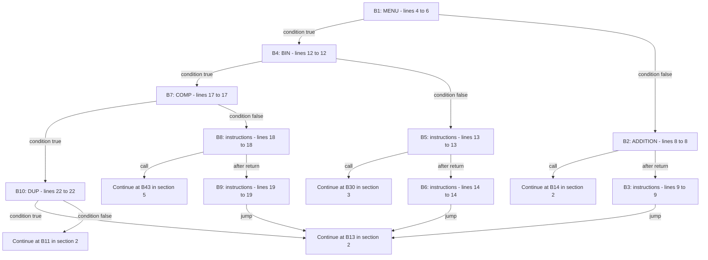
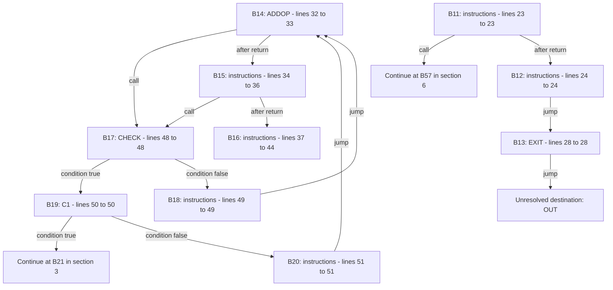
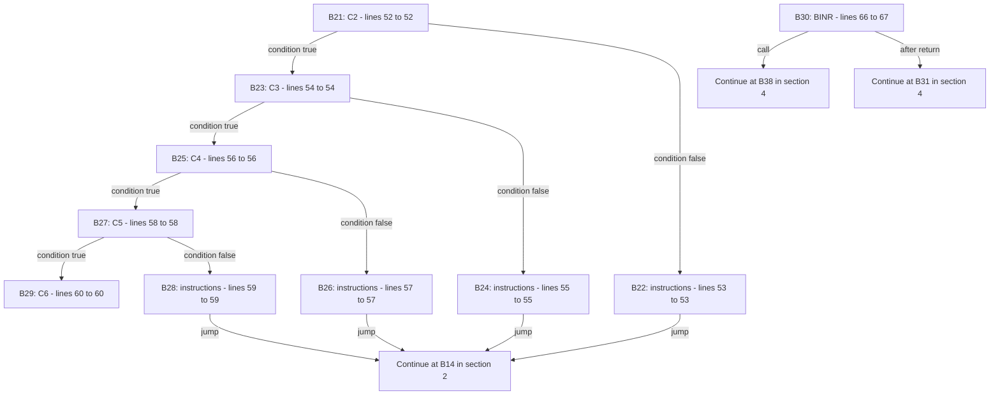
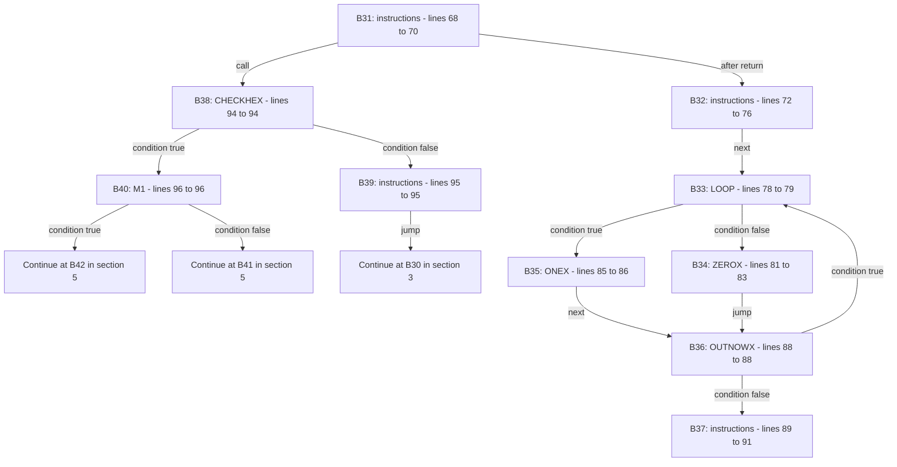
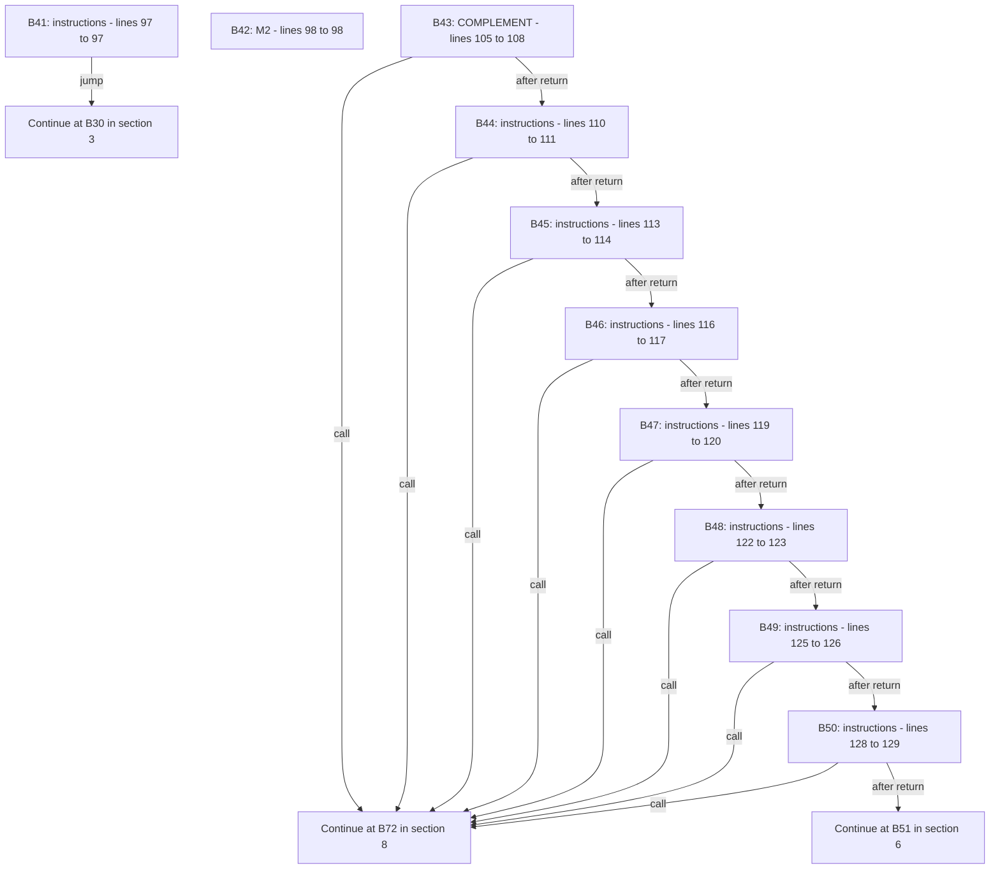
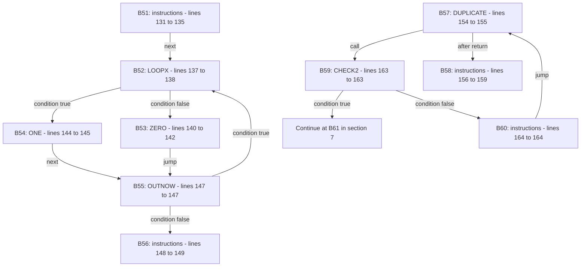
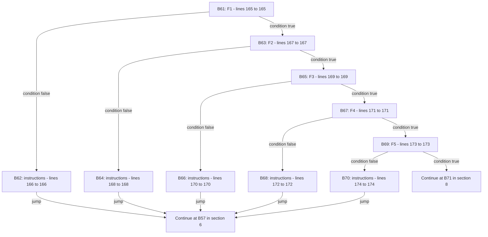
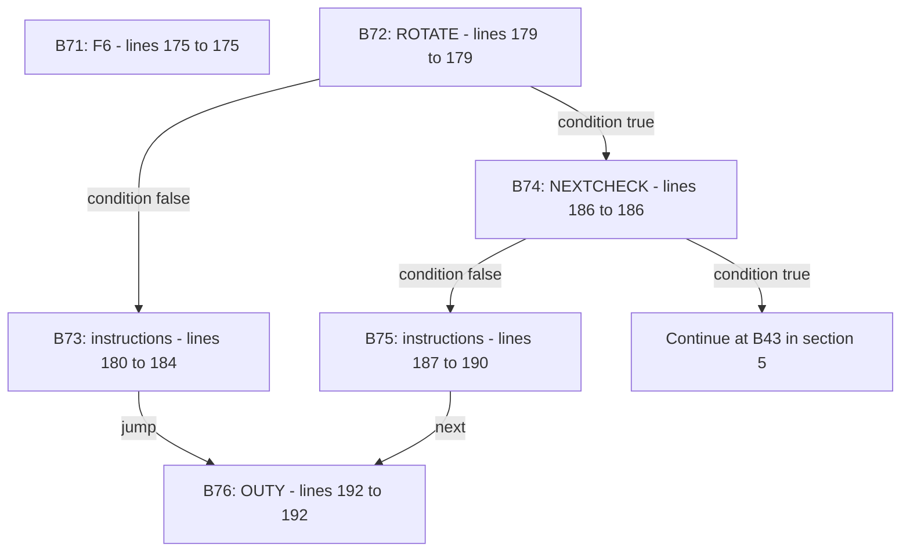

# Program Control Flow

[Back to project](README.md)

Control-flow blocks are indexed by source line. Calls resume at the instruction following the call if the subroutine returns normally.

## Entry locations

- `ORG 0H` begins at B1.

## Navigation

[Section 1](#section-1) · [Section 2](#section-2) · [Section 3](#section-3) · [Section 4](#section-4) · [Section 5](#section-5) · [Section 6](#section-6) · [Section 7](#section-7) · [Section 8](#section-8)

## Destinations requiring review

`OUT`. A repeated label is also unresolved because it has more than one candidate target.

## Lines outside the instruction parser

These may be assembler directives, macros, or malformed source; inspect them before building.

```asm
30: ///////////OP1
62: ///////////////END OF OP1
64: ///////////////OP2
100: ///////////////
103: ////////////////////////OP3
150: ///////////////////////
152: /////////////////////OP4
176: /////////////////////////
```

## Section 1



### B1

```asm
MOV A,#0CH
CJNE A,#0AH,BIN
```

### B2

```asm
ACALL ADDOP
```

### B3

```asm
AJMP EXIT
```

### B4

```asm
CJNE A,#0BH,COMP
```

### B5

```asm
ACALL BINR
```

### B6

```asm
AJMP EXIT
```

### B7

```asm
CJNE A,#0CH,DUP
```

### B8

```asm
ACALL COMPLEMENT
```

### B9

```asm
AJMP EXIT
```

### B10

```asm
CJNE A,#0DH,EXIT
```

## Section 2



### B11

```asm
ACALL DUPLICATE
```

### B12

```asm
AJMP EXIT
```

### B13

```asm
AJMP OUT
```

### B14

```asm
MOV A,#5
ACALL CHECK
```

### B15

```asm
MOV R1,A
MOV A,#6
ACALL CHECK
```

### B16

Return to the instruction following the active call.

```asm
ADD A,R1
MOV B,#10
DIV AB
MOV P1,A
MOV P2,B
RET
```

### B17

```asm
CJNE A,#'#',C1
```

### B18

```asm
AJMP ADDOP
```

### B19

```asm
CJNE A,#'*',C2
```

### B20

```asm
AJMP ADDOP
```

## Section 3



### B21

```asm
CJNE A,#0AH,C3
```

### B22

```asm
AJMP ADDOP
```

### B23

```asm
CJNE A,#0BH,C4
```

### B24

```asm
AJMP ADDOP
```

### B25

```asm
CJNE A,#0CH,C5
```

### B26

```asm
AJMP ADDOP
```

### B27

```asm
CJNE A,#0DH,C6
```

### B28

```asm
AJMP ADDOP
```

### B29

Return to the instruction following the active call.

```asm
RET
```

### B30

```asm
MOV A,#5
ACALL CHECKHEX
```

## Section 4



### B31

```asm
MOV R1,A
MOV A,#0AH
ACALL CHECKHEX
```

### B32

```asm
SWAP A
ADD A,R1
MOV R7,#8
MOV R0,#30H
```

### B33

```asm
RLC A
JC ONEX
```

### B34

```asm
MOV @R0,#0
INC R0
SJMP OUTNOWX
```

### B35

```asm
MOV @R0,#1
INC R0
```

### B36

```asm
DJNZ R7,LOOP
```

### B37

Return to the instruction following the active call.

```asm
INC R0
MOV @R0,#'B'
RET
```

### B38

```asm
CJNE A,#'#',M1
```

### B39

```asm
AJMP BINR
```

### B40

```asm
CJNE A,#'*',M2
```

## Section 5



### B41

```asm
AJMP BINR
```

### B42

Return to the instruction following the active call.

```asm
RET
```

### B43

```asm
MOV R1,#0
MOV A,#1
ACALL ROTATE
```

### B44

```asm
MOV A,#1
ACALL ROTATE
```

### B45

```asm
MOV A,#1
ACALL ROTATE
```

### B46

```asm
MOV A,#1
ACALL ROTATE
```

### B47

```asm
MOV A,#0
ACALL ROTATE
```

### B48

```asm
MOV A,#0
ACALL ROTATE
```

### B49

```asm
MOV A,#0
ACALL ROTATE
```

### B50

```asm
MOV A,#0
ACALL ROTATE
```

## Section 6



### B51

```asm
MOV A,R1
CPL A
MOV R7,#8
MOV R0,#30H
```

### B52

```asm
RLC A
JC ONE
```

### B53

```asm
MOV @R0,#0
INC R0
SJMP OUTNOW
```

### B54

```asm
MOV @R0,#1
INC R0
```

### B55

```asm
DJNZ R7,LOOPX
```

### B56

Return to the instruction following the active call.

```asm
MOV @R0,#'B'
RET
```

### B57

```asm
MOV A,#5
ACALL CHECK2
```

### B58

Return to the instruction following the active call.

```asm
MOV B,A
ADD A,B
MOV P3,A
RET
```

### B59

```asm
CJNE A,#'#',F1
```

### B60

```asm
AJMP DUPLICATE
```

## Section 7



### B61

```asm
CJNE A,#'*',F2
```

### B62

```asm
AJMP DUPLICATE
```

### B63

```asm
CJNE A,#'A',F3
```

### B64

```asm
AJMP DUPLICATE
```

### B65

```asm
CJNE A,#'B',F4
```

### B66

```asm
AJMP DUPLICATE
```

### B67

```asm
CJNE A,#'C',F5
```

### B68

```asm
AJMP DUPLICATE
```

### B69

```asm
CJNE A,#'D',F6
```

### B70

```asm
AJMP DUPLICATE
```

## Section 8



### B71

Return to the instruction following the active call.

```asm
RET
```

### B72

```asm
CJNE A,#0,NEXTCHECK
```

### B73

```asm
CLR C
MOV A,R1
RLC A
MOV R1,A
SJMP OUTY
```

### B74

```asm
CJNE A,#1,COMPLEMENT
```

### B75

```asm
SETB C
MOV A,R1
RLC A
MOV R1,A
```

### B76

Return to the instruction following the active call.

```asm
RET
```
