# Program Control Flow

[Back to project](README.md)

Control-flow blocks are indexed by source line. Calls resume at the instruction following the call if the subroutine returns normally.

## Entry locations

- `ORG 0H` begins at B1.

## Navigation

[Section 1](#section-1) · [Section 2](#section-2) · [Section 3](#section-3) · [Section 4](#section-4) · [Section 5](#section-5) · [Section 6](#section-6) · [Section 7](#section-7) · [Section 8](#section-8) · [Section 9](#section-9) · [Section 10](#section-10) · [Section 11](#section-11) · [Section 12](#section-12) · [Section 13](#section-13) · [Section 14](#section-14) · [Section 15](#section-15)

## Section 1

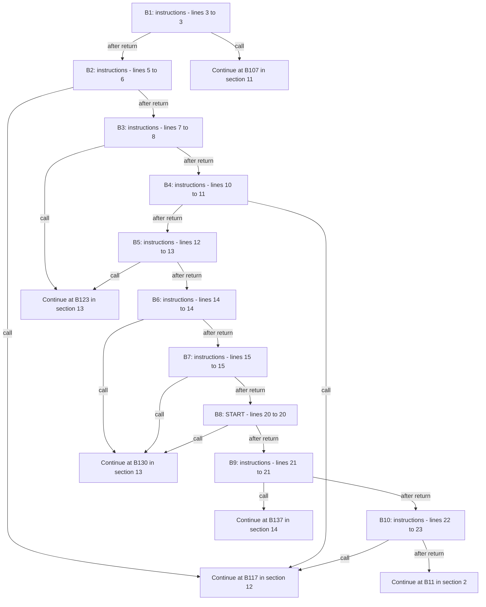

### B1

```asm
ACALL INLCD
```

### B2

```asm
MOV A,#80H
ACALL CMD
```

### B3

```asm
MOV DPTR,#NAME
ACALL WSTR
```

### B4

```asm
MOV A,#0C0H
ACALL CMD
```

### B5

```asm
MOV DPTR,#ID
ACALL WSTR
```

### B6

```asm
ACALL DELAY
```

### B7

```asm
ACALL DELAY
```

### B8

```asm
ACALL DELAY
```

### B9

```asm
ACALL CLEAR
```

### B10

```asm
MOV A,#80H
ACALL CMD
```

## Section 2

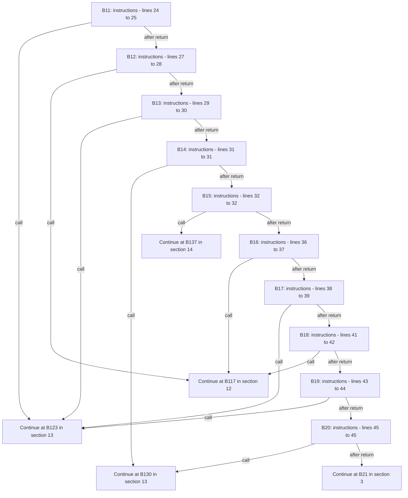

### B11

```asm
MOV DPTR,#MENU1
ACALL WSTR
```

### B12

```asm
MOV A,#0C0H
ACALL CMD
```

### B13

```asm
MOV DPTR,#MENU2
ACALL WSTR
```

### B14

```asm
ACALL DELAY
```

### B15

```asm
ACALL CLEAR
```

### B16

```asm
MOV A,#80H
ACALL CMD
```

### B17

```asm
MOV DPTR,#CHOICE1
ACALL WSTR
```

### B18

```asm
MOV A,#0C0H
ACALL CMD
```

### B19

```asm
MOV DPTR,#CH1
ACALL WSTR
```

### B20

```asm
ACALL DELAY
```

## Section 3

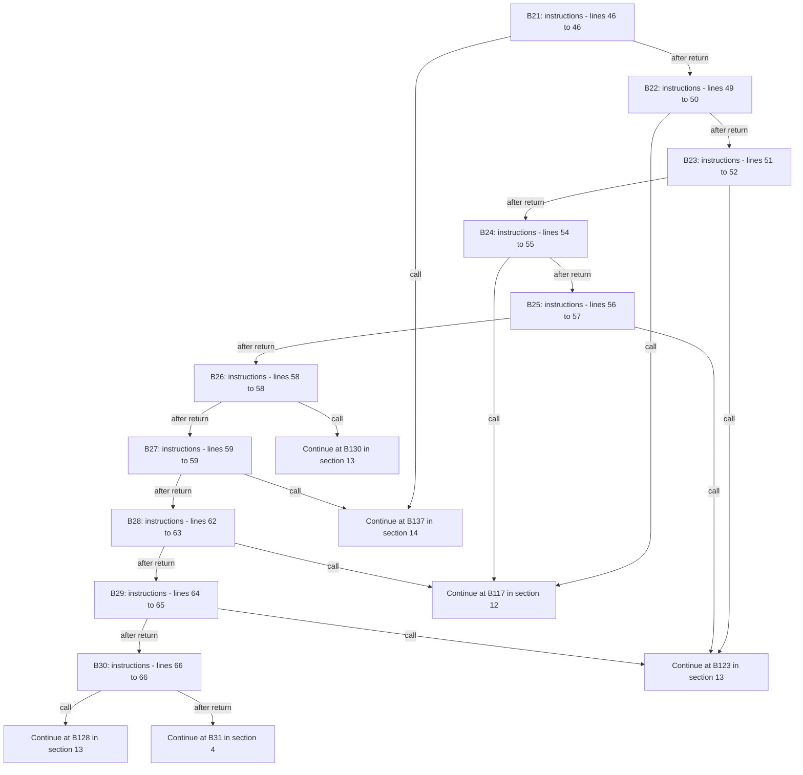

### B21

```asm
ACALL CLEAR
```

### B22

```asm
MOV A,#80H
ACALL CMD
```

### B23

```asm
MOV DPTR,#CHOICE2
ACALL WSTR
```

### B24

```asm
MOV A,#0C0H
ACALL CMD
```

### B25

```asm
MOV DPTR,#CH2
ACALL WSTR
```

### B26

```asm
ACALL DELAY
```

### B27

```asm
ACALL CLEAR
```

### B28

```asm
MOV A,#80H
ACALL CMD
```

### B29

```asm
MOV DPTR,#CHOICE3
ACALL WSTR
```

### B30

```asm
ACALL LDELAY
```

## Section 4

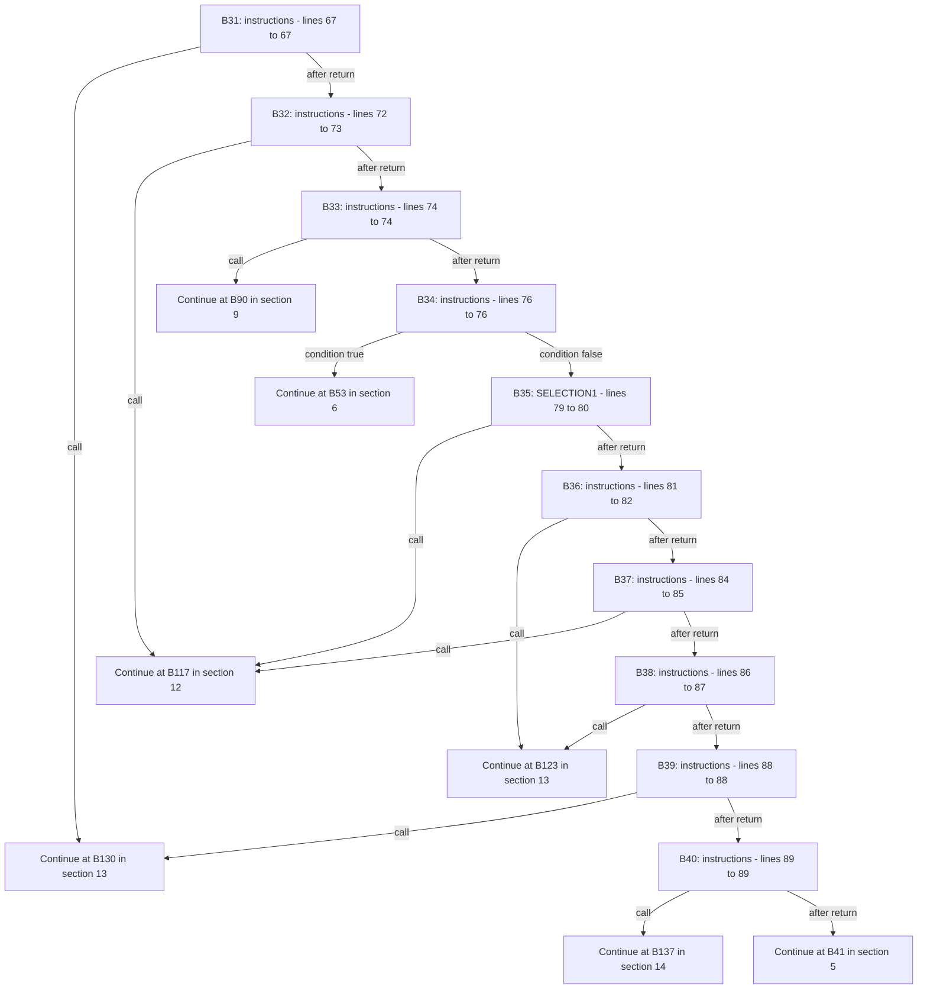

### B31

```asm
ACALL DELAY
```

### B32

```asm
MOV A,#0C0H
ACALL CMD
```

### B33

```asm
ACALL KEYPAD
```

### B34

```asm
CJNE A,#'1',SELECTION2
```

### B35

```asm
MOV A,#80H
ACALL CMD
```

### B36

```asm
MOV DPTR,#CHO1
ACALL WSTR
```

### B37

```asm
MOV A,#0C0H
ACALL CMD
```

### B38

```asm
MOV DPTR,#CHO11
ACALL WSTR
```

### B39

```asm
ACALL DELAY
```

### B40

```asm
ACALL CLEAR
```

## Section 5

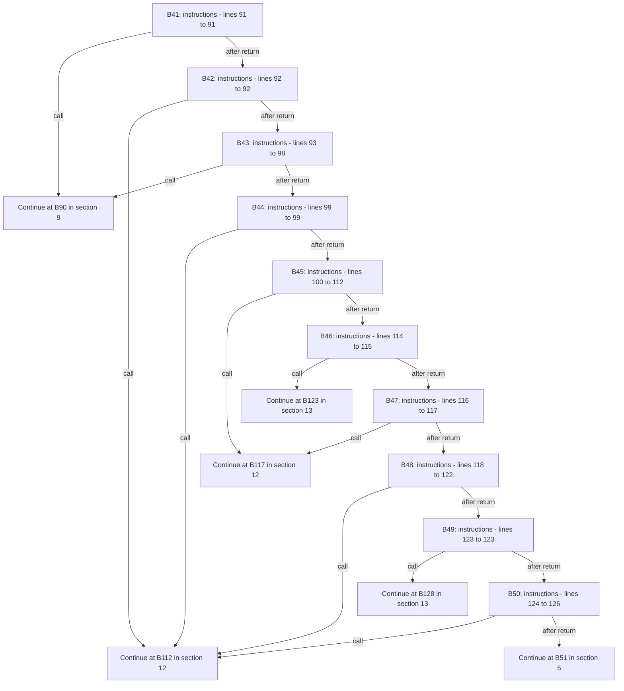

### B41

```asm
ACALL KEYPAD
```

### B42

```asm
ACALL WCHR
```

### B43

```asm
SUBB A,#30H
MOV B,#10
MUL AB
MOV R1,A
ACALL KEYPAD
```

### B44

```asm
ACALL WCHR
```

### B45

```asm
SUBB A,#30H
ADD A,R1
MOV R1,A
INC A
MOV R2,A
ADD A,R1
MOV B,#2
DIV AB
MOV R2,A
MOV A,#80H
ACALL CMD
```

### B46

```asm
MOV DPTR,#AVERGAE
ACALL WSTR
```

### B47

```asm
MOV A,#0C0H
ACALL CMD
```

### B48

```asm
MOV A,R2
mov b,#10
div ab
add a,#30h
ACALL WCHR
```

### B49

```asm
acall LDELAY
```

### B50

```asm
mov a,b
add a,#30h
ACALL WCHR
```

## Section 6

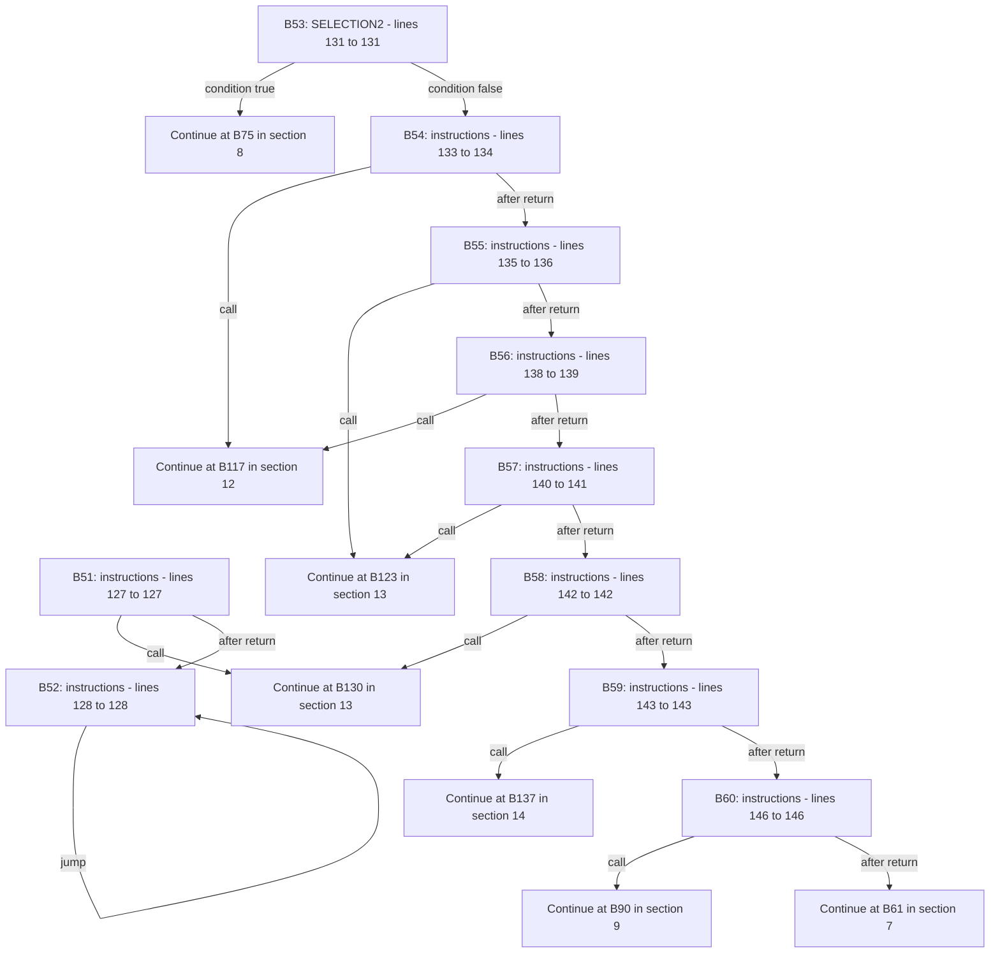

### B51

```asm
ACALL DELAY
```

### B52

```asm
SJMP $
```

### B53

```asm
CJNE A,#'2',SELECTION3
```

### B54

```asm
MOV A,#80H
ACALL CMD
```

### B55

```asm
MOV DPTR,#CHO1
ACALL WSTR
```

### B56

```asm
MOV A,#0C0H
ACALL CMD
```

### B57

```asm
MOV DPTR,#CHO12
ACALL WSTR
```

### B58

```asm
ACALL DELAY
```

### B59

```asm
ACALL CLEAR
```

### B60

```asm
ACALL KEYPAD
```

## Section 7

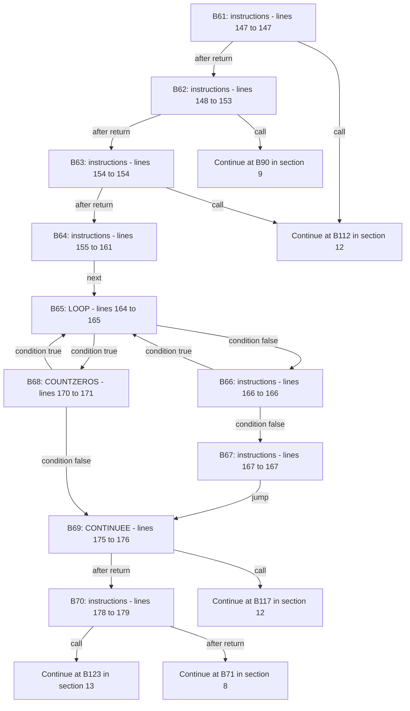

### B61

```asm
ACALL WCHR
```

### B62

```asm
SUBB A,#30H
MOV B,#10H
MUL AB
MOV R3,A
ACALL KEYPAD
```

### B63

```asm
ACALL WCHR
```

### B64

```asm
SUBB A,#30H
ADD A,R3
MOV R3,A
MOV R4,#8
MOV R7,#0
```

### B65

```asm
RRC A
JNC COUNTZEROS
```

### B66

```asm
DJNZ R4,LOOP
```

### B67

```asm
SJMP CONTINUEE
```

### B68

```asm
INC R7
DJNZ R4,LOOP
```

### B69

```asm
MOV A,#80H
ACALL CMD
```

### B70

```asm
MOV DPTR,#HEXA
ACALL WSTR
```

## Section 8

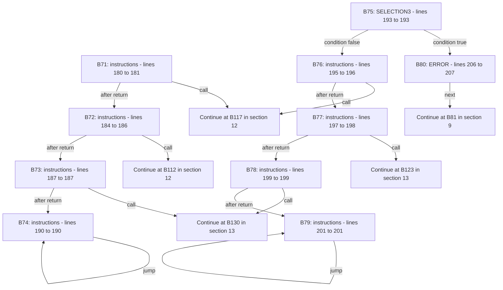

### B71

```asm
MOV A,#0C0H
ACALL CMD
```

### B72

```asm
MOV A,R7
add a,#30h
ACALL WCHR
```

### B73

```asm
acall DELAY
```

### B74

```asm
SJMP $
```

### B75

```asm
CJNE A,#'3',ERROR
```

### B76

```asm
MOV A,#80H
ACALL CMD
```

### B77

```asm
MOV DPTR,#EXIT
ACALL WSTR
```

### B78

```asm
ACALL DELAY
```

### B79

```asm
SJMP $
```

### B80

```asm
CLR P1.0
MOV R7,#3
```

## Section 9

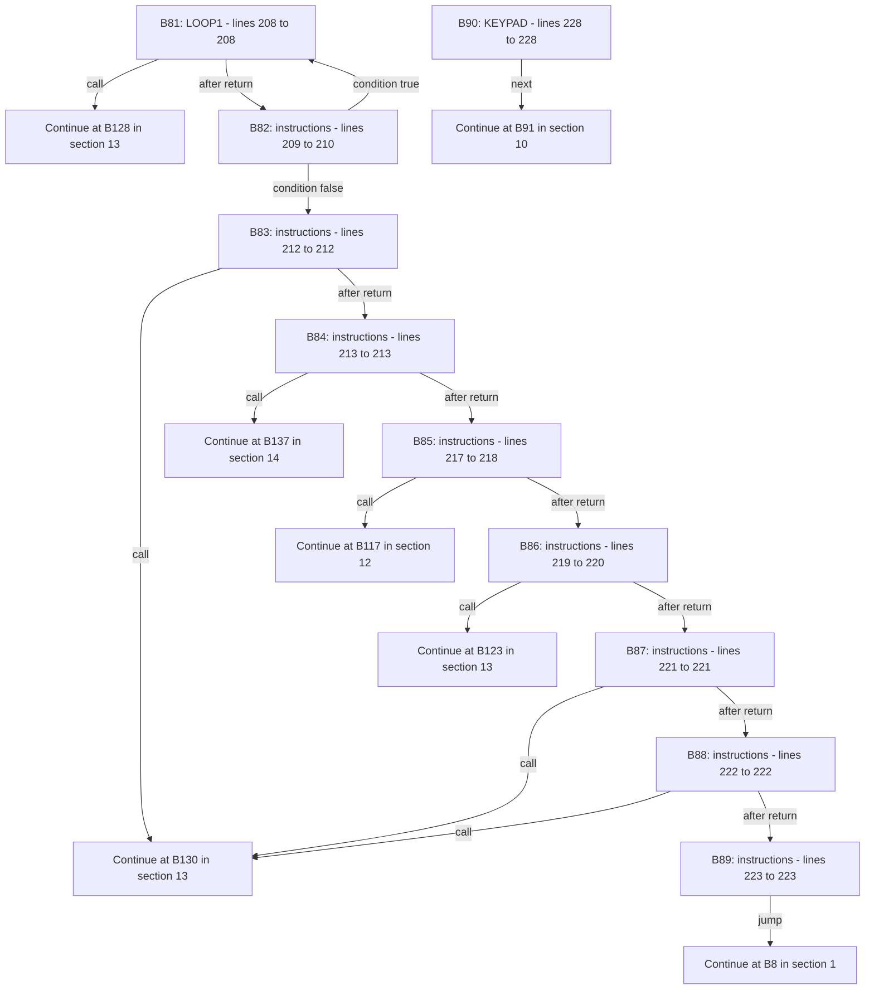

### B81

```asm
ACALL LDELAY
```

### B82

```asm
SETB P1.0
DJNZ R7,LOOP1
```

### B83

```asm
ACALL DELAY
```

### B84

```asm
ACALL CLEAR
```

### B85

```asm
MOV A,#80H
ACALL CMD
```

### B86

```asm
MOV DPTR,#ERRORMESSAGE
ACALL WSTR
```

### B87

```asm
ACALL DELAY
```

### B88

```asm
ACALL DELAY
```

### B89

```asm
AJMP START
```

### B90

```asm
MOV P0,#01110000B
```

## Section 10

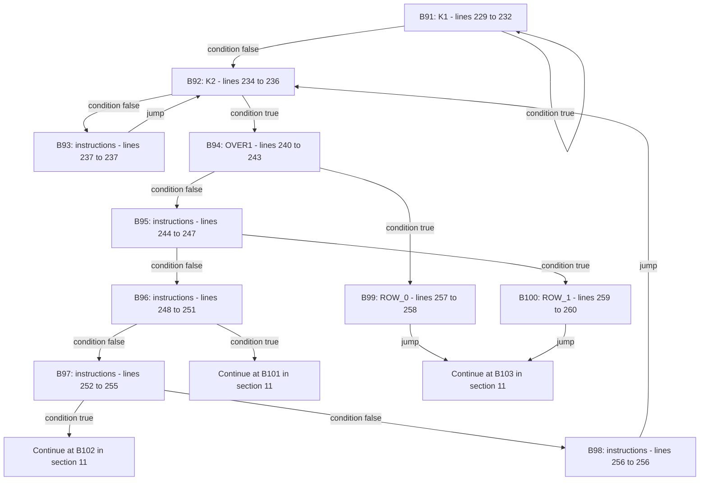

### B91

```asm
MOV P0,#01110000B
MOV A,P0
ANL A,#01110000B
CJNE A,#01110000B,K1
```

### B92

```asm
MOV A,P0
ANL A,#01110000B
CJNE A,#01110000B,OVER1
```

### B93

```asm
SJMP K2
```

### B94

```asm
MOV P0,#01111110B
MOV A,P0
ANL A,#01110000B
CJNE A,#01110000B,ROW_0
```

### B95

```asm
MOV P0,#01111101B
MOV A,P0
ANL A,#01110000B
CJNE A,#01110000B,ROW_1
```

### B96

```asm
MOV P0,#01111011B
MOV A,P0
ANL A,#01110000B
CJNE A,#01110000B,ROW_2
```

### B97

```asm
MOV P0,#01110111B
MOV A,P0
ANL A,#01110000B
CJNE A,#01110000B,ROW_3
```

### B98

```asm
LJMP K2
```

### B99

```asm
MOV DPTR,#KCODE0
SJMP FIND
```

### B100

```asm
MOV DPTR,#KCODE1
SJMP FIND
```

## Section 11

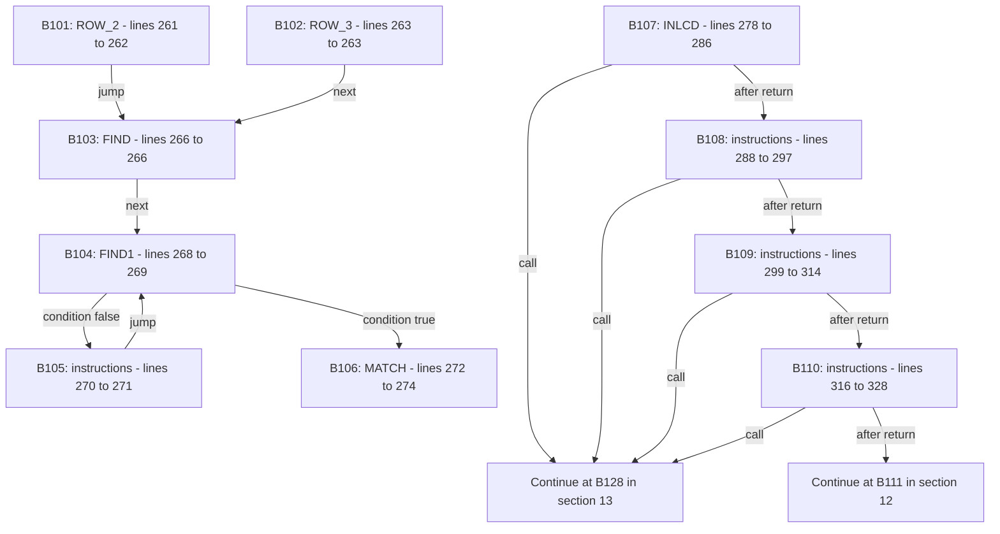

### B101

```asm
MOV DPTR,#KCODE2
SJMP FIND
```

### B102

```asm
MOV DPTR,#KCODE3
```

### B103

```asm
RLC A
```

### B104

```asm
RLC A
JNC MATCH
```

### B105

```asm
INC DPTR
SJMP FIND1
```

### B106

Return to the instruction following the active call.

```asm
CLR A
MOVC A,@A+DPTR
RET
```

### B107

```asm
CLR P1.3
CLR P1.7
CLR P1.6
SETB P1.5
CLR P1.4
SETB P1.2
CLR P1.2
ACALL LDELAY
```

### B108

```asm
SETB P1.2
CLR P1.2
SETB P1.7
CLR P1.6
CLR P1.5
CLR P1.4
SETB P1.2
CLR P1.2
ACALL LDELAY
```

### B109

```asm
CLR P1.7
CLR P1.6
CLR P1.5
CLR P1.4
SETB P1.2
CLR P1.2
SETB P1.7
SETB P1.6
SETB P1.5
SETB P1.4
SETB P1.2
CLR P1.2
ACALL LDELAY
```

### B110

```asm
CLR P1.7
CLR P1.6
CLR P1.5
CLR P1.4
SETB P1.2
CLR P1.2
SETB P1.6
SETB P1.5
SETB P1.2
CLR P1.2
ACALL LDELAY
```

## Section 12

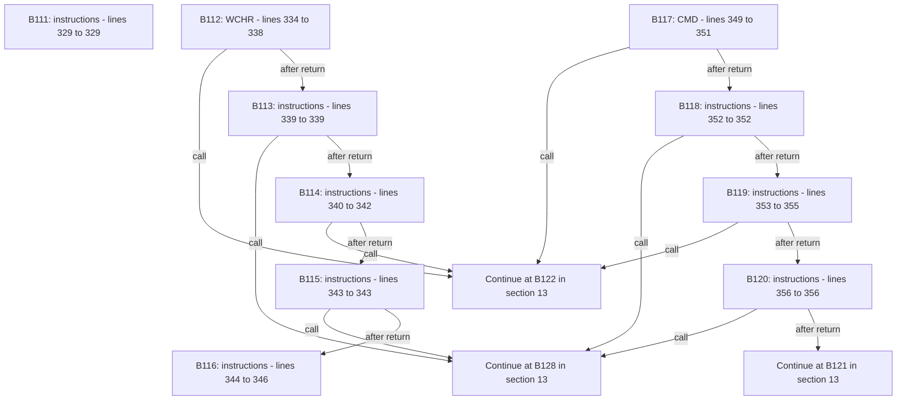

### B111

Return to the instruction following the active call.

```asm
RET
```

### B112

```asm
PUSH ACC
PUSH B
SETB P1.3
MOV B,A
ACALL COMMON
```

### B113

```asm
ACALL LDELAY
```

### B114

```asm
MOV A,B
SWAP A
ACALL COMMON
```

### B115

```asm
ACALL LDELAY
```

### B116

Return to the instruction following the active call.

```asm
POP B
POP ACC
RET
```

### B117

```asm
CLR P1.3
MOV B,A
ACALL COMMON
```

### B118

```asm
ACALL LDELAY
```

### B119

```asm
MOV A,B
SWAP A
ACALL COMMON
```

### B120

```asm
ACALL LDELAY
```

## Section 13

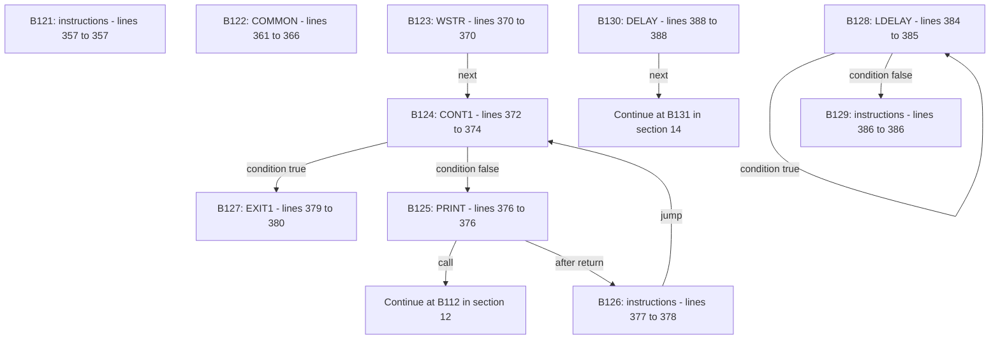

### B121

Return to the instruction following the active call.

```asm
RET
```

### B122

Return to the instruction following the active call.

```asm
ANL a,#11110000B
ANL P1, #00001111B
ORL P1,A
SETB P1.2
CLR P1.2
RET
```

### B123

```asm
PUSH    ACC
```

### B124

```asm
CLR     A
MOVC    A,@A+DPTR
JZ Exit1
```

### B125

```asm
ACALL    WCHR
```

### B126

```asm
INC DPTR
AJMP    CONT1
```

### B127

Return to the instruction following the active call.

```asm
POP     ACC
RET
```

### B128

```asm
MOV R0, #50
DJNZ R0, $
```

### B129

Return to the instruction following the active call.

```asm
RET
```

### B130

```asm
MOV R5,#2
```

## Section 14

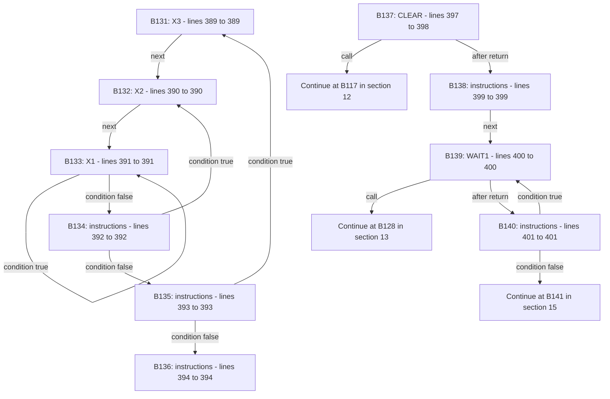

### B131

```asm
MOV R4,#20
```

### B132

```asm
MOV R3,#250
```

### B133

```asm
DJNZ R3,X1
```

### B134

```asm
DJNZ R4,X2
```

### B135

```asm
DJNZ R5,X3
```

### B136

Return to the instruction following the active call.

```asm
RET
```

### B137

```asm
MOV A,#01H
ACALL CMD
```

### B138

```asm
MOV R7,#14
```

### B139

```asm
ACALL LDELAY
```

### B140

```asm
DJNZ R7,WAIT1
```

## Section 15

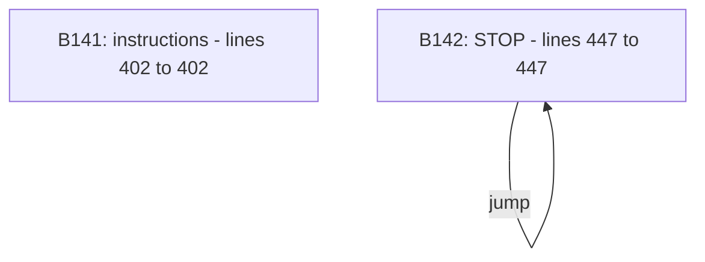

### B141

Return to the instruction following the active call.

```asm
RET
```

### B142

```asm
SJMP $
```
