# Program Control Flow

[Back to project](README.md)

Control-flow blocks are indexed by source line. Calls resume at the instruction following the call if the subroutine returns normally.

## Entry locations

- `ORG 00H` begins at B1.
- `ORG 0003H` begins at B2.

## Navigation

[Section 1](#section-1) · [Section 2](#section-2) · [Section 3](#section-3) · [Section 4](#section-4) · [Section 5](#section-5) · [Section 6](#section-6) · [Section 7](#section-7) · [Section 8](#section-8) · [Section 9](#section-9) · [Section 10](#section-10) · [Section 11](#section-11) · [Section 12](#section-12) · [Section 13](#section-13) · [Section 14](#section-14) · [Section 15](#section-15) · [Section 16](#section-16) · [Section 17](#section-17) · [Section 18](#section-18) · [Section 19](#section-19) · [Section 20](#section-20) · [Section 21](#section-21) · [Section 22](#section-22)

## Section 1

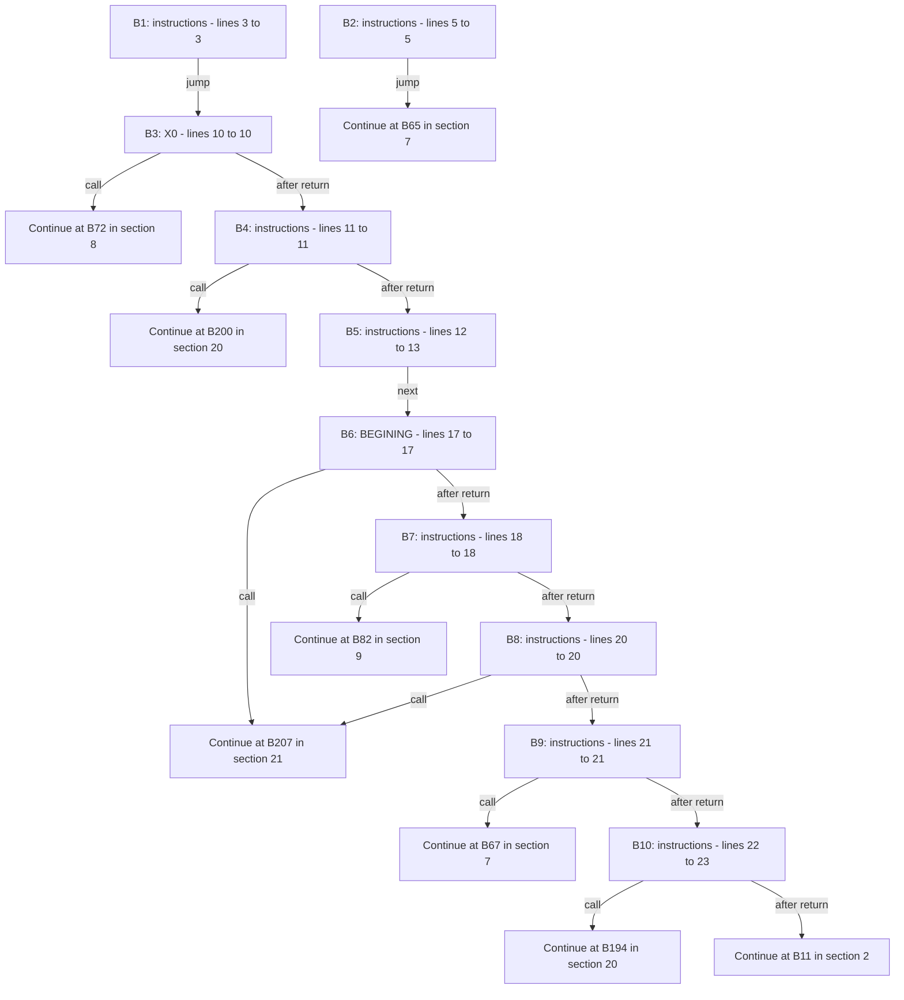

### B1

```asm
AJMP X0
```

### B2

```asm
LJMP EX0ISR
```

### B3

```asm
ACALL FLASH
```

### B4

```asm
ACALL INLCD
```

### B5

```asm
MOV IE,#10000001B
SETB IT0
```

### B6

```asm
acall clear
```

### B7

```asm
acall WRITE1
```

### B8

```asm
ACALL CLEAR
```

### B9

```asm
ACALL DELAY
```

### B10

```asm
mov a, #80H
acall cmd
```

## Section 2

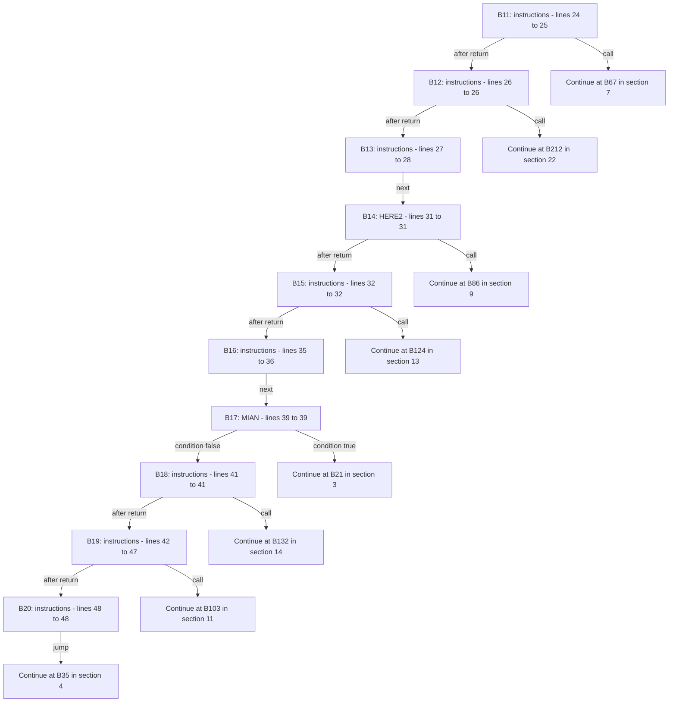

### B11

```asm
mov dptr, #STR15
ACALL DELAY
```

### B12

```asm
ACALL WSTR
```

### B13

```asm
CLR P3.6
SETB P3.6
```

### B14

```asm
acall WRITE2
```

### B15

```asm
ACALL READ1
```

### B16

```asm
MOV 50H,#0FH
MOV 51H,#0
```

### B17

```asm
CJNE R1,#1,ZEROOS
```

### B18

```asm
ACALL READ2
```

### B19

```asm
MOV A,40H
ADD A,41H
MOV B,#2
DIV AB
MOV 42H,A
ACALL WRITE3
```

### B20

```asm
SJMP CHECK
```

## Section 3

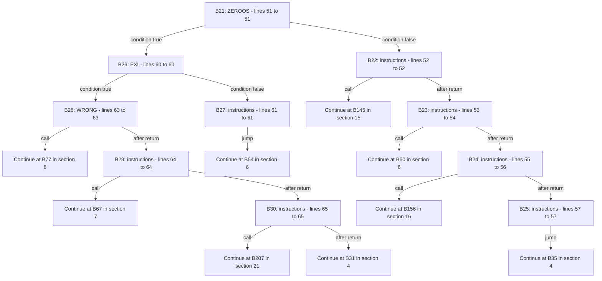

### B21

```asm
CJNE R1,#2, EXI
```

### B22

```asm
ACALL READ3
```

### B23

```asm
MOV A,50H
ACALL COUNT
```

### B24

```asm
MOV 30H,51H
ACALL WRITE4
```

### B25

```asm
SJMP CHECK
```

### B26

```asm
CJNE R1,#3, WRONG
```

### B27

```asm
SJMP EXITT
```

### B28

```asm
ACALL FLASHER
```

### B29

```asm
ACALL DELAY
```

### B30

```asm
ACALL CLEAR
```

## Section 4

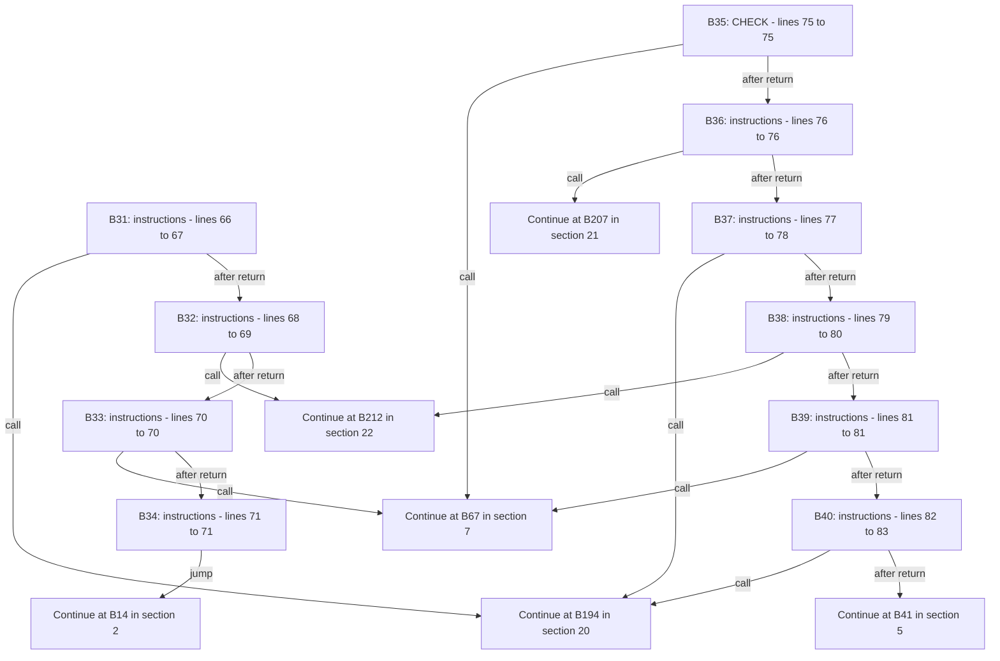

### B31

```asm
mov a, #80H
acall cmd
```

### B32

```asm
mov dptr, #STR11
acall WSTR
```

### B33

```asm
ACALL DELAY
```

### B34

```asm
SJMP HERE2
```

### B35

```asm
ACALL DELAY
```

### B36

```asm
ACALL CLEAR
```

### B37

```asm
mov a, #80H
acall cmd
```

### B38

```asm
mov dptr, #STR13
acall WSTR
```

### B39

```asm
ACALL DELAY
```

### B40

```asm
mov a, #0C0H
acall cmd
```

## Section 5

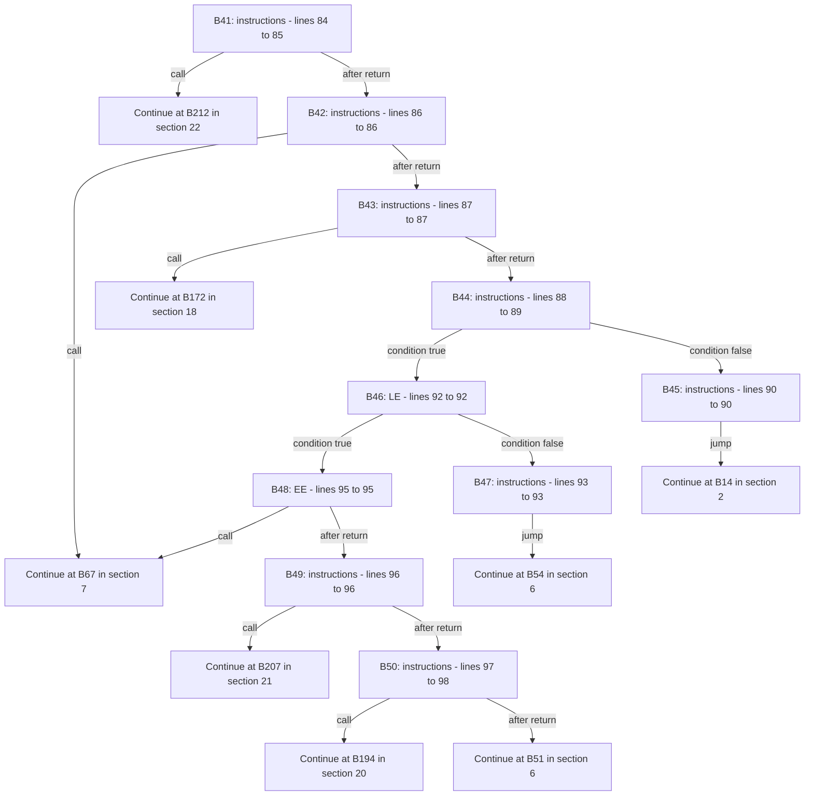

### B41

```asm
mov dptr, #STR14
acall WSTR
```

### B42

```asm
ACALL DELAY
```

### B43

```asm
ACALL KEYPAD
```

### B44

```asm
SUBB A,#30H
CJNE A,#1,LE
```

### B45

```asm
LJMP HERE2
```

### B46

```asm
CJNE A,#2,EE
```

### B47

```asm
SJMP EXITT
```

### B48

```asm
ACALL DELAY
```

### B49

```asm
ACALL CLEAR
```

### B50

```asm
mov a, #80H
acall cmd
```

## Section 6

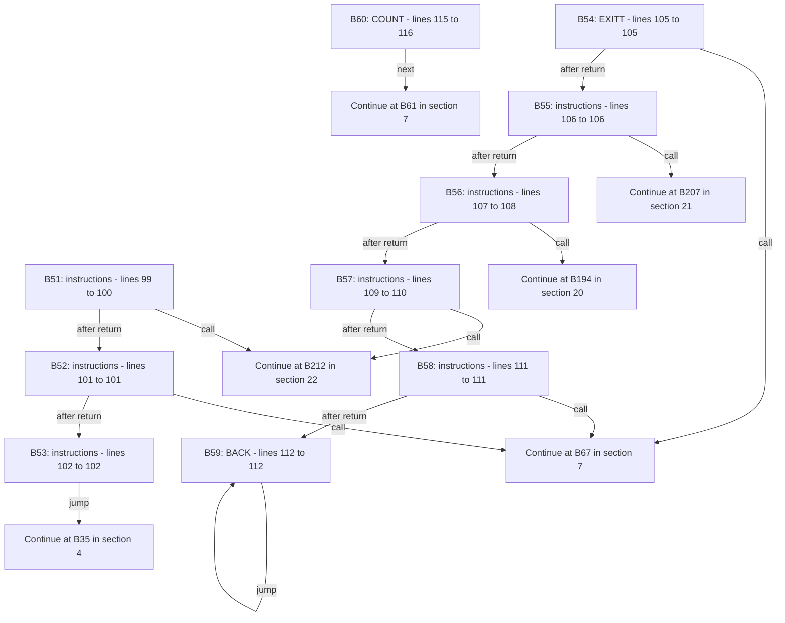

### B51

```asm
mov dptr, #STR11
acall WSTR
```

### B52

```asm
ACALL DELAY
```

### B53

```asm
SJMP CHECK
```

### B54

```asm
ACALL DELAY
```

### B55

```asm
ACALL CLEAR
```

### B56

```asm
mov a, #80H
acall cmd
```

### B57

```asm
mov dptr, #STR12
acall WSTR
```

### B58

```asm
ACALL DELAY
```

### B59

```asm
SJMP BACK
```

### B60

```asm
MOV A,50H
MOV R4,#8
```

## Section 7

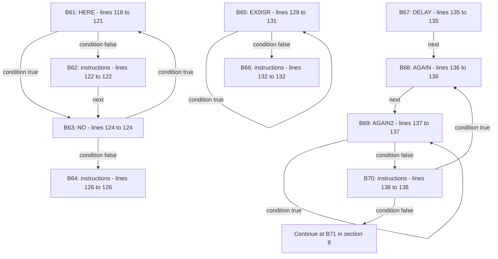

### B61

```asm
MOV B,#2
DIV AB
MOV R0,B
CJNE R0,#0,NO
```

### B62

```asm
INC 51H
```

### B63

```asm
DJNZ R4,HERE
```

### B64

Return to the instruction following the active call.

```asm
RET
```

### B65

```asm
MOV A,P2
ANL A,#01000000B
CJNE A,#0,EX0ISR
```

### B66

Return to the instruction following the active call.

```asm
RET
```

### B67

```asm
MOV R0,#20
```

### B68

```asm
MOV R1,#90
```

### B69

```asm
DJNZ R1,AGAIN2
```

### B70

```asm
DJNZ R0,AGAIN
```

## Section 8

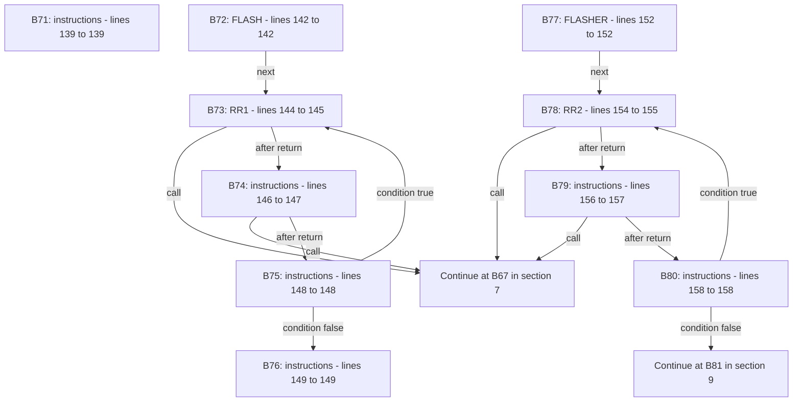

### B71

Return to the instruction following the active call.

```asm
RET
```

### B72

```asm
MOV R2,#4
```

### B73

```asm
SETB P1.2
ACALL DELAY
```

### B74

```asm
CLR P1.2
ACALL DELAY
```

### B75

```asm
DJNZ R2,RR1
```

### B76

Return to the instruction following the active call.

```asm
RET
```

### B77

```asm
MOV R2,#4
```

### B78

```asm
SETB P1.3
ACALL DELAY
```

### B79

```asm
CLR P1.3
ACALL DELAY
```

### B80

```asm
DJNZ R2,RR2
```

## Section 9

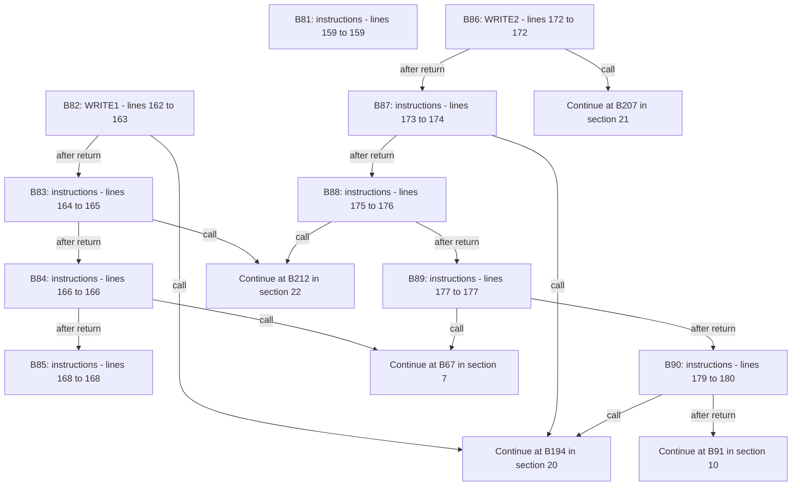

### B81

Return to the instruction following the active call.

```asm
RET
```

### B82

```asm
mov a, #80H
acall cmd
```

### B83

```asm
mov dptr, #STR1
acall WSTR
```

### B84

```asm
ACALL DELAY
```

### B85

Return to the instruction following the active call.

```asm
RET
```

### B86

```asm
ACALL CLEAR
```

### B87

```asm
mov a, #80H
acall cmd
```

### B88

```asm
mov dptr, #STR2
acall WSTR
```

### B89

```asm
ACALL DELAY
```

### B90

```asm
mov a, #0C0H
acall cmd
```

## Section 10

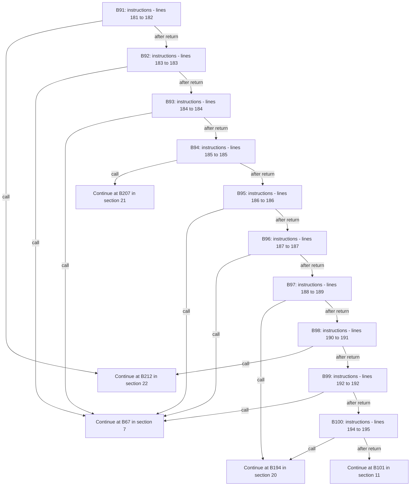

### B91

```asm
mov dptr, #STR3
acall WSTR
```

### B92

```asm
ACALL DELAY
```

### B93

```asm
ACALL DELAY
```

### B94

```asm
ACALL CLEAR
```

### B95

```asm
ACALL DELAY
```

### B96

```asm
ACALL DELAY
```

### B97

```asm
Mov a, #80H
acall cmd
```

### B98

```asm
mov dptr, #STR3
acall WSTR
```

### B99

```asm
ACALL DELAY
```

### B100

```asm
mov a, #0C0H
acall cmd
```

## Section 11

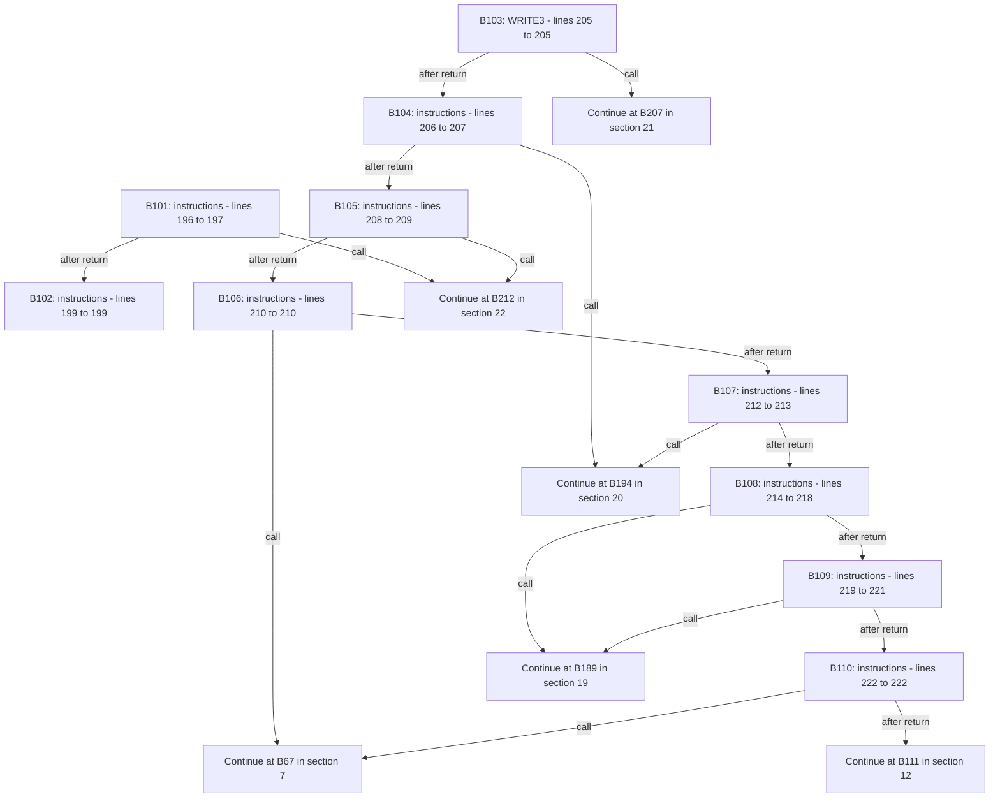

### B101

```asm
mov dptr, #STR33
acall WSTR
```

### B102

Return to the instruction following the active call.

```asm
RET
```

### B103

```asm
ACALL CLEAR
```

### B104

```asm
mov a, #80H
acall cmd
```

### B105

```asm
mov dptr, #STR4
acall WSTR
```

### B106

```asm
ACALL DELAY
```

### B107

```asm
mov a, #0C0H
acall cmd
```

### B108

```asm
mov a,40H
mov b,#10
div ab
add a,#30h
acall wchr
```

### B109

```asm
mov a,b
add a,#30h
acall wchr
```

### B110

```asm
ACALL DELAY
```

## Section 12

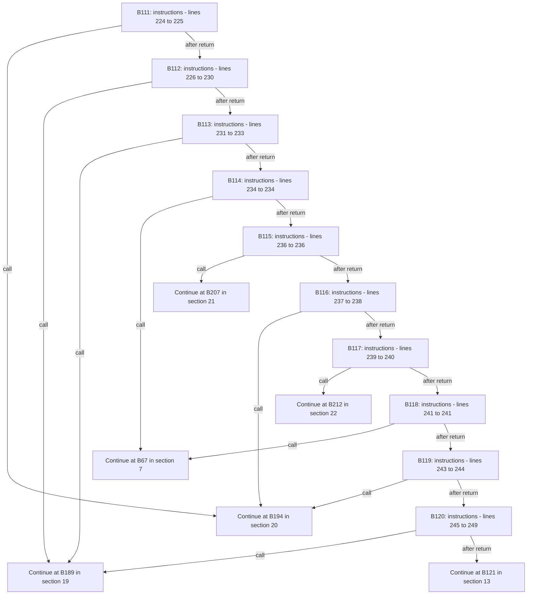

### B111

```asm
mov a, #0C8H
acall cmd
```

### B112

```asm
mov a,41H
mov b,#10
div ab
add a,#30h
acall wchr
```

### B113

```asm
mov a,b
add a,#30h
acall wchr
```

### B114

```asm
ACALL DELAY
```

### B115

```asm
ACALL CLEAR
```

### B116

```asm
mov a, #80H
acall cmd
```

### B117

```asm
mov dptr, #STR6
acall WSTR
```

### B118

```asm
ACALL DELAY
```

### B119

```asm
mov a, #0C0H
acall cmd
```

### B120

```asm
mov a,42H
mov b,#10
div ab
add a,#30h
acall wchr
```

## Section 13

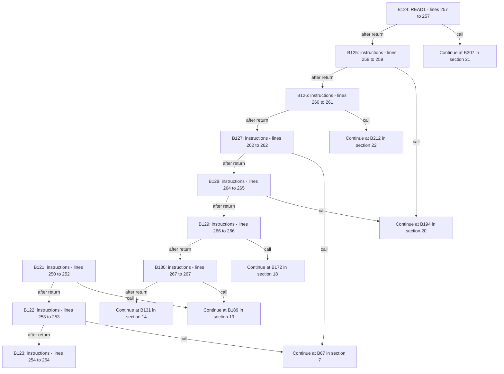

### B121

```asm
mov a,b
add a,#30h
acall wchr
```

### B122

```asm
ACALL DELAY
```

### B123

Return to the instruction following the active call.

```asm
RET
```

### B124

```asm
ACALL CLEAR
```

### B125

```asm
mov a, #80H
acall cmd
```

### B126

```asm
mov dptr, #STR7
acall WSTR
```

### B127

```asm
ACALL DELAY
```

### B128

```asm
MOV A, #0C8H
ACALL CMD
```

### B129

```asm
ACALL KEYPAD
```

### B130

```asm
ACALL WCHR
```

## Section 14

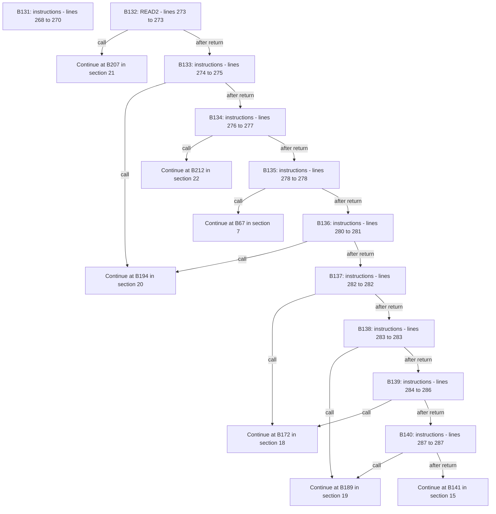

### B131

Return to the instruction following the active call.

```asm
SUBB A, #30H
MOV R1,A
RET
```

### B132

```asm
ACALL CLEAR
```

### B133

```asm
mov a, #80H
acall cmd
```

### B134

```asm
mov dptr, #STR8
acall WSTR
```

### B135

```asm
ACALL DELAY
```

### B136

```asm
MOV A, #0C1H
ACALL CMD
```

### B137

```asm
ACALL KEYPAD
```

### B138

```asm
ACALL WCHR
```

### B139

```asm
SUBB A, #30H
MOV 29H,A
ACALL KEYPAD
```

### B140

```asm
ACALL WCHR
```

## Section 15

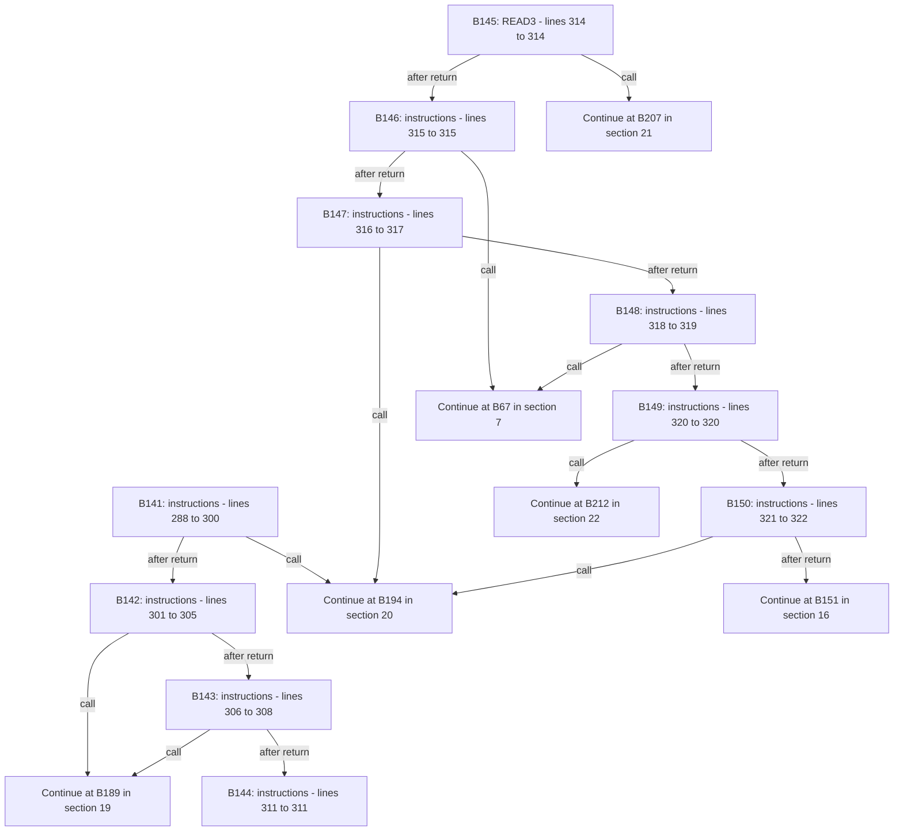

### B141

```asm
SUBB A, #30H
MOV 2AH,A
MOV B,#10
MOV A,29H
MUL AB
ADD A,2AH
MOV 40H,A
DEC A
MOV 41H,A
MOV A, #0C8H
ACALL CMD
```

### B142

```asm
MOV A,41H
MOV B,#10H
DIV AB
ADD A,#30H
ACALL WCHR
```

### B143

```asm
MOV A,B
ADD A,#30H
ACALL WCHR
```

### B144

Return to the instruction following the active call.

```asm
RET
```

### B145

```asm
ACALL CLEAR
```

### B146

```asm
ACALL DELAY
```

### B147

```asm
mov a, #80H
acall cmd
```

### B148

```asm
mov dptr, #STR10
ACALL DELAY
```

### B149

```asm
ACALL WSTR
```

### B150

```asm
MOV A, #0C8H
ACALL CMD
```

## Section 16

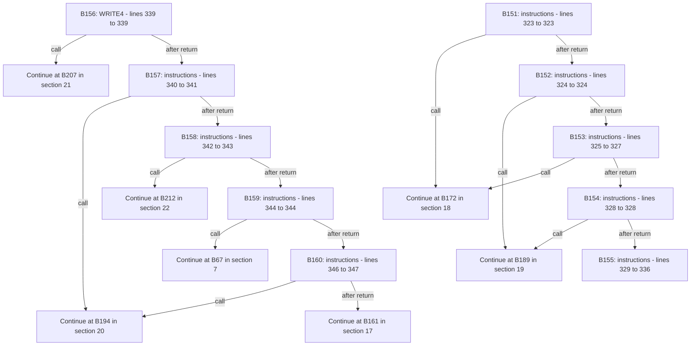

### B151

```asm
ACALL KEYPAD
```

### B152

```asm
ACALL WCHR
```

### B153

```asm
SUBB A, #30H
MOV 29H,A
ACALL KEYPAD
```

### B154

```asm
ACALL WCHR
```

### B155

Return to the instruction following the active call.

```asm
SUBB A, #30H
MOV 2AH,A
MOV B,#16
MOV A,29H
MUL AB
ADD A,2AH
MOV 50H,A
RET
```

### B156

```asm
ACALL CLEAR
```

### B157

```asm
mov a, #80H
acall cmd
```

### B158

```asm
mov dptr, #STR5
acall WSTR
```

### B159

```asm
ACALL DELAY
```

### B160

```asm
mov a, #0C0H
acall cmd
```

## Section 17

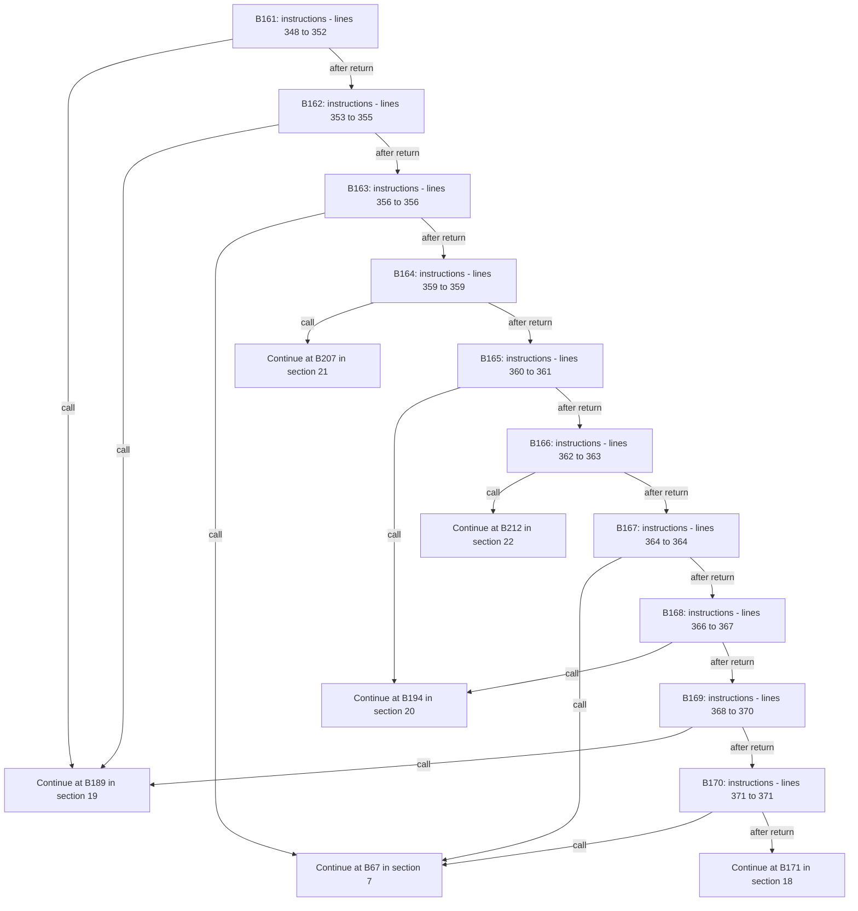

### B161

```asm
mov a,50H
mov b,#16
div ab
add a,#30h
acall wchr
```

### B162

```asm
mov a,b
add a,#30h
acall wchr
```

### B163

```asm
ACALL DELAY
```

### B164

```asm
ACALL CLEAR
```

### B165

```asm
mov a, #80H
acall cmd
```

### B166

```asm
mov dptr, #STR6
acall WSTR
```

### B167

```asm
ACALL DELAY
```

### B168

```asm
mov a, #0C0H
acall cmd
```

### B169

```asm
mov a,51H
add a,#30h
acall wchr
```

### B170

```asm
ACALL DELAY
```

## Section 18

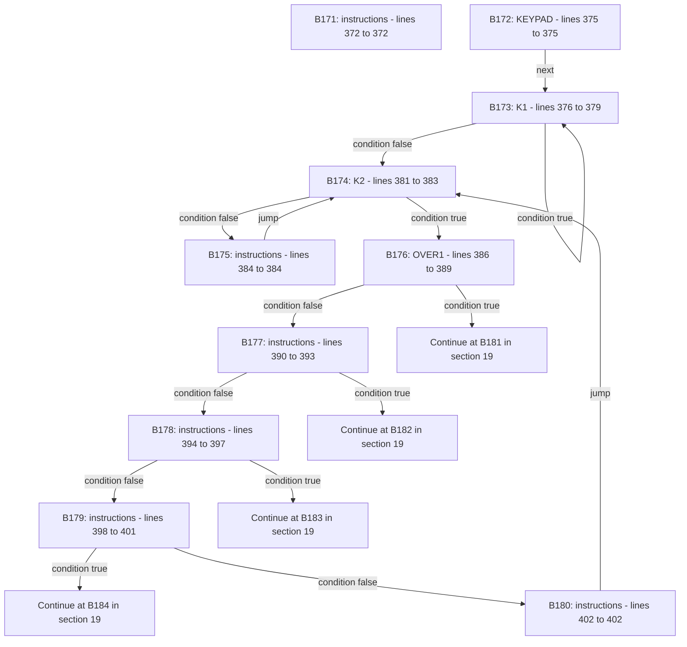

### B171

Return to the instruction following the active call.

```asm
RET
```

### B172

```asm
MOV P0,#01110000B
```

### B173

```asm
MOV P0,#01110000B
MOV A,P0
ANL A,#01110000B
CJNE A,#01110000B,K1
```

### B174

```asm
MOV A,P0
ANL A,#01110000B
CJNE A,#01110000B,OVER1
```

### B175

```asm
SJMP K2
```

### B176

```asm
MOV P0,#01111110B
MOV A,P0
ANL A,#01110000B
CJNE A,#01110000B,ROW_0
```

### B177

```asm
MOV P0,#01111101B
MOV A,P0
ANL A,#01110000B
CJNE A,#01110000B,ROW_1
```

### B178

```asm
MOV P0,#01111011B
MOV A,P0
ANL A,#01110000B
CJNE A,#01110000B,ROW_2
```

### B179

```asm
MOV P0,#01110111B
MOV A,P0
ANL A,#01110000B
CJNE A,#01110000B,ROW_3
```

### B180

```asm
LJMP K2
```

## Section 19

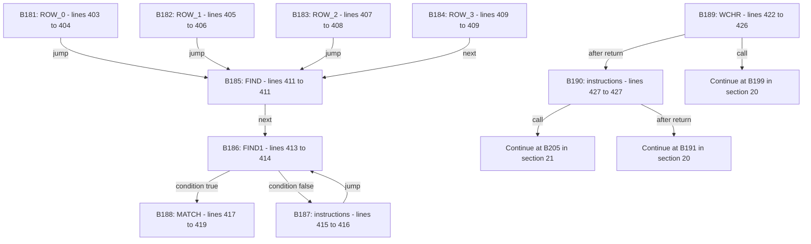

### B181

```asm
MOV DPTR,#KCODE0
SJMP FIND
```

### B182

```asm
MOV DPTR,#KCODE1
SJMP FIND
```

### B183

```asm
MOV DPTR,#KCODE2
SJMP FIND
```

### B184

```asm
MOV DPTR,#KCODE3
```

### B185

```asm
RLC A
```

### B186

```asm
RLC A
JNC MATCH
```

### B187

```asm
INC DPTR
SJMP FIND1
```

### B188

Return to the instruction following the active call.

```asm
CLR A
MOVC A,@A+DPTR
RET
```

### B189

```asm
PUSH ACC
PUSH B
SETB P1.3
MOV B,A
ACALL COMMON
```

### B190

```asm
ACALL LDELAY
```

## Section 20

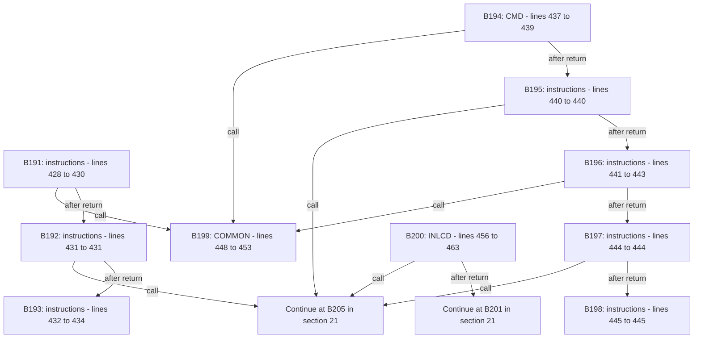

### B191

```asm
MOV A,B
SWAP A
ACALL COMMON
```

### B192

```asm
ACALL LDELAY
```

### B193

Return to the instruction following the active call.

```asm
POP B
POP ACC
RET
```

### B194

```asm
CLR P1.3
MOV B,A
ACALL COMMON
```

### B195

```asm
ACALL LDELAY
```

### B196

```asm
MOV A,B
SWAP A
ACALL COMMON
```

### B197

```asm
ACALL LDELAY
```

### B198

Return to the instruction following the active call.

```asm
RET
```

### B199

Return to the instruction following the active call.

```asm
ANL a,#11110000B
ANL P1, #00001111B
ORL P1,A
SETB P1.2
CLR P1.2
RET
```

### B200

```asm
CLR P1.3
CLR P1.7
CLR P1.6
SETB P1.5
CLR P1.4
SETB P1.2
CLR P1.2
ACALL LDELAY
```

## Section 21

```mermaid
flowchart TD
B200["B201: instructions - lines 464 to 472"]
B201["B202: instructions - lines 473 to 485"]
B202["B203: instructions - lines 486 to 496"]
B203["B204: instructions - lines 497 to 497"]
B204["B205: LDELAY - lines 500 to 501"]
B205["B206: instructions - lines 502 to 502"]
B206["B207: CLEAR - lines 505 to 506"]
B207["B208: instructions - lines 507 to 507"]
B208["B209: WAIT - lines 508 to 508"]
B209["B210: instructions - lines 509 to 509"]
B200 -->|call| B204
B200 -->|after return| B201
B201 -->|call| B204
B201 -->|after return| B202
B202 -->|call| B204
B202 -->|after return| B203
B204 -->|condition true| B204
B204 -->|condition false| B205
B206 -->|call| B193
B206 -->|after return| B207
B207 -->|next| B208
B208 -->|call| B204
B208 -->|after return| B209
B209 -->|condition true| B208
B209 -->|condition false| B210
B193["Continue at B194 in section 20"]
B210["Continue at B211 in section 22"]
```

### B201

```asm
SETB P1.2
CLR P1.2
SETB P1.7
CLR P1.6
CLR P1.5
CLR P1.4
SETB P1.2
CLR P1.2
ACALL LDELAY
```

### B202

```asm
CLR P1.7
CLR P1.6
CLR P1.5
CLR P1.4
SETB P1.2
CLR P1.2
SETB P1.7
SETB P1.6
SETB P1.5
SETB P1.4
SETB P1.2
CLR P1.2
ACALL LDELAY
```

### B203

```asm
CLR P1.7
CLR P1.6
CLR P1.5
CLR P1.4
SETB P1.2
CLR P1.2
SETB P1.6
SETB P1.5
SETB P1.2
CLR P1.2
ACALL LDELAY
```

### B204

Return to the instruction following the active call.

```asm
RET
```

### B205

```asm
MOV R0, #50
DJNZ R0, $
```

### B206

Return to the instruction following the active call.

```asm
RET
```

### B207

```asm
MOV A,#01H
ACALL CMD
```

### B208

```asm
MOV R7,#14
```

### B209

```asm
ACALL LDELAY
```

### B210

```asm
DJNZ R7,WAIT
```

## Section 22

```mermaid
flowchart TD
B210["B211: instructions - lines 510 to 510"]
B211["B212: WSTR - lines 513 to 513"]
B212["B213: CONT1 - lines 515 to 517"]
B213["B214: PRINT - lines 519 to 519"]
B214["B215: instructions - lines 520 to 521"]
B215["B216: EXIT1 - lines 522 to 523"]
B211 -->|next| B212
B212 -->|condition true| B215
B212 -->|condition false| B213
B213 -->|call| B188
B213 -->|after return| B214
B214 -->|jump| B212
B188["Continue at B189 in section 19"]
```

### B211

Return to the instruction following the active call.

```asm
ret
```

### B212

```asm
PUSH    ACC
```

### B213

```asm
CLR     A
MOVC    A,@A+DPTR
JZ Exit1
```

### B214

```asm
ACALL    WCHR
```

### B215

```asm
INC DPTR
AJMP    CONT1
```

### B216

Return to the instruction following the active call.

```asm
POP     ACC
RET
```
