# Program Control Flow

[Back to project](README.md)

Control-flow blocks are indexed by source line. Calls resume at the instruction following the call if the subroutine returns normally.

## Entry locations

- `ORG 0H` begins at B1.
- `ORG 0003H` begins at B2.
- `ORG 0030H` begins at B5.

## Navigation

[Section 1](#section-1) · [Section 2](#section-2) · [Section 3](#section-3) · [Section 4](#section-4) · [Section 5](#section-5) · [Section 6](#section-6) · [Section 7](#section-7) · [Section 8](#section-8) · [Section 9](#section-9) · [Section 10](#section-10) · [Section 11](#section-11) · [Section 12](#section-12) · [Section 13](#section-13) · [Section 14](#section-14) · [Section 15](#section-15) · [Section 16](#section-16) · [Section 17](#section-17) · [Section 18](#section-18) · [Section 19](#section-19) · [Section 20](#section-20) · [Section 21](#section-21) · [Section 22](#section-22) · [Section 23](#section-23) · [Section 24](#section-24) · [Section 25](#section-25)

## Section 1

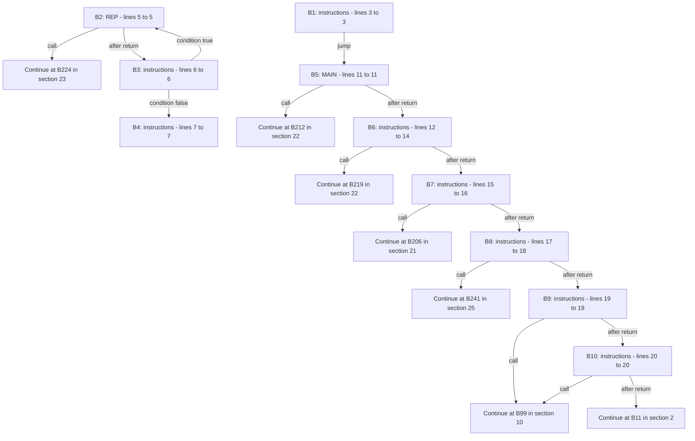

### B1

```asm
SJMP MAIN
```

### B2

```asm
ACALL KEYPAD
```

### B3

```asm
CJNE A,#'0',REP
```

### B4

Resume the interrupted program.

```asm
RETI
```

### B5

```asm
ACALL INLCD
```

### B6

```asm
MOV IE,#81H
SETB IT0
ACALL CLEAR
```

### B7

```asm
MOV A, #80H
ACALL CMD
```

### B8

```asm
MOV DPTR, #STR
ACALL WSTR
```

### B9

```asm
ACALL DELAY
```

### B10

```asm
ACALL DELAY
```

## Section 2

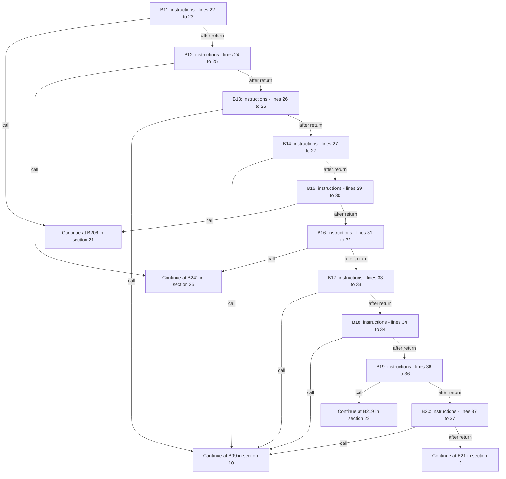

### B11

```asm
MOV A, #80H
ACALL CMD
```

### B12

```asm
MOV DPTR, #NAME
ACALL WSTR
```

### B13

```asm
ACALL DELAY
```

### B14

```asm
ACALL DELAY
```

### B15

```asm
MOV A,#0C0H
ACALL CMD
```

### B16

```asm
MOV DPTR, #ID
ACALL WSTR
```

### B17

```asm
ACALL DELAY
```

### B18

```asm
ACALL DELAY
```

### B19

```asm
ACALL CLEAR
```

### B20

```asm
ACALL DELAY
```

## Section 3

```mermaid
flowchart TD
B20["B21: instructions - lines 38 to 39"]
B21["B22: instructions - lines 40 to 41"]
B22["B23: instructions - lines 42 to 42"]
B23["B24: instructions - lines 44 to 45"]
B24["B25: MENU - lines 49 to 49"]
B25["B26: instructions - lines 50 to 50"]
B26["B27: instructions - lines 51 to 52"]
B27["B28: instructions - lines 53 to 54"]
B28["B29: instructions - lines 55 to 55"]
B29["B30: instructions - lines 56 to 56"]
B20 -->|call| B205
B20 -->|after return| B21
B21 -->|call| B240
B21 -->|after return| B22
B22 -->|call| B98
B22 -->|after return| B23
B23 -->|next| B24
B24 -->|call| B218
B24 -->|after return| B25
B25 -->|call| B98
B25 -->|after return| B26
B26 -->|call| B205
B26 -->|after return| B27
B27 -->|call| B240
B27 -->|after return| B28
B28 -->|call| B98
B28 -->|after return| B29
B29 -->|call| B98
B29 -->|after return| B30
B205["Continue at B206 in section 21"]
B240["Continue at B241 in section 25"]
B98["Continue at B99 in section 10"]
B218["Continue at B219 in section 22"]
B30["Continue at B31 in section 4"]
```

### B21

```asm
MOV A, #80H
ACALL CMD
```

### B22

```asm
MOV DPTR, #PUSHH
ACALL WSTR
```

### B23

```asm
ACALL DELAY
```

### B24

```asm
CLR P3.6
SETB P3.6
```

### B25

```asm
ACALL CLEAR
```

### B26

```asm
ACALL DELAY
```

### B27

```asm
MOV A, #80H
ACALL CMD
```

### B28

```asm
MOV DPTR, #CHOSE
ACALL WSTR
```

### B29

```asm
ACALL DELAY
```

### B30

```asm
ACALL DELAY
```

## Section 4

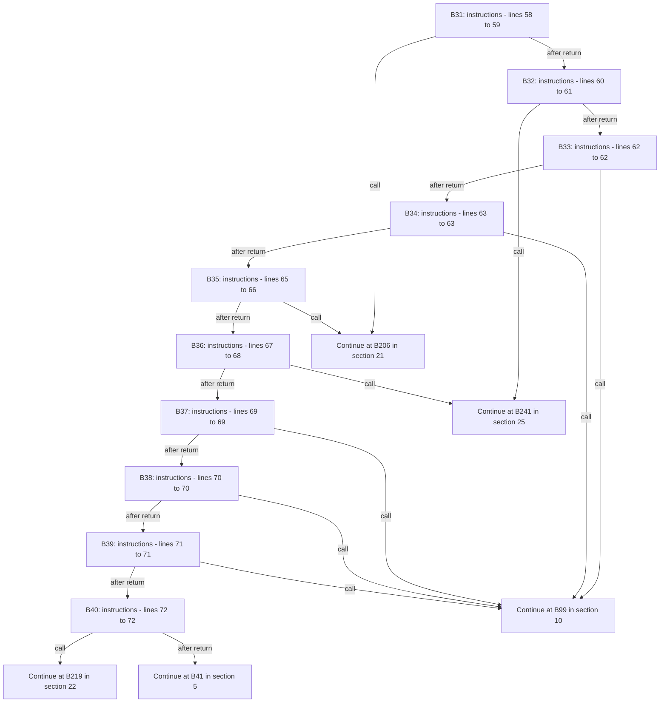

### B31

```asm
MOV A, #80H
ACALL CMD
```

### B32

```asm
MOV DPTR, #MODE1
ACALL WSTR
```

### B33

```asm
ACALL DELAY
```

### B34

```asm
ACALL DELAY
```

### B35

```asm
MOV A,#0C0H
ACALL CMD
```

### B36

```asm
MOV DPTR, #MODE2
ACALL WSTR
```

### B37

```asm
ACALL DELAY
```

### B38

```asm
ACALL DELAY
```

### B39

```asm
ACALL DELAY
```

### B40

```asm
ACALL CLEAR
```

## Section 5

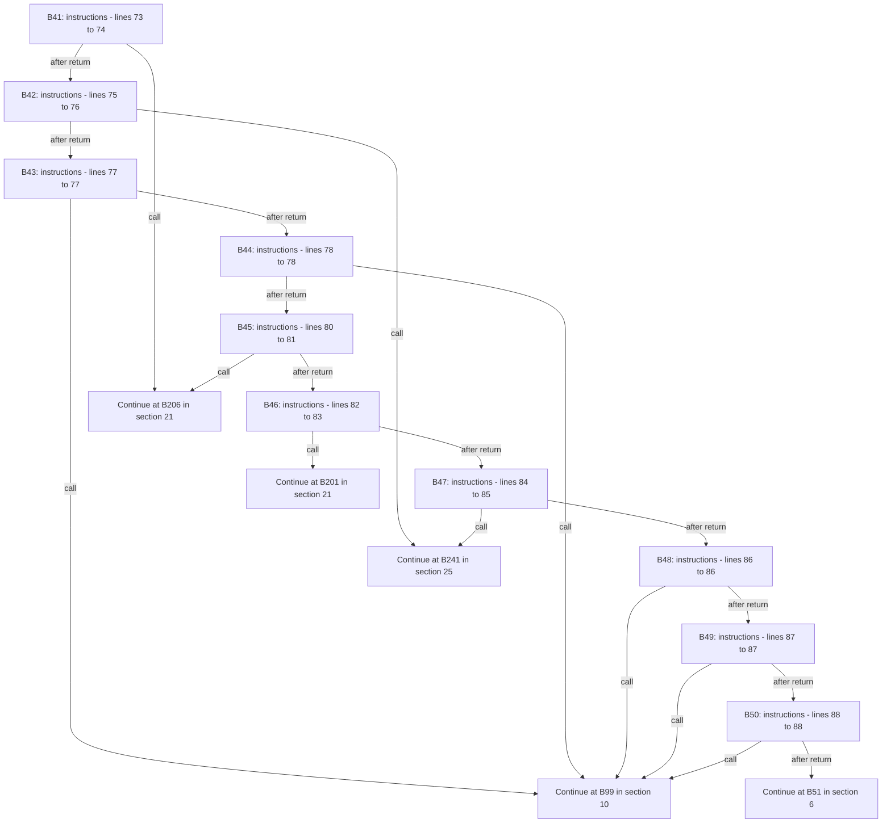

### B41

```asm
MOV A, #80H
ACALL CMD
```

### B42

```asm
MOV DPTR, #MODE2
ACALL WSTR
```

### B43

```asm
ACALL DELAY
```

### B44

```asm
ACALL DELAY
```

### B45

```asm
MOV A,#0C0H
ACALL CMD
```

### B46

```asm
MOV A,#'3'
ACALL WCHR
```

### B47

```asm
MOV DPTR, #EXIT
ACALL WSTR
```

### B48

```asm
ACALL DELAY
```

### B49

```asm
ACALL DELAY
```

### B50

```asm
ACALL DELAY
```

## Section 6

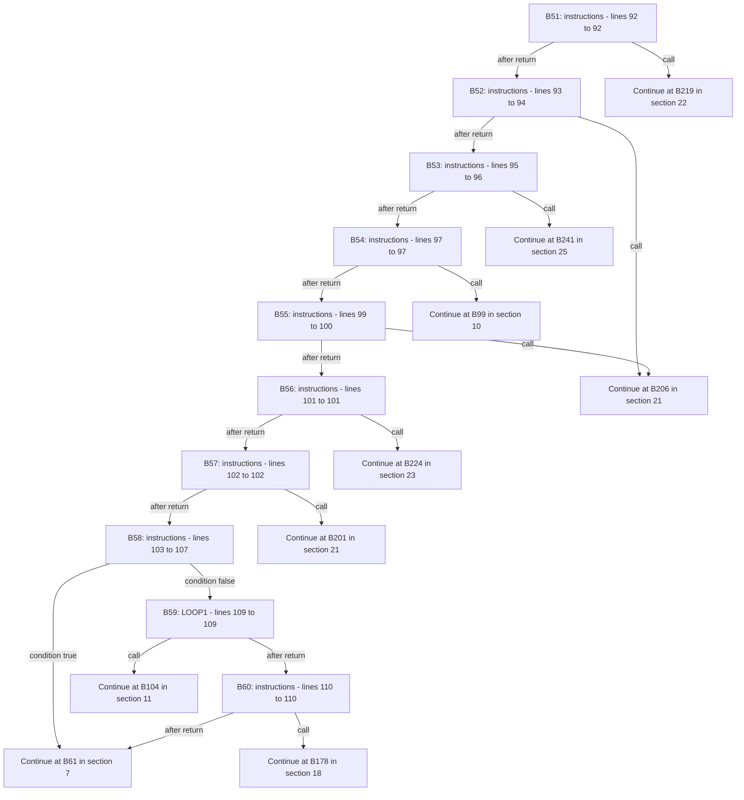

### B51

```asm
ACALL CLEAR
```

### B52

```asm
MOV A, #80H
ACALL CMD
```

### B53

```asm
MOV DPTR, #ENTER
ACALL WSTR
```

### B54

```asm
ACALL DELAY
```

### B55

```asm
MOV A, #0C0H
ACALL CMD
```

### B56

```asm
ACALL KEYPAD
```

### B57

```asm
ACALL WCHR
```

### B58

```asm
SUBB A,#30H
MOV R7,A
CJNE R7,#1, LOOP2
```

### B59

```asm
ACALL LOOOP1
```

### B60

```asm
ACALL TRIAL
```

## Section 7

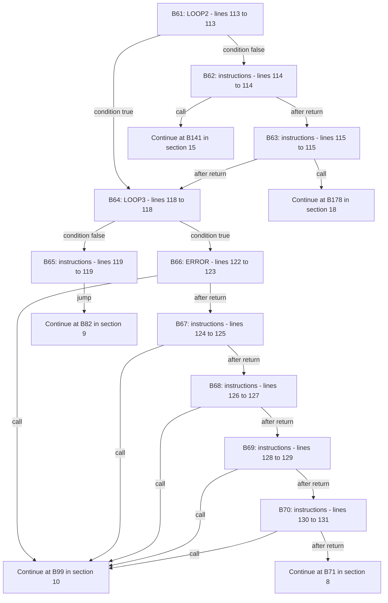

### B61

```asm
CJNE R7,#2,LOOP3
```

### B62

```asm
ACALL LOOOP2
```

### B63

```asm
ACALL TRIAL
```

### B64

```asm
CJNE A,#3,ERROR
```

### B65

```asm
AJMP FINISH
```

### B66

```asm
SETB P1.6
ACALL DELAY
```

### B67

```asm
CLR P1.6
ACALL DELAY
```

### B68

```asm
SETB P1.6
ACALL DELAY
```

### B69

```asm
CLR P1.6
ACALL DELAY
```

### B70

```asm
SETB P1.6
ACALL DELAY
```

## Section 8

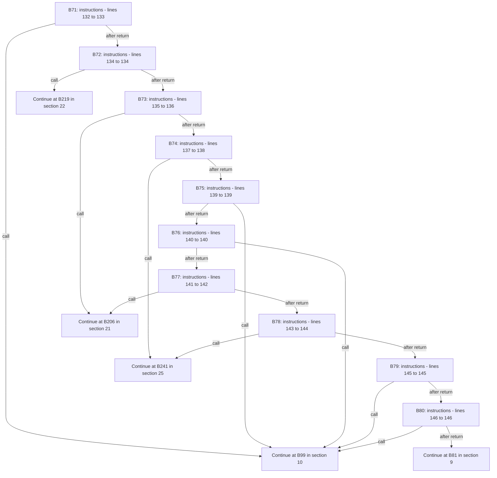

### B71

```asm
CLR P1.6
ACALL DELAY
```

### B72

```asm
ACALL CLEAR
```

### B73

```asm
MOV A, #80H
ACALL CMD
```

### B74

```asm
MOV DPTR, #ERR
ACALL WSTR
```

### B75

```asm
ACALL DELAY
```

### B76

```asm
ACALL DELAY
```

### B77

```asm
MOV A, #0C0H
ACALL CMD
```

### B78

```asm
MOV DPTR, #TRY
ACALL WSTR
```

### B79

```asm
ACALL DELAY
```

### B80

```asm
ACALL DELAY
```

## Section 9

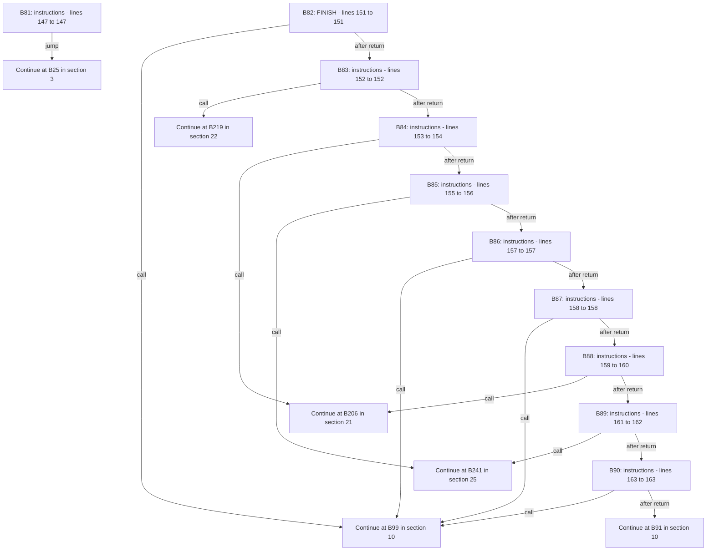

### B81

```asm
AJMP MENU
```

### B82

```asm
ACALL DELAY
```

### B83

```asm
ACALL CLEAR
```

### B84

```asm
MOV A, #80H
ACALL CMD
```

### B85

```asm
MOV DPTR, #THANKU
ACALL WSTR
```

### B86

```asm
ACALL DELAY
```

### B87

```asm
ACALL DELAY
```

### B88

```asm
MOV A, #0C0H
ACALL CMD
```

### B89

```asm
MOV DPTR, #THANKU2
ACALL WSTR
```

### B90

```asm
ACALL DELAY
```

## Section 10

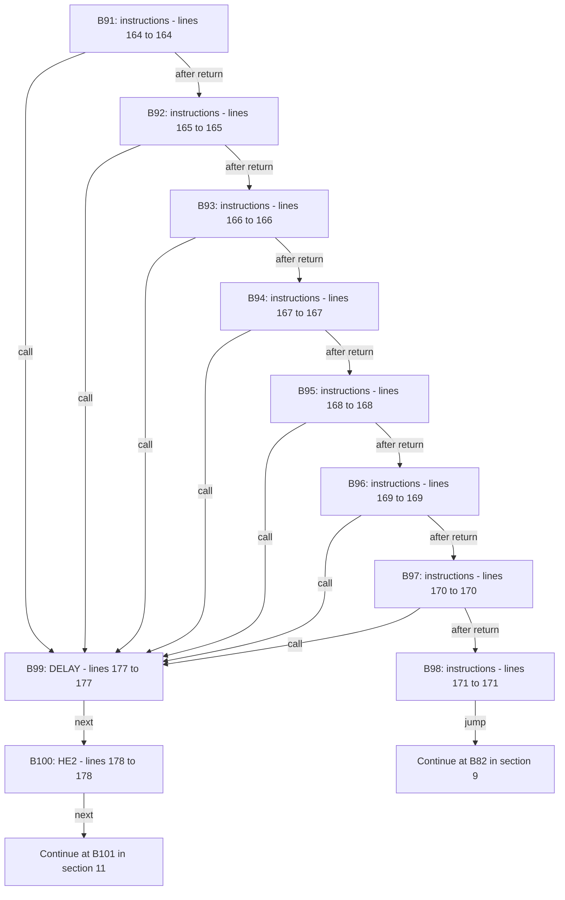

### B91

```asm
ACALL DELAY
```

### B92

```asm
ACALL DELAY
```

### B93

```asm
ACALL DELAY
```

### B94

```asm
ACALL DELAY
```

### B95

```asm
ACALL DELAY
```

### B96

```asm
ACALL DELAY
```

### B97

```asm
ACALL DELAY
```

### B98

```asm
SJMP FINISH
```

### B99

```asm
MOV R1,#100
```

### B100

```asm
MOV R0,#100
```

## Section 11

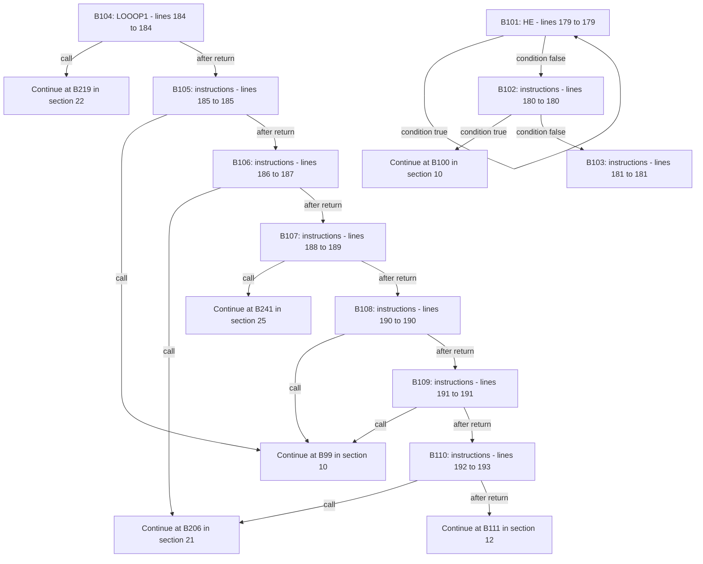

### B101

```asm
DJNZ R0,HE
```

### B102

```asm
DJNZ R1,HE2
```

### B103

Return to the instruction following the active call.

```asm
RET
```

### B104

```asm
ACALL CLEAR
```

### B105

```asm
ACALL DELAY
```

### B106

```asm
MOV A, #80H
ACALL CMD
```

### B107

```asm
MOV DPTR, #YOUCHOSE
ACALL WSTR
```

### B108

```asm
ACALL DELAY
```

### B109

```asm
ACALL DELAY
```

### B110

```asm
MOV A,#0C0H
ACALL CMD
```

## Section 12

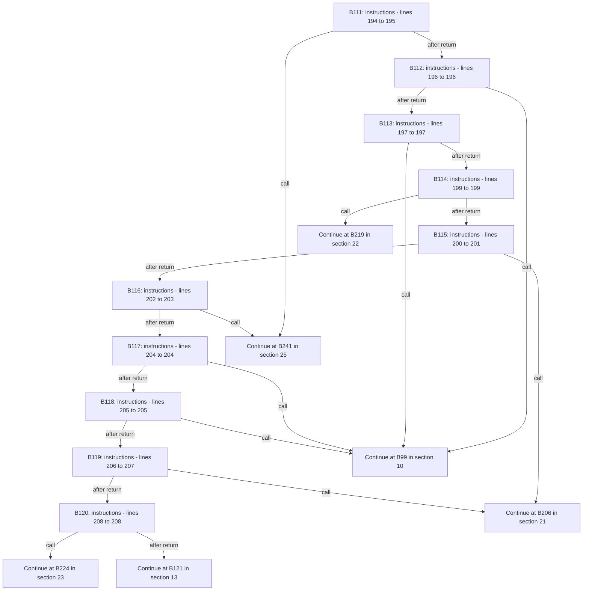

### B111

```asm
MOV DPTR, #AVG
ACALL WSTR
```

### B112

```asm
ACALL DELAY
```

### B113

```asm
ACALL DELAY
```

### B114

```asm
ACALL CLEAR
```

### B115

```asm
MOV A,#80H
ACALL CMD
```

### B116

```asm
MOV DPTR, #ENTER
ACALL WSTR
```

### B117

```asm
ACALL DELAY
```

### B118

```asm
ACALL DELAY
```

### B119

```asm
MOV A,#0C0H
ACALL CMD
```

### B120

```asm
ACALL KEYPAD
```

## Section 13

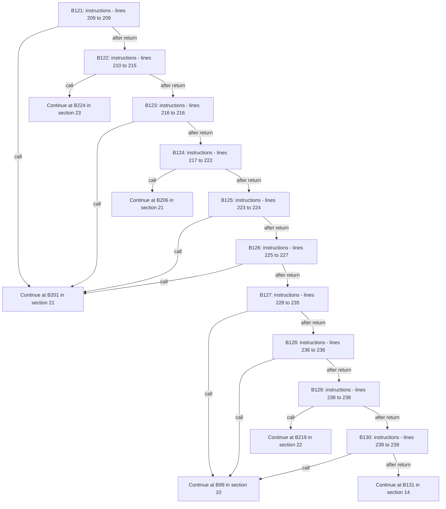

### B121

```asm
ACALL WCHR
```

### B122

```asm
MOV 60H,A
SUBB A,#30H
MOV B,#10
MUL AB
MOV R1,A
ACALL KEYPAD
```

### B123

```asm
ACALL WCHR
```

### B124

```asm
MOV 61H,A
SUBB A,#30H
ADD A,R1
MOV R1,A
MOV A,#0C3H
ACALL CMD
```

### B125

```asm
MOV A,60H
ACALL WCHR
```

### B126

```asm
MOV A,61H
ADD A,#1
ACALL WCHR
```

### B127

```asm
MOV A,R1
ADD A,#1
ADD A,R1
MOV B,#2
DIV AB
MOV 70H,A
ACALL DELAY
```

### B128

```asm
ACALL DELAY
```

### B129

```asm
ACALL CLEAR
```

### B130

```asm
ACALL DELAY
```

## Section 14

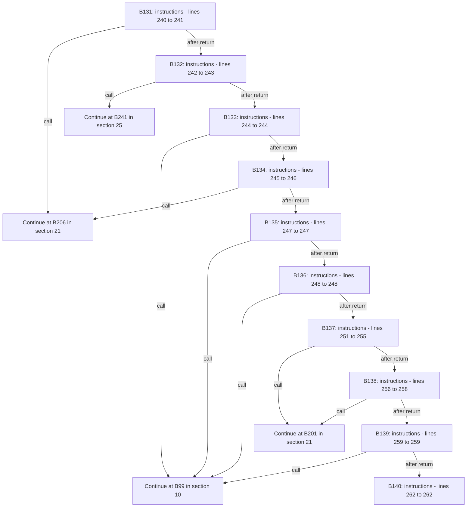

### B131

```asm
MOV A, #80H
ACALL CMD
```

### B132

```asm
MOV DPTR, #AVGMSG
ACALL WSTR
```

### B133

```asm
ACALL DELAY
```

### B134

```asm
MOV A,#0C0H
ACALL CMD
```

### B135

```asm
ACALL DELAY
```

### B136

```asm
ACALL DELAY
```

### B137

```asm
MOV A,70H
MOV B,#10
DIV AB
ADD A,#30H
ACALL WCHR
```

### B138

```asm
MOV A,B
ADD A,#30H
ACALL WCHR
```

### B139

```asm
ACALL DELAY
```

### B140

Return to the instruction following the active call.

```asm
RET
```

## Section 15

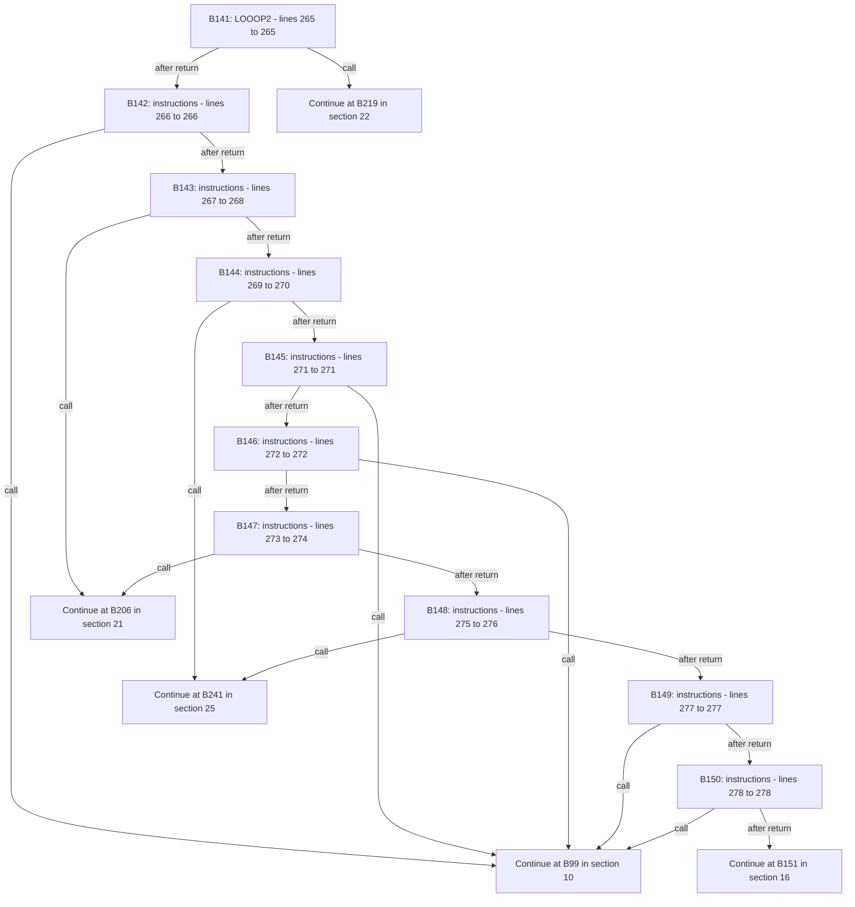

### B141

```asm
ACALL CLEAR
```

### B142

```asm
ACALL DELAY
```

### B143

```asm
MOV A, #80H
ACALL CMD
```

### B144

```asm
MOV DPTR, #YOUCHOSE
ACALL WSTR
```

### B145

```asm
ACALL DELAY
```

### B146

```asm
ACALL DELAY
```

### B147

```asm
MOV A,#0C0H
ACALL CMD
```

### B148

```asm
MOV DPTR, #ZZ
ACALL WSTR
```

### B149

```asm
ACALL DELAY
```

### B150

```asm
ACALL DELAY
```

## Section 16

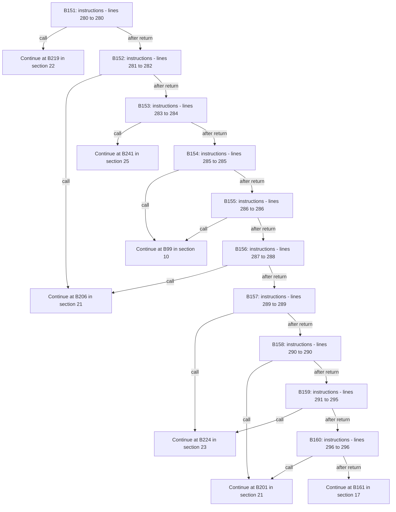

### B151

```asm
ACALL CLEAR
```

### B152

```asm
MOV A,#80H
ACALL CMD
```

### B153

```asm
MOV DPTR, #ENTER
ACALL WSTR
```

### B154

```asm
ACALL DELAY
```

### B155

```asm
ACALL DELAY
```

### B156

```asm
MOV A,#0C0H
ACALL CMD
```

### B157

```asm
ACALL KEYPAD
```

### B158

```asm
ACALL WCHR
```

### B159

```asm
SUBB A,#30H
MOV B,#16
MUL AB
MOV R1,A
ACALL KEYPAD
```

### B160

```asm
ACALL WCHR
```

## Section 17

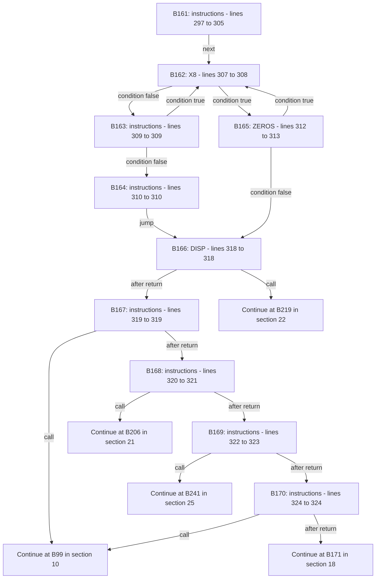

### B161

```asm
SUBB A,#30H
ADD A,R1
MOV R1,A
MOV 72H,A
MOV R4,#8
MOV 20H,#0
CLR A
MOV A,72H
```

### B162

```asm
RLC A
JNC ZEROS
```

### B163

```asm
DJNZ R4,X8
```

### B164

```asm
SJMP DISP
```

### B165

```asm
INC 20H
DJNZ R4,X8
```

### B166

```asm
ACALL CLEAR
```

### B167

```asm
ACALL DELAY
```

### B168

```asm
MOV A, #80H
ACALL CMD
```

### B169

```asm
MOV DPTR, #ZZMSG
ACALL WSTR
```

### B170

```asm
ACALL DELAY
```

## Section 18

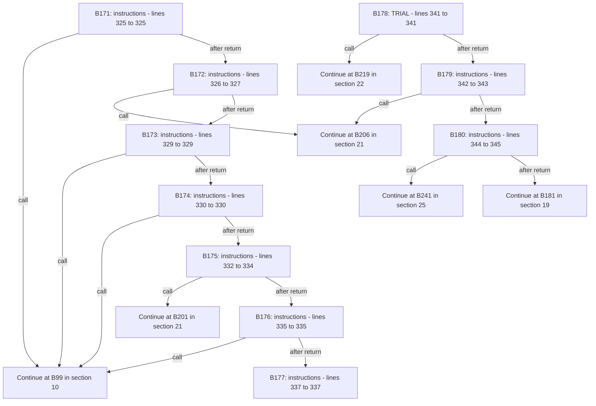

### B171

```asm
ACALL DELAY
```

### B172

```asm
MOV A,#0C0H
ACALL CMD
```

### B173

```asm
ACALL DELAY
```

### B174

```asm
ACALL DELAY
```

### B175

```asm
MOV A,20H
ADD A,#30H
ACALL WCHR
```

### B176

```asm
ACALL DELAY
```

### B177

Return to the instruction following the active call.

```asm
RET
```

### B178

```asm
ACALL CLEAR
```

### B179

```asm
mov a, #80H
acall cmd
```

### B180

```asm
mov dptr, #AG
acall wstr
```

## Section 19

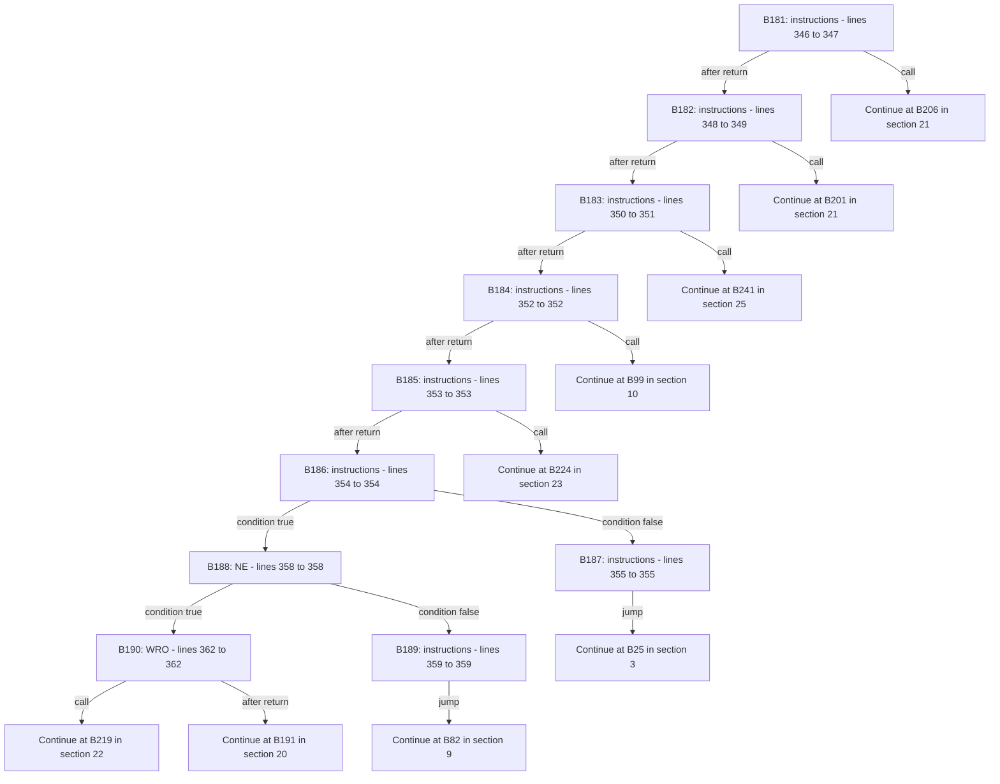

### B181

```asm
mov a,#0c0h
acall cmd
```

### B182

```asm
MOV A,#'2'
ACALL WCHR
```

### B183

```asm
mov dptr, #EXIT
acall wstr
```

### B184

```asm
ACALL DELAY
```

### B185

```asm
ACALL KEYPAD
```

### B186

```asm
CJNE A,#31H,NE
```

### B187

```asm
LJMP MENU
```

### B188

```asm
CJNE A,#'2',WRO
```

### B189

```asm
LJMP FINISH
```

### B190

```asm
ACALL CLEAR
```

## Section 20

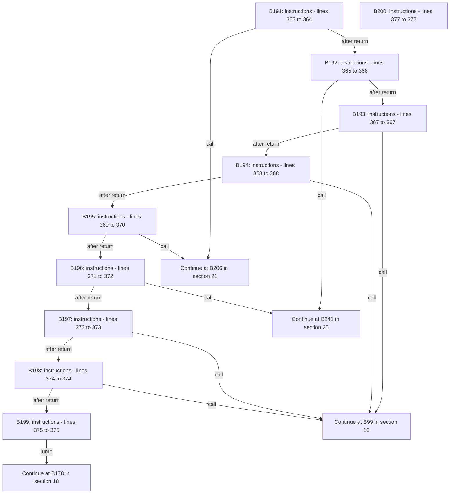

### B191

```asm
MOV A, #80H
ACALL CMD
```

### B192

```asm
MOV DPTR, #ERR
ACALL WSTR
```

### B193

```asm
ACALL DELAY
```

### B194

```asm
ACALL DELAY
```

### B195

```asm
MOV A, #0C0H
ACALL CMD
```

### B196

```asm
MOV DPTR, #TRY
ACALL WSTR
```

### B197

```asm
ACALL DELAY
```

### B198

```asm
ACALL DELAY
```

### B199

```asm
SJMP HERE1
```

### B200

Return to the instruction following the active call.

```asm
RET
```

## Section 21

```mermaid
flowchart TD
B200["B201: WCHR - lines 380 to 384"]
B201["B202: instructions - lines 385 to 385"]
B202["B203: instructions - lines 386 to 388"]
B203["B204: instructions - lines 389 to 389"]
B204["B205: instructions - lines 390 to 392"]
B205["B206: CMD - lines 395 to 397"]
B206["B207: instructions - lines 398 to 398"]
B207["B208: instructions - lines 399 to 401"]
B208["B209: instructions - lines 402 to 402"]
B209["B210: instructions - lines 403 to 403"]
B200 -->|call| B210
B200 -->|after return| B201
B201 -->|call| B216
B201 -->|after return| B202
B202 -->|call| B210
B202 -->|after return| B203
B203 -->|call| B216
B203 -->|after return| B204
B205 -->|call| B210
B205 -->|after return| B206
B206 -->|call| B216
B206 -->|after return| B207
B207 -->|call| B210
B207 -->|after return| B208
B208 -->|call| B216
B208 -->|after return| B209
B210["Continue at B211 in section 22"]
B216["Continue at B217 in section 22"]
```

### B201

```asm
PUSH ACC
PUSH B
SETB P1.3
MOV B,A
ACALL COMMON
```

### B202

```asm
ACALL LDELAY
```

### B203

```asm
MOV A,B
SWAP A
ACALL COMMON
```

### B204

```asm
ACALL LDELAY
```

### B205

Return to the instruction following the active call.

```asm
POP B
POP ACC
RET
```

### B206

```asm
CLR P1.3
MOV B,A
ACALL COMMON
```

### B207

```asm
ACALL LDELAY
```

### B208

```asm
MOV A,B
SWAP A
ACALL COMMON
```

### B209

```asm
ACALL LDELAY
```

### B210

Return to the instruction following the active call.

```asm
RET
```

## Section 22

```mermaid
flowchart TD
B210["B211: COMMON - lines 406 to 411"]
B211["B212: INLCD - lines 414 to 421"]
B212["B213: instructions - lines 422 to 430"]
B213["B214: instructions - lines 431 to 443"]
B214["B215: instructions - lines 444 to 454"]
B215["B216: instructions - lines 455 to 455"]
B216["B217: LDELAY - lines 458 to 459"]
B217["B218: instructions - lines 460 to 460"]
B218["B219: CLEAR - lines 463 to 464"]
B219["B220: instructions - lines 465 to 465"]
B211 -->|call| B216
B211 -->|after return| B212
B212 -->|call| B216
B212 -->|after return| B213
B213 -->|call| B216
B213 -->|after return| B214
B214 -->|call| B216
B214 -->|after return| B215
B216 -->|condition true| B216
B216 -->|condition false| B217
B218 -->|call| B205
B218 -->|after return| B219
B219 -->|next| B220
B205["Continue at B206 in section 21"]
B220["Continue at B221 in section 23"]
```

### B211

Return to the instruction following the active call.

```asm
ANL A,#11110000B
ANL P1, #00001111B
ORL P1,A
SETB P1.2
CLR P1.2
RET
```

### B212

```asm
CLR P1.3
CLR P1.7
CLR P1.6
SETB P1.5
CLR P1.4
SETB P1.2
CLR P1.2
ACALL LDELAY
```

### B213

```asm
SETB P1.2
CLR P1.2
SETB P1.7
CLR P1.6
CLR P1.5
CLR P1.4
SETB P1.2
CLR P1.2
ACALL LDELAY
```

### B214

```asm
CLR P1.7
CLR P1.6
CLR P1.5
CLR P1.4
SETB P1.2
CLR P1.2
SETB P1.7
SETB P1.6
SETB P1.5
SETB P1.4
SETB P1.2
CLR P1.2
ACALL LDELAY
```

### B215

```asm
CLR P1.7
CLR P1.6
CLR P1.5
CLR P1.4
SETB P1.2
CLR P1.2
SETB P1.6
SETB P1.5
SETB P1.2
CLR P1.2
ACALL LDELAY
```

### B216

Return to the instruction following the active call.

```asm
RET
```

### B217

```asm
MOV R0, #50
DJNZ R0, $
```

### B218

Return to the instruction following the active call.

```asm
RET
```

### B219

```asm
MOV A,#01H
ACALL CMD
```

### B220

```asm
MOV R7,#14
```

## Section 23

```mermaid
flowchart TD
B220["B221: WAIT - lines 466 to 466"]
B221["B222: instructions - lines 467 to 467"]
B222["B223: instructions - lines 468 to 468"]
B223["B224: KEYPAD - lines 471 to 471"]
B224["B225: K1 - lines 472 to 475"]
B225["B226: K2 - lines 477 to 479"]
B226["B227: instructions - lines 480 to 480"]
B227["B228: OVER1 - lines 482 to 485"]
B228["B229: instructions - lines 486 to 489"]
B229["B230: instructions - lines 490 to 493"]
B220 -->|call| B216
B220 -->|after return| B221
B221 -->|condition true| B220
B221 -->|condition false| B222
B223 -->|next| B224
B224 -->|condition true| B224
B224 -->|condition false| B225
B225 -->|condition true| B227
B225 -->|condition false| B226
B226 -->|jump| B225
B227 -->|condition true| B232
B227 -->|condition false| B228
B228 -->|condition true| B233
B228 -->|condition false| B229
B229 -->|condition true| B234
B229 -->|condition false| B230
B216["Continue at B217 in section 22"]
B232["Continue at B233 in section 24"]
B233["Continue at B234 in section 24"]
B234["Continue at B235 in section 24"]
B230["Continue at B231 in section 24"]
```

### B221

```asm
ACALL LDELAY
```

### B222

```asm
DJNZ R7,WAIT
```

### B223

Return to the instruction following the active call.

```asm
RET
```

### B224

```asm
MOV P0,#01110000B
```

### B225

```asm
MOV P0,#01110000B
MOV A,P0
ANL A,#01110000B
CJNE A,#01110000B,K1
```

### B226

```asm
MOV A,P0
ANL A,#01110000B
CJNE A,#01110000B,OVER1
```

### B227

```asm
SJMP K2
```

### B228

```asm
MOV P0,#01111110B
MOV A,P0
ANL A,#01110000B
CJNE A,#01110000B,ROW_0
```

### B229

```asm
MOV P0,#01111101B
MOV A,P0
ANL A,#01110000B
CJNE A,#01110000B,ROW_1
```

### B230

```asm
MOV P0,#01111011B
MOV A,P0
ANL A,#01110000B
CJNE A,#01110000B,ROW_2
```

## Section 24

```mermaid
flowchart TD
B230["B231: instructions - lines 494 to 497"]
B231["B232: instructions - lines 498 to 498"]
B232["B233: ROW_0 - lines 499 to 500"]
B233["B234: ROW_1 - lines 501 to 502"]
B234["B235: ROW_2 - lines 503 to 504"]
B235["B236: ROW_3 - lines 505 to 505"]
B236["B237: FIND - lines 507 to 507"]
B237["B238: FIND1 - lines 509 to 510"]
B238["B239: instructions - lines 511 to 512"]
B239["B240: MATCH - lines 513 to 515"]
B230 -->|condition true| B235
B230 -->|condition false| B231
B231 -->|jump| B225
B232 -->|jump| B236
B233 -->|jump| B236
B234 -->|jump| B236
B235 -->|next| B236
B236 -->|next| B237
B237 -->|condition true| B239
B237 -->|condition false| B238
B238 -->|jump| B237
B225["Continue at B226 in section 23"]
```

### B231

```asm
MOV P0,#01110111B
MOV A,P0
ANL A,#01110000B
CJNE A,#01110000B,ROW_3
```

### B232

```asm
LJMP K2
```

### B233

```asm
MOV DPTR,#KCODE0
SJMP FIND
```

### B234

```asm
MOV DPTR,#KCODE1
SJMP FIND
```

### B235

```asm
MOV DPTR,#KCODE2
SJMP FIND
```

### B236

```asm
MOV DPTR,#KCODE3
```

### B237

```asm
RLC A
```

### B238

```asm
RLC A
JNC MATCH
```

### B239

```asm
INC DPTR
SJMP FIND1
```

### B240

Return to the instruction following the active call.

```asm
CLR A
MOVC A,@A+DPTR
RET
```

## Section 25

```mermaid
flowchart TD
B240["B241: WSTR - lines 525 to 525"]
B241["B242: CONT1 - lines 527 to 529"]
B242["B243: PRINT - lines 531 to 531"]
B243["B244: instructions - lines 532 to 533"]
B244["B245: EXIT1 - lines 534 to 535"]
B240 -->|next| B241
B241 -->|condition true| B244
B241 -->|condition false| B242
B242 -->|call| B200
B242 -->|after return| B243
B243 -->|jump| B241
B200["Continue at B201 in section 21"]
```

### B241

```asm
PUSH    ACC
```

### B242

```asm
CLR     A
MOVC    A,@A+DPTR
JZ EXIT1
```

### B243

```asm
ACALL    WCHR
```

### B244

```asm
INC DPTR
AJMP    CONT1
```

### B245

Return to the instruction following the active call.

```asm
POP     ACC
RET
```
