# Program Control Flow

[Back to project](README.md)

Control-flow blocks are indexed by source line. Calls resume at the instruction following the call if the subroutine returns normally.

## Entry locations

- `org 0h` begins at B1.

## Navigation

[Section 1](#section-1) · [Section 2](#section-2) · [Section 3](#section-3) · [Section 4](#section-4) · [Section 5](#section-5) · [Section 6](#section-6) · [Section 7](#section-7) · [Section 8](#section-8) · [Section 9](#section-9) · [Section 10](#section-10) · [Section 11](#section-11) · [Section 12](#section-12) · [Section 13](#section-13) · [Section 14](#section-14) · [Section 15](#section-15) · [Section 16](#section-16) · [Section 17](#section-17) · [Section 18](#section-18) · [Section 19](#section-19)

## Section 1

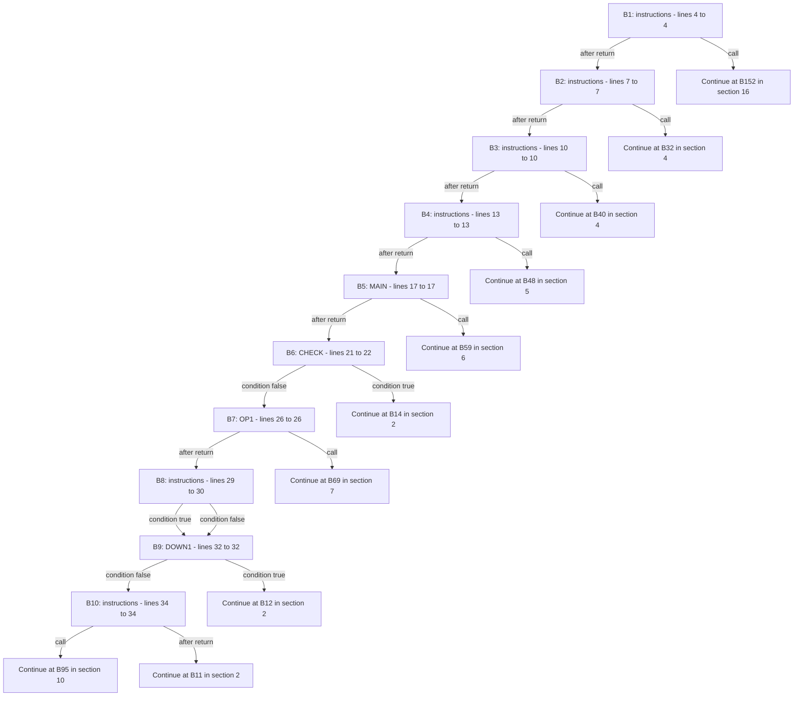

### B1

```asm
acall inlcd
```

### B2

```asm
acall welcome
```

### B3

```asm
acall name_id
```

### B4

```asm
acall intkey
```

### B5

```asm
acall main_menu
```

### B6

```asm
mov a, 30h
cjne a, #1, not1
```

### B7

```asm
acall enter_num
```

### B8

```asm
mov a, 40h
cjne a, #91h, down1
```

### B9

```asm
jc inrange_1
```

### B10

```asm
acall error
```

## Section 2

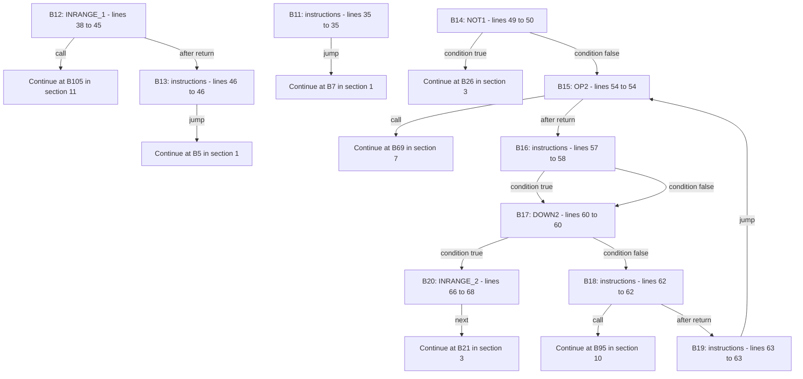

### B11

```asm
sjmp op1
```

### B12

```asm
mov a, 40h
mov r0, a
inc r0
add a, r0
mov b, #2
div ab
mov 41h, a
acall result_1
```

### B13

```asm
ljmp main
```

### B14

```asm
mov a, 30h
cjne a, #2, not2
```

### B15

```asm
acall enter_num
```

### B16

```asm
mov a, 50h
cjne a, #91h, down2
```

### B17

```asm
jc inrange_2
```

### B18

```asm
acall error
```

### B19

```asm
sjmp op2
```

### B20

```asm
mov r0, #0
mov r1, #8
mov a, 50h
```

## Section 3

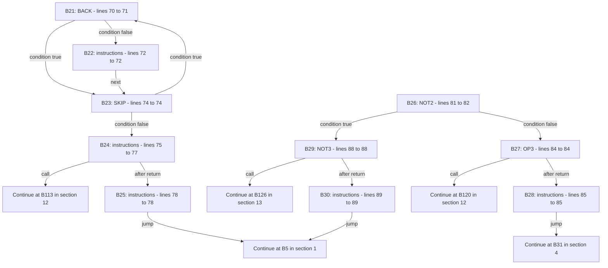

### B21

```asm
rrc a
jc skip
```

### B22

```asm
inc r0
```

### B23

```asm
djnz r1, back
```

### B24

```asm
mov a, r0
mov 51h, a
acall result_2
```

### B25

```asm
ljmp main
```

### B26

```asm
mov a, 30h
cjne a, #3, not3
```

### B27

```asm
acall exit_routine
```

### B28

```asm
sjmp done
```

### B29

```asm
acall invalid_choice
```

### B30

```asm
ljmp main
```

## Section 4

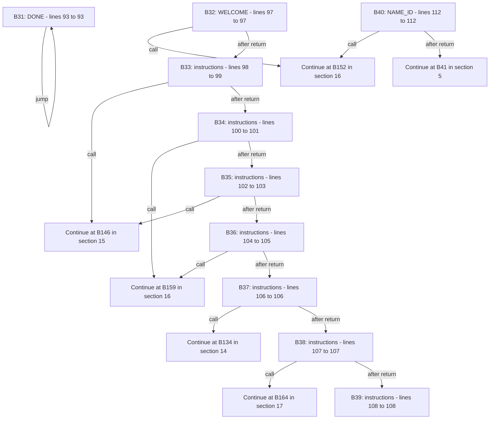

### B31

```asm
sjmp $
```

### B32

```asm
acall inlcd
```

### B33

```asm
mov a,#80h
acall cmd
```

### B34

```asm
mov dptr, #M11
acall wstr
```

### B35

```asm
mov a,#0c0h
acall cmd
```

### B36

```asm
mov dptr, #M12
acall wstr
```

### B37

```asm
acall delay
```

### B38

```asm
acall clear
```

### B39

Return to the instruction following the active call.

```asm
ret
```

### B40

```asm
acall inlcd
```

## Section 5

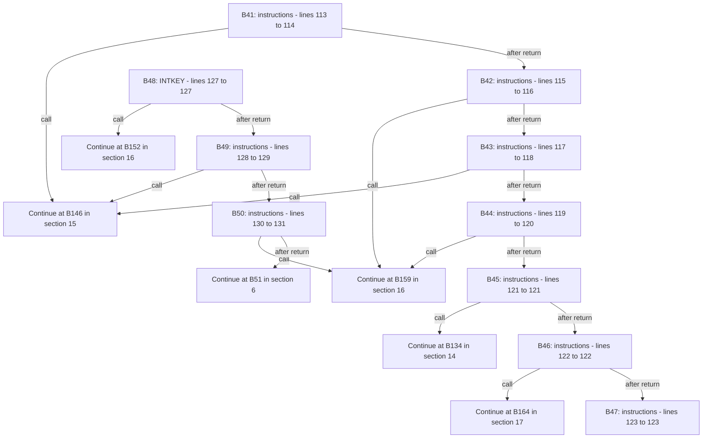

### B41

```asm
mov a,#80h
acall cmd
```

### B42

```asm
mov dptr, #M21
acall wstr
```

### B43

```asm
mov a,#0c0h
acall cmd
```

### B44

```asm
mov dptr, #M22
acall wstr
```

### B45

```asm
acall delay
```

### B46

```asm
acall clear
```

### B47

Return to the instruction following the active call.

```asm
ret
```

### B48

```asm
acall inlcd
```

### B49

```asm
mov a,#80h
acall cmd
```

### B50

```asm
mov dptr, #M23
acall wstr
```

## Section 6

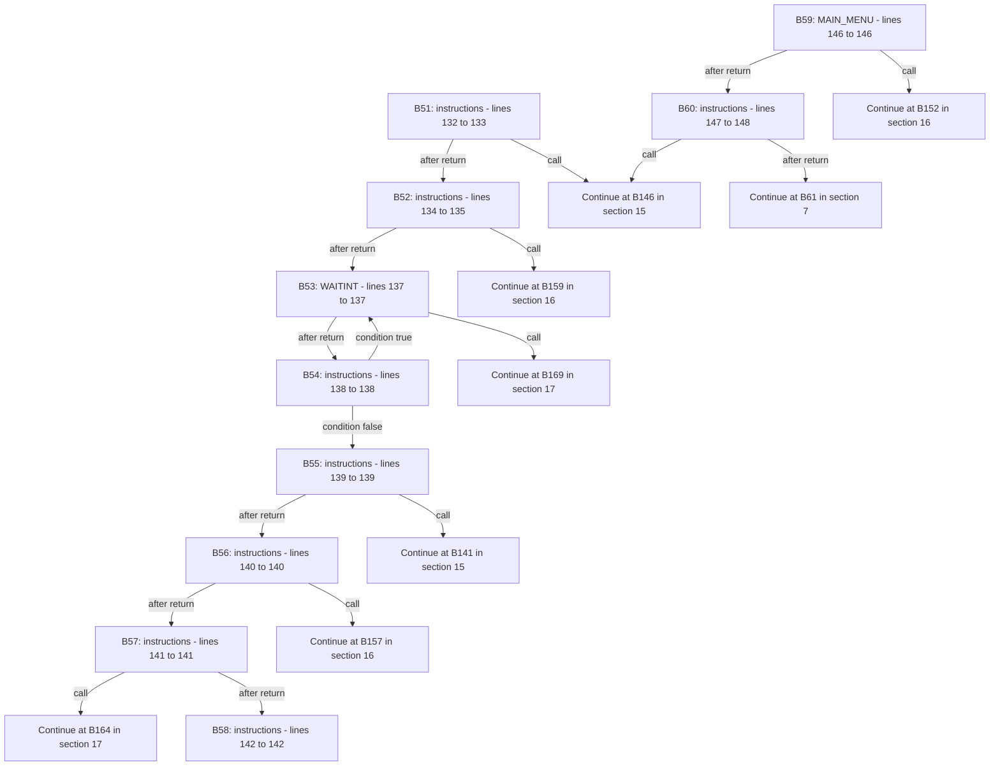

### B51

```asm
mov a,#0c0h
acall cmd
```

### B52

```asm
mov dptr, #M24
acall wstr
```

### B53

```asm
acall keypad
```

### B54

```asm
cjne a, #'#', waitint
```

### B55

```asm
acall wchr
```

### B56

```asm
acall ldelay
```

### B57

```asm
acall clear
```

### B58

Return to the instruction following the active call.

```asm
ret
```

### B59

```asm
acall inlcd
```

### B60

```asm
mov a,#80h
acall cmd
```

## Section 7

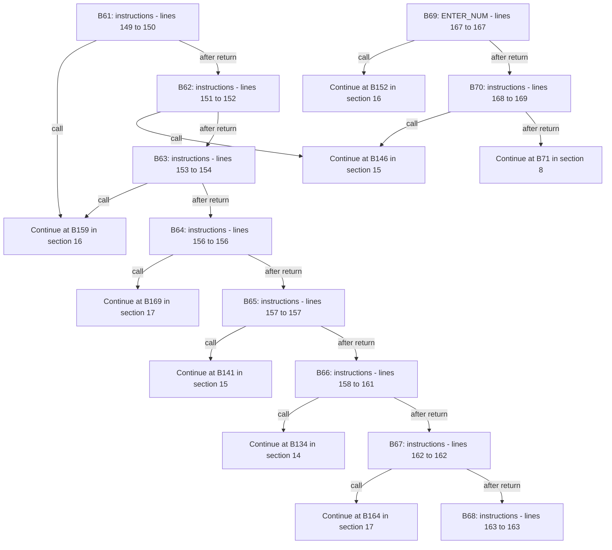

### B61

```asm
mov dptr, #M31
acall wstr
```

### B62

```asm
mov a,#0c0h
acall cmd
```

### B63

```asm
mov dptr, #M32
acall wstr
```

### B64

```asm
acall keypad
```

### B65

```asm
acall wchr
```

### B66

```asm
subb a, #30h
mov 30h, a
acall delay
```

### B67

```asm
acall clear
```

### B68

Return to the instruction following the active call.

```asm
ret
```

### B69

```asm
acall inlcd
```

### B70

```asm
mov a,#80h
acall cmd
```

## Section 8

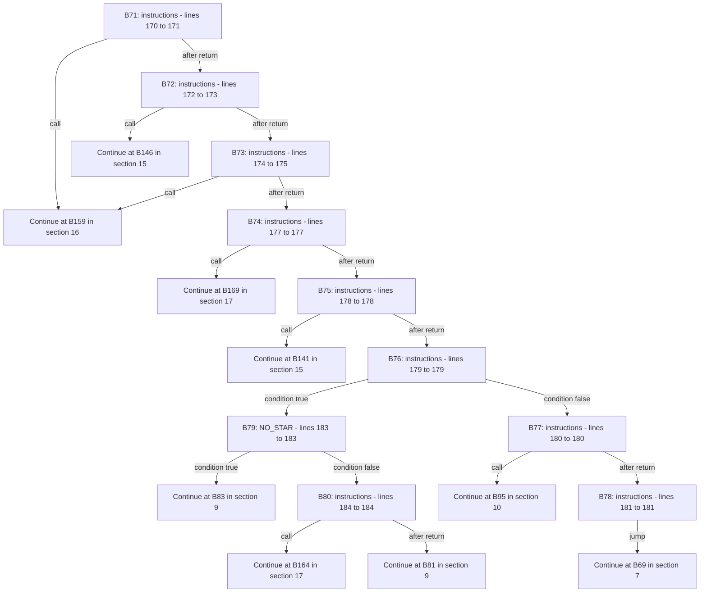

### B71

```asm
mov dptr, #M41
acall wstr
```

### B72

```asm
mov a,#0c0h
acall cmd
```

### B73

```asm
mov dptr, #M42
acall wstr
```

### B74

```asm
acall keypad
```

### B75

```asm
acall wchr
```

### B76

```asm
cjne a,#'*',no_star
```

### B77

```asm
acall error
```

### B78

```asm
sjmp enter_num
```

### B79

```asm
cjne a,#'#',no_hash
```

### B80

```asm
acall clear
```

## Section 9

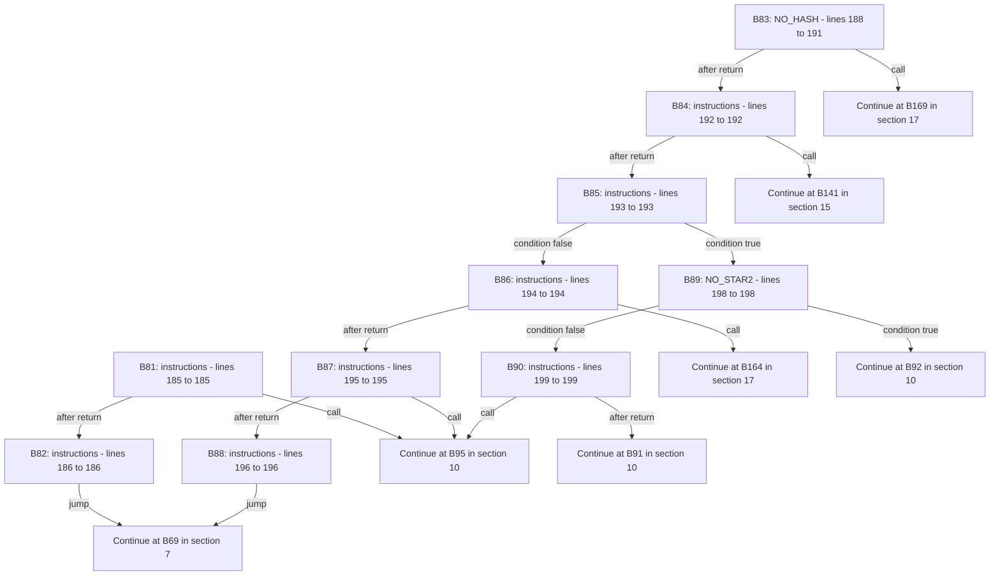

### B81

```asm
acall error
```

### B82

```asm
sjmp enter_num
```

### B83

```asm
subb a, #30h
mov 41h, a
acall keypad
```

### B84

```asm
acall wchr
```

### B85

```asm
cjne a,#'*',no_star2
```

### B86

```asm
acall clear
```

### B87

```asm
acall error
```

### B88

```asm
sjmp enter_num
```

### B89

```asm
cjne a,#'#',no_hash2
```

### B90

```asm
acall error
```

## Section 10

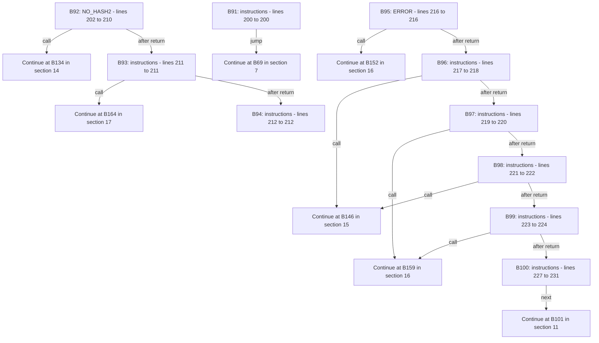

### B91

```asm
sjmp enter_num
```

### B92

```asm
subb a, #30h
mov 42h, a
mov a, 41h
swap a
add a, 42h
mov 40h, a
mov 50h, a
acall delay
```

### B93

```asm
acall clear
```

### B94

Return to the instruction following the active call.

```asm
ret
```

### B95

```asm
acall inlcd
```

### B96

```asm
mov a,#80h
acall cmd
```

### B97

```asm
mov dptr, #M61
acall wstr
```

### B98

```asm
mov a,#0c0h
acall cmd
```

### B99

```asm
mov dptr, #M62
acall wstr
```

### B100

```asm
mov p1, #0ffh
clr p1.0
clr p1.3
clr p1.6
mov r6, #2
```

## Section 11

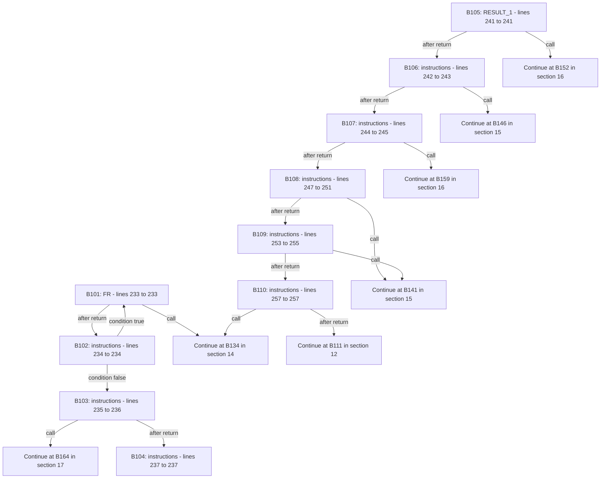

### B101

```asm
acall delay
```

### B102

```asm
djnz r6, fr
```

### B103

```asm
mov p1, #0ffh
acall clear
```

### B104

Return to the instruction following the active call.

```asm
ret
```

### B105

```asm
acall inlcd
```

### B106

```asm
mov a,#80h
acall cmd
```

### B107

```asm
mov dptr, #M5
acall wstr
```

### B108

```asm
mov a, 41h
mov b, #10h
div ab
add a, #30h
acall wchr
```

### B109

```asm
mov a, b
add a, #30h
acall wchr
```

### B110

```asm
acall delay
```

## Section 12

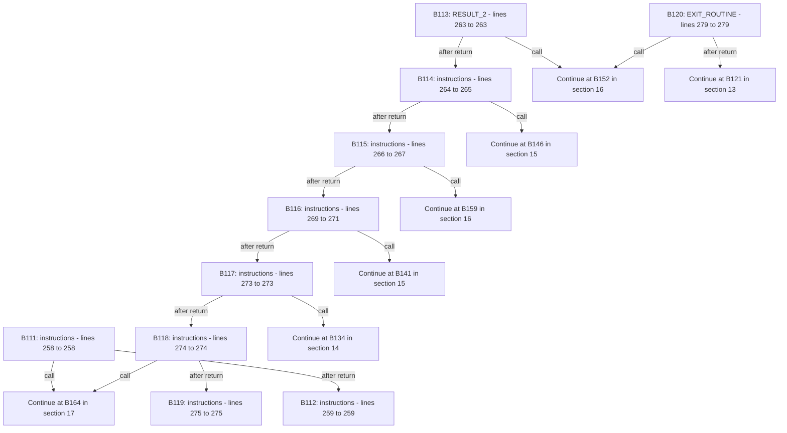

### B111

```asm
acall clear
```

### B112

Return to the instruction following the active call.

```asm
ret
```

### B113

```asm
acall inlcd
```

### B114

```asm
mov a,#80h
acall cmd
```

### B115

```asm
mov dptr, #M7
acall wstr
```

### B116

```asm
mov a, 51h
add a, #30h
acall wchr
```

### B117

```asm
acall delay
```

### B118

```asm
acall clear
```

### B119

Return to the instruction following the active call.

```asm
ret
```

### B120

```asm
acall inlcd
```

## Section 13

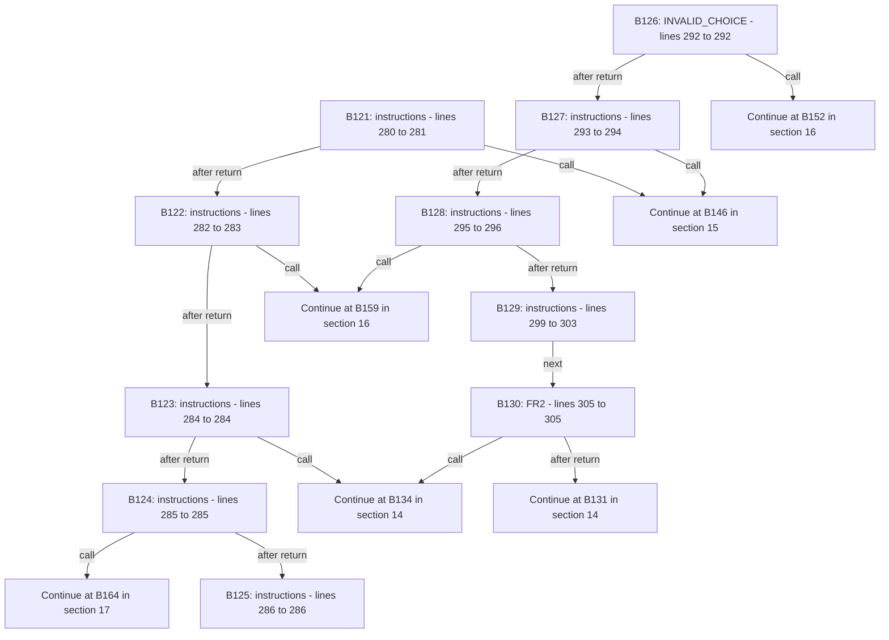

### B121

```asm
mov a,#80h
acall cmd
```

### B122

```asm
mov dptr, #M9
acall wstr
```

### B123

```asm
acall delay
```

### B124

```asm
acall clear
```

### B125

Return to the instruction following the active call.

```asm
ret
```

### B126

```asm
acall inlcd
```

### B127

```asm
mov a,#80h
acall cmd
```

### B128

```asm
mov dptr, #M10
acall wstr
```

### B129

```asm
mov p1, #0ffh
clr p1.0
clr p1.3
clr p1.6
mov r6, #2
```

### B130

```asm
acall delay
```

## Section 14

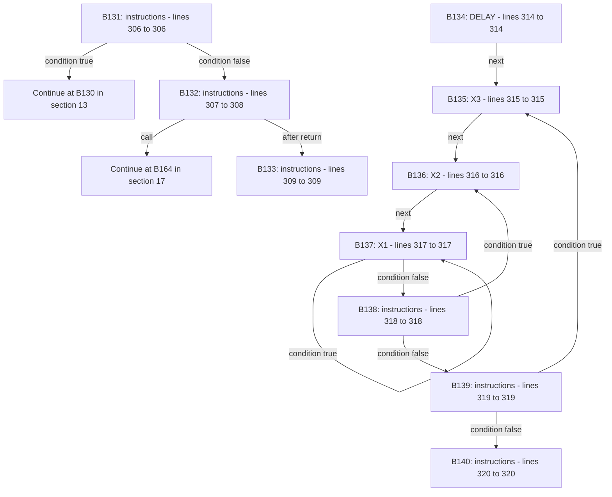

### B131

```asm
djnz r6, fr2
```

### B132

```asm
mov p1, #0ffh
acall clear
```

### B133

Return to the instruction following the active call.

```asm
ret
```

### B134

```asm
mov r5, #2
```

### B135

```asm
mov r4, #200
```

### B136

```asm
mov r3, #150
```

### B137

```asm
djnz r3,x1
```

### B138

```asm
djnz r4,x2
```

### B139

```asm
djnz r5,x3
```

### B140

Return to the instruction following the active call.

```asm
ret
```

## Section 15

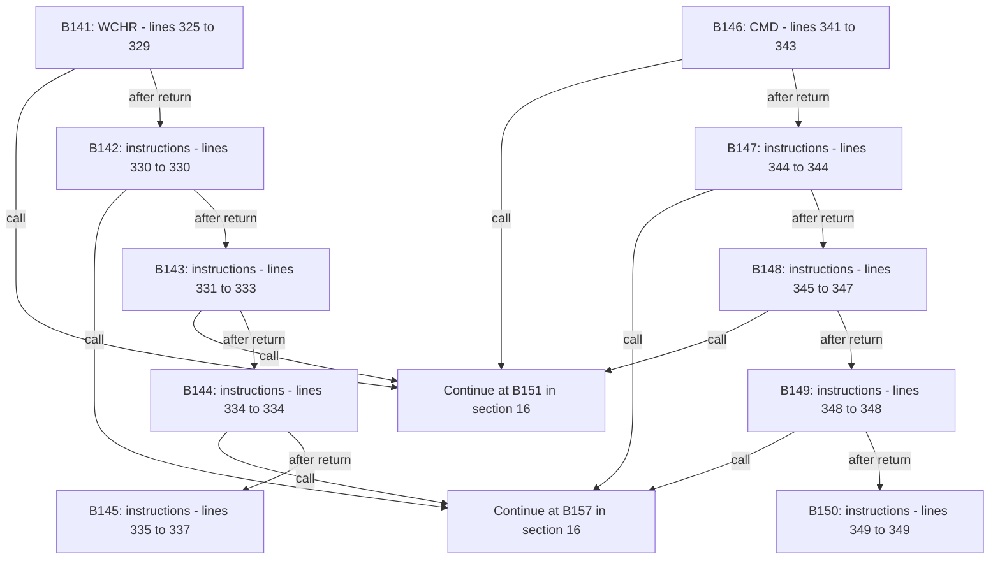

### B141

```asm
PUSH ACC
PUSH B
SETB P1.3
MOV B,A
ACALL COMMON
```

### B142

```asm
ACALL LDELAY
```

### B143

```asm
MOV A,B
SWAP A
ACALL COMMON
```

### B144

```asm
ACALL LDELAY
```

### B145

Return to the instruction following the active call.

```asm
POP B
POP ACC
RET
```

### B146

```asm
CLR P1.3
MOV B,A
ACALL COMMON
```

### B147

```asm
ACALL LDELAY
```

### B148

```asm
MOV A,B
SWAP A
ACALL COMMON
```

### B149

```asm
ACALL LDELAY
```

### B150

Return to the instruction following the active call.

```asm
RET
```

## Section 16

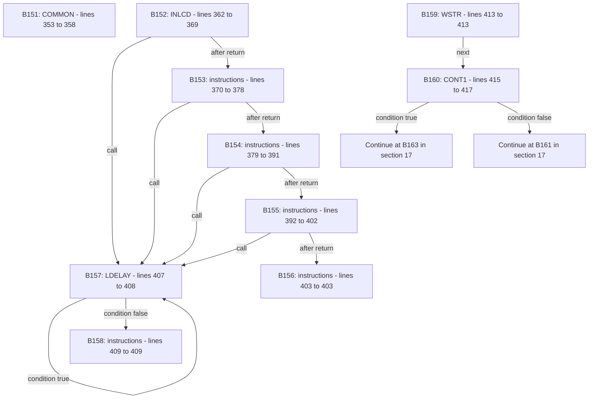

### B151

Return to the instruction following the active call.

```asm
ANL a,#11110000B
ANL P1, #00001111B
ORL P1,A
SETB P1.2
CLR P1.2
RET
```

### B152

```asm
CLR P1.3
CLR P1.7
CLR P1.6
SETB P1.5
CLR P1.4
SETB P1.2
CLR P1.2
ACALL LDELAY
```

### B153

```asm
SETB P1.2
CLR P1.2
SETB P1.7
CLR P1.6
CLR P1.5
CLR P1.4
SETB P1.2
CLR P1.2
ACALL LDELAY
```

### B154

```asm
CLR P1.7
CLR P1.6
CLR P1.5
CLR P1.4
SETB P1.2
CLR P1.2
SETB P1.7
SETB P1.6
SETB P1.5
SETB P1.4
SETB P1.2
CLR P1.2
ACALL LDELAY
```

### B155

```asm
CLR P1.7
CLR P1.6
CLR P1.5
CLR P1.4
SETB P1.2
CLR P1.2
SETB P1.6
SETB P1.5
SETB P1.2
CLR P1.2
ACALL LDELAY
```

### B156

Return to the instruction following the active call.

```asm
RET
```

### B157

```asm
MOV R0, #50
DJNZ R0, $
```

### B158

Return to the instruction following the active call.

```asm
RET
```

### B159

```asm
PUSH ACC
```

### B160

```asm
CLR A
MOVC A,@A+DPTR
JZ Exit1
```

## Section 17

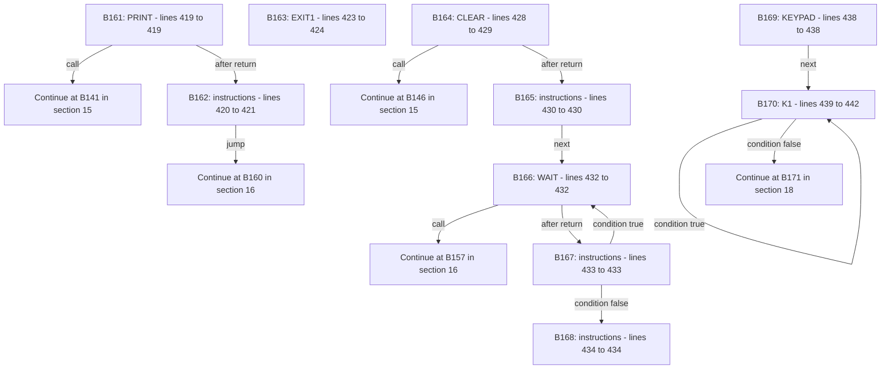

### B161

```asm
ACALL WCHR
```

### B162

```asm
INC DPTR
AJMP CONT1
```

### B163

Return to the instruction following the active call.

```asm
POP ACC
RET
```

### B164

```asm
MOV A, #01H
ACALL CMD
```

### B165

```asm
MOV R7, #14
```

### B166

```asm
ACALL LDELAY
```

### B167

```asm
DJNZ R7, Wait
```

### B168

Return to the instruction following the active call.

```asm
RET
```

### B169

```asm
mov p0,#01110000b
```

### B170

```asm
mov p0,#01110000b
mov a,p0
anl a,#01110000b
cjne a,#01110000b,k1
```

## Section 18

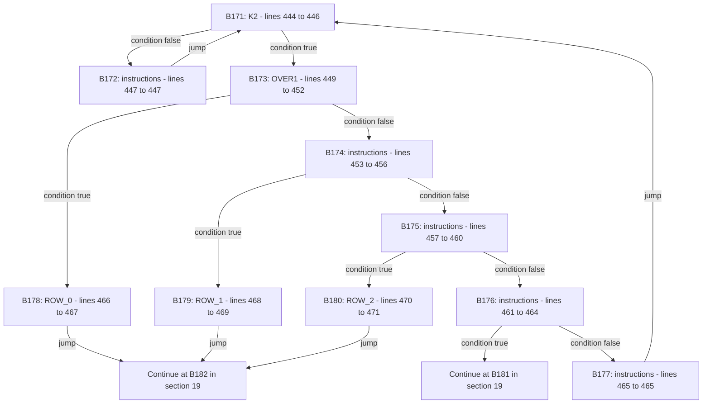

### B171

```asm
mov a,p0
anl a,#01110000b
cjne a,#01110000b,over1
```

### B172

```asm
sjmp k2
```

### B173

```asm
mov p0,#01111110b
mov a,p0
anl a,#01110000b
cjne a,#01110000b,row_0
```

### B174

```asm
mov p0,#01111101b
mov a,p0
anl a,#01110000b
cjne a,#01110000b,row_1
```

### B175

```asm
mov p0,#01111011b
mov a,p0
anl a,#01110000b
cjne a,#01110000b,row_2
```

### B176

```asm
mov p0,#01110111b
mov a,p0
anl a,#01110000b
cjne a,#01110000b,row_3
```

### B177

```asm
ljmp k2
```

### B178

```asm
mov dptr,#kcode0
sjmp find
```

### B179

```asm
mov dptr,#kcode1
sjmp find
```

### B180

```asm
mov dptr,#kcode2
sjmp find
```

## Section 19

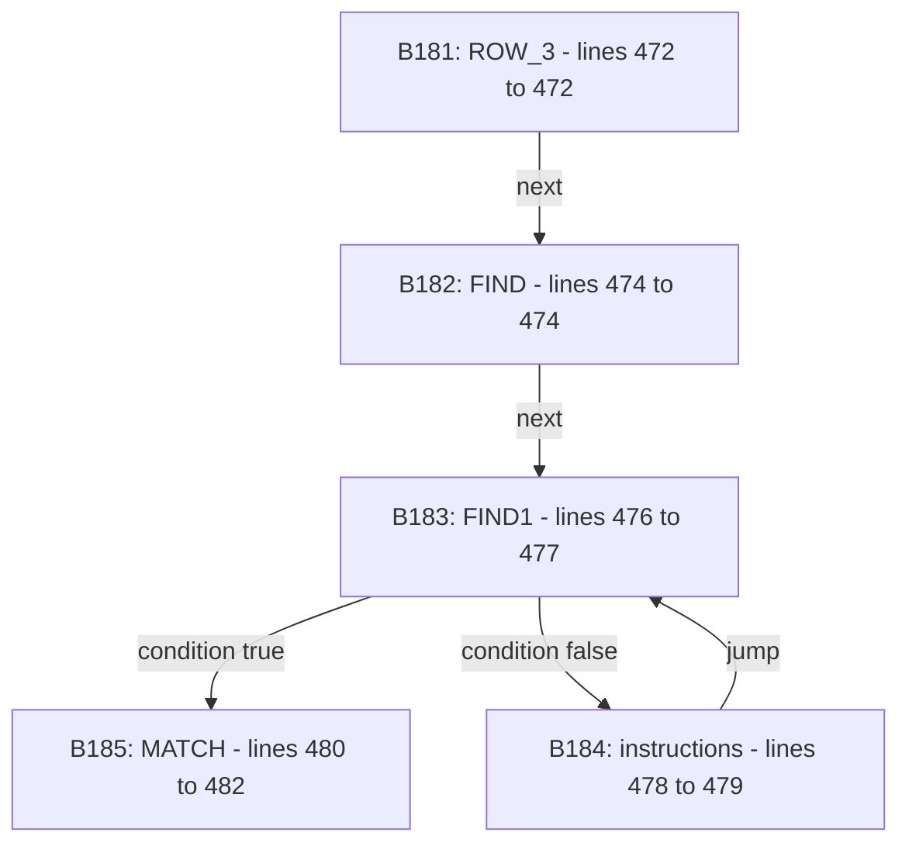

### B181

```asm
mov dptr,#kcode3
```

### B182

```asm
rlc a
```

### B183

```asm
rlc a
jnc match
```

### B184

```asm
inc dptr
sjmp find1
```

### B185

Return to the instruction following the active call.

```asm
clr a
movc a,@a+dptr
ret
```
