# Program Control Flow

[Back to project](README.md)

Control-flow blocks are indexed by source line. Calls resume at the instruction following the call if the subroutine returns normally.

## Entry locations

- `ORG 00H` begins at B1.

## Navigation

[Section 1](#section-1) · [Section 2](#section-2) · [Section 3](#section-3) · [Section 4](#section-4) · [Section 5](#section-5) · [Section 6](#section-6) · [Section 7](#section-7) · [Section 8](#section-8) · [Section 9](#section-9) · [Section 10](#section-10) · [Section 11](#section-11)

## Section 1

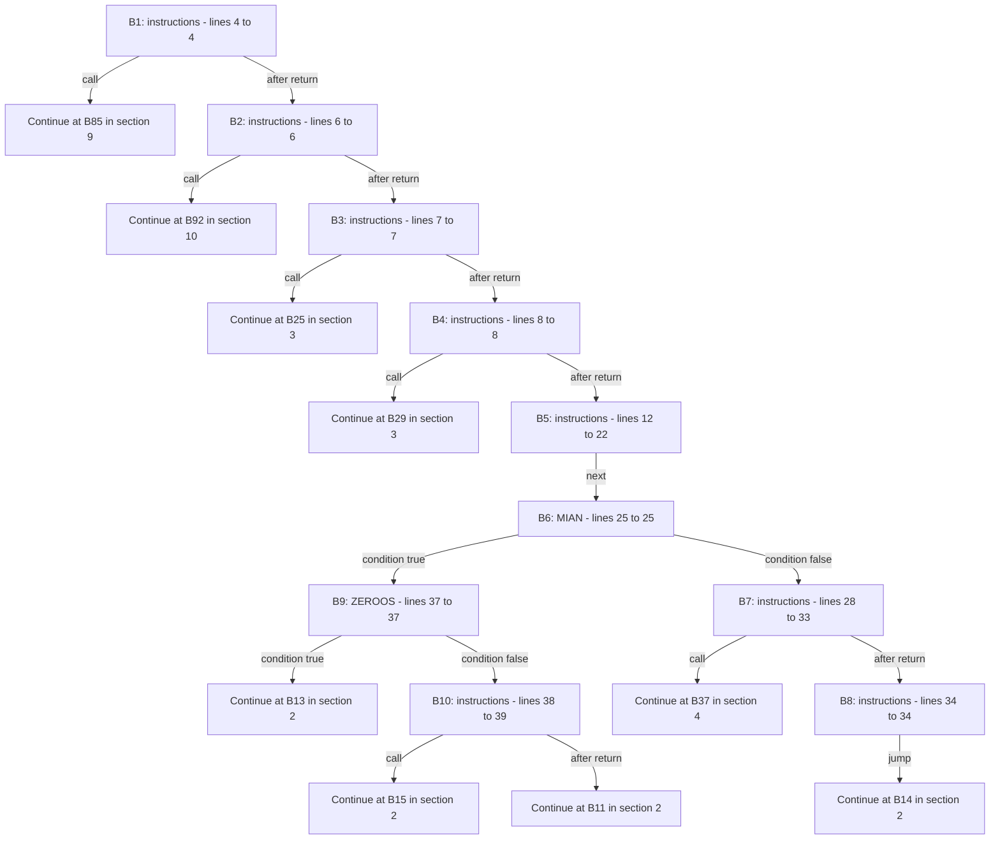

### B1

```asm
ACALL INLCD
```

### B2

```asm
acall clear
```

### B3

```asm
acall WRITE1
```

### B4

```asm
acall WRITE2
```

### B5

```asm
MOV R1,#2
MOV 40H,#23
MOV 41H,#24
MOV 42H,#0
MOV 50H,#0FH
MOV 51H,#0
```

### B6

```asm
CJNE R1,#1,ZEROOS
```

### B7

```asm
MOV A,40H
ADD A,41H
MOV B,#2
DIV AB
MOV 42H,A
ACALL WRITE3
```

### B8

```asm
SJMP BACK
```

### B9

```asm
CJNE R1,#2, WRONG
```

### B10

```asm
MOV A,50H
ACALL COUNT
```

## Section 2

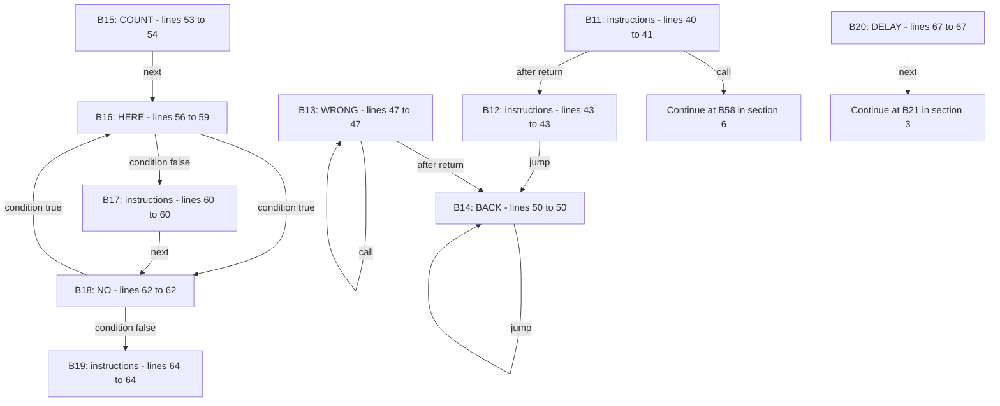

### B11

```asm
MOV 30H,51H
ACALL WRITE4
```

### B12

```asm
SJMP BACK
```

### B13

```asm
ACALL WRONG
```

### B14

```asm
SJMP BACK
```

### B15

```asm
MOV A,50H
MOV R4,#8
```

### B16

```asm
MOV B,#2
DIV AB
MOV R0,B
CJNE R0,#0,NO
```

### B17

```asm
INC 51H
```

### B18

```asm
DJNZ R4,HERE
```

### B19

Return to the instruction following the active call.

```asm
RET
```

### B20

```asm
MOV R0,#20
```

## Section 3

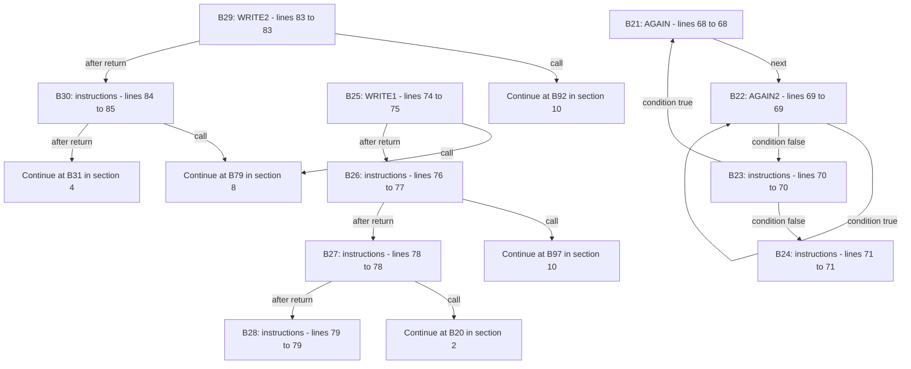

### B21

```asm
MOV R1,#90
```

### B22

```asm
DJNZ R1,AGAIN2
```

### B23

```asm
DJNZ R0,AGAIN
```

### B24

Return to the instruction following the active call.

```asm
RET
```

### B25

```asm
mov a, #80H
acall cmd
```

### B26

```asm
mov dptr, #STR1
acall WSTR
```

### B27

```asm
ACALL DELAY
```

### B28

Return to the instruction following the active call.

```asm
RET
```

### B29

```asm
ACALL CLEAR
```

### B30

```asm
mov a, #80H
acall cmd
```

## Section 4

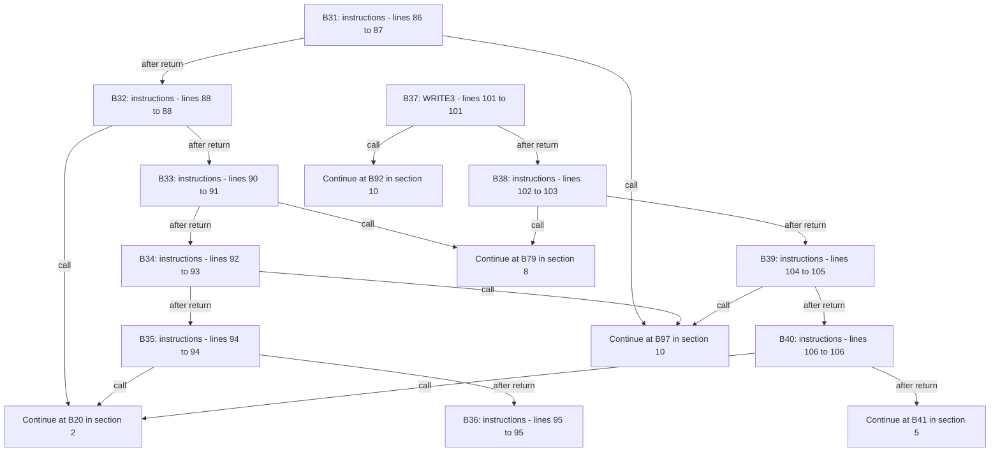

### B31

```asm
mov dptr, #STR2
acall WSTR
```

### B32

```asm
ACALL DELAY
```

### B33

```asm
mov a, #0C0H
acall cmd
```

### B34

```asm
mov dptr, #STR3
acall WSTR
```

### B35

```asm
ACALL DELAY
```

### B36

Return to the instruction following the active call.

```asm
RET
```

### B37

```asm
ACALL CLEAR
```

### B38

```asm
mov a, #80H
acall cmd
```

### B39

```asm
mov dptr, #STR4
acall WSTR
```

### B40

```asm
ACALL DELAY
```

## Section 5

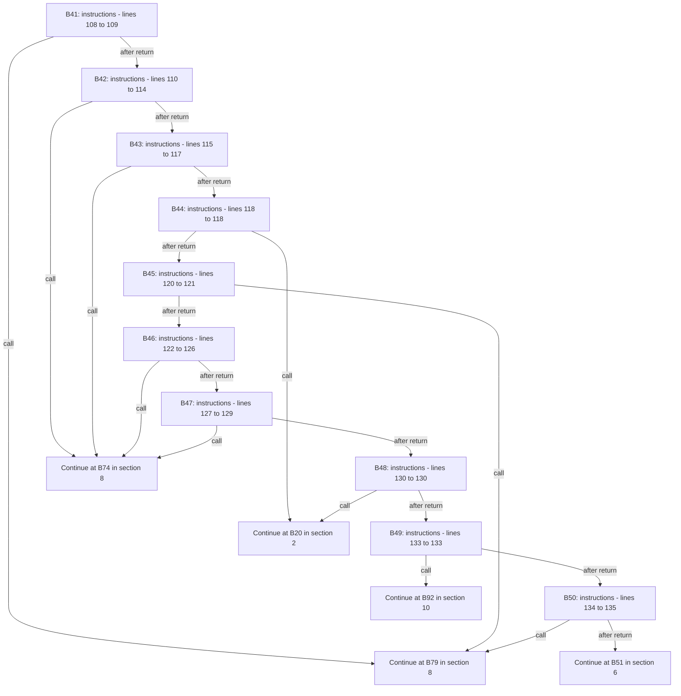

### B41

```asm
mov a, #0C0H
acall cmd
```

### B42

```asm
mov a,40H
mov b,#10
div ab
add a,#30h
acall wchr
```

### B43

```asm
mov a,b
add a,#30h
acall wchr
```

### B44

```asm
ACALL DELAY
```

### B45

```asm
mov a, #0C8H
acall cmd
```

### B46

```asm
mov a,41H
mov b,#10
div ab
add a,#30h
acall wchr
```

### B47

```asm
mov a,b
add a,#30h
acall wchr
```

### B48

```asm
ACALL DELAY
```

### B49

```asm
ACALL CLEAR
```

### B50

```asm
mov a, #80H
acall cmd
```

## Section 6

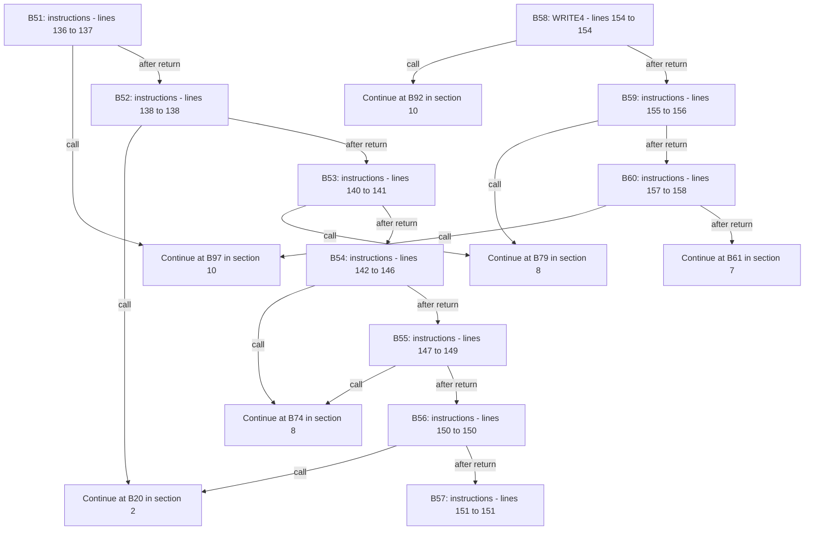

### B51

```asm
mov dptr, #STR6
acall WSTR
```

### B52

```asm
ACALL DELAY
```

### B53

```asm
mov a, #0C0H
acall cmd
```

### B54

```asm
mov a,42H
mov b,#10
div ab
add a,#30h
acall wchr
```

### B55

```asm
mov a,b
add a,#30h
acall wchr
```

### B56

```asm
ACALL DELAY
```

### B57

Return to the instruction following the active call.

```asm
RET
```

### B58

```asm
ACALL CLEAR
```

### B59

```asm
mov a, #80H
acall cmd
```

### B60

```asm
mov dptr, #STR5
acall WSTR
```

## Section 7

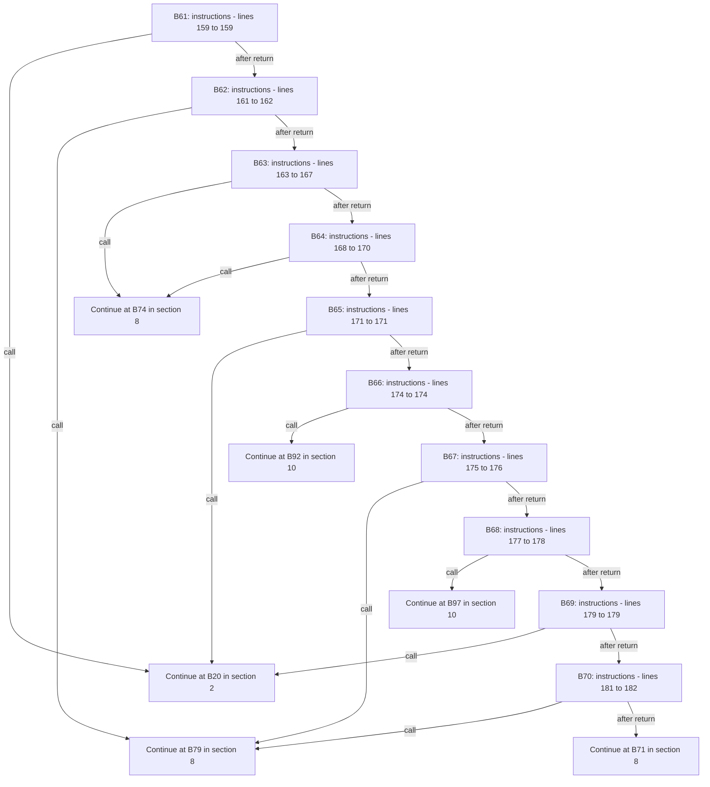

### B61

```asm
ACALL DELAY
```

### B62

```asm
mov a, #0C0H
acall cmd
```

### B63

```asm
mov a,50H
mov b,#10
div ab
add a,#30h
acall wchr
```

### B64

```asm
mov a,b
add a,#30h
acall wchr
```

### B65

```asm
ACALL DELAY
```

### B66

```asm
ACALL CLEAR
```

### B67

```asm
mov a, #80H
acall cmd
```

### B68

```asm
mov dptr, #STR6
acall WSTR
```

### B69

```asm
ACALL DELAY
```

### B70

```asm
mov a, #0C0H
acall cmd
```

## Section 8

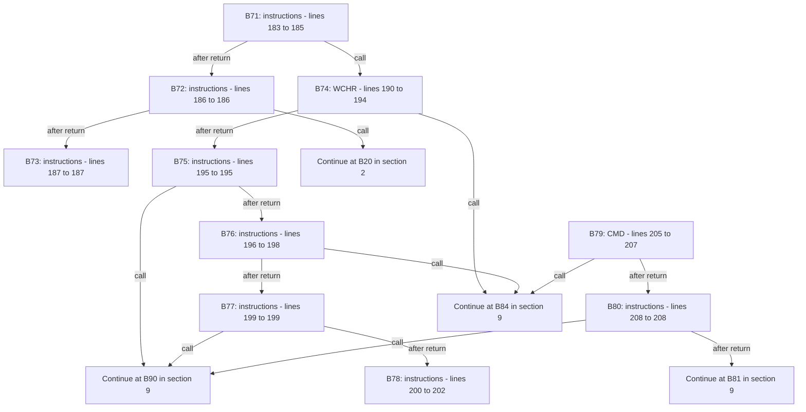

### B71

```asm
mov a,51H
add a,#30h
acall wchr
```

### B72

```asm
ACALL DELAY
```

### B73

Return to the instruction following the active call.

```asm
RET
```

### B74

```asm
PUSH ACC
PUSH B
SETB P1.3
MOV B,A
ACALL COMMON
```

### B75

```asm
ACALL LDELAY
```

### B76

```asm
MOV A,B
SWAP A
ACALL COMMON
```

### B77

```asm
ACALL LDELAY
```

### B78

Return to the instruction following the active call.

```asm
POP B
POP ACC
RET
```

### B79

```asm
CLR P1.3
MOV B,A
ACALL COMMON
```

### B80

```asm
ACALL LDELAY
```

## Section 9

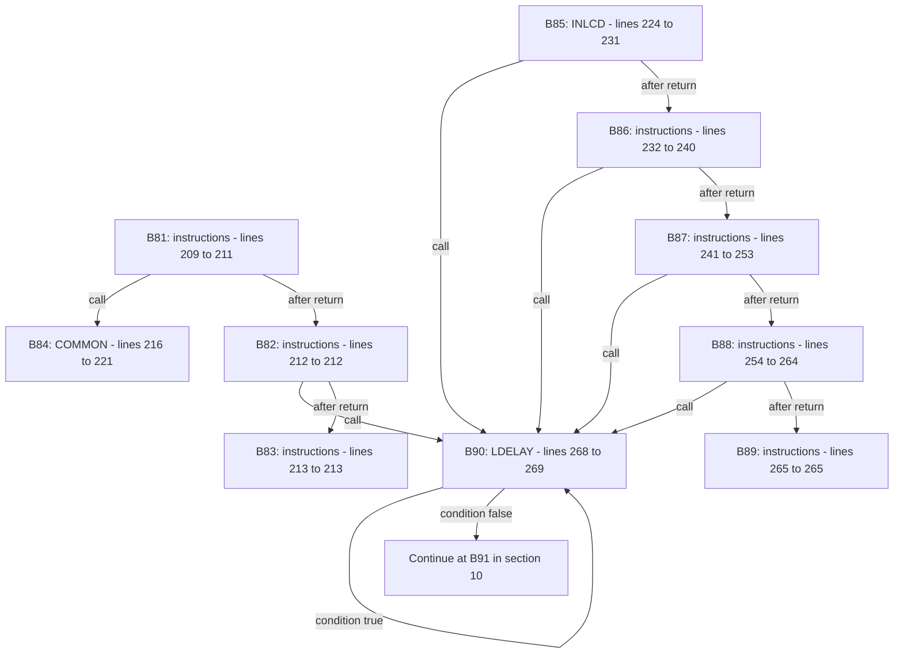

### B81

```asm
MOV A,B
SWAP A
ACALL COMMON
```

### B82

```asm
ACALL LDELAY
```

### B83

Return to the instruction following the active call.

```asm
RET
```

### B84

Return to the instruction following the active call.

```asm
ANL a,#11110000B
ANL P1, #00001111B
ORL P1,A
SETB P1.2
CLR P1.2
RET
```

### B85

```asm
CLR P1.3
CLR P1.7
CLR P1.6
SETB P1.5
CLR P1.4
SETB P1.2
CLR P1.2
ACALL LDELAY
```

### B86

```asm
SETB P1.2
CLR P1.2
SETB P1.7
CLR P1.6
CLR P1.5
CLR P1.4
SETB P1.2
CLR P1.2
ACALL LDELAY
```

### B87

```asm
CLR P1.7
CLR P1.6
CLR P1.5
CLR P1.4
SETB P1.2
CLR P1.2
SETB P1.7
SETB P1.6
SETB P1.5
SETB P1.4
SETB P1.2
CLR P1.2
ACALL LDELAY
```

### B88

```asm
CLR P1.7
CLR P1.6
CLR P1.5
CLR P1.4
SETB P1.2
CLR P1.2
SETB P1.6
SETB P1.5
SETB P1.2
CLR P1.2
ACALL LDELAY
```

### B89

Return to the instruction following the active call.

```asm
RET
```

### B90

```asm
MOV R0, #50
DJNZ R0, $
```

## Section 10

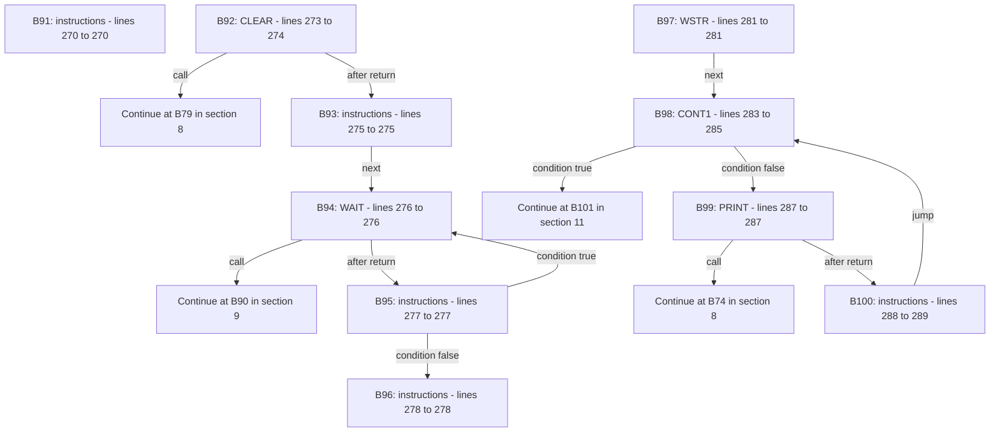

### B91

Return to the instruction following the active call.

```asm
RET
```

### B92

```asm
MOV A,#01H
ACALL CMD
```

### B93

```asm
MOV R7,#14
```

### B94

```asm
ACALL LDELAY
```

### B95

```asm
DJNZ R7,WAIT
```

### B96

Return to the instruction following the active call.

```asm
ret
```

### B97

```asm
PUSH    ACC
```

### B98

```asm
CLR     A
MOVC    A,@A+DPTR
JZ Exit1
```

### B99

```asm
ACALL    WCHR
```

### B100

```asm
INC DPTR
AJMP    CONT1
```

## Section 11

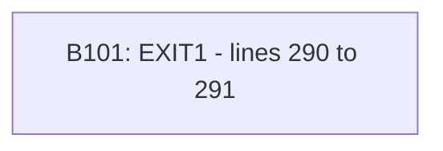

### B101

Return to the instruction following the active call.

```asm
POP     ACC
RET
```
