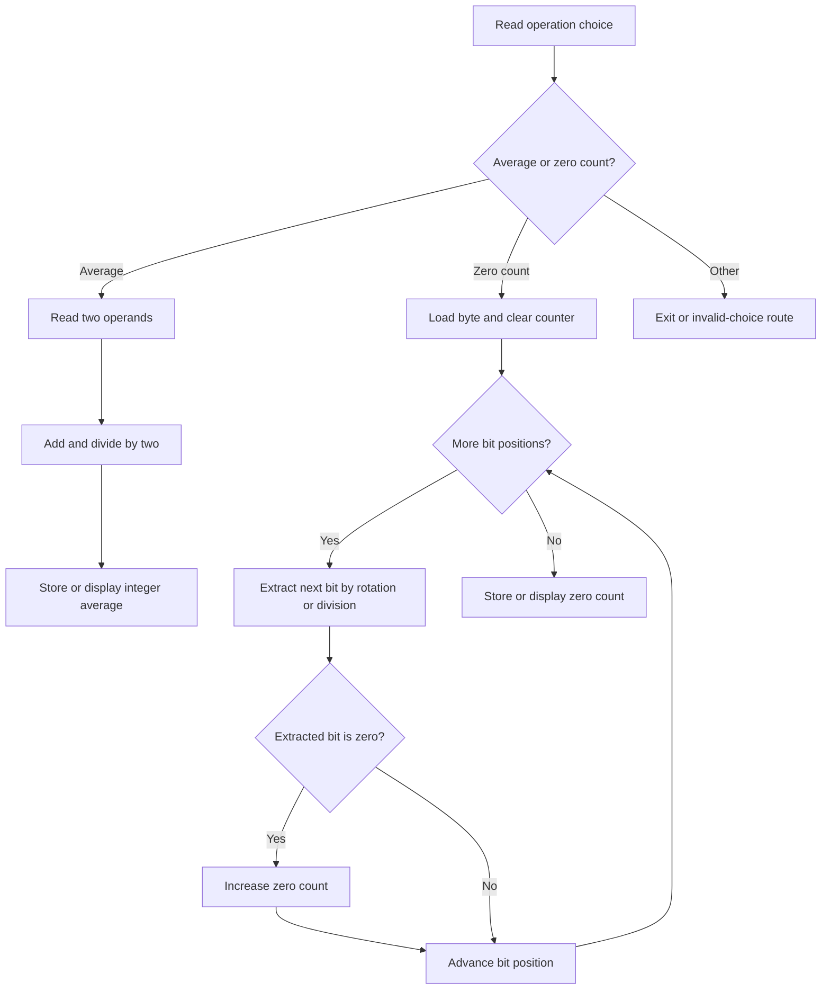
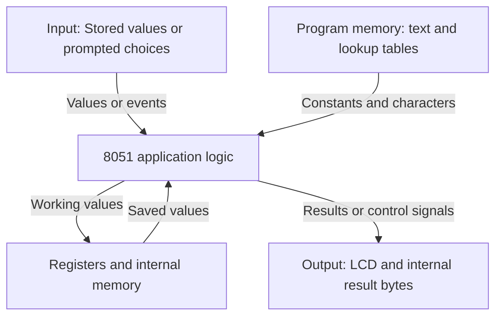

# Average Calculator and Binary Zero Counter

[Group overview](../../README.md) · [Compare implementations](../README.md)

Either calculate the average of two numbers or count the zero bits in a binary value. These are two separate menu operations.

**Implementation:** LCD Fixed Input Rotate Counter

**Input:** stored values or prompted choices.  
**Output:** LCD and internal result bytes.

## Inputs and results

| Parameter | Description |
| --- | --- |
| Input | Two numbers for the average, or one byte for the zero counter |
| Output | An integer average or a count of zero bits |

## Worked example

The average of 23 and 25 is 24. The byte 00110000 contains six zero bits when all eight positions are counted.

### Calculation details

The zero-count path loads 31H (00110001 binary), sets R5 to 8 and clears 20H. Five of the eight rotations shift out zero, so 20H reaches 05H. Inspect it after the eighth DJNZ, before the display or menu path modifies state.

## Program operation

### Functional flowchart

[Detailed control flow](source-flow.md)

### Simplified block diagram

**Port registers:** `P1`, `P1.2`, `P1.3`, `P1.4`, `P1.5`, `P1.6`, `P1.7`.

## Technical limitations

No additional defect was recorded in the earlier source review. This is not evidence of a successful build or hardware test.

## Build and test

1. Open the [assembly source](source.asm) in an 8051 assembler or simulator.
2. Review the technical limitations and configure the peripherals required by this implementation.
3. Check the expected result using the example inputs.
