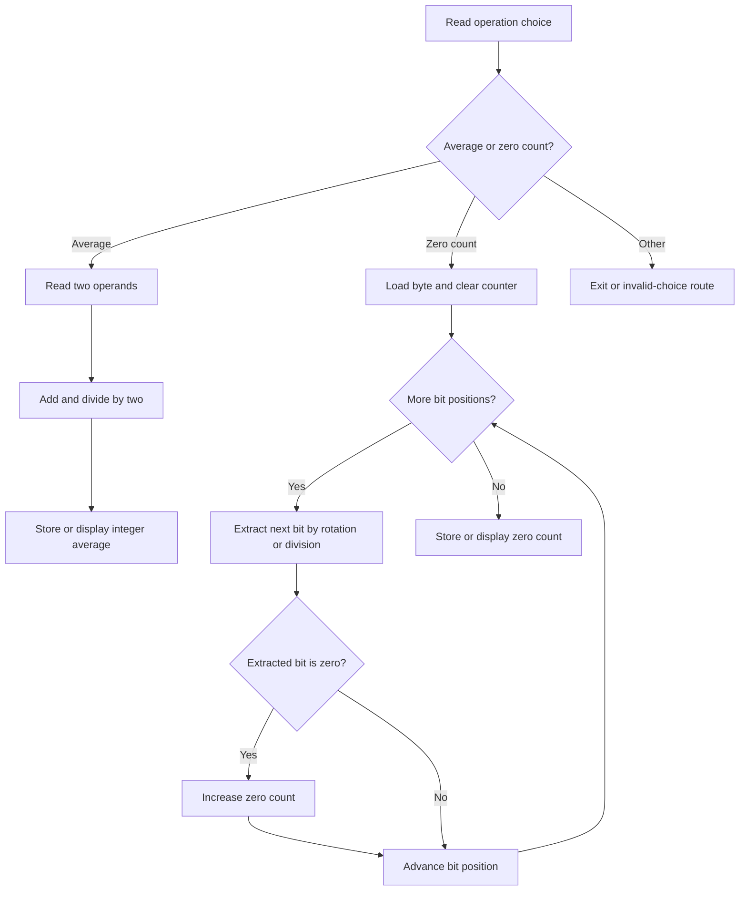
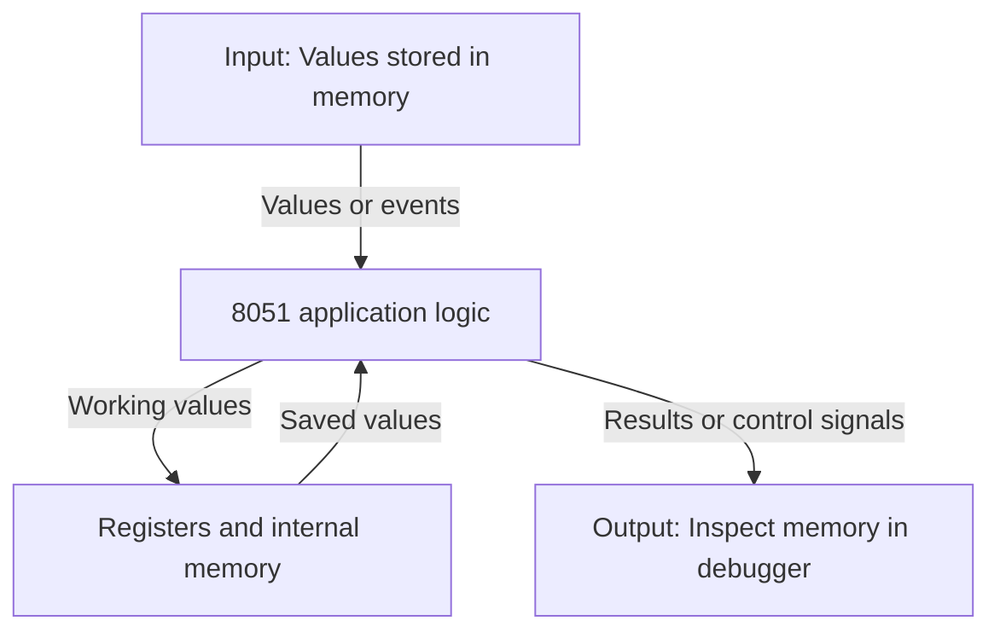

# Average Calculator and Binary Zero Counter

[Group overview](../../README.md) · [Compare implementations](../README.md)

Either calculate the average of two numbers or count the zero bits in a binary value. These are two separate menu operations.

**Implementation:** Memory Eight Bit Zero Counter

**Input:** values stored in memory.  
**Output:** inspect memory in debugger.

## Inputs and results

| Parameter | Description |
| --- | --- |
| Input | Two numbers for the average, or one byte for the zero counter |
| Output | An integer average or a count of zero bits |

## Worked example

The average of 23 and 25 is 24. The byte 00110000 contains six zero bits when all eight positions are counted.

### Calculation details

Run with the source defaults. R7 = 2 selects the zero counter and R1 contains 30H (00110000 binary). Eight right rotations move the original bits into carry one at a time. Six have carry clear, so RAM 10H ends at 06H and the program enters its self-loop.

## Program operation

### Functional flowchart

[Detailed control flow](source-flow.md)

### Simplified block diagram

Results are available in memory without a display.

## Technical limitations

No additional defect was recorded in the earlier source review. This is not evidence of a successful build or hardware test.

## Build and test

1. Open the [assembly source](source.asm) in an 8051 assembler or simulator.
2. Review the technical limitations and configure the peripherals required by this implementation.
3. Check the expected result using the example inputs.
