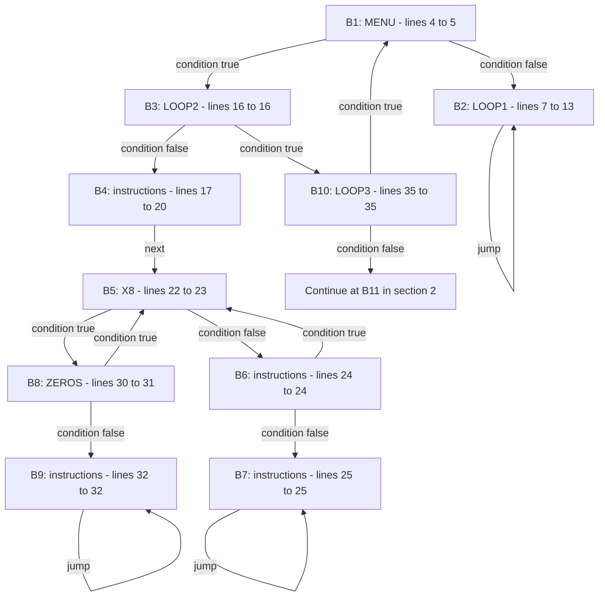
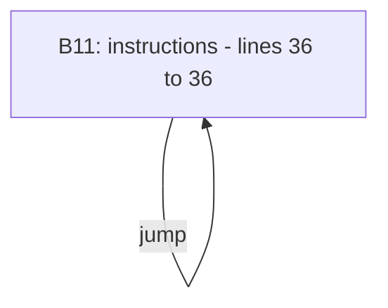

# Program Control Flow

[Back to project](README.md)

Control-flow blocks are indexed by source line. Calls resume at the instruction following the call if the subroutine returns normally.

## Entry locations

- `ORG 0H` begins at B1.

## Navigation

[Section 1](#section-1) · [Section 2](#section-2)

## Section 1



### B1

```asm
MOV R7,#2
CJNE R7,#1, LOOP2
```

### B2

```asm
MOV R1,#90
MOV A,R1
ADD A,#1
ADD A,R1
MOV B,#2
DIV AB
SJMP $
```

### B3

```asm
CJNE R7,#2,LOOP3
```

### B4

```asm
MOV R1,#30H
MOV R5,#8
MOV 10H,#0
MOV A,R1
```

### B5

```asm
RRC A
JNC ZEROS
```

### B6

```asm
DJNZ R5,X8
```

### B7

```asm
SJMP $
```

### B8

```asm
INC 10H
DJNZ R5,X8
```

### B9

```asm
SJMP $
```

### B10

```asm
CJNE A,#3,MENU
```

## Section 2



### B11

```asm
SJMP $
```
