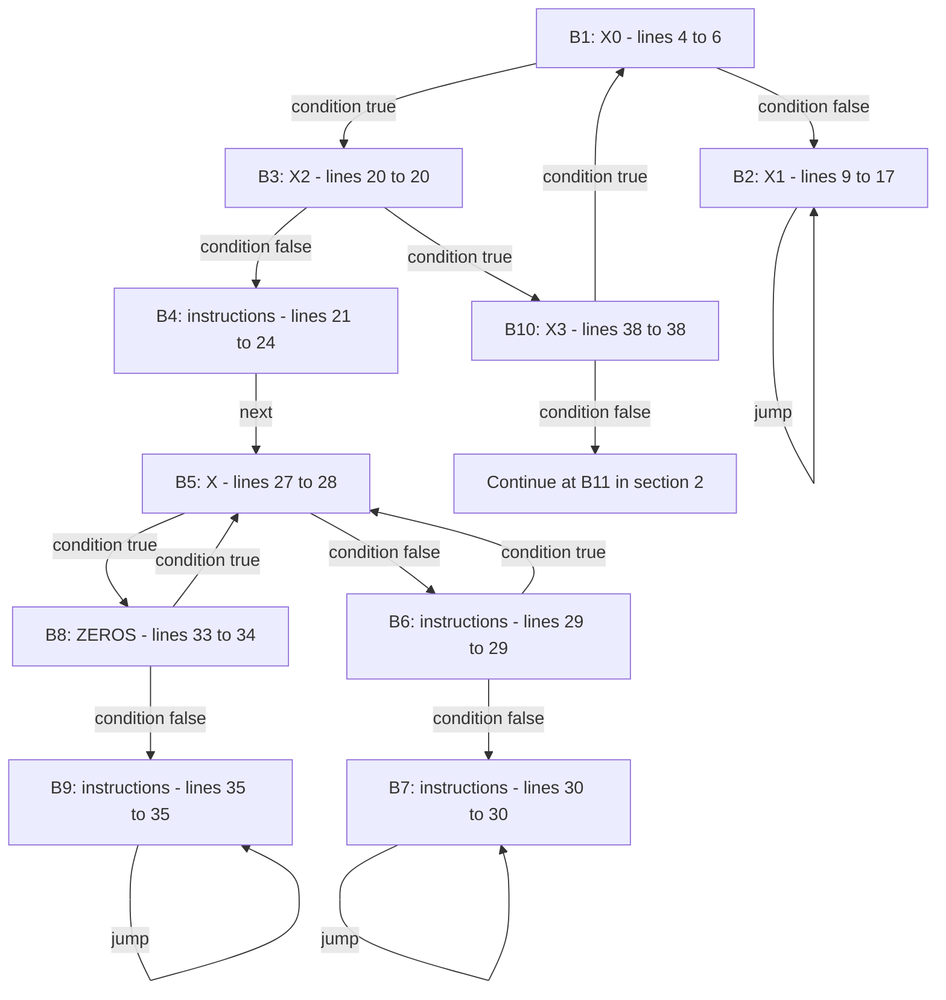
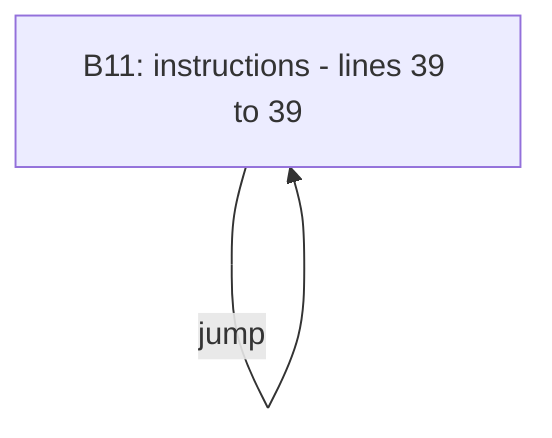

# Program Control Flow

[Back to project](README.md)

Control-flow blocks are indexed by source line. Calls resume at the instruction following the call if the subroutine returns normally.

## Entry locations

- `ORG 00H` begins at B1.

## Navigation

[Section 1](#section-1) · [Section 2](#section-2)

## Section 1



### B1

```asm
MOV R3,#2
CJNE R3,#1,X2
```

### B2

```asm
MOV R0,#39
MOV A,R0
SUBB A,#1
ADD A,R0
MOV B,#2
DIV AB
MOV R6,A
SJMP $
```

### B3

```asm
CJNE R3,#2,X3
```

### B4

```asm
MOV R0,#40H
MOV R1,#8
MOV 20H,#0
MOV A,R0
```

### B5

```asm
RRC A
JNC ZEROS
```

### B6

```asm
DJNZ R1,X
```

### B7

```asm
SJMP $
```

### B8

```asm
INC 20H
DJNZ R1,X
```

### B9

```asm
SJMP $
```

### B10

```asm
CJNE A,#3, X0
```

## Section 2



### B11

```asm
SJMP $
```
