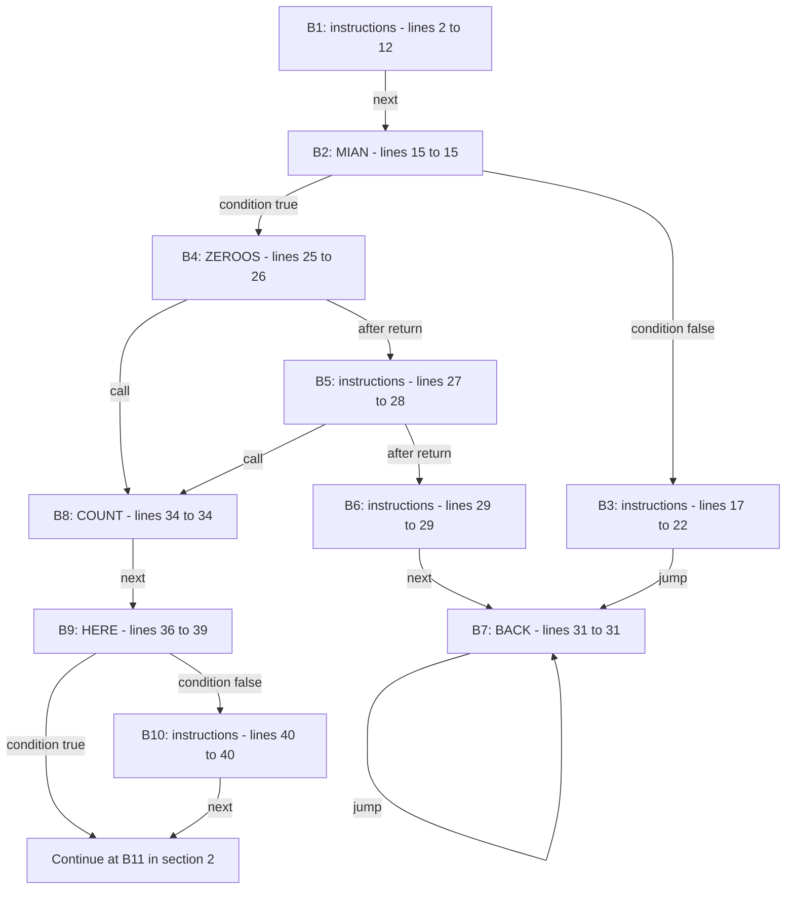
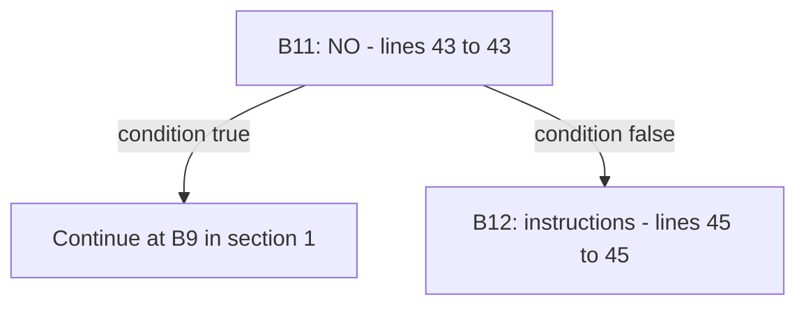

# Program Control Flow

[Back to project](README.md)

Control-flow blocks are indexed by source line. Calls resume at the instruction following the call if the subroutine returns normally.

## Entry locations

- `ORG 00H` begins at B1.

## Navigation

[Section 1](#section-1) · [Section 2](#section-2)

## Section 1



### B1

```asm
MOV R1,#2
MOV 40H,#23
MOV 41H,#25
MOV 42H,#0
MOV R5,#0F0H
MOV R6,#0F1H
MOV R7,#0
```

### B2

```asm
CJNE R1,#1,ZEROOS
```

### B3

```asm
MOV A,40H
ADD A,41H
MOV B,#2
DIV AB
MOV 42H,A
SJMP BACK
```

### B4

```asm
MOV A,R5
ACALL COUNT
```

### B5

```asm
MOV A,R6
ACALL COUNT
```

### B6

```asm
MOV 30H,R7
```

### B7

```asm
SJMP BACK
```

### B8

```asm
MOV R4,#7
```

### B9

```asm
MOV B,#2
DIV AB
MOV R0,B
CJNE R0,#0,NO
```

### B10

```asm
INC R7
```

## Section 2



### B11

```asm
DJNZ R4,HERE
```

### B12

Return to the instruction following the active call.

```asm
RET
```
