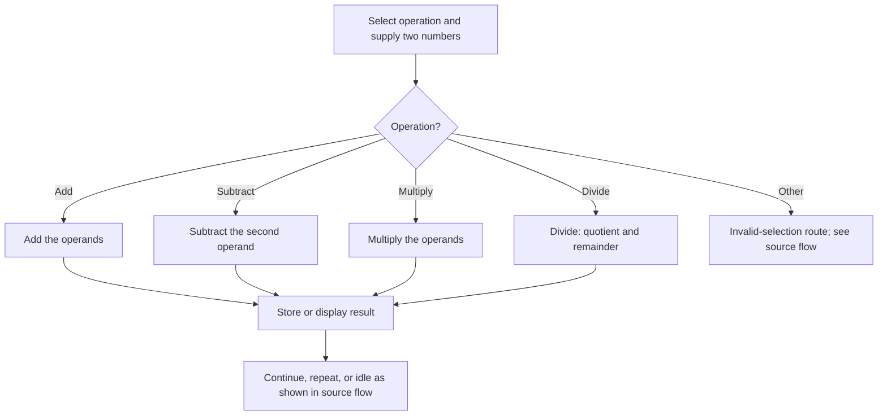
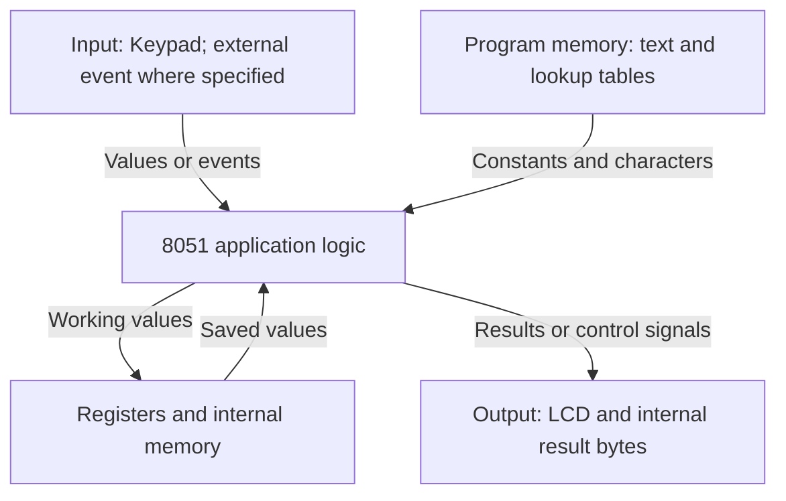

# Four Operation Calculator

[Group overview](../../README.md) · [Compare implementations](../README.md)

Choose addition, subtraction, multiplication, or division for two numbers.

**Implementation:** Interrupt Enabled Keypad Calculator

**Input:** keypad.  
**Output:** LCD and internal result bytes.

## Inputs and results

| Parameter | Description |
| --- | --- |
| Input | An operation and two operands |
| Output | The arithmetic result; division can also leave a remainder |

## Worked example

Choose division and supply 6 and 3. The expected quotient is 2 and the remainder is 0.

### Calculation details

At the start of the division branch, use operation 4 and operands 6 and 3 in 40H and 41H. The code loads A = 6 and B = 3. DIV AB leaves A = 2 and B = 0. Inspect the quotient written to 50H.

## Program operation

### Functional flowchart

[Detailed control flow](source-flow.md)

### Simplified block diagram

**Port registers:** `P0`, `P0.0`, `P0.1`, `P0.2`, `P1.0`, `P1.1`, `P1.3`, `P2`.

## Technical limitations

No additional defect was recorded in the earlier source review. This is not evidence of a successful build or hardware test.

## Build and test

1. Open the [assembly source](source.a51) in an 8051 assembler or simulator.
2. Review the technical limitations and configure the peripherals required by this implementation.
3. Check the expected result using the example inputs.
